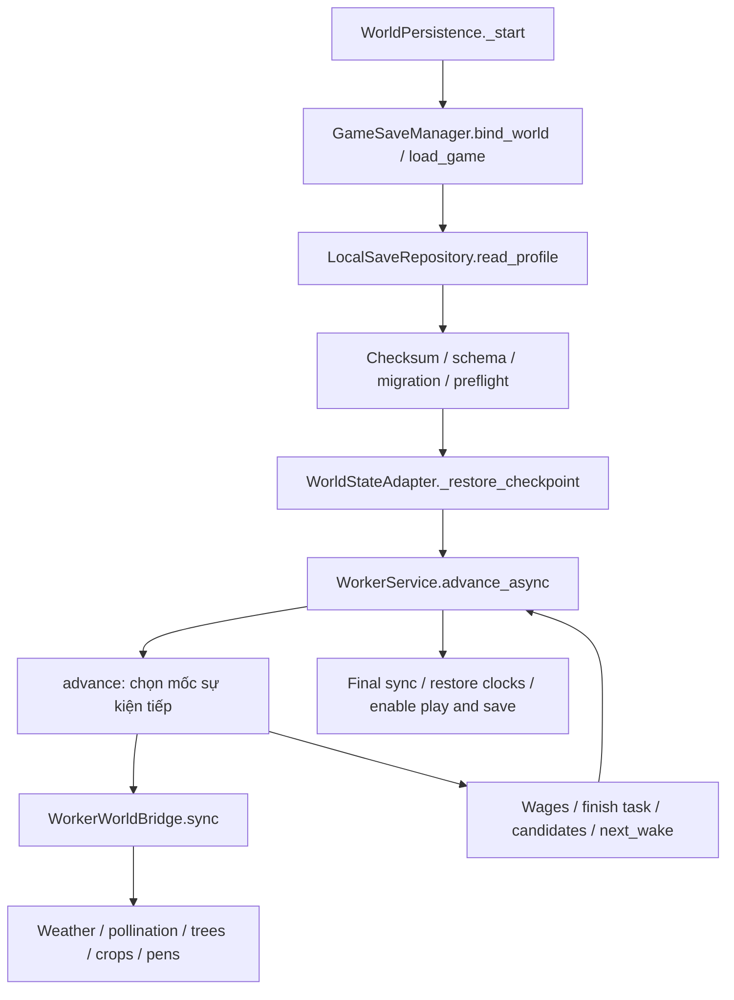

# Kế hoạch tối ưu tải game và mô phỏng offline

Ngày lập: **29/10/2026, UTC+7**. Engine đo thực tế: **Godot 4.7.2**.

**Trạng thái sau triển khai 29/10:** đã thực hiện nhóm tối ưu hẹp P1, tách kernel phân công ong, bổ sung chỉ mục và sửa ba lỗi timeline/pickup. Median load save lớn 15,5 giờ giảm từ **89,656 s xuống 20,539 s**; native có mẫu 22,611–93,118 s và QA visible 24,959 s. Chưa hoàn thành kiến trúc P2–P5 và chưa đạt SLO 5 s / native p95 10 s. Chi tiết bằng chứng và giới hạn trong [RESULT.md](RESULT.md).

## 1. Quyết định đề xuất

Chọn **mô phỏng offline chính xác trên dữ liệu, theo mốc sự kiện có chỉ mục**, sau đó dựng trạng thái cuối vào scene một lần. Triển khai từng giai đoạn, dùng bộ mô phỏng hiện tại làm chuẩn đối chiếu.

Ưu tiên trước: đo từng pha; giảm quét lặp và truy vấn cảnh; màn hình tải nhẹ; giới hạn công việc trên main thread; kiểm soát commit và lưu dữ liệu. Khi mô hình dữ liệu đã ổn định, mới bổ sung một worker thread trên nền tảng hỗ trợ.

Lý do chọn:

1. Giảm **khối lượng công việc**, giải quyết thời gian chờ thay vì chỉ làm thanh tiến độ chuyển động.
2. Tách tính toán kinh tế khỏi Node, physics, render, signals và deferred callbacks giúp kiểm thử chính xác hơn.
3. Giữ được giới hạn kho, tiền công theo thứ tự thuê, công việc dở, thời tiết, tuổi vật nuôi và seed RNG.
4. Có đường triển khai dần và quay lại thuật toán tham chiếu khi phát hiện sai khác.
5. Có thể chạy cùng kernel trên main thread theo budget hoặc trên worker thread; hỗ trợ Web không phụ thuộc việc bật thread.

Không chọn làm mặc định: phát thưởng bằng `sản lượng/giờ × số giờ`, cắt thời gian offline, bỏ công việc quá hạn, tăng tốc độ nhân công, xóa nhiệm vụ, hoặc cho chơi/saving trong khi thế giới còn đang khôi phục. Đây là các thay đổi luật kinh tế cần quyết định sản phẩm riêng.

## 2. Phạm vi và tiêu chí thành công

### 2.1 Phạm vi

- Từ mở game đến lúc điều khiển và lưu game sẵn sàng.
- Tải JSON/checksum/migration/validation/preflight.
- Catch-up cây trồng, cây lâu năm, ong, thời tiết, vật nuôi, kho và ba vai nhân công.
- Quay lại sau khi ứng dụng bị treo nền; các đường `settle()` khi save/quit cũng phải được đo để tránh chuyển chỗ khựng.
- Desktop Forward+ và Compatibility; Web kiểm tra riêng với runtime/export thực tế.

### 2.2 Định nghĩa chỉ số

| Chỉ số | Điểm bắt đầu → kết thúc | Cách dùng |
|---|---|---|
| `T_ready_total` | Khởi động process → world cho phép nhập và save service sẵn sàng | Chỉ số trải nghiệm chính, đo native/export |
| `T_first_visible_progress` | Khởi động process → khung hình tải thực sự hiển thị | Không thay bằng thời gian callback `process_frame` headless |
| `T_load_game` | Vào `GameSaveManager.load_game()` → coroutine hoàn tất | Benchmark hiện có đo trực tiếp |
| `T_scene_setup` | Load/instantiate world → qua fence khởi tạo physics/frame | Đo tách; không cộng median các pha từ những run khác nhau |
| `T_checkpoint` | Dựng checkpoint trong `WorldStateAdapter._restore_checkpoint()` | Pha hiện vẫn đồng bộ |
| `T_model_cpu` | CPU thực thi kernel dữ liệu | Cần bổ sung counter; hiện chưa tách khỏi thời gian yield |
| `frame_gap` | Khoảng thời gian thực giữa hai heartbeat của main loop | Có thể phát hiện đoạn không yield; headless không đại diện native FPS |
| `N_events`, `N_scans`, `N_physics` | Số event, lần quét toàn bộ và truy vấn physics | Gate cấu trúc ít nhiễu hơn thời gian CI |
| `RSS_peak`, `node_peak` | Đỉnh bộ nhớ process và số Node trong run | Ngăn giải pháp nhanh nhưng làm tràn bộ nhớ |
| `economic_diff` | Khác biệt kết quả mới so với tham chiếu | Là điều kiện phát hành bắt buộc |

### 2.3 Mục tiêu nghiệm thu — chưa phải kết quả đã đạt

Máy chuẩn cần ghi model CPU/GPU, RAM, OS, engine, build debug/release, renderer và chế độ cache. Dùng cùng fixture, mốc thời gian, seed và mã nguồn khi so sánh.

| Nhóm | Mục tiêu sau tối ưu | Điều kiện |
|---|---|---|
| Load thông thường, gap 0–1 giờ | Native `T_ready_total` p95 ≤ 3 giây | Assets đã import; đo process mới |
| Save lớn, gap 15,5 giờ | Native `T_ready_total` p95 ≤ 10 giây | 396 crops, 306 trees, 48 animals, 3 workers; fixture khóa checksum |
| Save lớn, gap 48 giờ | Native `T_ready_total` p95 ≤ 20 giây | Có đủ event thực; kiểm tra cả kho đầy và kho còn chỗ |
| Kernel/load benchmark lớn 15,5 giờ | Median `T_load_game` headless ≤ 5 giây | Cùng runner và fixture trong RESULT; không suy ra native từ headless |
| Khung tải đầu tiên | ≤ 1 giây warm; ≤ 2 giây process cold với assets đã import | Đo màn hình tải riêng, trước khi dựng world nặng |
| Phản hồi màn hình tải | p95 heartbeat ≤ 50 ms, max ≤ 100 ms | Máy có khả năng chạy màn hình tải nhẹ ≥ 30 FPS; ghi baseline rendering |
| Kiểm tra cấu trúc kernel | 0 truy vấn SceneTree/physics/GPU trong vòng lặp pure model | Thu thập topology trên main thread một lần, cập nhật theo revision |
| Bộ nhớ | `RSS_peak` ≤ 1,25 × baseline cùng renderer/fixture | Cấm giữ toàn bộ lịch sử event; chỉ giữ trạng thái và event sắp tới |
| Tính đúng | 0 sai lệch kinh tế; 0 mutation bản lưu nguồn | Tolerance theo mục 7 |

Để công bố p95 dùng tối thiểu 30 process-run cho mỗi tổ hợp đại diện, báo cả timeout/failure và số mẫu. Ba run chẩn đoán hiện tại chỉ đủ mô tả median/min/max, không đủ tuyên bố SLO p95. Import lần đầu, shader cold và cache warm phải có nhóm đo riêng.

Nếu sau P1 chưa đạt mốc 5 giây headless, tiếp tục P2–P3; không đổi mục tiêu thành “thanh phần trăm vẫn chạy”. Với median baseline `B`, cải thiện mục tiêu là `(B - 5.000) / B × 100%` cho metric headless này; chỉ tính thành tích thực tế sau khi có `B_after` cùng điều kiện.

## 3. Hiện trạng và nguyên nhân

### 3.1 Luồng thực thi đã kiểm tra bằng graph và source



Nguồn chính: `persistence/save_manager.gd::load_game`, `persistence/world_state_adapter.gd::_restore_checkpoint`, `components/workers/worker_service.gd::advance`, `components/workers/worker_world_bridge.gd::sync/candidates/next_wake`.

**Lưu ý quan trọng:** scheduler hiện tại đã chọn mốc sự kiện, không chạy lại từng frame của 15 giờ. Chi phí cao đến từ số mốc vẫn lớn và mỗi mốc gọi lại nhiều logic scene. `PenOfflineModel` đã có phép tính theo biên liên tục; nên tái sử dụng và kiểm chứng nó, tránh viết lại toàn bộ từ đầu.

### 3.2 Bảng nguyên nhân và mức bằng chứng

| Vấn đề | Bằng chứng | Hệ quả | Việc cần làm |
|---|---|---|---|
| Catch-up chạy trên live scene | `advance()` gọi bridge sync/commit, truy cập actor, inventory và world | Chi phí model, render, physics, signals bị trộn | Tách DTO/model và view |
| Quét rộng tại nhiều event | `candidates()` duyệt trees/crops/pickup group; `next_wake()` lại duyệt trạng thái | Số lần quét tăng cùng số nhiệm vụ | Chỉ mục ready/dry/pickup theo vùng; revision cache |
| Tìm ô gieo tốn nhiều lượt | `CropWorkerPolicy.planting_task()` thử đến 32 ứng viên, `_allowed()` duyệt TileMap và query physics | Ô bị chặn có thể bị kiểm tra lại nhiều lần | Bảng topology/occupancy có revision; cache thất bại đúng TTL |
| Sync toàn thế giới ở mỗi event | Bridge cập nhật thời tiết, ong/cây/crops và từng pen | Một việc nhỏ có thể làm nhiều vùng không liên quan tính lại | Dependency-aware advancement và dirty sets |
| Patrol và wake-up khi rảnh vẫn sinh event | Nhánh patrol/next_wake cùng signals yêu cầu scan | Kho đầy hoặc thiếu tài nguyên vẫn có overhead | Chỉ bỏ qua event rảnh khi chứng minh giữ nguyên phase/vị trí/task |
| Đoạn khởi tạo còn đồng bộ | `_restore_checkpoint()` và final sync nằm ngoài budget worker | Vẫn có frame dài dù worker biết yield | Chia pha và dựng trạng thái cuối theo budget |
| IO đọc chưa đi qua worker IO | `read_profile()` đọc/checksum/schema đồng bộ; `_run_io()` hiện được dùng cho các thao tác async khác | Có thể làm khựng với save lớn; chưa chứng minh là nút thắt chính của save này | Đo riêng, tối ưu theo tỷ trọng |
| Validation/preflight lặp | Manager validate/preflight rồi checkpoint preflight tiếp | Tăng chi phí cố định | Dùng validated snapshot bất biến gắn revision; vẫn giữ kiểm tra ở API public |
| Ngân sách 32 ms chỉ kiểm tra giữa event | `advance_async(..., 32000)`, `advance()` kiểm tra budget sau event | Không bảo đảm event ≤ 32 ms hoặc 60 FPS | Counter max-event; chia event lớn; budget thích nghi 4–8 ms khi khả thi |
| Progress theo thời gian mô phỏng | `(simulated_at-start)/(until-start)` | 1% đầu có thể tốn nhiều hơn phần cuối; ETA gây hiểu nhầm | Hiển thị theo pha, chỉ 100% sau commit và bật điều khiển |

Các cache sức chứa trong một truy vấn, sync thụ phấn theo batch, cache vùng ảnh cây và async catch-up đã có trong working tree trước kế hoạch này. Đó là nền tảng để tiếp tục, chưa đủ chứng minh đã đạt mục tiêu thời gian tải.

Không coi số phần trăm thời gian của từng nguyên nhân là đã biết khi chưa có profiler/counter tương ứng. Chi phí đọc ảnh GPU có khả năng gây stall; mức đóng góp cụ thể cần benchmark render thật, không suy từ source hoặc headless.

## 4. So sánh phương pháp sửa

| Phương pháp | Lợi ích | Hạn chế/rủi ro | Quyết định |
|---|---|---|---|
| Chỉ thêm yield/thanh tiến độ | UI phản hồi, sửa nhanh | Tổng công việc giữ nguyên, thêm thời gian chờ frame | Giữ làm hàng rào UX, không dùng làm tối ưu cuối |
| Cache/chỉ mục và gom truy vấn | Giảm scan, thay đổi hẹp | Cache stale có thể cho phép thu trùng hoặc chặn công việc hợp lệ | Làm trước, bắt buộc revision + invalidation tests |
| Thêm thread quanh code hiện tại | Có vẻ dễ chuyển tải CPU | Live scene/Node/resource/physics không thể chuyển nguyên khối an toàn | Không áp dụng trực tiếp |
| Pure DTO + event timeline chính xác | Giảm scene overhead; deterministic; test độc lập | Phải port đủ biên phụ thuộc giữa hệ thống | **Phương án lõi khuyến nghị** |
| Tính nhanh theo khoảng không có sự kiện | Rất nhanh cho grow/idle/saturation | Dễ bỏ lỡ dawn, death, stock depletion, pollination hoặc vị trí patrol | Dùng có điều kiện sau parity; ưu tiên công thức đã có |
| Thưởng trung bình theo giờ/cắt gap offline | Nhanh và đơn giản | Thay kinh tế, có thể mất sản phẩm hoặc cho thưởng vượt kho | Phương án sản phẩm riêng; không thuộc sửa hiệu năng bảo toàn logic |
| Cho chơi trong lúc catch-up | Vào bản đồ sớm | Race mua/bán/thu hoạch/save với kết quả chưa commit | Chỉ hiển thị preview; giao dịch vẫn khóa đến READY |
| Backend/server tính offline | Có thể kiểm soát nguồn giờ | Hạ tầng mới, mạng, tài khoản, chi phí vận hành | Ngoài phạm vi hiện tại |

Quy tắc thread tham khảo [Godot: Thread-safe APIs](https://docs.godotengine.org/en/stable/tutorials/performance/thread_safe_apis.html): tránh thao tác active SceneTree trong worker; hạn chế truy cập GPU; dữ liệu chia sẻ cần kiểm soát đồng bộ. Thiết kế ở đây chọn snapshot riêng cho một job, kết quả bất biến trả về main thread để giảm vùng chia sẻ.

## 5. Thiết kế đề xuất

### 5.1 Hợp đồng dữ liệu

`OfflineInput` chứa snapshot đã validate/migrate, `saved_at`, `target_at`, revision/profile/world ID, seed RNG, catalog dạng primitive và topology đã chụp. Không giữ Node, Resource có thể thay đổi, RID hoặc Callable trỏ vào scene. `target_at` cố định cho toàn bộ job.

`OfflineOutput` chứa trạng thái cuối, phần task còn dở, lượng tiền/vật phẩm/tier, stock phân số, cursor đã commit và thống kê. Event queue được dựng lại từ trạng thái; ưu tiên không đưa cache/queue nội bộ vào save schema. Nếu bắt buộc thay schema, tạo version/migration riêng và kiểm tra tương thích trước khi cho autosave.

Luồng đề xuất:

1. Mở loading shell nhẹ, khóa các giao dịch world và save.
2. Đọc/checksum/migrate/validate vào snapshot riêng; snapshot nguồn được giữ nguyên.
3. Chuẩn bị catalog/topology/occupancy một lần trên main thread.
4. Mô phỏng đúng mốc thời gian trên working state độc lập.
5. Validate output + đối chiếu revision/job token.
6. Dựng entities/UI từ trạng thái cuối theo budget, cập nhật model và chỉ mục như một giao dịch.
7. Bật điều khiển, đồng hồ và saving; lúc đó mới phát trạng thái READY/100%.

### 5.2 Timeline và chỉ mục

- Một thứ tự event ổn định, có timestamp, phase, hire order, entity ID và sequence. **Phase phải mô tả đúng thứ tự code tham chiếu**, không tự quy định “thu hoạch trước lương” khi hai việc cùng mốc.
- Event quan trọng: deadline task, bình minh/xét lương, thay đổi thời tiết, crop maturity/moisture, fruit/honey readiness, depletion của máng, maturity/death của animal, retry TTL và thay đổi kho có ảnh hưởng.
- Ready queues theo role/khu; tập crop dry/mature/plantable; pickup index theo pen/region; capacity cache gắn inventory revision và quality tiers.
- Topology cache gắn map/land/plot revision. Tách yếu tố tĩnh khỏi body di động; offline vốn dùng travel-time logic, không cam kết replay mọi va chạm online.
- Không tự bỏ patrol rồi đặt người làm ở home: patrol phase/vị trí ảnh hưởng khoảng cách đến công việc kế tiếp. Chỉ tính gộp khi tái tạo được trạng thái tương đương tại biên cần quan sát.
- Không lặp thêm hàng triệu bước `+0.00001` để xử lý một cursor không tiến. Xử lý hết batch cùng timestamp đến khi ổn định; phát hiện chu trình zero-time và trả lỗi có chẩn đoán, giữ save nguồn, không ghi kết quả một phần.

### 5.3 Các công thức có thể tái sử dụng

| Hệ thống | Cách tính nhanh hợp lệ | Biên bắt buộc |
|---|---|---|
| Cây không có người thu | Tính growth và fruit work có giới hạn theo khoảng | Maturity, weather, bee boost, trạng thái graft |
| Crops | Deadline stage/maturity, moisture tích phân theo weather | Mưa, evaporation, water/fertilizer, root/pollination boost |
| Ong | Gom theo khoảng source/recipe ổn định, giữ capacity batch | Sunflower/flower readiness, hive repair/recipe, weather, saturation |
| Vật nuôi | Tái sử dụng `PenOfflineModel` và stock phân số | Nhu cầu, cạn máng, arrival, maturity/death, production output |
| Nhân công | Chỉ tiến tới event có thể đổi quyết định | Wages, nguồn/đích còn hợp lệ, capacity, supplies, travel/work finish |

Không nhân năng suất trung bình qua các biên tương tác nêu trên. Không bán tự động để trả lương và không bỏ qua giới hạn nguyên đợt thu hoạch.

### 5.4 Commit, đóng game và khôi phục lỗi

- Trạng thái job: `READ_VALIDATE → BUILD_INPUT → SIMULATE → BUILD_SCENE → COMMIT → READY`; có `CANCELLED/FAILED`.
- Một load job đang hoạt động; generation token ngăn kết quả job cũ đè world mới.
- Hủy trước COMMIT: bỏ working state, giữ primary/backup. Hủy trong COMMIT: kết thúc/rollback giao dịch trước khi mở điều khiển.
- Lỗi validation, timeout hay thread: không phát READY, không autosave snapshot một phần; UI có retry/thoát và thông tin lỗi ngắn.
- F5/F9, focus-out save và quit-save dùng cùng busy contract. “Tiến độ đến 100%” không được mở save sớm.
- Giữ cursor simulated và đồng hồ dùng cho deferred callbacks đúng thời điểm; wall-clock tick không được chạy lên world đang restore.

## 6. Các giai đoạn triển khai

| Pha | Hạng mục / khu vực sở hữu | Điều kiện hoàn thành | Ước lượng công sức* |
|---|---|---|---:|
| P0 | `scripts/benchmark_offline_load.py`, test fixtures, counters/manifest | Baseline tái lập; fixture bất biến; phân biệt native/headless và fixed/per-event cost | 0,5–1 ngày |
| P1 | Manager/adapter/bridge/policy + loading shell | Counter theo pha; indices có invalidation; phân pha dựng world; không mất hợp đồng async | 1–3 ngày |
| P2 | `components/offline/` models cho clock/weather/crops/trees/bees/pens | Pure models cho cùng checkpoint ra cùng kết quả; không Node/physics/GPU trong kernel | 3–5 ngày |
| P3 | `WorkerOfflineSimulation`, event queue, selector/index | Ba vai + wages + kho + supplies + partial tasks parity; không broad scan mỗi event | 3–6 ngày |
| P4 | Async executor/thread, adapter commit/cancel | Một job + token + frozen DTO; Web fallback; hủy/lỗi giữ save | 1–2 ngày |
| P5 | Bench/export/native QA, rollout, sửa fixture cũ liên quan | Đạt mục tiêu thời gian và integrity; rollback diễn tập; báo cáo before/after | 2–3 ngày |

*Là ước lượng theo người-ngày, chưa phải lịch cam kết; phụ thuộc độ khó parity giữa ong/crops/nhân công. P0 đo lặp còn cần mở rộng; phần runner và 6 test mới đã được thực hiện trong đợt báo cáo, không đồng nghĩa toàn P0 hoàn tất.

### P0 — đo trước khi thay thuật toán

- [x] Tạo runner đọc bản sao save trong staging/userdata riêng; xuất JSON và log.
- [x] Bổ sung unit và hồi quy cho tie-breaking, timestamp, phân đoạn thời gian, warehouse/wage boundary và async endpoint.
- [ ] Thêm counter event/scan/cache miss/physics/image readback và `T_model_cpu` vào diagnostic build.
- [ ] Chốt thêm fixture new/medium/stress, gaps 24h/48h/7d, cold/warm cache.
- [ ] Native/export: ít nhất 30 samples cho SLO; lưu distribution và failure rate.
- [ ] Phân loại/fix fixture test cũ đang lỗi; bộ test có baseline failures không phải bộ test xanh toàn dự án.

### P1 — thay đổi hẹp, giữ public API

- Cache candidates theo revision phù hợp, không giữ cache capacity qua commit mà không invalidate.
- Thu gom tín hiệu phát sinh trong cùng event vào dirty sets; tránh deferred callback trở lại timestamp cũ.
- Giữ thứ tự selector `priority → distance → stable ID` và thứ tự trả lương theo `hire_order`.
- Preflight snapshot đã xác thực được tái sử dụng trong giao dịch bất biến; API restore độc lập vẫn validate.
- Loading shell là main scene nhẹ; resource/world tải sau shell. Không để `_enter_tree/_ready/preload` của world lớn chặn khung tiến độ đầu.
- Thử render world preview sau COMMIT; không vẽ lại hàng trăm entity mỗi bước lịch offline.
- Budget đầu 4–8 ms cho đoạn có thể chia nhỏ; phân loại single-event > budget, không coi mốc budget là hard real-time guarantee.
- Benchmark lại để định lượng phần lợi ích đã đạt; không đưa hệ số tăng tốc giả định vào changelog.

### P2–P3 — chuyển model và scheduler

- Viết adapter đọc catalog Resource thành DTO trên main thread; làm mô hình reference mới ở chế độ single thread trước.
- Port từng subsystem, shadow-run trên **hai bản sao độc lập** của cùng input. Không chạy hai engine lần lượt trên cùng live world đã bị mutate.
- Tạo semantic comparator cho kinh tế và task state; generated pickup ID được canonicalize theo nguồn/sự kiện vì UUID mới không tự giống giữa hai run.
- Thay broad queries bằng indices có revision; thống kê scan phải giảm theo số thay đổi chứ không theo mọi entity × mọi event.
- Tách các nhánh idle/saturated đã chứng minh tương đương; giữ fallback reference cho trường hợp chưa chứng minh.
- Đối chiếu hai mode ít nhất 100 seed/workload đại diện, sau đó test chia khoảng không đều và save/reload giữa các biên.

### P4–P5 — vận hành và phát hành

- Executor dùng một worker với input riêng khi platform cho phép; cấm truyền live Node/Resource vào job.
- Web/single-thread chạy cùng kernel theo budget, không duy trì thuật toán thứ hai khác semantics.
- Thêm cờ `reference / optimized / shadow` cho diagnostic/internal build; khả năng rollback theo save còn tương thích.
- Canary nội bộ, sau đó mở dần; dừng rollout nếu có economic mismatch, save corruption hoặc p95 tăng >20%.
- Mọi lần đổi schema cần version riêng, migration fixture và backup; không chỉ đổi cờ engine để đọc save tương lai.
- Chốt RESULT before/after, nêu rõ renderer/build/fixture/gap/sample count và các gate chưa đạt.

## 7. Bảo toàn core logic và phân tích mất mát

| Miền | Bất biến bắt buộc | Nguy cơ khi tối ưu sai | Kiểm tra |
|---|---|---|---|
| Coins/wages | Xét đúng dawn, hire order, trial flag; không chi âm hoặc trừ lặp | Mất tiền/miễn công; sai người được làm tiếp | Trước/đúng/sau dawn, thiếu tiền chỉ đủ 1 vai, load lặp |
| Kho/inventory | Item, quantity, quality tiers, stack/capacity và destination giữ đúng | Duplication, overflow, mất phần dư | Kho trống/đầy/còn thiếu 1 phần; nguồn nguyên đợt |
| Cây/graft/crops | Deadlines, fertilizer/root/pollination, harvest quality giữ đúng | Cho thu sớm, mất graft, tính boost hai lần | 0/1/2 event cùng mốc; weather/bee boundary |
| Vật nuôi | Fair sharing máng, fractional stock, lifespan, output cuối cùng | Ăn quá mức, sản xuất sau chết, mất sản phẩm | Death/arrival/depletion và partition equivalence |
| Workers/tasks | Role/zone/ID/order, paid-through, partial travel/work, paused state giữ đúng | Hoàn thành task hai lần; teleport lấy sản phẩm | Endpoint/repeated timestamp; resume/save/reload |
| Time | Cursor đơn điệu, target cố định, clock floor không lùi | Replay cùng khoảng hoặc bỏ thời gian | Clock reversal/nonfinite/future-save tests |
| Save | Primary/backup nguyên vẹn đến khi có output hợp lệ | Save một phần hoặc mất dữ liệu khi cancel | Hash input; corrupt/checksum/future-version/read/write-fail |
| Presentation | Chỉ rebuild hình ảnh ở trạng thái đã commit | HUD báo số chưa chốt, thao tác khi đang restore | UI/input/F5/F9/quit giữa các pha |

Sai lệch chấp nhận trong tối ưu bảo toàn luật:

- **0** cho coins, item counts/tiers, contract flags, ID liên quan save, số lần commit task, số lần trả lương.
- Sai số float đề xuất tối đa `1e-5` cho needs/stock/progress liên tục; timestamp tuyệt đối `1e-4` giây. Chốt tolerance theo mô hình, không dùng rounding để che event sai.
- Test `deadline − 0,001`, `deadline`, `deadline + 0,001` phải giữ đúng nhánh quyết định ngay cả khi các float nằm trong tolerance.
- Texture/material/UI animation có thể cập nhật một lần cuối; việc bỏ animation trung gian không được bỏ domain event hoặc phần thưởng.
- UUID mới giữa hai simulation được so sánh theo semantic event/source; ID có sẵn từ save phải giữ nguyên.

Đích đến: **không mất dữ liệu và không đổi luật kinh tế**. Tách model là thay đổi có rủi ro cao về implementation dù mục tiêu không đổi luật; chỉ phát hành khi comparator và các gate đạt.

## 8. Ma trận unit, hồi quy và hiệu năng

| Nhóm | Trường hợp bắt buộc | Tình trạng |
|---|---|---|
| Selector unit | 6 hoán vị tie, priority/distance/ID, copy độc lập khỏi index | Đã thêm test chạy được |
| Time/schema unit | NaN/Inf/âm/future cursor, repeated/backward time | Đã thêm và kế thừa test hiện có |
| Pen unit | Partition không đều qua weather, dawn, arrival, death, fractional supplies | Đã thêm test chạy được |
| Worker regression | Async endpoint thu đúng một lần, empty roster 1 năm, kho thiếu chỗ qua dawn | Đã thêm test chạy được |
| Existing parity | 48h một bước vs theo giờ; ranch theo phút; crop theo giây | Có sẵn, giữ làm reference |
| Multi-role parity | Ba vai cạnh tranh kho/feed/coins; crop auto-plant/fertilize/pause; deterministic seed | Mở rộng P2–P3 |
| Cache invalidation | Unlock land, topology/occupied, inventory revision, tier, supply add/remove | Viết cùng từng cache P1 |
| Lifecycle/IO | Fail/cancel/quit tại mọi phase; backup corrupt; future schema; save overlap | Mở rộng P4; không bỏ test hiện có |
| Platform | Forward+/Compatibility native/export; Web; desktop sleep/resume | P5 |
| Performance structural | Không broad physics/SceneTree trong pure kernel; event count không tỷ lệ với giây rảnh | P2–P3, không dùng timing flaky làm unit assertion |
| Performance statistical | Same fixture/seed, warm/cold, 0h/1h/15,5h/48h/7d, medians/p95/RSS | Runner headless đã thêm; native/counters/RSS chưa hoàn tất |

Test correctness dùng clock cố định, seed cố định và restore fixture mới cho mỗi run. Test không assert “máy phải chạy dưới X ms” trong unit CI. Timing ở job benchmark riêng, có điều kiện hardware và archive kết quả. Thất bại/timeout phải xuất hiện trong báo cáo, không loại khỏi mẫu để làm đẹp số.

### Lệnh tái hiện

```bash
GODOT_BIN=/path/to/Godot_v4.7.2-stable_linux.x86_64
"$GODOT_BIN" --headless --path . -s addons/gut/gut_cmdln.gd -gconfig= \
  -gtest=res://tests/unit/test_worker_roles.gd,res://tests/unit/test_pen_offline.gd,res://tests/integration/test_workers.gd -gexit

python3 scripts/benchmark_offline_load.py --godot "$GODOT_BIN" \
  --save /path/to/preserved/profile_local.json --gaps 0,3600,55800 \
  --repeats 3 --output output/offline-load-benchmark
```

Runner tạo staging bỏ runtime MCP, dùng `.godot/imported` đã có, userdata riêng và bản sao save; không mở scene thành main scene để tự bind profile thật. Không dùng benchmark này làm bằng chứng native FPS. Chưa bao gồm cold import, shader compile hoặc first visible frame của bản export.

## 9. Checklist chốt phát hành

- [ ] Baseline và optimized cùng fixture/hash, code revision, seed, target, hardware, renderer/build/cache policy.
- [ ] Core invariants: 0 economic mismatch trên deterministic + randomized + replay/save/reload.
- [ ] Mục tiêu native p95 đạt với số mẫu đủ; timeout/failure rate được báo.
- [ ] Kernel counters và memory gate đạt; không chuyển stall sang save/quit/resume.
- [ ] Không còn lỗi test mới. Các fixture cũ thuộc phạm vi release đã được xử lý hoặc có quyết định bằng chứng cụ thể, không gọi toàn suite là xanh.
- [ ] Input/saving chỉ mở sau COMMIT; cancel/failure/fallback không ghi một phần.
- [ ] Diễn tập rollback; schema tương thích; primary/backup phục hồi được.
- [ ] RESULT.md có before/after thật và chỉ rõ phần nào đạt, chưa đạt hoặc ngoài phạm vi.

## 10. Truy vết tài liệu

- [RESULT.md](RESULT.md): số đo, kiểm thử và kết luận hiện tại.
- [Evidence và JSON benchmark](docs/offline_loading_2026-10-29/): manifest, raw measurements, test log.
- `docs/crop_worker_automation.md`: luật crop worker hiện hành; `docs/workers_v1.md` có phần lịch sử đã bị thay thế, cần đối chiếu source/schema hiện tại.
- Codebase graph project `home-dungnguyen-Projects-test-js`, Verify tier. Graph giúp tìm đường gọi; virtual dispatch/dynamic calls không được coi là graph đã bao phủ đầy đủ. Các kết luận quan trọng được đọc source trực tiếp; coverage “no recorded issue” không phải chứng minh tuyệt đối đầy đủ.


## 11. Công việc đã triển khai và phần còn lại

### Đã triển khai

- Main scene `world/loading_screen.tscn` nhẹ, tải resource farm bằng `ResourceLoader.load_threaded_request`; frame tải được vẽ trước khi bắt đầu nạp world. Giữ cửa sổ 960×540.
- Kiểm tra soil/crop trước truy vấn permission/physics; chỉ mục TileMapLayer được invalid khi thêm/bớt layer. Pen lookup dùng weak reference và kiểm tra parent/ID trước tái sử dụng.
- `PollinationAssignment` chạy trên primitive geometry; cache ownership/assignment có chữ ký hive, radius, repaired, garden, legacy batch và deadline nở hoa. Chỉ mục nguồn hoa cập nhật khi plant/harvest/restore/clear/lock; deadline và vị trí nguồn được đọc lại.
- Chỉ mục crop trong vùng ong; sunflower xa vẫn có deadline trong danh sách source. Maturity của crop thường ở ngoài mọi bán kính không thay đổi pollen nên không tạo split dư.
- Weather/radius dùng chung trong lượt advance cây; batch cây/fruit đã cap không tính growth thừa. Capacity không giữ qua commit.
- Độ ẩm và soil_changed vẫn commit từng event; đường viền đất ướt dựng một lần sau async catch-up. Weather HUD/lighting xuất bản ở trạng thái cuối.
- Garden khôi phục ở saved_at, rồi cùng workers phát lại tới target; bỏ việc advance ong/cây tới tương lai trước workers.
- Pickup notification được xếp weak-reference queue và drain ở event timestamp sau bridge.sync, giữ kết quả khi đổi budget/yield. Commit bỏ qua pickup cũ đang queue_free/amount=0 khi ID được khôi phục lại.
- Benchmark snapshot, so sánh DTO, native startup probe và hồi quy mới đã chạy. Tham chiếu dùng thuật toán nguồn hoa/assignment/cây không cache nhưng cùng timeline đã sửa; 1h và 15,5h có 0 khác biệt.

### Chưa hoàn tất theo lộ trình lớn

- P1: scene instantiate/checkpoint vẫn có đoạn đồng bộ vài trăm ms; chưa đáp ứng max frame 100 ms, chưa batch toàn bộ scene construction.
- P2: mới tách geometry kernel; weather/crops/trees/pen bridge vẫn truy cập live Nodes. Chưa có bộ OfflineInput/OfflineOutput đầy đủ.
- P3: chưa có WorkerOfflineSimulation thuần dữ liệu, ready queues, pickup index và snapshot commit một lần. Không đánh dấu đã xong vì có cache.
- P4: chưa có thread executor, generation token/cancel, fallback Web kiểm tra trên export. Hiện vẫn dùng coroutine với budget 32 ms giữa event trên main thread.
- P5: còn 30+ native samples/SLO, memory peak, export/Web, cold import và triage fixture lỗi cũ.

Giữ ưu tiên tiếp theo là P2–P3. Số đo hiện tại xác nhận cache có ích, đồng thời cho thấy riêng cache chưa đạt đích trải nghiệm tải dài. Thread chỉ thêm sau khi kernel không còn Node/physics/render/signals.
