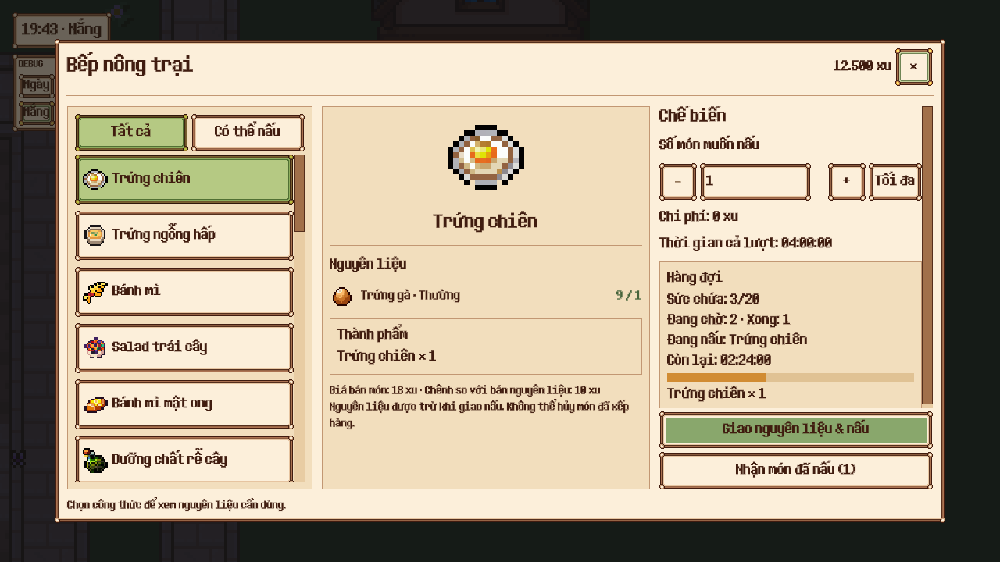
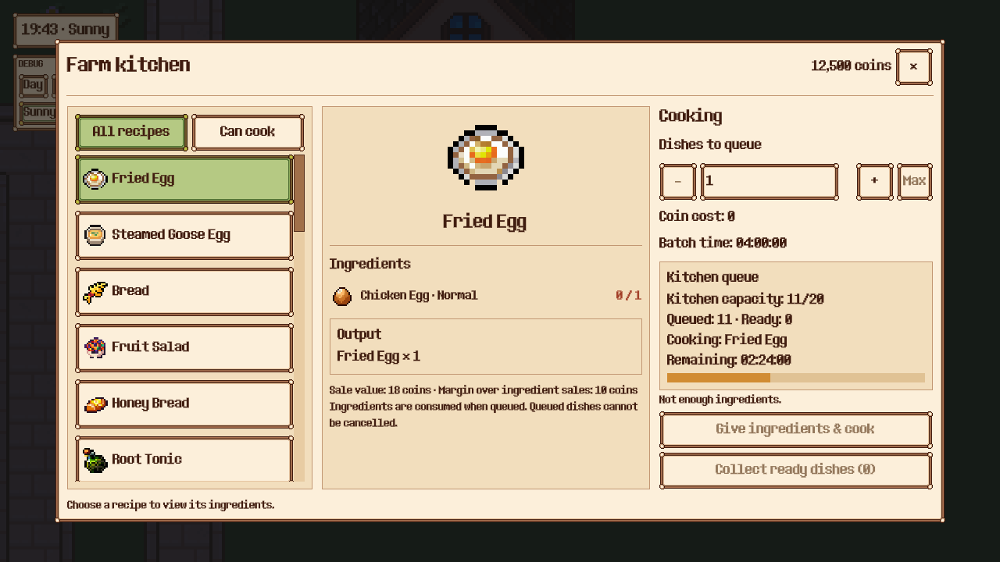
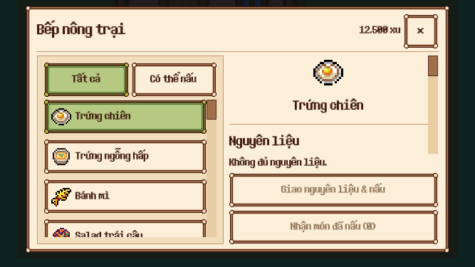

# Bếp nông trại — UI đã triển khai

Concept được người dùng duyệt ngày 2026-10-27. Giao diện mới được nối vào ChefMerchant và dùng nguyên ChefCooking, dữ liệu công thức, giá, phẩm chất, thời gian và schema lưu hiện có.

- Scene có thể chỉnh trong editor: `scenes/ui/cooking.tscn` (53 node).
- Ba vùng trên desktop; hai vùng trên màn nhỏ, nguyên liệu và nội dung chế biến cùng cuộn, nút nấu/nhận món luôn ở cuối cột.
- 25 công thức hiện có, lọc tất cả/có thể nấu, chọn công thức với màu xanh và tooltip đầy đủ.
- Nguyên liệu đúng phẩm chất, số đang có/cần dùng, thành phẩm, phí xu, thời gian cả lượt, giá bán và chênh lệch giá nguyên liệu khi có dữ liệu thị trường.
- Nút Tối đa tính theo nguyên liệu, xu, hàng chờ và món đã hoàn thành. Sức chứa chung vẫn là 20.
- Tiến độ món đầu hàng đợi, số món chờ, danh sách món hoàn thành và nhận món vào túi bằng cơ chế hiện có.
- EN/VI và điều khiển chuột/cảm ứng. Không dùng ảnh concept làm texture toàn màn; tái sử dụng panel 9-slice và icon thật.

## Ảnh chạy thật

## Kiểm tra

- 5/5 test UI mới và 7/7 test logic nấu: 178 assertions.
- 22/22 kiểm tra runtime: chuột nấu/nhận món, bộ lọc, cuộn tới công thức cuối, Tối đa, tăng/giảm bằng cảm ứng, đóng modal và giới hạn màn có safe insets.
- Test tương thích Chef: 4/5 đạt. Test `test_cooking_snapshot_roundtrips_through_disk` line 91 vẫn có lỗi thời điểm sẵn từ baseline: kỳ vọng hai món đã xong, đôi khi chỉ một; đã có lần chạy đạt và lần chạy lỗi cả trước/sau UI. Không sửa cơ chế offline trong đợt đổi UI này.
- Lint controller nấu và scene UI: 0 lỗi, 0 cảnh báo. Validate phạm vi scenes/ui: 0 lỗi, 28 cảnh báo trong dependency có sẵn, không có diagnostic thuộc file cooking mới/sửa.
- Layout desktop/compact: không zero-size/overlap; header và nút nấu/nhận không có finding. Báo cáo toàn cây đánh dấu các hàng công thức nằm ngoài màn trong ScrollContainer; đó là các hàng bị cắt khi cuộn, không phải lỗi tràn panel. Vị trí panel và nút còn được kiểm tra trong runtime ở 844×390 và 667×375.
- QA dùng farm con và thư mục dữ liệu riêng; không đọc/ghi save cá nhân.

Chi tiết: `verification.json`, `runtime-report.json`, `scene-tree.json` và các báo cáo layout. Concept gốc: `concept-approved.png`.
