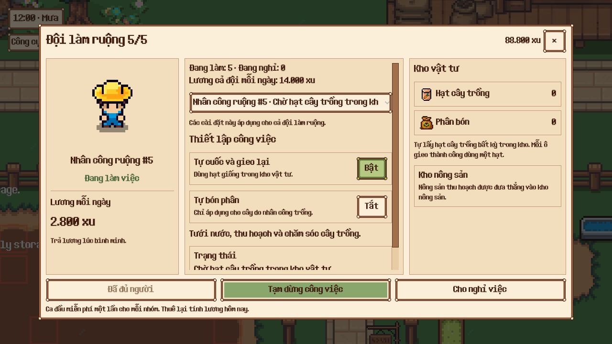
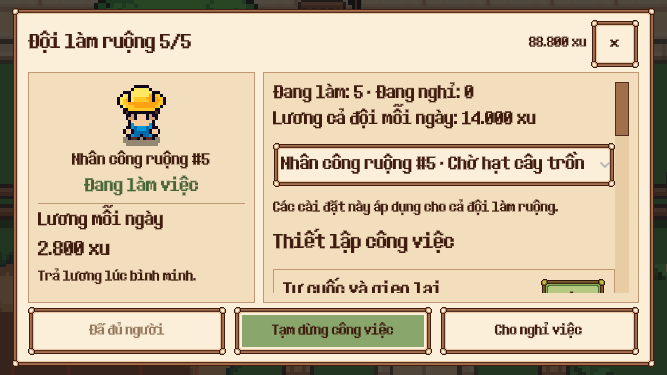

# Đội trồng ruộng 5 người — triển khai 29/10/2026

Đã mở rộng trồng ruộng từ một lên tối đa năm nhân công, giữ điều kiện mở khóa 12 cột đất. Save hiện tại là v36.

## Hành vi đã triển khai

- Mỗi nhân công có ID, số thứ tự ổn định, actor, vị trí, giỏ, lương, nhiệm vụ và ô chờ gieo riêng. Thuê bù tái sử dụng chỗ đã sa thải; không tích lũy bản ghi vô hạn.
- Cả đội tự chọn việc trong ruộng đã mở. Phân công theo ô/pickup và hạt/phân giữ chỗ được suy ra từ nhiệm vụ của người đang làm, không có bảng cache phân công thứ hai trong save.
- Một người bị kẹt không chặn mục tiêu cho cả đội. Khi người nghỉ lương quay lại, nhiệm vụ/ô đã được đồng nghiệp tiếp nhận được giải phóng trước khi nhận việc mới.
- Lương 2.800 xu/người/ngày, 14.000 xu/ngày khi thuê đủ. Miễn phí ca đầu một lần cho nghề trong profile. Trả lương theo thứ tự thuê; người thiếu lương vẫn chiếm chỗ.
- Bảng đội có danh sách từng người, tình trạng công việc, tổng lương, thuê thêm và sa thải đúng người. Tương tác NPC chọn sẵn người đó. Gieo/bón/tạm dừng là tùy chọn chung.
- Migration v35 → v36 giữ ID, công việc, vị trí, giỏ cũ, ưu đãi và chuyển ô chờ gieo sang chủ sở hữu. Save cũ không tự phát sinh nhân công.
- Chăn nuôi và vườn cây tiếp tục giới hạn một nhân công; các API truy xuất actor/giỏ nội bộ dùng ID.

## Kiểm chứng

Các suite liên quan đã qua:

| Suite | Kết quả |
| --- | ---: |
| Worker roles, actor, UI, warehouse, workers | 57/57 |
| Đội crop nhiều người (mới) | 17/17 |
| Crop automation | 13/13 |
| Crop quality | 6/6 |
| Save repository | 21/21 |
| Tổng các suite trên | 114/114 |

17 test mới bao phủ giới hạn, thuê lại, trả lương, vật tư cuối cùng, chia việc, ô chờ gieo, người chơi can thiệp, kho đầy, kẹt đường, ưu đãi, migration, ID/slot trùng, giỏ riêng, replay 48 giờ và tiến độ online/offline trong điều kiện không vật cản.

Native Compatibility trên Godot 4.7.2: **13/13 kiểm tra**, click thuê đủ năm người, chặn người thứ sáu, xác nhận sa thải đúng người và thuê bù. Giao diện tiếng Anh/Việt được chụp ở desktop 1280×720 và tiếng Việt ở 667×375. Cảnh kiểm thử dùng world con và thư mục dữ liệu tạm, không liên kết save cá nhân. Xem `native-result.json` và `native.log`.

So sánh cùng năm ô, năm hạt trong 15 giây mô phỏng: một người gieo 2 ô, ba người gieo 5 ô, năm người gieo 5 ô. Đây là ví dụ ruộng nhỏ để chứng minh chia việc song song; không phải bảo đảm đội năm người nhanh gấp năm lần. Thời gian tính trong lượt kiểm tra cuối khoảng 8–17 ms; xem `CROP_TEAM_COMPARISON` trong `crop-team.log`.

Lint trước/sau: **0 lỗi**, cùng 11 cảnh báo đường dẫn có sẵn. Engine kiểm tra chín script worker: **0 lỗi/0 lỗi parse**, còn 32 cảnh báo từ dependency; không ghi nhận cảnh báo tại chính các script worker sau khi chỉnh tên biến cache.

## Các lỗi có sẵn ngoài phạm vi

Không khẳng định toàn bộ repository đã xanh:

- `test_crops.gd`: hai trường hợp về hủy gieo/chuyển hotbar thất bại. Đã chạy lại đúng hai trường hợp trên mã worker/save trước thay đổi và tái hiện cùng lỗi (lượng hạt khởi tạo 24 so với kỳ vọng cũ 12/11, và một hành động không gieo được).
- `test_world_persistence.gd`: 17/32 qua, 15 trường hợp thất bại trên cả mã trước và sau; tập tên kiểm thử thất bại giống nhau. Các fixture lịch sử liên quan cây/hoa và kinh tế không thuộc tính năng đội crop.
- Validator toàn cây thư mục còn lỗi do backup trong `output/flower_scene_refactor_backup` và addon cũ dùng `WindowDialog`. Bản kiểm tra tạm bỏ qua backup vẫn có ba lỗi addon, không có lỗi parse. Không sửa/xóa backup hoặc addon trong lần này.
- Fixture kho worker đã được bổ sung quyền sở hữu các cột cây mà chính fixture tạo, để round-trip qua schema hiện hành. Probe cũ cũng được cập nhật API actor theo ID và sửa một dòng thụt lề lỗi.
- Benchmark offline có sẵn được cập nhật chữ ký override `fertilizer_task` để tương thích tham số ID mới; các tối ưu offline đang dở trong workspace được giữ lại.

## Ảnh giao diện

## Chạy lại

Các scene QA là `tests/support/crop_team_probe.tscn` và các test GUT dưới `tests/integration/test_crop_team.gd`, `test_worker_ui.gd`. Dùng bản project QA có thư mục dữ liệu tạm, tắt autoload MCP khi chạy headless trong môi trường không cho mở cổng.

Các lệnh GUT dùng `-gselect=test_crop_team.gd -gexit`, `-gselect=test_worker -gexit`, `-gselect=test_crop_automation.gd -gexit`, `-gselect=test_crop_quality.gd -gexit`, `-gselect=test_save_repository.gd -gexit`. Không dùng `-gtest` để chọn suite vì runner hiện tại không hiểu cờ đó.
