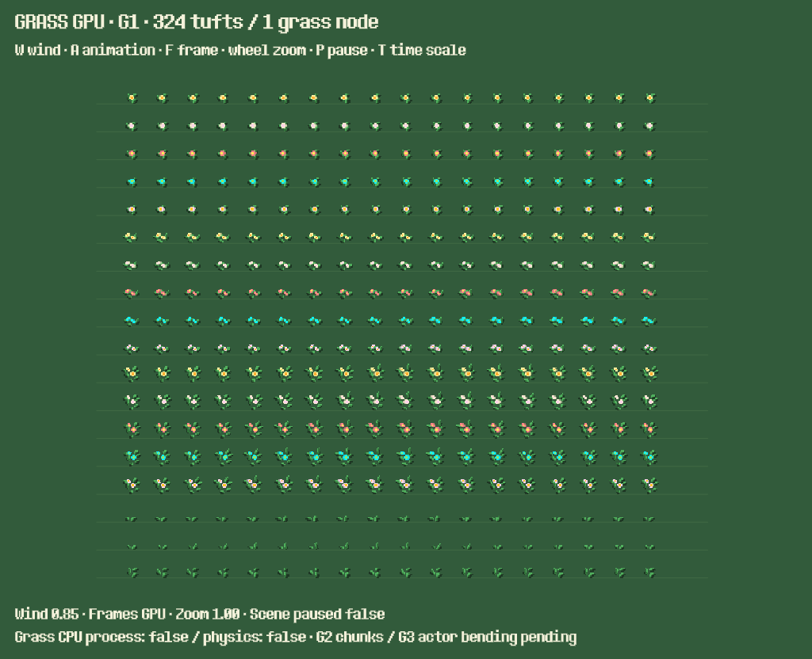

# Cỏ GPU — bàn giao G0 + G1

Ngày 24/10/2026. Đã dựng POC độc lập, chưa thay thế cỏ trong map chính. Save và gameplay giữ nguyên. Kế hoạch tổng thể: [G0–G6](grass_gpu_implementation_plan.md).

## Chạy thử

Mở `tests/support/grass_gpu_poc.tscn` trong Godot và nhấn **F6**. Có 324 bụi, đủ 18 loại asset. Chỉnh `tuft_count` trên GrassField để thử 100–500 bụi. Chỉ GrassField là node của tính năng; camera/HUD thuộc scene kiểm thử.

| Điều khiển | Tác dụng |
| --- | --- |
| W | Bật/tắt gió |
| A | Bật/tắt hoạt ảnh atlas |
| F | Xem lần lượt frame 0–7 rồi trở lại tự động |
| Con lăn | Zoom 0,5–3,0, bước 0,25 |
| P | Pause cây scene; gió vẫn chạy theo hành vi TIME hiện tại |
| T | Đổi Engine.time_scale 0/1; dừng/chạy cả gió lẫn frame |



## Dữ liệu và hợp đồng hình học

- Atlas mới `resources/grass/grass_poc_atlas.png`: 128×288, ghép nguyên pixel từ 18 strip nguồn 128×16. Mỗi loại có tám frame 16×16; POC chạy 8fps. Không sửa ảnh gốc.
- Metadata được sinh bằng `scripts/grass/build_grass_assets.gd`: đường dẫn nguồn, từng frame alpha bounds, root ổn định. Flower_Grass 1–10 có root_y=12; 11–15 có root_y=15; Grass 1/2 có root_y=10, Grass 3 có root_y=12.
- Quad được shader dựng từ UV và root rõ ràng. Shear tuyến tính đi qua chân opaque; phần padding trong suốt dưới chân vẫn tiếp tục shear để nội suy không kéo lệch chân. Sampling kẹp vào tâm texel trong đúng frame.
- Dữ liệu MultiMesh được dựng khi nạp/thay mẫu. Một CanvasItem RID do renderer sở hữu; không có node, Tween, collider hay callback CPU cho mỗi bụi. G1 là **một batch**, chưa có chunk/Y-sort với actor.
- Shader thử dùng `unshaded`; nối ánh sáng/ngày đêm và gió thời tiết thuộc G4. Chu kỳ gió 5/9 giây chia hết TIME rollover mặc định 3.600 giây.

[Manifest đầy đủ](grass_gpu_g0_g1_2026-10-24/asset_manifest.json) ghi cả tile-size, atlas region, animation, texture-origin, alternative/transform flags, z-index, Y-sort và số ô theo từng nguồn/tile:

| Scene/layer | Kết quả audit |
| --- | --- |
| MainWorld | 404 node authoring; 2.031 node runtime trong fixture fresh |
| Decor / TinyDecor | 479 / 1.130 ô; lưới logic 4×4 và atlas hỗn hợp, chưa cho chuyển tự động |
| FarmLandscape / MeadowGrass | 1.062 ô, lưới 16×16; MainWorld không tham chiếu trực tiếp scene này |

Audit phát hiện 32 ô cũ của Decor/TinyDecor tham chiếu tile không còn trong nguồn (21/11 ô). Manifest đánh dấu `source_tile_exists=false`; không tự sửa map và không coi chúng là cỏ hợp lệ. Allowlist chuyển từng tile trong atlas hỗn hợp vẫn cần chốt trước G4. Chưa ẩn bất kỳ layer nguồn nào.

## Kiểm chứng

- **4/4 GUT, 174 assertions:** byte atlas so với 18 nguồn; chân của cả 144 frame; 500 instances không sinh node con/process; bounds với flip/scale và padding; clear hai lần an toàn.
- **189/189 native checks mỗi renderer**, Forward+ và Compatibility trên Godot 4.7.2: 144 frame so Sprite2D gốc, scale/lật/xoay và parent transform, camera zoom 1,25/2,0, root riêng từng instance, gió thực đổi pixel, frame loop, rollover, pause/time scale, rebuild và điều khiển POC.
- Ngoại lệ đã đo: Flower_Grass_11, frame 3 khi xoay 0,23 rad, scale lẻ và flip có **đúng một pixel** chọn texel nearest khác Sprite2D trên cả hai renderer. Test cho phép một pixel chỉ trong nhóm transform xoay/lẻ đó và ghi chi tiết vào `fractional_rotation_edge_cases`; 144 phép đối chiếu cơ bản không dùng ngoại lệ này.
- Lint và engine validation không có lỗi mới của cỏ. Validation còn cảnh báo có sẵn ở resource/script khác, được giữ trong log. Web release export thành công; chưa chạy POC trong trình duyệt hoặc trên điện thoại thật.

Kết quả, raw samples, ảnh và log: [thư mục bằng chứng](grass_gpu_g0_g1_2026-10-24/). `compatibility/` và `forward-plus/` có `render-checks.json`, `baseline.json`, `poc-controls.png`, `main-baseline.png`, `poc-324.png` và log native.

## Mốc hiệu năng desktop

Máy đo: Windows, **RTX 3050 Ti Laptop GPU**, Godot 4.7.2. Mỗi case warmup 120 frame, lấy 240 frame; giới hạn 60fps. MainWorld là hồ sơ khởi tạo riêng, bốn cột, hoa khóa, chưa có đàn; player/camera đứng yên, sunny lúc debug 12h. Không dùng save cá nhân. Đây chưa phải benchmark gameplay đủ 87 actor hoặc đường camera G5.

| Case | Renderer | Draw calls p50 | Render CPU p95 (ms) | GPU p95 (ms) |
| --- | --- | ---: | ---: | ---: |
| MainWorld fresh, 1280×720 | Compatibility | 173 | 3,011 | 1,805 |
| MainWorld fresh, 1280×720 | Forward+ | 178 | 1,024 | 0,376 |
| 324 bụi tĩnh, 1024×832 | Compatibility | 1 | 0,452 | 0,421 |
| 324 bụi gió + frame, 1024×832 | Compatibility | 1 | 0,477 | 0,839 |
| 324 bụi tĩnh, 1024×832 | Forward+ | 1 | 0,084 | 0,057 |
| 324 bụi gió + frame, 1024×832 | Forward+ | 1 | 0,083 | 0,060 |

Đây là thời gian viewport của từng case, không phải riêng chi phí shader. Frame interval đã gồm cap/vsync; không dùng nó để suy ra GPU cost. Performance.TIME_PROCESS là monitor toàn engine, có thể lặp giữa các lần cập nhật; không gán số đó thành CPU của cỏ. Bộ nhớ ghi toàn engine gồm cache, không gọi là bộ nhớ riêng hiệu ứng. Dữ liệu thô giữ nguyên trong JSON; một lượt desktop chưa đủ kết luận chênh lệch nhỏ hay ngân sách điện thoại.

Mục tiêu tham chiếu vẫn là desktop 60fps (16,67ms), điện thoại 30fps (33,33ms) trước khi cân nhắc 60fps. Chưa có điện thoại mục tiêu để đo, vì vậy chưa khóa ngân sách effect hoặc tuyên bố đạt mobile. G5 phải dùng thiết bị thật, mật độ map và đủ actor.

## Tái chạy

Chuẩn bị staging cách ly bằng `scripts/build_web.py --godot ENGINE`. Sau đó:

```powershell
python -B scripts/grass/run_grass_g1.py --godot ENGINE
```

Runner kiểm tra custom userdata của staging, chạy hai renderer tuần tự, cửa sổ native ẩn trên Windows. Mặc định ghi `.godot/grass-g1-results`; có `--checks-only`, `--baseline-only`, `--output`. Native GPU bắt buộc, không dùng headless để nghiệm thu pixel. Scene baseline chỉ gắn MainWorld làm con của fixture nên WorldPersistence không liên kết save cá nhân.

Bake lại atlas/manifest trong staging:

```powershell
ENGINE --headless --path .godot/web-stage -s res://scripts/grass/build_grass_assets.gd -- --evidence-dir ABSOLUTE_OUTPUT_DIRECTORY
```

Sau bake cần import lại nếu ảnh đã thay đổi. Chạy suite riêng bằng `tests/run_tree_tests.py --godot MONO_ENGINE --suite tests/unit/test_grass_gpu.gd`.

## Bước kế tiếp

**G2:** chia chunk, batch theo hàng chân, chứng minh Y-sort với actor bên ngoài, kiểm tra biên camera/bounds và ownership/cache tài nguyên. **G3** mới thêm ảnh hưởng player/vật nuôi; **G4** mới tích hợp vùng map và thời tiết. G0 còn ngân sách thiết bị và allowlist map cuối, được theo dõi trong kế hoạch thay vì coi mọi mục đã hoàn tất.
