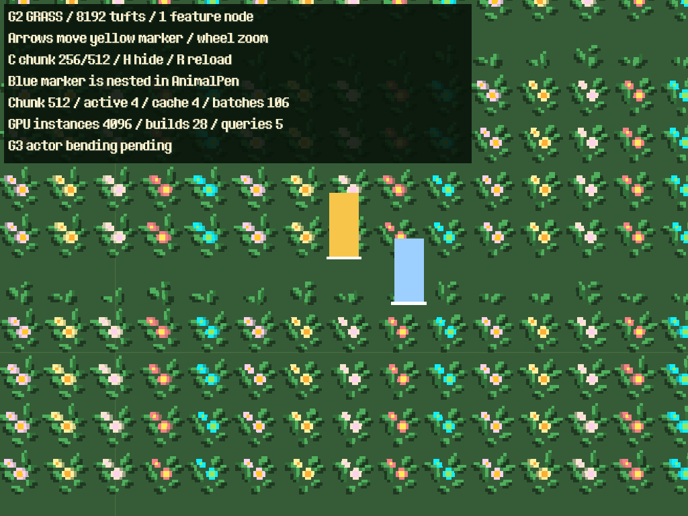

# Cỏ GPU — G2: chunk, Y-sort và vòng đời

Ngày 24/10/2026. Đã hoàn thành renderer thử G2 trong scene độc lập. Chưa thay cỏ MainWorld, nối thời tiết hoặc thêm phản ứng actor; save không thay đổi. [Kế hoạch tổng thể](grass_gpu_implementation_plan.md).

## Chạy thử bằng F6

Mở `tests/support/grass_gpu_chunks_poc.tscn`. Fixture có 8.192 bụi; **GrassChunkField là một node tính năng**, camera, HUD và các marker thuộc fixture. Marker vàng đi bằng phím mũi tên; marker xanh di chuyển bên trong một **AnimalPen thật** bật Y-sort.

| Điều khiển | Tác dụng |
| --- | --- |
| Mũi tên | Di chuyển marker vàng và camera qua các hàng/vùng cỏ |
| Con lăn | Zoom 0,75–5,0 |
| C | Chuyển chunk 512/256 và xây lại index |
| H | Ẩn/hiện cỏ, dừng/chạy manager |
| R | Giải phóng và dựng lại cache GPU |

HUD hiển thị chunks, số instances/batch đang giữ, số lần dựng chunk và truy vấn index. Hai marker chỉ dùng kiểm chứng che khuất, chưa làm cỏ nghiêng khi đi qua.



## Cách thực hiện

| Module | Trách nhiệm |
| --- | --- |
| `components/grass/grass_chunk_field.gd` | Một Node2D điều phối, lấy bốn góc viewport, chuyển tọa độ và quản lý hide/disable/exit/reenter |
| `components/grass/grass_chunk_index.gd` | Index CPU theo tọa độ chunk; phân nhóm nền hoặc Y chân chính xác + z-index |
| `components/grass/grass_chunk_renderer.gd` | Cache LRU có giới hạn, dựng leaf MultiMesh, parent CanvasItem RID vào sort root chung với actor |
| `components/grass/grass_poc_renderer.gd` | Primitive dựng/free từng leaf, tái sử dụng từ G1 |

**Hợp đồng đầu vào:** sort_root là ancestor Node2D bật Y-sort, cùng không gian sắp xếp với actor. Mỗi mẫu có `type`, `transform` trong tọa độ manager, tùy chọn `phase`, `tall`, `z_index`. Cỏ thấp dùng `tall=false` và z thấp phù hợp với ground của map; fixture dùng ground=-2, cỏ thấp=-1. Manager transform được bake về sort-root space, kể cả offset/scale/lật. Chỉnh dataset, chunk size hay các giới hạn thì gọi `rebuild()`.

Cỏ cao có CanvasItem RID riêng cho từng **Y chân chính xác và z-index trong mỗi chunk**, không chỉ sort instance bên trong một MultiMesh. Các RID này là con trực tiếp của sort root, nhờ đó Godot sắp chúng cùng actor và con của AnimalPen bật Y-sort. Không thêm node cho từng hàng hoặc từng bụi.

Không làm tròn Y để giả tăng batching. Dữ liệu rải tùy ý hoặc xoay có thể tạo nhiều hàng hơn; có giới hạn batch và báo lỗi rõ thay vì gộp sai thứ tự. Một node không đồng nghĩa một draw call: xếp lớp đúng cần nhiều batch hơn POC G1.

Index được dựng O(N) khi nạp/chỉnh dữ liệu hoặc đổi transform tương đối của manager. CPU vẫn giữ dataset/index cho toàn bộ dữ liệu đã cung cấp; chưa stream dữ liệu từ đĩa. Mỗi frame chỉ lấy transform/bốn góc camera và so cửa sổ chunk. Chỉ khi cửa sổ đổi mới lookup các tọa độ chunk quanh camera, không quét toàn map. Instance buffer chỉ dựng khi chunk chưa có trong cache hoặc dữ liệu bị rebuild; shader vẫn làm gió/frame.

Vùng truy vấn được mở rộng bằng toàn bộ hình học đã transform, độ lệch gió tối đa và một vòng chunk dự phòng. Bounds từng leaf cũng mở rộng theo gió; inverse-basis bound tính cả skew/nonuniform scale của sort root. Dữ liệu ngoài màn hình không được cấp phát GPU toàn bộ.

## Giới hạn và tài nguyên

Mặc định thử desktop: **chunk 512**, dự phòng một chunk, tối đa **64 chunks / 100.000 instances / 2.048 leaf batches** trong cache. Chunk 256 vẫn chọn được. Giới hạn ba loại đồng thời, không chỉ đếm chunk trong một vùng có thể rất dày. Nếu camera yêu cầu hơn 16.384 tọa độ chunk hoặc vùng cần vượt ngân sách, renderer giải phóng phần đang giữ và đặt `last_error`, không hiển thị một phần danh sách âm thầm. HUD thử hiển thị lỗi; fallback cỏ nguồn cho map thật thuộc G4.

LRU chỉ evict chunk không còn cần cho vùng nhìn/dự phòng. Hide/disable ẩn toàn bộ RID và dừng manager, giữ cache trong ngân sách. Exit/reload giải phóng CanvasItem RID do renderer tự tạo, thả tham chiếu Resource Mesh/MultiMesh/material/texture; không free thủ công RID thuộc Resource. Reenter dựng lại được, không để hình vẽ mồ côi. Visibility được truyền riêng vì RID là sibling của manager trong sort root.

## Kết quả kiểm tra

- **14/14 GUT, 326 assertions**, gồm hồi quy G1: negative coordinates, exact fractional rows, z/cỏ thấp, parent transform, padding/bounds, view đứng yên, LRU qua 40 vùng, hide/disable/reenter và các giới hạn chunk/instances/batches/zoom cực lớn.
- **74/74 native checks mỗi bên** Forward+ và Compatibility, Godot 4.7.2. So pixel với Sprite2D gốc ở trước/sau/giữa hàng, actor trực tiếp và dưới AnimalPen, z-index, manager scale/offset, zoom lẻ và bốn mép camera. Ảnh tham chiếu phải có pixel thật để tránh pass do cả hai ảnh trống. Có đối chiếu gió tại biên với batch GPU G1.
- Kiểm tra hide/show/disable/exit/reenter bằng ảnh thực; 20 lần rebuild vẫn chỉ có một leaf sống trong case một hàng. Counter RID cân bằng khi exit. Buffer monitor toàn engine giữ phẳng trên Compatibility; Forward+ tăng 172 byte ở lần warm đầu rồi phẳng trong lượt đo. Đây là bằng chứng cho fixture này, không tuyên bố driver không có cache hoặc đã soak dài hạn.
- Các điều khiển scene thử và input di chuyển được tự động kiểm tra. Lint không có lỗi/cảnh báo; engine validation không có diagnostic của cỏ, còn 25 cảnh báo có sẵn ở module/resource khác.
- Web release export thành công. **Chưa chạy POC G2 trong browser hoặc trên điện thoại thật.**

Ảnh, log, raw samples và JSON: [bằng chứng G2](grass_gpu_g2_2026-10-24/). `sorted-pen.png` thể hiện actor nằm giữa hai hàng; `g2-checks.json` ghi đầy đủ benchmark và buffer monitor.

## Đo desktop và lựa chọn chunk

Windows, RTX 3050 Ti Laptop GPU, viewport 640×480, cap 60fps; mỗi case warm 60 frame rồi lấy 120 frame. Có gió/atlas GPU, camera đứng yên; **không có AI hoặc actor tương tác** trong case đo. 4.096 bụi gần camera giữ nguyên; bản 65.536 thêm 61.440 bụi ở vùng xa. Render CPU/GPU là thời gian toàn viewport, không phải riêng manager. FPS có cap không dùng để suy GPU cost.

| Renderer | Chunk | Dataset | Leaf giữ / draw calls | Instances giữ | Render CPU p95 ms | GPU p95 ms |
| --- | ---: | ---: | ---: | ---: | ---: | ---: |
| Compatibility | 256 | 4.096 | 104 / 78 | 2.048 | 1,062 | 0,450 |
| Compatibility | 256 | 65.536 | 104 / 78 | 2.048 | 0,950 | 0,200 |
| Compatibility | 512 | 4.096 | 75 / 50 | 3.072 | 0,846 | 0,226 |
| Compatibility | 512 | 65.536 | 75 / 50 | 3.072 | 0,703 | 0,230 |
| Forward+ | 256 | 4.096 | 104 / 78 | 2.048 | 0,278 | 0,166 |
| Forward+ | 256 | 65.536 | 104 / 78 | 2.048 | 0,290 | 0,182 |
| Forward+ | 512 | 4.096 | 75 / 50 | 3.072 | 0,227 | 0,184 |
| Forward+ | 512 | 65.536 | 75 / 50 | 3.072 | 0,275 | 0,179 |

Phần thêm ngoài màn hình không tăng batch/buffer/draw-call đang hoạt động trong fixture này. Chunk 512 giảm draw calls 78→50, đổi lại giữ nhiều instances hơn 50%, nên chọn làm mặc định **thử desktop**. Không suy ra GPU nhanh hơn từ các chênh lệch nhỏ hoặc nhiễu của một lượt đo. Cache có cả vùng dự phòng nên số leaf giữ lớn hơn draw calls thực tế. Ngân sách điện thoại, camera path dài, tốc độ dựng chunk khi di chuyển nhanh và đủ 87 actor vẫn thuộc G5/G3.

## Tái chạy và phần tiếp theo

Chuẩn bị `.godot/web-stage` bằng `scripts/build_web.py --godot ENGINE`, sau đó:

```powershell
python -B scripts/grass/run_grass_g1.py --phase g2 --godot ENGINE --output .godot/grass-g2-results
python -B tests/run_tree_tests.py --godot MONO_ENGINE --suite tests/unit/test_grass_chunks.gd --suite tests/unit/test_grass_gpu.gd
```

Native runner dùng GPU thật và userdata staging riêng; chạy hai renderer tuần tự. Scene thử không có FarmWorld/persistence binding. G1 được giữ làm tham chiếu; chưa sửa map chính hoặc save.

**Tiếp theo G3:** registry vị trí chân player/vật nuôi, upload dùng chung, shader footprint/capsule và kiểm chứng đủ 87 actor (96 slot thử). Không thêm script, Tween hay Area2D theo từng bụi. Ánh sáng, thời tiết, chuyển tile allowlist và fallback nguồn thuộc G4; shader hiện vẫn `unshaded` như G1.
