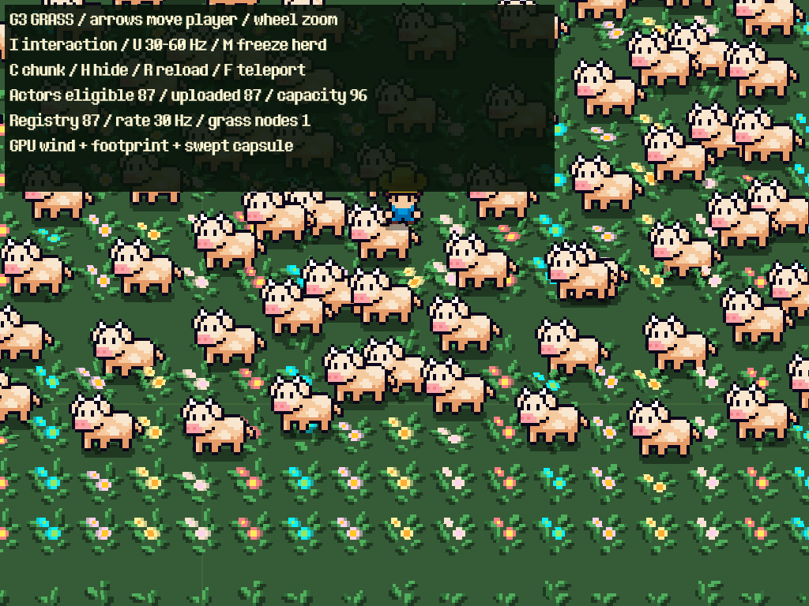

# Cỏ GPU — G3: player và vật nuôi làm cỏ nghiêng

Ngày 24/10/2026. Đã triển khai tương tác trong scene thử, một node quản lý cỏ. Chưa chuyển tile hoặc bật renderer vào MainWorld; không sửa save/gameplay. [Kế hoạch G0–G6](grass_gpu_implementation_plan.md).

## Chạy thử

Mở `tests/support/grass_gpu_interactions_poc.tscn` rồi **F6**. Có 8.192 bụi, player và 86 proxy vật nuôi dùng AnimatedSprite2D. Proxy chỉ phục vụ chuyển động/hiển thị, không chạy AI hay kinh tế. Bộ adapter riêng đã kiểm thử với FarmPlayer và 86 AnimalActor thật, đủ bảy loài.

| Phím | Tác dụng |
| --- | --- |
| Mũi tên / con lăn | Di chuyển player / zoom |
| I | Bật/tắt tương tác, để đối chiếu với gió đơn thuần |
| U | Đổi upload 60/30Hz |
| M | Dừng/chạy cả đàn; áp lực lên cỏ vẫn giữ khi đứng yên |
| F | Teleport player, reset đoạn di chuyển để tránh vệt xuyên map |
| C / H / R | Đổi chunk 512/256, ẩn/hiện, dựng lại chunk |

HUD ghi registered/eligible/uploaded/capacity và lỗi. Nhìn gốc cỏ: phần chân vẫn neo nguyên vị trí, phần ngọn nghiêng ra khỏi vùng chân actor.



## Phân chia CPU/GPU

- `components/grass/grass_interaction_feed.gd` là RefCounted, không phải node. Registry WeakRef quét group đúng một lần khi attach, sau đó nhận node_added/node_removed. Spawn được xét deferred sau `_ready`; actor bị bán, chết, queued-free, ẩn hoặc đổi world được loại khỏi dữ liệu ảnh hưởng. Không thêm component vào player/vật nuôi.
- Nguồn tự động: `farm_players`, `animal_status_targets`; tùy chọn `grass_interactors` cho fixture/actor mở rộng. Scope là sort root của field. `register_actor(node, radius, strength)` cho nguồn thủ công; `reset_motion(node)` dùng khi teleport/restore, `reset_all_motion()` khi tiếp tục hiển thị.
- Điểm chân lấy từ global_position của root actor, cùng gốc sắp xếp Y hiện tại. Radius player mặc định 14 world-pixel; AnimalActor lấy từ footprint definition cộng biên 6px (ít nhất 8px), rồi tính theo scale. Radius/strength có thể chỉ định khi register.
- CPU chỉ cập nhật registry, chân/scale, lịch upload và lọc theo camera mở rộng đủ kích thước hình cỏ + giới hạn lệch. Đoạn quét đi ngang màn hình vẫn được giữ dù hai đầu đều ở ngoài. Actor đứng yên vẫn được upload; không chọn riêng 16 con đang chuyển động.
- `shaders/grass_actor_bend.gdshaderinc` tính khoảng cách chân cỏ tới footprint/capsule, falloff, hướng đẩy và tổng lực bằng vertex shader. Cỏ vẫn dùng MultiMesh/chunk/Y-sort G2; không có distance loop, collider, Tween hoặc callback CPU cho mỗi bụi. Không compute shader/GPU readback trong runtime.

Hai mảng vec4 cố định **96 slot**: đoạn trước/hiện tại và radius/strength/thời gian chuyển động/góc dự phòng. Khi actor nằm đúng chân cỏ, shader dùng hướng dự phòng ổn định thay cho normalize vector 0. Tổng gió + tương tác giới hạn **12 world-pixel**, bounds/camera query cũng mở rộng theo mức này. Chân opaque vẫn có hệ số biến dạng bằng 0.

Nếu hơn 96 actor hợp lệ cùng ảnh hưởng vùng nhìn, feed ghi rõ lỗi và đặt actor_count=0 cho toàn bộ tương tác; cỏ/gió vẫn hiển thị. Không âm thầm cắt danh sách. Cấu hình 96 đã chạy thật trên hai renderer của máy đo, chưa cam kết cho mọi điện thoại/WebGL.

## Thời gian, chạy nhanh và hồi phục

Upload chọn 30 hoặc 60Hz, mặc định **60Hz** để giảm độ trễ. Chân trước/hiện tại tạo capsule nên bước chạy 80px giữa hai lần cập nhật vẫn tác động lên cỏ ở giữa. Không cập nhật transform/buffer của từng bụi khi actor đi qua.

Đoạn vừa đi qua thu dần về footprint hiện tại bằng smoothstep trong **0,18 giây**; footprint giữ áp lực khi đứng yên. Khi rời xa, spatial falloff đưa lực về 0. Đây là biến dạng hình ảnh, không phải mô phỏng vật lý hoặc vệt lún có bộ nhớ lâu dài.

Shader nhận clock mô phỏng từ manager; timestamp actor cùng gốc clock này, không trộn Unix hoặc shader TIME. Clock được rebase trước khi lớn quá 1.024 giây và rebase cả timestamp. Pause giữ nguyên áp lực/đoạn quét; time scale dùng delta engine. Gió vẫn theo TIME như G1.

Jump dài hơn `max(96px, radius×8)` được coi là teleport và bỏ đoạn quét. Game có teleport ngắn/restore nên gọi `reset_motion` rõ ràng. Ẩn/hiện actor hoặc tiếp tục hiển thị field reset lịch sử để không tạo vệt giả. Ranh giới teleport là cấu hình heuristic hiện tại, không thay cơ chế di chuyển/collision gameplay.

## Kiểm chứng

- **23/23 GUT, 353 assertions** gồm G1/G2 và G3: đủ 87/96, overflow 97, đoạn chạy nhanh, stationary, lọc biên, lịch upload, spawn/remove, global feet/scale, clock rebase, hidden/reappear và resume reset.
- **48/48 native checks mỗi renderer**, Godot 4.7.2 Forward+ và Compatibility: pixel thực thay đổi khi đứng gần, giữ lực khi đứng yên, chân không trượt, root trùng actor không NaN, capsule chạy nhanh và hồi phục, teleport, pause không trôi clock, slot 87/96 thực sự tác động hình ảnh, chồng 96 actor bị giới hạn đúng 12px, parent transform và các điều khiển lab.
- Adapter dùng MainWorld làm **con của scene QA**, nên WorldPersistence không bind SaveManager. Tạo 30 gà, 10 vịt, 10 ngỗng, 12 bò, 8 cừu, 8 lợn, 8 ngựa; FarmPlayer + đàn được nhận tự động đủ 87. Bán/chết bỏ hai actor còn 85; thoát world xóa registry. AI fixture bị disable để tách adapter khỏi gameplay.
- Hồi quy native sau khi sửa shader chung: G1 **189/189**, G2 **74/74** trên mỗi renderer. Ngoại lệ một pixel nearest khi xoay/lật tọa độ lẻ của G1 vẫn được ghi trong báo cáo G1, không mở rộng ngoại lệ sang test G3.
- Lint toàn dự án không có lỗi/cảnh báo. Engine validation có cảnh báo cũ ở module/resource khác; kết quả gốc được lưu. Web release export thành công. **Chưa nghiệm thu G3 trong browser hoặc điện thoại thật.**

## Số đo và lựa chọn backend

Xem [bảng benchmark sinh từ dữ liệu cuối](grass_gpu_g3_2026-10-24/benchmarks.md), cùng raw samples/log/ảnh trong [bằng chứng G3](grass_gpu_g3_2026-10-24/).

Máy Windows/RTX 3050 Ti Laptop GPU, viewport 640×480, cap 60fps, 4.096 bụi trong dataset. Mỗi case warm 30 frame, lấy 60 frame; thử 0/1/16/87/96 actor ở 30 và 60Hz. Chuyển động proxy xác định, không có AI/UI trong case benchmark. GPU time đo toàn viewport; manager CPU bao gồm culling + feed + upload, không suy từ FPS. Case 30Hz vẫn cập nhật clock mỗi frame nhưng chỉ gửi mảng tọa độ ở lịch 30Hz.

Lịch upload đạt đúng 30/60 lần trong 60 frame đo. 30Hz tiết kiệm các frame không upload; p95 ở frame có upload không nhất thiết giảm tương ứng. Chu kỳ lấy mẫu tương ứng tối đa 33,3/16,7ms trước khi xét render/physics; chưa coi đây là số đo latency đầu-cuối trên thiết bị. Chọn 60Hz làm mặc định thử desktop, giữ 30Hz để đánh giá mobile. Số đo hiện tại chưa cho thấy cần thêm texture field; giữ uniform backend đã chứng minh đủ 87/96. G5 mới chốt ngân sách trên thiết bị thật, mật độ map, camera path và AI đầy đủ.

## API tích hợp và tái chạy

Đặt `interaction_enabled=true` trước khi field vào tree, hoặc gọi `set_interactions_enabled(true)` khi runtime. Scope tự gắn sort_root hiện có. Group registry được cấp bởi actor hiện hữu; không sửa các script actor chỉ để phản ứng với cỏ. Khi tắt hoặc exit, count về 0 và signal được disconnect; reattach sẽ lấy lại actor trong scope.

Sau khi có staging từ `scripts/build_web.py --godot ENGINE`:

```powershell
python -B scripts/grass/run_grass_g1.py --phase g3 --godot ENGINE --output .godot/grass-g3-results
python -B tests/run_tree_tests.py --godot MONO_ENGINE --suite tests/unit/test_grass_interactions.gd --suite tests/unit/test_grass_chunks.gd --suite tests/unit/test_grass_gpu.gd
```

**Tiếp theo G4:** tích hợp một vùng tile đã có allowlist, toggle/fallback nguồn, nối gió thời tiết và ánh sáng, thử player/đàn thật trong gameplay. Shader hiện vẫn unshaded như G1/G2. Chưa mở rộng toàn map.
