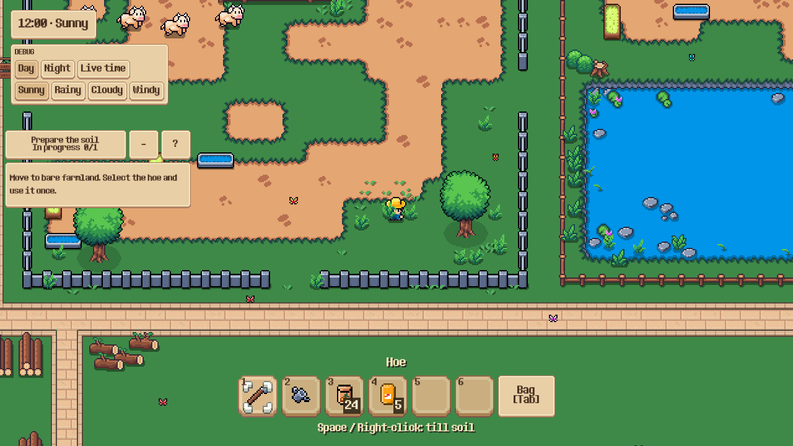

# Cỏ GPU — G4: tích hợp một vùng nông trại

**Cập nhật 25/10/2026:** đã [bật cỏ GPU trên toàn map](grass_gpu_world.md), gồm cả nhóm overlap bằng shader TileMap. Nội dung bên dưới là báo cáo lịch sử của bản vùng thử 24/10.

Ngày 24/10/2026. Đã bật G4 trong MainWorld: **10 cụm cỏ GPU ở khu chuồng gia súc**, ba cụm chồng props cùng hàng giữ nguồn cũ. [Kế hoạch tổng thể](grass_gpu_implementation_plan.md).

## Xem trong game

Chạy game bình thường và đến BarnPen. Vùng thử trong tọa độ World: **Rect2(1008, 592, 384, 272)**. Cỏ ở đây phản ứng với player/vật nuôi, gió theo thời tiết và chịu ánh sáng ngày/đêm/đèn hiện có.

Trong Godot debug, nhấn **F10** để đổi GPU ↔ cỏ TileMap gốc. Đây là công tắc đối chiếu theo phiên, không phải tùy chọn đã lưu trong profile. Release vẫn có fallback tự động và API `world.grass.set_conversion(bool)`.

Muốn thử mà không mở save cá nhân: mở **`tests/support/grass_gpu_farm_preview.tscn` rồi F6**. Scene này tạo World làm con, hồ sơ khởi tạo và 36 gia súc thử; không bind persistence cá nhân. Player bắt đầu cạnh cỏ ở cuối chuồng, có thể đi lại và dùng F10. Các con thêm vào chỉ thuộc preview, không phải quà New Game.



Trong editor vẫn thấy cỏ TileMap gốc để author map. Khi chạy mới có một node `GPUGrass`; renderer dùng CanvasItem RIDs, không tạo node/physics/Tween cho mỗi bụi.

## Nguồn và phạm vi chuyển đổi

- Chỉ đọc `TinyDecor`, texture chính xác `assets/Outdoor decoration/Outdoor_Decor.png`, atlas coords **(6,2), (6,3), (7,3), (8,3)**. Có 169 ô của bốn loại này trên map; 13 ô có tâm nằm trong vùng BarnPen. Guard giữ lại ba ô chồng hoa/props cùng Y-sort; 10 ô an toàn được chuyển.
- Artwork thực tế không khớp pixel với strip hoạt ảnh POC. Runtime dùng **chung texture nguồn của TileMap**, không thay hình thành một loại cây khác. `build_farm_grass_assets.gd` sinh metadata chân và ảnh lặp frame để kiểm tra byte offline; ảnh đóng gói không phải texture runtime G4.
- UV được nội suy ở vertex theo rect chuẩn hóa của atlas gốc. Mesh dùng đường chéo tam giác giống Canvas rect thay vì đường chéo mặc định của QuadMesh, để giữ lấy mẫu nearest khi zoom lẻ. Có đối chiếu [mã Canvas của Godot](https://raw.githubusercontent.com/godotengine/godot/master/drivers/gles3/shaders/canvas.glsl), rồi xác minh trên engine đang cài.
- Một sibling GPU batch không thể chen vào giữa các draw command trong cùng hàng TileMap. Guard mở rộng vùng kiểm tra theo giới hạn lệch 12px, giữ component chồng props chưa chuyển ở nguồn; không xóa/chuyển hoa để che sai lệch alpha-order. Các instance cùng hàng GPU giữ X draw order của layer.
- Chân opaque trong atlas mới ở y=14/15. Y-sort authoring của tile là một giá trị riêng. `sort_origin` giữ nguyên thứ tự vẽ cũ, còn transform chân dùng đúng opaque root để tính lực; không đoán chân theo lưới logic 4×4.
- Chỉ nhận tile không có collider/navigation, alternative=0, texture-origin=0, tint trắng và không có material riêng. Layer bị ẩn/vô hiệu không được chuyển. Tile không được hỗ trợ giữ nguyên.
- Không ẩn cả TinyDecor, không sửa TileSet/ảnh nguồn hoặc serialized cell data của main_world.tscn. Đá, hoa, gỗ, các tile tham chiếu lỗi sẵn có và toàn bộ vùng ngoài trial giữ nguồn cũ. Không chèn FarmLandscape vào MainWorld.

[Allowlist và vị trí từng ô](grass_gpu_g4_2026-10-24/source-allowlist.json) ghi provenance, metadata và hash asset. Regenerate atlas sau khi thay artwork, rồi chạy kiểm tra pixel.

## Composition, ánh sáng và thời tiết

`FarmWorld._ready` thêm **một FarmGrassField**. World có export `gpu_grass_enabled` (mặc định true) và `grass_trial_region`. Các helper dữ liệu/renderer/feed đều RefCounted.

`shaders/grass_field_core.gdshaderinc` chứa geometry/UV/gió/tương tác dùng chung. POC G1–G3 vẫn dùng wrapper unshaded; `grass_farm.gdshader` bỏ unshaded để nhận CanvasModulate và PointLight2D như TileMap. Không đổi ánh sáng của các thành phần khác.

Gió dùng cùng hướng drift (100,18) với hiệu ứng windy. Biên độ ở strength=1: sunny **0,65**, cloudy **1,0**, rain **1,2**, windy **2,8** world-pixel. Adapter đọc active_weather/strength của WeatherEffects nên đi theo fade-out/fade-in hiện tại. Bounds vẫn giữ mức an toàn 12px của G3; khi chỉ đổi amplitude trong bounds không rebuild leaf/index. Không loop qua cỏ mỗi frame.

Registry G3 nhận player và đàn thật từ group hiện có. Restore thành công phát signal model; field reset lịch sử chuyển động để một dịch chuyển ngắn khi load save không tạo capsule giả. Không thêm dữ liệu cỏ vào DTO và không nâng schema save.

## Giao dịch và fallback

`GrassSourceTransfer.prepare` chỉ lập backup/sample sau khi lọc overlap. Sau khi preflight atlas/shader và renderer/feed thành công, `suppress` kiểm tra lại **toàn bộ** tuple source/coords/alternative rồi mới erase đúng 10 ô đã chọn. Không có thời điểm cố ý vẽ cả nguồn lẫn GPU cho cùng ô trong trạng thái ổn định.

Khi tắt hoặc gặp lỗi, field ẩn/giải phóng cache GPU và khôi phục từng ô. Restore lặp lại an toàn. Nếu ô đã bị hệ thống khác sửa, giữ thay đổi đó và ghi conflict thay vì đè lên. Renderer ở headless giữ cỏ nguồn, không cấp phát buffer cỏ runtime.

Các nhánh đã kiểm chứng: thiếu atlas, thiếu shader, vượt ngân sách chunk/batch, hơn 96 actor hợp lệ, tắt/bật, exit/reenter và reload scene. Retry sau khi điều kiện lỗi được giải quyết sẽ dựng lại renderer và dùng nguồn backup đúng. Không tự retry vô hạn mỗi frame. Preflight kiểm tra resource/schema; đây không phải cơ chế phục hồi toàn game sau lỗi driver GPU.

## Kiểm chứng

- **57/57 GUT, 864 assertions** trong project tạm/userdata riêng: atlas đúng pixel, giao dịch chỉ 10 ô và giữ ba overlap, source bị sửa giữa chừng, restore không đè edit ngoài, source ẩn/vô hiệu, headless fallback, sort-origin, G1/G2/G3, thời tiết, starter content và persistence bootstrap.
- **49/49 native checks mỗi renderer**, Forward+ và Compatibility (Godot 4.7.2). GPU đứng yên khớp ảnh nguồn cả trưa/đêm và zoom **0,8/1,25** trong sai số tối đa 1/255; fallback budget/atlas/shader cũng khớp **ảnh render nguồn**, không chỉ đếm ô. Không nới ngưỡng để bỏ qua lỗi zoom.
- Đàn thật đủ **86 con + player = 87** trong gameplay, AI hoạt động; shader nhận đủ actor nhìn thấy. Player di chuyển qua cỏ bằng input thật, inventory và pause hoạt động. Một con bò thật làm thay đổi pixel cỏ trong khu BarnPen.
- Save DTO trước/sau toggle giống nhau; restore cùng pipeline kinh tế giữ tiến trình bốn cột và reset đúng lịch sử teleport 32px. Toàn bộ thao tác QA dùng World làm con, không mở/ghi save cá nhân.
- Vượt 97 actor khôi phục toàn vùng nguồn; bỏ actor dư retry được. Exit field trả lại tile và giải phóng RID, reenter phục hồi registry 87. Reload World không tích lũy hoặc mất decor. Preview F6 có player + 36 gia súc và chạy GPU thực.
- Hồi quy native G1: **189/189 mỗi renderer** sau khi tách shader core. Bộ GUT đã kiểm tra lại chunk/cache và feed G2/G3. Test mưa cũ còn giả định một cột khởi đầu được sửa ranh giới ô khóa thành 52 vì profile nay mở bốn cột (53..56); không sửa luật mưa.
- Lint toàn project không lỗi/cảnh báo; engine validation không có diagnostic của cỏ, vẫn có cảnh báo cũ ở module khác. Web release export thành công. **Chưa nghiệm thu G4 trong browser hoặc trên điện thoại thật.**

Ảnh, log, JSON, raw samples: [bằng chứng G4](grass_gpu_g4_2026-10-24/). `source-12/gpu-12` và `source-0/gpu-0` đối chiếu ngày/đêm; ảnh `farm-herd-*` là đàn đầy đủ; `preview-barn.png` là cận cảnh vùng thử.

## Đo hiệu năng và phần tiếp theo

[Bảng số đo sinh từ JSON cuối](grass_gpu_g4_2026-10-24/benchmarks.md). Máy Windows/RTX 3050 Ti Laptop GPU, viewport 1280×720, cap 60fps. G4 giữ 10 instances trong một chunk, 7 leaf batches theo Y authoring; không gọi đây là một draw call.

Có một sample 60 frame với AI thật. Phép đối chiếu source/GPU dùng cùng tư thế/chuyển động player-bò và camera cố định, AI/animation/TIME bị freeze; warm 30 rồi lấy 60 frame mỗi case. GPU/render CPU là thời gian **toàn viewport**; manager CPU của case GPU đo riêng đoạn culling/feed, không phải tổng gameplay CPU. Đây là diagnostic ngắn, chưa đủ kết luận tốc độ, FPS thực, soak dài hoặc ngân sách điện thoại.

**Tiếp theo G5:** benchmark dài với camera path/mật độ mục tiêu, phân tách tải renderer và AI, chốt profile desktop/Web/mobile trên thiết bị có số đo; chỉ sau đó mới mở rộng ngoài vùng thử và cân nhắc backend texture field. Chưa bật toàn bộ cỏ trên map.

## Tái tạo và tái chạy

Sau khi chuẩn bị staging bằng `scripts/build_web.py --godot ENGINE`:

```powershell
ENGINE --headless --path .godot/web-stage -s res://scripts/grass/build_farm_grass_assets.gd
python -B scripts/grass/run_grass_g1.py --phase g4 --godot ENGINE --output .godot/grass-g4-results
```

Import lại khi atlas thay đổi. Suite GUT: `tests/unit/test_grass_farm.gd`, `test_grass_interactions.gd`, `test_grass_chunks.gd`, `test_grass_gpu.gd` và integration `test_weather.gd`, `test_starter_content.gd`, `test_persistence_bootstrap.gd`; dùng `tests/run_tree_tests.py` để có userdata riêng. Test native cần GPU thật, không dùng headless để nghiệm thu pixel.
