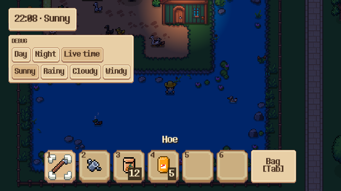
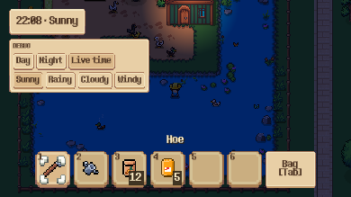
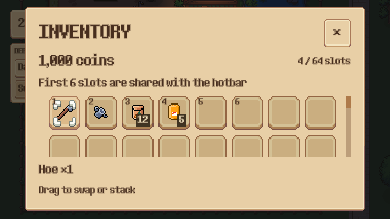

# Kết quả tự kiểm thử khả năng chơi trên điện thoại

> Cập nhật sau triển khai M0: blocker Web templates và save trên Web đã được xử lý, bản Web đã chạy/lưu/tải/reload được. Xem [kết quả mới và hướng dẫn build](web_build.md). Các kết quả bên dưới ghi lại thời điểm audit trước khi sửa; các hạn chế về điều khiển cảm ứng và thiết bị thật vẫn còn.

Ngày kiểm thử: 23/10/2026. Kết luận: chưa đủ điều kiện xác nhận game chơi được trọn vẹn trên điện thoại. Đã chạy test desktop, render ở kích thước điện thoại và thử export Web; chưa chạy trên trình duyệt hoặc thiết bị Android/iPhone thật vì chưa có build Web hợp lệ.

## Môi trường và cách kiểm tra

- Windows, Godot 4.7.1 stable Mono; render preview bằng Compatibility/OpenGL trên RTX 3050 Ti Laptop GPU. Đây không phải số liệu hiệu năng mobile.
- Thử export bằng cả engine Mono 4.7.1 và standard 4.7.2 có sẵn trên máy. Không cài engine/templates mới, không đổi cấu hình gameplay gốc.
- Dùng project kiểm thử riêng tại `.godot/mobile-audit/project`, cấu hình user-data riêng; main world trong preview không phải current_scene nên WorldPersistence không bind save đang chơi.
- Bộ GUT dùng runner cô lập `tests/run_tree_tests.py`. Không sửa nội dung map hoặc test đang lỗi để làm kết quả xanh.
- Render cửa sổ 844×390 và 390×844; đọc cả kích thước cửa sổ, vùng render và hình học UI. Chụp ảnh framebuffer và kiểm tra hình ảnh.
- Probe input gọi handler hiện tại với `InputEventScreenTouch` và `InputEventMagnifyGesture`. Đây là kiểm tra handler, không phải mô phỏng toàn bộ touch stack của trình duyệt/điện thoại.

## 1. Kết quả test hiện có

| Suite | Đạt | Lỗi | Diễn giải |
| --- | ---: | ---: | --- |
| `test_small_window_ui.gd` | 4 | 0 | Kiểm tra bố cục nhỏ, click đã biến đổi tọa độ, EN/VI; dùng mouse, chưa chứng minh dùng cảm ứng |
| `test_player.gd` | 32 | 0 | Điều khiển desktop, tìm đường, zoom con lăn và khóa input |
| `test_save_repository.gd` | 20 | 0 | File roundtrip, checksum, backup, revision, migration, async write trên desktop |
| `test_world_persistence.gd` | 22 | 9 | Có giả định fixture không còn phù hợp với main world hiện tại |
| Tổng | 78 | 9 | 87 test; 973/982 assertion đạt; runner exit 1 |

Lệnh đã chạy với Python runtime đi kèm môi trường:

```powershell
python tests/run_tree_tests.py --godot C:/Godot_v4.7.1-stable_mono_win64/Godot_v4.7.1-stable_mono_win64_console.exe --suite tests/integration/test_small_window_ui.gd --suite tests/integration/test_world_persistence.gd --suite tests/integration/test_player.gd --suite tests/unit/test_save_repository.gd
```

`python` trong lệnh trên cần trỏ tới runtime thực, không phải WindowsApps alias không hoạt động trên máy này.

### Các lỗi world persistence

- Sáu test truy cập `BarnPen/Cow_1`, nhưng node này không có trong map hiện tại: offline production, needs run-out, removed entity, death-during-capture, offline death và clock rollback.
- Hai test chốt cứng số thú còn lại là 36, trong khi snapshot sau bỏ PondPen của fixture hiện tại có 0: test mua/bán vật nuôi và migration v1.
- Một test invalid-load truy cập phần tử đầu của mảng đang rỗng.
- Fixture dùng MainWorld thực thay vì tự tạo đàn riêng; nó bỏ PondPen trong `before_each`, nên thay đổi bố trí map có thể làm test hỏng dù chưa chứng minh lỗi thuật toán lưu.

Hành động cần làm: dựng fixture tường minh có cow/đàn cần cho từng test và thay số hard-code bằng kỳ vọng của fixture, rồi chạy lại. Chưa kết luận các ca offline này đúng hay sai cho tới khi có fixture hợp lệ; 20/20 repository test đạt không thay thế cho kiểm thử đầy đủ world restore.

## 2. UI và tỉ lệ màn hình

| Cửa sổ | Vùng render đo được | Quan sát |
| --- | --- | --- |
| 844×390 ngang | 693×390 | Giữ khung 16:9; không tận dụng toàn bộ chiều ngang |
| 390×844 dọc | 390×219 | Vẫn giữ khung 16:9, vùng chơi chỉ chiếm khoảng 26% chiều cao cửa sổ |

Ảnh chụp là framebuffer vùng game, không phải toàn bộ cửa sổ có letterbox. Vì vậy ảnh dọc bên dưới vẫn có dạng ngang; phần trống ngoài vùng render không xuất hiện trong PNG.

- Inventory và nút đóng nằm trong vùng render ở cả hai kích thước đã đo.
- Ở cửa sổ dọc, slot hotbar chỉ khoảng 39×41 pixel hiển thị; inventory bị thu nhỏ trong vùng cao 219 pixel. Việc không tràn màn hình không đồng nghĩa dễ đọc hoặc dễ chạm trên điện thoại.
- Preview có bảng DEBUG thời tiết do chạy debug build. Không đánh dấu đây là lỗi release: mã chỉ tạo bảng khi `OS.is_debug_build()`.
- Chưa đo safe area, bàn phím ảo hoặc thanh trình duyệt thực.







## 3. Điều khiển cảm ứng

### Đã tái hiện

- Handler điều khiển player không đặt navigation focus khi nhận trực tiếp `InputEventScreenTouch`.
- `InputEventMagnifyGesture` với factor 1,5 không đổi zoom mục tiêu. CameraZoomComponent hiện chỉ xử lý nút con lăn chuột.
- Runtime đang bật `emulate_mouse_from_touch`. Vì vậy một chạm có thể được đổi thành click ở nền tảng hỗ trợ; kết quả handler trực tiếp không có nghĩa mọi tap đều thất bại.

### Khoảng trống xác nhận từ mã và UI

- Chưa có joystick/nút dùng công cụ/nút tương tác trên màn hình để thay đủ bàn phím và right-click.
- Hotbar vẫn hiển thị phím số, `Bag [Tab]`; hướng dẫn công cụ tham chiếu Space/right-click.
- Thông tin hover và thao tác inventory cần được thử/thay thế cho môi trường không có con trỏ; drag trên điện thoại chưa được xác nhận.
- Chưa có định tuyến đa chạm cho joystick + hành động hoặc cơ chế phân biệt tap/drag/pinch để tránh lệnh ngoài ý muốn.

Không thể hoàn tất kiểm thử vòng chơi chỉ bằng cảm ứng ở trạng thái hiện tại; cần làm phần M2 trước khi nghiệm thu.

## 4. Export Web

### Lần 1 — Mono 4.7.1

Export thất bại: engine báo không hỗ trợ export Web từ bản C#/.NET và yêu cầu standard editor nếu project không dùng C#.

### Lần 2 — Standard 4.7.2

Đã tìm thấy và chạy engine standard sẵn trên máy. Export vẫn thất bại vì thiếu:

```text
C:/Users/faker/AppData/Roaming/Godot/export_templates/4.7.2.stable/web_nothreads_debug.zip
C:/Users/faker/AppData/Roaming/Godot/export_templates/4.7.2.stable/web_nothreads_release.zip
```

Không tạo được `index.html/.wasm/.pck`, nên không có bản game hợp lệ để mở và chơi trên browser. Đây là blocker môi trường build, không phải bằng chứng gameplay không chạy được trên Web.

Backend save có `Thread` trong khi preset Web đang `variant/thread_support=false`. Cần kiểm tra thực nghiệm khi có build: chưa đánh dấu lỗi runtime Web khi chưa chạy được. Kiểm thử IndexedDB, reload, chuyển nền và tính bền vững của save còn chưa thực hiện.

## 5. Thứ tự xử lý đề xuất

1. M0: thiết lập một bộ standard engine + Web export templates cùng phiên bản. Export và chạy Web, kiểm tra boot/save/reload trước khi chốt đường phát hành.
2. Sửa fixture world persistence rồi chạy lại 9 ca chưa có kết quả đáng tin cậy.
3. M1: chọn ngang làm hướng chơi đầu tiên; tận dụng tỉ lệ màn hình ngang, safe area và kích thước chạm. Có thông báo xoay máy nếu chưa hỗ trợ dọc.
4. M2: thêm input cảm ứng qua cùng lệnh gameplay, joystick, nút hành động/tương tác và zoom gesture; ngăn click/touch trùng và input xuyên UI.
5. M3: đo FPS/frame time, bộ nhớ, chuyển nền và save trên thiết bị Android/iPhone thuộc ma trận hỗ trợ.

## Bằng chứng lưu kèm

- `mobile_audit_2026-10-23/probe-results.json`: số đo cửa sổ, render, UI và input.
- `mobile_audit_2026-10-23/probe.log`: lượt preview cuối chạy không có script/runtime error.
- `mobile_audit_2026-10-23/web-export-standard.log`: lỗi thiếu export templates.
- Bốn PNG ngang/dọc của nông trại và inventory.

Giới hạn: chưa có chứng nhận Android/iOS, chưa đo cảm giác chạm thật hoặc hiệu năng mobile. Chưa sửa gameplay hoặc cấu hình sản phẩm trong lượt kiểm thử này.
