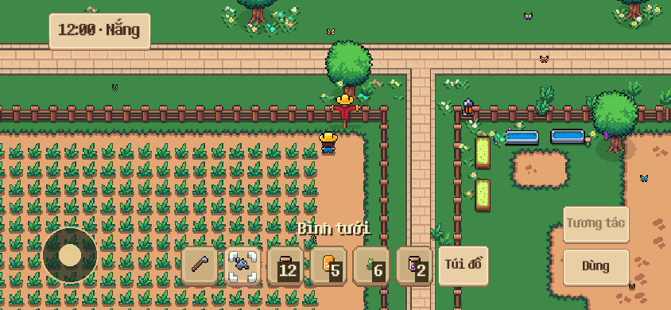
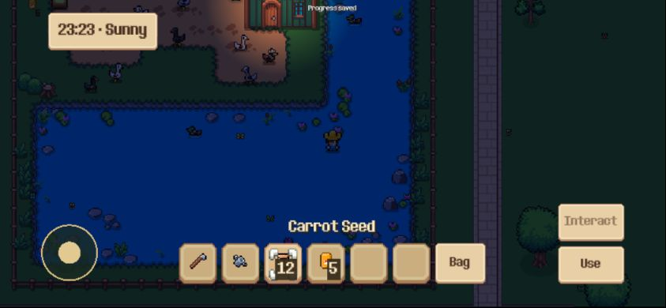

# M2 — Điều khiển cảm ứng

Ngày kiểm tra: 23/10/2026. Đã triển khai điều khiển và xuất bản Web release tại `.dist`. Đã kiểm tra bằng sự kiện touch của engine và trình duyệt desktop; chưa nghiệm thu điện thoại Android/iPhone thật.

## Cách chơi

| Thao tác | Điều khiển |
| --- | --- |
| Di chuyển | Giữ joystick góc trái dưới, kéo theo hướng muốn đi; vẫn theo dõi ngón tay khi kéo ra ngoài vòng |
| Dùng đồ | Chọn ô hotbar rồi chạm **Use / Dùng**; có thể bấm bằng ngón thứ hai khi giữ joystick |
| Tương tác | Hướng về mục tiêu rồi chạm **Interact / Tương tác**; badge hiển thị hành động và outline đánh dấu mục tiêu |
| Chạm bản đồ | Chạm rồi nhấc tay: nền đất đặt điểm đi tới; đối tượng hợp lệ dùng resolver tiếp cận/tương tác hiện có |
| Zoom | Kéo hai ngón trên bản đồ ra/vào; không phát thêm lệnh đi hoặc dùng đồ |
| Túi đồ | Chạm **Bag / Túi đồ**; có thể mở bằng ngón thứ hai khi giữ joystick |
| Cuộn danh sách | Vuốt trong túi đồ/shop/chi tiết; qua ngưỡng kéo sẽ hủy lần nhấn ô/nút ban đầu |
| Bật/tắt nút cảm ứng | Trong túi đồ chạm **Touch controls / Cảm ứng** để chuyển Tự động → Bật → Tắt; lựa chọn hiện áp dụng trong phiên này |

Các nút đóng/xác nhận, số lượng +/−, chọn/chuyển vật phẩm dùng UI M1. Chuột/phím và zoom con lăn vẫn hoạt động. Có thể kéo joystick và bấm nút bằng chuột khi xem preview touch trên PC. Khi không có mục tiêu, nút tương tác bị vô hiệu hóa; trong animation hành động không nhận lệnh dùng đồ lặp.

## Quy tắc input

- `TouchGestureRouter` giữ vai trò riêng cho mỗi touch ID: joystick, dùng đồ, tương tác, UI hoặc bản đồ. Ngón ở UI không trở thành ngón pinch/map khi kéo ra ngoài.
- Chạm bản đồ chỉ commit khi nhấc tay, trong 600 ms và không di chuyển quá 12 UI points. Pinch hủy tap của mọi ngón tham gia; thay cặp ngón không gây nhảy zoom.
- `TouchScrollGesture` cuộn trực tiếp theo tọa độ UI và gửi thông báo hủy nhấn cho nút trong danh sách. Không phụ thuộc việc PC preview có khai báo phần cứng touchscreen hay không.
- Mouse emulation của touch vẫn phục vụ UI; `StateComponent` bỏ qua mouse giả lập ở bản đồ để tránh chạy lệnh hai lần. Hotbar/Bag có đường xử lý riêng cho ngón thứ hai khi ngón đầu đang giữ joystick.
- Mở modal, mất focus/chuyển nền, đổi kích thước/xoay, đổi chế độ hoặc load save đều xóa trạng thái input đang giữ. Animation đã bắt đầu vẫn theo quy tắc tác động hiện có; không tạo nhánh gameplay mobile riêng.
- `StateComponent`, navigation và interaction resolver tiếp tục quyết định canh tác/tương tác; giao dịch dùng các service hiện có. Đặt tổ ong bằng nút Dùng sử dụng ô phía trước player, cùng vị trí preview, thay vì vị trí chuột cũ.

## Kiểm chứng

**102/102 bài GUT đạt, 4.072 assertions; 22/22 kiểm tra native touch đạt.** Log và ma trận thử nằm trong [bộ bằng chứng M2](mobile_m2_2026-10-23/test-results.json).

- GUT kiểm tra router, joystick + hành động, tap/pinch, swipe, modal, hủy touch, focus/rotation, chế độ lai, safe area/DPI và EN/VI. Có vòng cuốc → gieo → tưới → thu hoạch qua sự kiện touch; đồng thời chạy hồi quy player, canh tác, tương tác, inventory, mua/bán, mở đất, localization và bootstrap save.
- Native preview đưa `InputEventScreenTouch/ScreenDrag` qua `Input.parse_input_event`, sử dụng cầu nối touch-to-mouse thật của engine. **22 kiểm tra đạt**: chọn hotbar, Bag/đóng, swipe không chọn nhầm ô, tương tác NPC, mua đúng 2 vật phẩm, bán đúng 1, mở đúng 1 cột đất và trừ đúng 15.000 xu, joystick + dùng đồ bằng ngón thứ hai, Bag bằng ngón thứ hai và pinch không click xuyên.
- Ma trận UI: ngang 667×375, 740×360, 844×390; density 1 và 3; safe area giả lập; EN/VI. Kiểm tra chữ nút không bị cắt và nút không chồng hotbar/vượt vùng an toàn.
- Native preview và test runner có cache/user-data riêng, world được đặt trong harness để không bind save cá nhân. Debug giờ trưa và vật phẩm/xu thử chỉ tồn tại trong preview.
- Lint và build report được giữ cùng log; ảnh có cả native EN/VI và Web thật. Các fixture/wiring lỗi cũ đã ghi ở M0/audit vẫn ngoài bộ hồi quy này.
- Web release đã reload rồi thử kéo joystick bằng chuột trong chế độ touch, mở Bag và chuyển Auto → On → Off → Auto. Điều khiển hiện/ẩn đúng; log trình duyệt thu thập không có warning/error. Đây là kiểm tra browser desktop, không thay kiểm thử touch trên trình duyệt điện thoại.

Chạy kiểm thử router/input độc lập:

```powershell
python tests/run_tree_tests.py --godot "C:/Godot_v4.7.1-stable_mono_win64/Godot_v4.7.1-stable_mono_win64_console.exe" --suite tests/unit/test_touch_gestures.gd --suite tests/integration/test_mobile_controls.gd
```

Sau khi build theo `web_build.md`, có thể chạy native preview kiểm thử bằng Godot standard, mở cửa sổ test tạm rồi tự thoát:

```powershell
& "C:/Users/faker/Downloads/Godot_v4.7.2-stable_win64.exe/Godot_v4.7.2-stable_win64_console.exe" --path .godot/web-stage --rendering-method gl_compatibility res://tests/support/mobile_input_preview.tscn
```

Harness ghi kết quả `.godot/m2-native-input.json` và ảnh `.godot/m2-*.png`. Chạy trong staging để giữ cấu hình Compatibility và user-data thử riêng.





## Giới hạn và phần tiếp theo

Kiểm tra engine trên máy tính không mô phỏng đầy đủ trình duyệt/OS/GPU điện thoại. Còn cần nghiệm thu Android/iPhone thật, đa chạm thực, safe area thực và chuyển ứng dụng/khóa màn hình. M3 vẫn phụ trách hiệu năng/lifecycle và lưu trên thiết bị thật; chưa cam kết offline/PWA hoặc cloud save. Server preview vẫn chỉ bind loopback, không mở LAN/Internet.

Theo lộ trình tiếp theo là 1A — nền tảng mục tiêu và tiến trình. Cần đo baseline kinh tế ở phần 0 trước khi chốt số lượng/phần thưởng nhập môn. Menu/Settings và lưu lựa chọn cảm ứng dài hạn được hoàn thiện ở giai đoạn menu.
