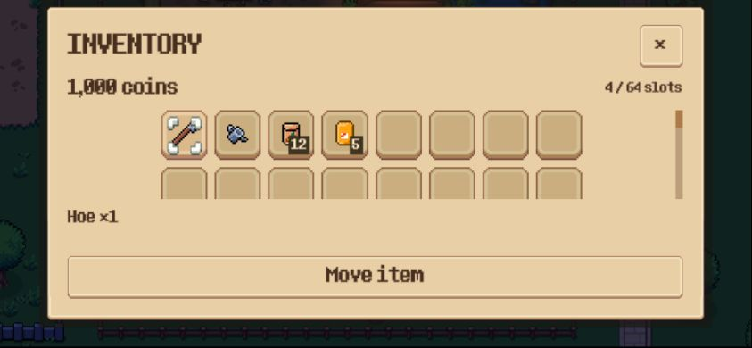
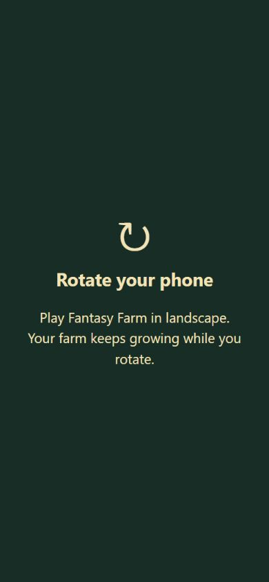

# M1 — Giao diện điện thoại

Ngày kiểm tra: 23/10/2026. Đã triển khai và kiểm tra bằng test tự động, native preview và bản Web release trên trình duyệt desktop. Chưa nghiệm thu trên Android/iPhone thật. Điều khiển gameplay M2 đã được bổ sung sau M1; xem [báo cáo M2](mobile_controls.md).

## Thay đổi

- Web dùng toàn bộ màn hình ngang, có vùng đệm safe area và tự cập nhật khi resize/xoay. Màn hình dọc hiện hướng dẫn xoay máy bằng EN/VI; mô phỏng nông trại vẫn tiếp tục.
- `MobileLayout` quy đổi kích thước UI sang CSS/device points, tránh nút bị nhỏ trên màn hình DPI cao. Nút thao tác chính có vùng chạm tối thiểu 48×48 points.
- Hotbar gọn, bỏ nhãn phím trên touch và chừa hai góc dưới cho điều khiển M2.
- Túi đồ cuộn được toàn bộ 64 ô. Chạm ô để xem chi tiết; chọn **Move item / Di chuyển vật phẩm**, rồi chạm ô đích. Đóng túi hủy thao tác đang chọn. Không cần hover hoặc kéo thả.
- Shop/bán nông sản có nút +/− điều chỉnh số lượng, giới hạn theo tồn kho/xu và không mở bàn phím ảo. Danh sách/chi tiết cuộn riêng; phần xác nhận giữ trong panel.
- Bảng mở đất và thông tin vật nuôi thích ứng với màn hình ngang thấp, có kiểm tra cả EN/VI. Badge tương tác tính đúng tọa độ sau khi thêm safe area; ẩn phím E trên touch.
- Chuột/phím vẫn dùng luồng desktop. Không thay thuật toán giao dịch hay schema save.

## Chơi thử và QA

Build/serve theo `web_build.md`. Mở `http://127.0.0.1:8060/index.html?layout=touch` để xem giao diện touch trên máy tính. `?layout=touch&safe=44,0,44,21` mô phỏng vùng đệm trái/trên/phải/dưới theo CSS points; chỉ áp dụng override này khi ép touch. Thiết bị thật dùng CSS `env(safe-area-inset-*)` và phát hiện cảm ứng tự động.

Server chỉ bind loopback; điện thoại khác không truy cập được URL này. Các kết quả/ảnh bên dưới là bằng chứng M1; bản Web hiện tại đã có điều khiển M2.

## Kết quả

- **35/35 test đạt, 3.387 assertions**: mobile layout, small-window UI, localization, inventory, produce sales và land expansion.
- Ma trận layout tự động: 844×390, 667×375, 740×360; point scale 1 và 3; EN/VI và safe area giả lập. Kiểm tra nút/ô đồ, modal, chuyển stack, mua/bán đúng số lượng và thông tin thú không đè hotbar.
- Lint: 0 lỗi, 0 cảnh báo. Các script mới/chính được engine kiểm tra không có diagnostics.
- Web release export thành công. Browser 844×390 dùng canvas khoảng 843×389; UI nằm trong vùng an toàn. Đã chuyển stack 12 hạt bằng nút Move, lưu và reload, giữ đúng số lượng/vị trí và ví 1.000 xu. Console thu thập không có warning/error.
- Xoay viewport sang 390×844 hiển thị hướng dẫn xoay, trở lại ngang khôi phục UI. Native preview đã kiểm tra shop và bán nông sản bằng EN/VI.

Bằng chứng nằm trong `mobile_m1_2026-10-23/`: log test, build report, console log và ảnh thật. Kết quả này không thay thế kiểm thử đa chạm, safe area, GPU, bàn phím và lifecycle trên thiết bị thật. Các lỗi fixture/wiring cũ đã ghi ở audit và tài liệu M0 vẫn ngoài phạm vi bộ test trên.

## Phần tiếp theo

M2 đã triển khai joystick, nút dùng đồ/tương tác, phân quyền touch ID, pinch zoom, ngăn click xuyên UI và nhả input khi mất focus/xoay máy. Xem `mobile_controls.md` cho kết quả mới và các phần còn cần nghiệm thu thiết bị thật.
