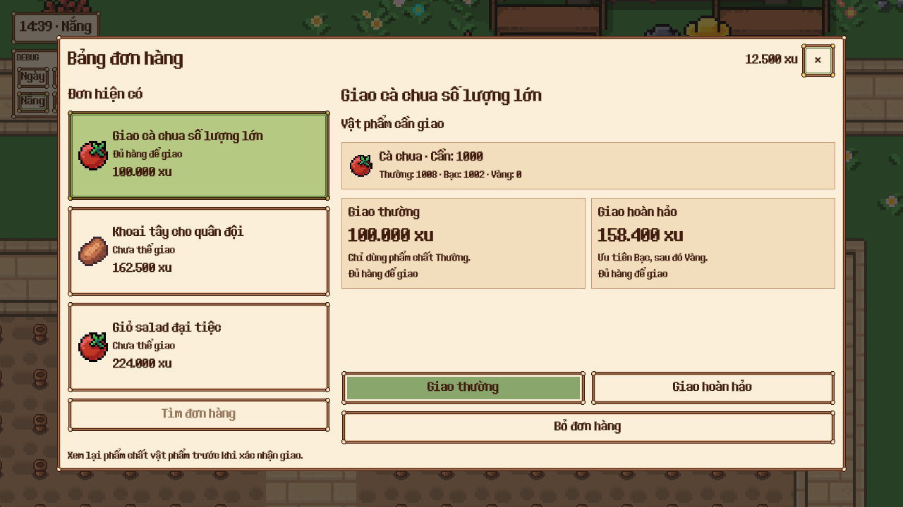
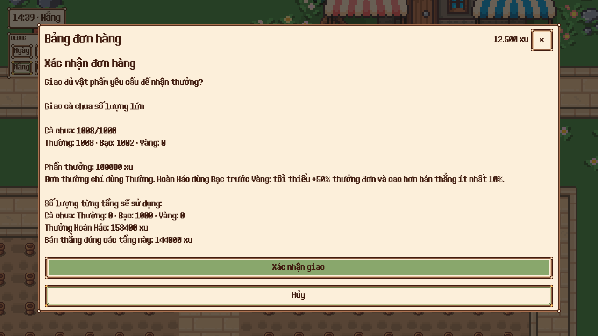
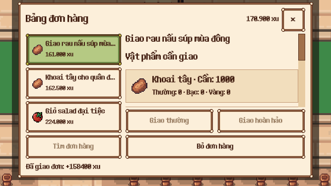
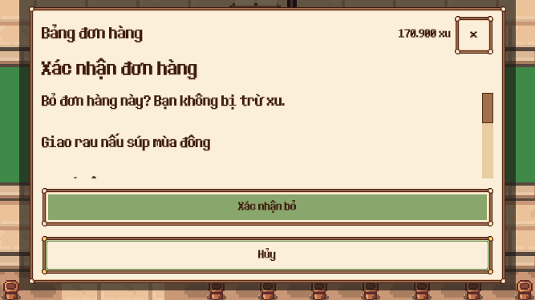

# Bảng đơn hàng — UI đã triển khai

Concept được duyệt và cho triển khai ngày 2026-10-27. Scene mới `scenes/ui/orders.tscn` nối vào OrderBoard; giữ OrderService và schema lưu hiện có.

## Nội dung

- Ba thẻ đơn có icon vật phẩm, tên, trạng thái và phần thưởng cơ bản. Tên dài có tooltip, thẻ chọn tô xanh.
- Chi tiết yêu cầu từng vật phẩm, số đang có ở cả ba phẩm chất; không gộp chúng thành số đủ giao thường.
- Hai ô thưởng và hai nút giao thường/giao hoàn hảo. Giao thường chỉ dùng Thường. Giao hoàn hảo ưu tiên Bạc rồi Vàng và giữ bảo đảm giá bán của service.
- Mức hoàn hảo hiển thị quote thực khi có đủ vật phẩm. Khi chưa có quote hợp lệ, chỉ hiển thị cận dưới ≥ 150% thưởng cơ bản cùng lý do chưa giao được; không coi đó là giá cuối cùng.
- Bỏ đơn tách riêng; tìm đơn chỉ bật khi có ô trống.
- Xác nhận thay nội dung màn chính, giữ nút xác nhận/hủy và đóng trong vùng an toàn. Xem trước chính xác các phẩm chất sẽ bị trừ; thay đổi plan làm xác nhận bị vô hiệu. Cancel không thay inventory/wallet; xác nhận lặp không trả thưởng lần hai.
- EN/VI, desktop, mobile và safe insets. Nội dung dài cuộn, nút hành động luôn nằm ngoài vùng cuộn.
- Khi đổi đơn hoặc restore thay template cùng serial, danh sách yêu cầu được dựng lại đúng template.

## Kiểm tra

- 10/10 test trong test_orders, 286 assertions (7 test sẵn có và 3 test mới).
- Test tương thích perfect preview trong test_planting_s5: 1/1, 5 assertions.
- 74/74 kiểm tra runtime với chuột/cảm ứng: chọn thẻ, normal confirmation/cancel, perfect confirm, reward theo quote, chống nhận hai lần, bỏ đơn không trừ xu, đóng modal và bounds/touch targets.
- Bốn báo cáo layout: màn chính/xác nhận ở desktop 1280×720 và compact 667×375, không có finding. Native còn kiểm tra safe insets ở 844×390 và 667×375.
- Lint toàn components: 0 lỗi/cảnh báo; scenes/ui: 0 lỗi/cảnh báo. Validate scenes/ui: 0 lỗi, 28 cảnh báo dependency có sẵn, không có diagnostic thuộc màn đơn hàng mới/sửa.
- QA dùng farm con và dữ liệu riêng, không gắn adapter save cá nhân.

Chi tiết: `verification.json`, `runtime-report.json`, `scene-tree.json` và các báo cáo layout. Concept tham chiếu: `concept.png`; prompt: `prompt.md`.
