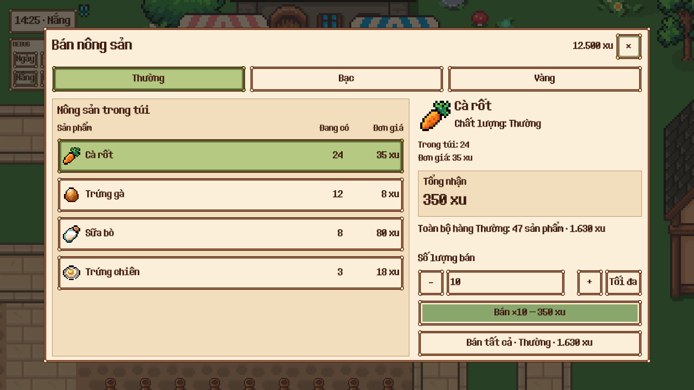
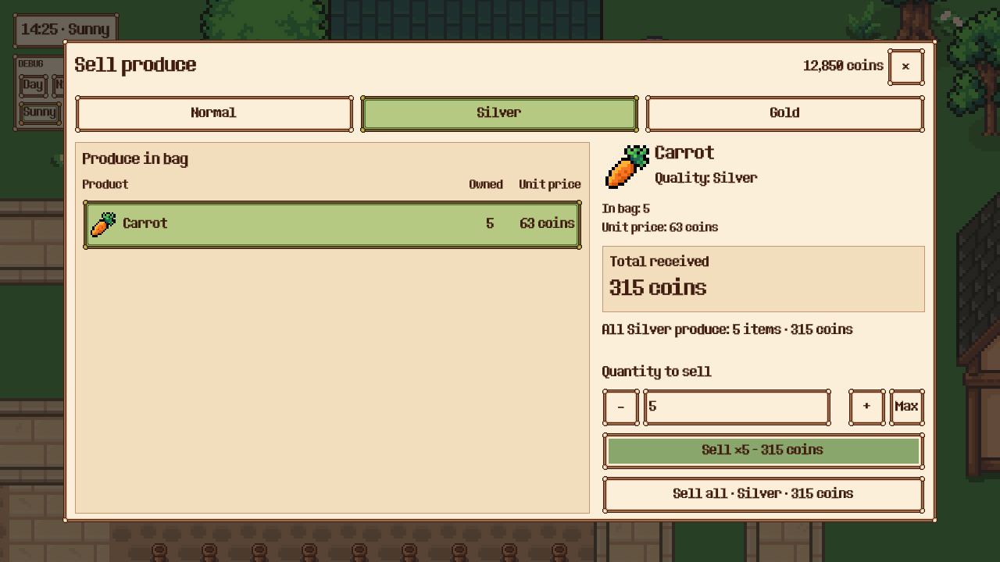
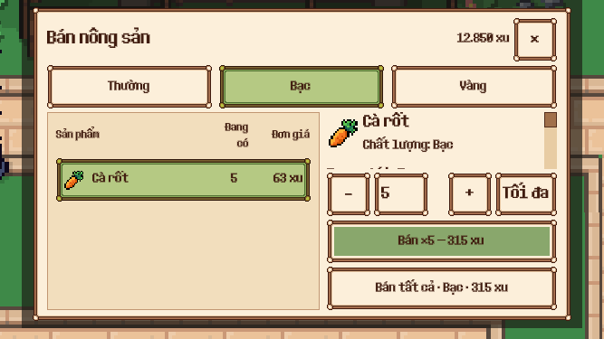

# Bán nông sản — UI đã triển khai

Concept được người dùng cho triển khai ngày 2026-10-27. Màn mới nối trực tiếp vào ProduceBuyer hiện có; dùng nguyên ProduceSaleService và bảng giá hiện tại.

## Giao diện

- Ba tab phẩm chất Thường/Bạc/Vàng áp dụng cho toàn màn.
- Danh sách hàng có trong túi, icon thật, số lượng và đơn giá đúng phẩm chất; hàng chọn tô xanh.
- Thông tin mặt hàng, số lượng bán, nút +/- và Tối đa, tổng nhận, ví hiện tại.
- Tối đa tính theo số hàng đang có và phần ví còn nhận được. Nhập quá số hàng hoặc bán vượt giới hạn ví vẫn được service từ chối, không bán một phần ngoài ý muốn.
- Bán tất cả ghi rõ phẩm chất và tổng tiền; chỉ bán hàng được thu mua thuộc phẩm chất đó, giữ nguyên hàng phẩm chất khác và vật phẩm không thu mua.
- Cảnh báo vật phẩm dành cho đơn hàng được giữ ở panel riêng, không thay thế phản hồi giao dịch. Cảnh báo không tự ngăn bán hay tự giao đơn hàng.
- Màn nhỏ giữ ô số lượng và hai nút bán luôn hiện; phần chi tiết cuộn. Cảnh báo chuyển vào vùng cuộn khi màn nhỏ để không đẩy nút ra ngoài safe area.
- EN/VI, chuột/cảm ứng, shared modal lifecycle và UIScale. Mở/chuyển chất lượng đặt lại vị trí cuộn phù hợp.

Scene: `scenes/ui/produce_sales.tscn`. Hàng mặt hàng tái sử dụng: `scenes/ui/produce_sale_row.tscn`. Controller: `components/produce_sales_ui.gd`.

## Kiểm tra

- 16/16 test trong test_produce_sales + test_produce_sale_service, 288 assertions.
- Test cảnh báo đơn hàng: 1/1, 5 assertions. Test checkout trong safe area mobile: 1/1, 9 assertions.
- 30/30 kiểm tra runtime: bán bằng chuột/cảm ứng, đổi ba phẩm chất, Tối đa, giữ hàng phẩm chất khác, bán tất cả đúng quote, trạng thái rỗng và đóng modal.
- Desktop 1280×720, mobile 844×390 và 667×375 (có safe insets). Hai bộ báo cáo layout không có finding trên fixture. Header, ô số lượng và hai nút bán đều kiểm tra mọi loại finding.
- Lint components và scenes/ui: 0 lỗi, 0 cảnh báo. Validate scenes/ui: 0 lỗi, 28 cảnh báo dependency có sẵn; không có diagnostic thuộc màn bán mới/sửa.
- Scene được inspect lại sau khi viết, không có kết nối NodePath hỏng. QA dùng dữ liệu riêng và farm con, không dùng save cá nhân.
- Cập nhật test cũ cho row Button và tab phẩm chất, ví fixture xác định và giá đọc từ catalog hiện hành. Không thay đổi giá hoặc dịch vụ bán để làm test đạt.

Chi tiết: `verification.json`, `runtime-report.json`, `scene-tree.json` và các báo cáo layout. Concept tham chiếu: `concept.png`; prompt: `prompt.md`.
