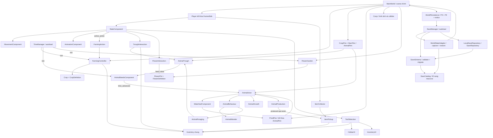
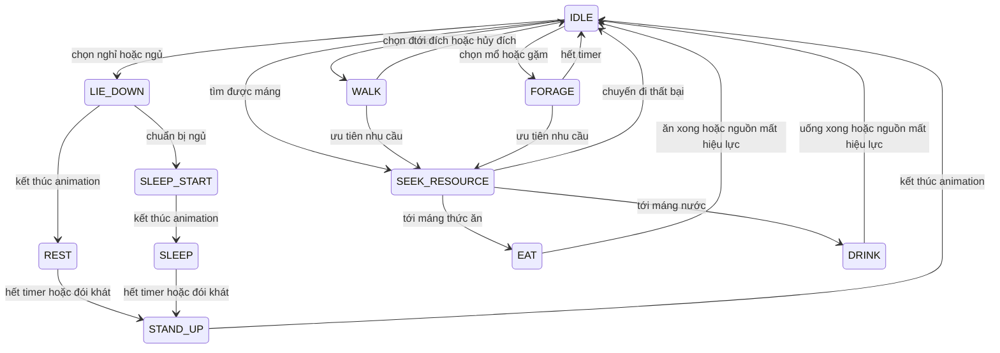

# Fantasy Farm — Phân tích hệ thống và tra cứu script runtime

Cập nhật ngày **20/10/2026**, đối chiếu commit **`de8eaa0` — `add duck cow`** và refactor `class_name`/typed wiring trong workspace trên nhánh `rewrite-by-ai`. Tài liệu mô tả code hiện có, không phải bản thiết kế cho các tính năng tương lai.

## 1. Phạm vi và cách đọc

Phạm vi là **48 script do project sở hữu**, đi tới được từ `project.godot`: scene chính `world/main_world.tscn`, autoload TimeManager/SaveManager, scene kế thừa/instance, resource, scene preload và các kiểu `class_name` mà chúng sử dụng. Script đang được gắn nhưng node bị ẩn vẫn thuộc phạm vi vì `_ready`, signal và logic của nó vẫn được nạp. So với bản reference đầu tiên, bổ sung 2 script ao/vịt-ngỗng, 4 script định nghĩa/vườn/chậu/tương tác hoa và 7 script lưu trữ. Refactor hiện tại thêm FarmPlayer/FarmWorld làm composition root với tham chiếu typed được gán trong scene, cùng CameraZoomComponent xử lý zoom bằng con lăn và PlayerNavigationComponent tìm đường tới điểm focus.

Tra cứu nhanh: [khu bò/cừu](barn_animals.md), [vịt/ngỗng và ao](waterfowl.md), [vườn hoa](flowers.md), [lưu/tải và phục hồi](saving.md), [hiển thị chữ](ui_text.md). [system_design.md](system_design.md) là ảnh chụp kiến trúc cũ tại `83ee633`; dùng reference này cho runtime hiện tại.

Không trình bày addon, plugin/skill, test, script sinh asset/chạy thiết lập hoặc file không nằm trong chuỗi runtime trên. Việc một scene khác chưa có trong farm hiện tại không tự động chứng minh nó là “dead” trên toàn repository; tài liệu này chỉ phân tích cấu hình game chính hiện tại. Không có danh mục API của các file bị loại.

Quy ước:

| Ký hiệu/khái niệm | Ý nghĩa trong tài liệu |
|---|---|
| `class_name` | Tên kiểu đăng ký toàn cục của Godot; dùng trực tiếp cho annotation, cast, enum/static method hoặc `.new()`. `TimeManager`/`SaveManager` là tên instance autoload, lớp tương ứng là FarmClock/GameSaveManager để tránh trùng tên. |
| `extends` | Kiểu Node/Resource của Godot mà script kế thừa. Không liệt kê lại toàn bộ API có sẵn của engine. |
| `@export` | Cấu hình được sửa qua Inspector hoặc ghi đè trong `.tscn`/`.tres`. Mặc định trong script không luôn là giá trị trên scene. |
| Tham chiếu node typed | `@export var component: ComponentType` được gán trong Inspector và lưu trong scene; có thể dùng trước `_ready`. Đối tượng tạo lúc chạy nhận tham chiếu trực tiếp qua configure/constructor. |
| Property bắt đầu `_` | Trạng thái nội bộ, nên thay qua method thay vì sửa trực tiếp. Dấu `_` không tự tạo private access trong GDScript. |
| `const X = preload(...)` | PackedScene/texture/resource asset cố định được nạp sẵn; scene chỉ tạo node khi gọi instantiate(). Các kiểu GDScript dùng class_name trực tiếp. |
| `signal` | Thông báo cho nơi khác nghe; callback có thể không xuất hiện như một lời gọi trực tiếp trong call graph. |
| `_ready`, `_process`, `_physics_process`, input/drag callbacks | Entry point do engine gọi. Không có caller trực tiếp không đồng nghĩa method chết. |
| `timestamp`, `elapsed`, `delta` | Timestamp là mốc Unix; elapsed là hiệu hai mốc; delta là thời gian một frame. Tuổi/cây/sản xuất dùng elapsed từ clock; vận động và timer hành vi dùng delta. |
| Đơn vị stock / gói thức ăn / điểm nhu cầu | Ba đại lượng khác nhau: một gói mặc định nạp 300 stock; một bữa thường tốn 1 stock; 1 stock hồi 40 điểm nhu cầu theo cấu hình máng. |

Mỗi phần class có vai trò, cấu hình/trạng thái, signal/enum/constant và tất cả method được script đó tự khai báo. Các kiểu runtime dùng `class_name`; chỉ giữ preload cho PackedScene/asset. Tham chiếu node cố định dùng `@export` và được gán trong scene bằng editor, không tìm bằng `$Path` hoặc chuỗi `get_node()`. `NodePath` do Godot serialize trong `.tscn` là wiring của engine, không phải đường dẫn viết tay trong gameplay. Khai báo có chữ `gán khi chạy` nghĩa là source không đặt giá trị ban đầu tường minh; không phải mọi node reference đều dùng được trước `_ready()`.

## 2. Bản đồ hệ thống



### Cấu trúc node quan trọng

```text
/root
├── TimeManager
├── SaveManager
└── MainWorld
    ├── WorldPersistence
    ├── Player (CharacterBody2D, scenes/characters/player.tscn)
    │   ├── AnimatedSprite2D + CollisionShape2D
    │   ├── MovementComponent + AnimationComponent + StateComponent + PlayerNavigation
    │   ├── Camera2D + CameraZoom + DustParticles
    │   ├── FarmingActionComponent + SoilFocus
    │   ├── ToolSelection
    │   │   └── Inventory (được tạo nếu không inject kho sẵn)
    │   ├── Hotbar + InventoryUI
    │   ├── ItemCollector
    │   ├── TroughInteraction / PromptLayer / Prompt (reparent khi chạy)
    │   └── FlowerInteraction / Prompt
    ├── FarmingController (script quản lý các TileMapLayer đất)
    ├── Coop (StaticBody2D, script đổi ngoại hình)
    ├── CoopPen (AnimalPen)
        ├── Chicken / Rooster (cùng kế thừa animal.tscn)
        │   ├── MovementComponent + AnimationComponent
        │   ├── NeedsComponent + GrowthComponent + ProductionComponent
        │   ├── WanderComponent + BehaviourComponent + ForagingComponent
        │   └── NeedsDisplay
        ├── FeedTrough ×2
        ├── WaterTrough ×2
        └── ItemPickup (được tạo lúc animal có đầu ra)
    ├── BarnPen (AnimalPen)
    │   ├── Cow ×9 + Sheep ×9 (cùng các component AnimalActor)
    │   ├── FeedTrough + WaterTrough
    │   └── LivestockFeed (pickup ×5 gói)
    ├── PondPen (kế thừa AnimalPen)
    │   ├── Duck ×5 + Goose ×6 (thêm WaterfowlComponent khi chạy)
    │   ├── FeedTrough + WaterTrough
    │   └── PoultryFeed (pickup ×5 gói)
    └── FlowerGarden
        ├── Pots / FlowerPot ×60 (tạo trong _ready)
        └── Các pickup hạt hoa (10 mẫu ×6 hạt)
```

Đây là sơ đồ các nhánh logic; các layer nền, hàng rào và node trang trí được lược bớt. Camera2D và các thanh NeedsDisplay là node engine, không có class script riêng cần tra cứu.

### Quyền sở hữu dữ liệu

| Dữ liệu | Nơi sở hữu | Nơi chỉ đọc/điều phối |
|---|---|---|
| Định nghĩa loài/cây/item/chu kỳ | Resource `.tres` qua các class Definition | Actor, controller và UI đọc cấu hình |
| Stack, slot và số lượng trong kho | Inventory | Hotbar, túi, pickup, nạp máng, farming cùng dùng một kho |
| Lựa chọn 6 ô và cờ mở túi | ToolSelection | StateComponent cùng hai UI |
| Vận tốc và đích di chuyển | MovementComponent / CharacterBody2D | FSM player, Wander và Foraging đưa lệnh |
| Điểm focus và đường đi của player | PlayerNavigationComponent | StateComponent nhận click, hủy khi dùng phím/công cụ/túi hoặc tải save |
| Tuổi, nhu cầu, tiến độ phụ phẩm | Các component riêng của từng animal | AnimalActor nối signal và điều phối |
| Stock và điểm đứng trên máng | AnimalTrough | Foraging giữ/release chỗ; người chơi nạp |
| Cây theo ô và quyền trồng trọt | FarmingController + TileMapLayer | FarmingAction thực thi theo frame, SoilFocus hiển thị |
| Item đang nằm ngoài đất | ItemPickup | ItemCollector đề nghị chuyển vào Inventory |
| Hoa trong từng chậu | FlowerPot | FlowerGarden đồng bộ clock/capture; FlowerInteraction chốt thao tác |
| Đường đi và phân biệt bờ/nước | PondPen giữ hai AStarGrid2D; Waterfowl giữ waypoint | Wander/Foraging dùng API destination chung |
| Snapshot và revision hồ sơ | SaveManager điều phối; SaveRepository sở hữu IO | WorldStateAdapter chuyển scene ↔ DTO, SaveSchema kiểm tra, SaveCatalog resolve ID |

Không ghi tuổi/nhu cầu của cá thể lên Resource dùng chung: nếu làm vậy nhiều animal cùng definition sẽ vô tình dùng chung trạng thái.

## 3. Các luồng hoạt động

### 3.1. Di chuyển, chọn vật phẩm và ưu tiên tương tác

1. HotbarUI đổi `ToolSelection.selected_index` từ click hoặc phím 1–6; việc chọn không tự dùng công cụ. Con lăn thuộc CameraZoomComponent: lên phóng to, xuống thu nhỏ, không đổi hotbar. Zoom mượt từ 1× đến 3× ở viewport 1920×1080, mỗi nấc nhân/chia 1.15; giới hạn tối thiểu tăng theo viewport nếu cần để không lộ ngoài bản đồ. Túi đồ đang mở hoặc UI đã xử lý input sẽ chặn zoom.
2. StateComponent nhận hướng di chuyển. Chuột trái chọn điểm focus; PlayerNavigationComponent tìm đường tránh collision tới chỗ đứng trong tầm 20 px, dừng và quay mặt về đó. Khi có FarmingController, điểm đứng còn phải ở ô kề và hướng nhìn đúng ô đã click. Không tự dùng công cụ. Phím hướng, mở túi, dùng công cụ hoặc tải save hủy focus/đường đi. WALK và bụi dựa trên dịch chuyển thực, không chỉ hướng input.
3. E/Space/chuột phải được gom thành yêu cầu xử lý ở physics tick. Mở túi hoặc đang TOOL/WATER thì không bắt đầu thao tác mới.
4. `use_selected_tool()` gọi `TroughInteraction.prepare_action()` trước, rồi `FlowerInteraction.prepare_action()`, cuối cùng mới xử lý đất. Adapter trả rỗng để nhường bước sau, `blocked` để tiêu thụ input hoặc action cụ thể để vào TOOL/WATER. Khi focus chậu, E thu hoa; hạt hoa/bình tưới dùng thao tác gieo/tưới riêng. SoilFocus ẩn khi đang focus máng hoặc chậu.
5. State TOOL/WATER phát animation; adapter chờ frame 3 để sửa dữ liệu. Kết thúc animation mới quay về IDLE/WALK.

`active_action` diễn tả **việc làm**, còn state TOOL/WATER diễn tả **nhóm hoạt ảnh/khóa vận động**. Vì thế hành động nạp nước dùng state WATER nhưng không gọi tưới đất.

### 3.2. Cuốc → tưới/gieo → lớn → thu hoạch

`FarmingAction` chốt ô theo vị trí/hướng người chơi và chốt seed/slot nếu gieo. Tới frame chạm, `FarmingController` kiểm tra quyền custom data của tile, đối tượng chiếm ô, các layer có `blocks_farming` và collider trước khi sửa terrain hoặc tạo cây.

`Crop.configure()` ghi thời điểm gieo và hạn trưởng thành. Clock phát tick, controller gọi `Crop.refresh(timestamp)`, cây chọn một trong 4 texture theo tiến độ. Thu hoạch yêu cầu cây chín, sản phẩm hợp lệ và kho đủ chứa **cả lô**, rồi mới thêm đồ và xóa cây.

Trạng thái WET hiện là thông tin đất hiển thị/kiểm tra hành động. Chưa có cơ chế bắt buộc đủ nước để cây tăng trưởng, tự khô, theo mùa hoặc héo trong các script này.

### 3.3. Animal tìm máng và ăn/uống



Nếu không có `sleep_start` one-shot nhưng có sleep, chuỗi đi thẳng từ LIE_DOWN sang SLEEP. Những animation nằm/đứng không có đủ điều kiện thì hành vi nghỉ/ngủ không được chọn.

Foraging chỉ xét máng **cùng pen**, đúng loài, đủ khẩu phần, có slot đứng trống trong biên và có đường tới. CoopPen/BarnPen kiểm tra đường thẳng bằng shape; PondPen ủy quyền cho Waterfowl/PondPen tìm đường AStar. Nhu cầu thấp hơn được ưu tiên; bằng nhau thì nước trước. Khi không có nguồn cho nhu cầu đầu, vẫn thử nhu cầu còn lại. Reservation được release khi hủy/rời tree; chưa trừ stock ở bước giữ chỗ hay di chuyển.

Đến serving point, Behaviour đợi `serving_seconds` rồi gọi `serve()`. Máng kiểm tra lại stock/reservation/khoảng cách trước khi hồi nhu cầu và trừ khẩu phần. FORAGE thông thường chỉ là animation, không phải một nguồn thức ăn vô hạn.

### 3.4. Tuổi và phụ phẩm theo thời gian

Với một khoảng elapsed, Needs tính phần thời gian cả no và nước còn dương **trước khi** trừ nhu cầu. Actor lấy `juvenile_seconds` ở đầu khoảng và thực hiện:

```text
age += elapsed
eligible_seconds = max(0, supplied_seconds - juvenile_seconds)
production.advance(eligible_seconds)
```

Ví dụ còn 5 giây mới trưởng thành, elapsed=20 và cả hai nhu cầu chỉ đủ cho 12 giây đầu: tuổi tăng 20, production chỉ nhận `12 - 5 = 7` giây. Tick dài không sinh phụ phẩm trong đoạn trước trưởng thành hay sau khi đã hết một nhu cầu.

Production giữ phần tiến độ dư khi tạm ngừng. WORLD_DROP chuyển đầu ra sang một đống pickup đang tồn tại của cá thể; các chu kỳ sau cộng vào đống đó tại vị trí thả ban đầu. DIRECT_COLLECTION giữ trong component và được thu bằng `AnimalActor.collect_produce(inventory)`; chưa có input tương tác riêng cho mode này.

Riêng `eggs_on_land` trong PondPen: khi chim ở nước, `_on_produced()` giữ trứng trong `stored_amount`, chưa tạo/cộng pickup. Waterfowl ưu tiên đưa chim tới bờ đi tới được; lên đất mới giao stock sang đống trứng. Đích thả được đưa về đất để trứng không rơi xuống ao.

Không có juvenile art hợp lệ thì dùng adult art, tiếp tục giữ skin cá thể nếu có. Trưởng thành thật về dữ liệu không phụ thuộc việc sprite có đổi hình hay không; nếu có art để đổi thì actor đợi IDLE trước khi thay.

### 3.5. Người chơi nạp máng và nhặt phụ phẩm

Nạp máng chốt target khi bắt đầu; tới frame chạm kiểm tra lại reach, vật cản, inventory và action. FOOD lấy gói nguyên theo `feed_item`; WATER cần bình tưới ở slot đã chốt và thêm tối đa `water_per_use`. Đổi hotbar không chuyển lần nạp sang công cụ khác; mở túi hủy lần nạp đang chờ.

ItemCollector dùng Area2D để phát hiện ItemPickup. Pickup gọi `Inventory.add()` và chỉ giảm `amount` theo lượng thực nhận; phần dư vẫn nằm trên đất. Khi inventory đổi, collector thử lại các đống còn trong vùng. Các khóa `_collecting`/`_refilling` ngăn signal đồng bộ gọi lồng nhau và giao đồ hai lần.

### 3.6. Vườn hoa: gieo → tưới một lần → thu

FlowerGarden tạo 180 chậu ở lưới logic 18×10, chia 4 cụm bằng lối đi chữ thập, khoảng cách chậu 16 px. `focused_pot()` chọn chậu cách người chơi tối đa 28 px và ở phía trước. FlowerInteraction khóa chậu/hạt/slot cho tới impact frame 3; mở túi, ra xa hoặc đổi stack hạt trước impact sẽ hủy gieo. Tưới được kiểm tra lại công cụ đang chọn tại impact.

Hoa mới gieo có `growth_started_at = -1`, chưa lớn cho tới lần tưới đầu. Sau đó dùng timestamp để lớn trong 120 giây theo resource, qua 5 stage có animation riêng; tưới lặp không reset đồng hồ. E thu khi nở, kho phải chứa đủ cả lô; thu xong giữ lại chậu trống. Garden có 8 chậu trồng sẵn (2 chưa tưới, 2 đã chín); cờ `starter_flowers_added` ngăn hồi sinh hoa đã thu sau lưu/tải.

### 3.7. Di chuyển trong khu ao

PondPen đọc tile nước từ FarmLand (source 1, terrain 1), tạo hai AStarGrid2D ô 16 px, chỉ đi 4 hướng. Graph đất chặn nước; graph lưỡng cư cho vịt đi cả bờ/nước. Cả hai loại trừ vật cản World bằng shape 10×6. `can_swim` chọn graph; `eggs_on_land` trong PondPen quyết định gắn WaterfowlComponent. Ngỗng không bơi; vịt map walk/idle/sleep thành swim/swim_idle/swim_sleep và bỏ chuỗi nằm/đứng trên cạn khi ở nước.

Khởi tạo/tải chờ 2 physics tick để collider ổn định. Khi đổi terrain hoặc vật cản lúc chạy, gọi `rebuild_after_load()` hoặc dựng lại navigation sau khi physics cập nhật. Waypoint và reservation chỉ sống trong phiên; không ghi chúng vào file lưu.

### 3.8. Lưu, tải và tiến trình offline

WorldPersistence chỉ bind khi MainWorld là `current_scene`, nên instance GUT/preview không tự mở hồ sơ thật. SaveManager tải hồ sơ `local` khi bind; tự lưu mỗi 30 giây, khi mất focus và khi đóng cửa sổ. F5 lưu, F9 tải; tải bỏ thay đổi chưa lưu và reset thao tác/đích di chuyển/túi/camera smoothing.

Capture đồng bộ nhu cầu trước để tính đủ phụ phẩm, rồi ghi player, inventory, soil/crops, animals, troughs, pickups, flower_gardens và animal_pens. SaveSchema version 3 migrate version 1 và 2 trong bộ nhớ, giữ vị trí vật lý và tiến độ hoa khi mở rộng vườn từ 60 lên 180 chậu; SaveCatalog ánh xạ ID sang resource đóng gói. Adapter preflight cấu trúc world trước khi thay entity; chuồng/vườn mới nhận nội dung khởi tạo một lần, nội dung đã được lưu không tự hồi sinh.

LocalSaveRepository ghi `user://saves/profile_local.json`: payload JSON + SHA-256, kiểm tra `.tmp` sau flush rồi xoay `.bak` hợp lệ và rename. Primary hỏng thử backup; bản tương lai bị từ chối. Khi không tải/phục hồi được, giữ file và tắt tự lưu. Lỗi ghi thông thường cho phép thử lại; nếu lưu khi thoát lỗi, game giữ cửa sổ, đóng lần nữa để thoát không lưu.

Tải đồng bộ clock tối thiểu tới `saved_at`. Cây/hoa đã tưới lớn theo timestamp; vật nuôi tăng tuổi, giảm nhu cầu và chỉ sản xuất trong phần thời gian còn đủ no/nước. Không mô phỏng di chuyển, ăn/uống hay tiêu thụ máng lúc offline; trứng dưới nước giữ trong stock tới khi lên bờ. Repository có thể thay bằng backend bất đồng bộ; hiện chưa có cloud, đăng nhập hoặc multiplayer. Xem [saving.md](saving.md) cho hợp đồng backend và giới hạn revision local.

## 4. Tra cứu class, property và method

Các giá trị dưới đây được trích từ khai báo source; phần diễn giải giải thích cách sử dụng. `Default trong script` và giá trị scene hiện tại được phân biệt trong mô tả.

### Chỉ mục script

| Nhóm | Class/vai trò |
|---|---|
| Dữ liệu cấu hình | [ItemDefinition](#item-definition), [CropDefinition](#crop-definition), [AnimalTypes](#animal-types), [AnimalDefinition](#animal-definition), [AnimalProductionDefination](#animal-production-definition) |
| Composition root | [FarmWorld](#farm-world), [FarmPlayer](#farm-player) |
| Thời gian, vận động và người chơi | [TimeManager](#time-manager), [MovementComponent](#movement-component), [AnimationComponent](#animation-component), [StateComponent](#state-component), [CameraZoomComponent](#camera-zoom-component), [PlayerNavigationComponent](#player-navigation-component) |
| Kho đồ và giao diện | [Inventory](#inventory-component), [ToolSelection](#tool-selection-component), [InventorySlot](#inventory-slot), [HotbarUI](#hotbar-ui), [InventoryUI](#inventory-ui) |
| Trồng trọt | [FarmingController](#farming-controller), [FarmingAction](#farming-action-component), [SoilFocus](#soil-focus-component), [Crop](#crop) |
| Chăn nuôi | [AnimalPen](#animal-pen), [AnimalActor](#animal-actor), [AnimalNeedsComponent](#animal-needs-component), [AnimalGrowthComponent](#animal-growth-component), [AnimalProductionComponent](#animal-production-component), [AnimalBehaviourComponent](#animal-behaviour-component), [AnimalWanderComponent](#animal-wander-component), [AnimalForagingComponent](#animal-foraging-component), [AnimalTrough](#animal-trough), [TroughInteraction](#trough-interaction-component) |
| Vật phẩm ngoài thế giới và chuồng | [ItemPickup](#item-pickup), [ItemCollector](#item-collector), [CoopAppearance](#coop) |
| Ao và di chuyển gia cầm | [PondPen](#pond-pen), [WaterfowlComponent](#waterfowl-component) |
| Vườn hoa | [FlowerDefinition](#flower-definition), [FlowerPot](#flower-pot), [FlowerGarden](#flower-garden), [FlowerInteraction](#flower-interaction) |
| Lưu trữ | [SaveRepository](#save-repository), [LocalSaveRepository](#local-save-repository), [SaveCatalog](#save-catalog), [SaveSchema](#save-schema), [WorldStateAdapter](#world-state-adapter), [SaveManager](#save-manager), [WorldPersistence](#world-persistence) |

### 4.1. Dữ liệu cấu hình

<a id="item-definition"></a>

#### ItemDefinition

**Source:** [scripts/item_definition.gd](/home/dungnguyen/Projects/test-js/scripts/item_definition.gd). **Kế thừa:** `Resource`. **class_name:** `ItemDefinition`.

Resource mô tả một loại vật phẩm. Các stack giữ tham chiếu tới Resource này; số lượng thuộc Inventory, không nằm trên định nghĩa.

**Property và trạng thái**

| Property | Kiểu / mặc định trong script | Ý nghĩa |
|---|---|---|
| `show_world_quantity` | `bool = true` | Cho phép hiện nhãn số lượng pickup ngoài đất; không thay số lượng thật hoặc count trong túi/hotbar. |
| `item_id` | `StringName` | Khóa nhận diện vật phẩm; dùng để so khớp, đếm và trừ xuyên nhiều stack. Không được rỗng khi thêm vào kho. |
| `display_name` | `String` | Tên hiển thị trong hotbar, tooltip, túi đồ và thông báo thiếu thức ăn. |
| `icon` | `Texture2D` | Texture hiển thị ở ô đồ và pickup ngoài thế giới. |
| `item_type` | `ItemType = ItemType.TOOL` | Nhóm công cụ, hạt giống, sản phẩm hoặc thức ăn; quyết định hành động và giới hạn stack. |
| `tool_type` | `ToolType = ToolType.HOE` | Phân biệt cuốc với bình tưới khi item là công cụ. |
| `crop` | `Resource` | Resource CropDefinition hoặc FlowerDefinition cho hạt giống; controller/chậu kiểm tra đúng kiểu trước khi gieo. |
| `max_stack` | `int = 99` | Giới hạn gộp stack cho vật phẩm thường. Công cụ vẫn bị giới hạn 1. |
| `food_units_per_item` | `int = 300` | Số đơn vị thức ăn của một gói; mặc định 300, dùng khi nạp máng. |

**Enum**

| Enum | Ý nghĩa |
|---|---|
| `ItemType` | TOOL=0, SEED=1, PRODUCE=2, FEED=3, HOE=4. HOE là giá trị tương thích cũ vẫn được các nhánh xử lý công cụ chấp nhận. |
| `ToolType` | HOE=0, WATERING_CAN=1; chỉ có ý nghĩa trong ngữ cảnh công cụ. |

**Method**

| Chữ ký trong source | Ý nghĩa, điều kiện và kết quả |
|---|---|
| `get_stack_limit() -> int` | Trả 1 với TOOL/HOE; các loại khác trả max(1, max_stack). |
| `matches(other: Resource) -> bool` | Trả true khi đối tượng kia là ItemDefinition và có cùng item_id không rỗng. Không so bằng tên hiển thị hoặc icon. |

<a id="crop-definition"></a>

#### CropDefinition

**Source:** [scripts/crop_definition.gd](/home/dungnguyen/Projects/test-js/scripts/crop_definition.gd). **Kế thừa:** `Resource`. **class_name:** `CropDefinition`.

Resource chứa quy tắc chung của một giống cây, tách khỏi tuổi và tiến độ của từng cây đã trồng.

**Property và trạng thái**

| Property | Kiểu / mặc định trong script | Ý nghĩa |
|---|---|---|
| `crop_id` | `StringName` | Mã giống cây, hiện là metadata; is_valid() không bắt buộc khóa này khác rỗng. |
| `stage_textures` | `Array[Texture2D] = []` | Đúng 4 texture, theo thứ tự từ cây non đến sẵn sàng thu hoạch. |
| `growth_seconds` | `float = 1200.0` | Thời gian từ gieo đến trưởng thành, tính bằng giây timestamp. |
| `harvest_item` | `Resource` | Resource sản phẩm; được ép/kiểm tra là ItemDefinition khi thu hoạch. |
| `harvest_amount` | `int = 1` | Số sản phẩm nhận cho mỗi cây; phải dương để thu hoạch được. |


**Method**

| Chữ ký trong source | Ý nghĩa, điều kiện và kết quả |
|---|---|
| `is_valid() -> bool` | Kiểm tra thời gian lớn hơn 0, đủ 4 texture và không có texture null; chưa kiểm tra sản phẩm thu hoạch. |
| `has_valid_harvest() -> bool` | Kiểm tra harvest_item là ItemDefinition loại PRODUCE và harvest_amount > 0. |

<a id="animal-types"></a>

#### AnimalTypes

**Source:** [scripts/animals/animal_types.gd](/home/dungnguyen/Projects/test-js/scripts/animals/animal_types.gd). **Kế thừa:** `RefCounted`. **class_name:** `AnimalTypes`.

RefCounted chứa enum loài dùng chung giữa định nghĩa animal và giới hạn loài trên máng. Không có trạng thái instance, property hay method tự khai báo.

**Enum**

| Enum | Ý nghĩa |
|---|---|
| `Species` | CHICKEN=0, DUCK=1, COW=2, SHEEP=3, PIG=4, GOOSE=5, HORSE=6. Danh sách enum không đồng nghĩa mọi loài đều đã được đặt trong scene chính. |

<a id="animal-definition"></a>

#### AnimalDefinition

**Source:** [scripts/animals/animal_definition.gd](/home/dungnguyen/Projects/test-js/scripts/animals/animal_definition.gd). **Kế thừa:** `Resource`. **class_name:** `AnimalDefinition`.

Resource cấu hình loài: ngoại hình, vận động, trọng số hành vi, nhu cầu, tuổi trưởng thành và phụ phẩm. Nhiều con có thể chia sẻ cùng Resource mà vẫn giữ tuổi/nhu cầu/tiến độ riêng.

**Property và trạng thái**

| Property | Kiểu / mặc định trong script | Ý nghĩa |
|---|---|---|
| `eggs_on_land` | `bool = false` | Trong PondPen, gắn WaterfowlComponent và giữ stock tới khi chim ở đất để thả trứng. |
| `can_swim` | `bool = false` | Cho phép dùng graph bờ/nước và animation bơi trong PondPen; vịt bật, ngỗng giữ false. |
| `animal_id` | `StringName` | Mã loài/định nghĩa; is_valid() yêu cầu không rỗng. |
| `display_name` | `String` | Tên để hiển thị hoặc tham khảo; actor hiện không tự tạo nameplate từ trường này. |
| `species` | `AnimalTypes.Species = AnimalTypes.Species.CHICKEN` | Giá trị AnimalTypes.Species, dùng kiểm tra allowed_species của máng. |
| `move_speed` | `float = 28.0` | Tốc độ áp vào MovementComponent của từng animal khi actor khởi tạo. |
| `idle_seconds` | `Vector2 = Vector2(0.6, 1.8)` | Khoảng min/max giây đứng chờ; cũng được truyền sang Wander. |
| `footprint` | `Vector2 = Vector2(10, 6)` | Kích thước RectangleShape2D ở chân; actor tạo shape riêng theo kích thước này. |
| `pen_margin` | `float = 12.0` | Khoảng lùi khỏi biên pen; actor lấy ít nhất nửa độ dài đường chéo footprint. |
| `walk_weight` | `float = 5.0` | Trọng số chọn đi dạo khi hết thời gian IDLE. |
| `forage_weight` | `float = 3.0` | Trọng số chọn hành vi mổ/gặm; chỉ có hiệu lực khi có animation phù hợp. |
| `rest_weight` | `float = 1.0` | Trọng số nghỉ; chỉ dùng khi có chuỗi nằm xuống/đứng lên không lặp. |
| `sleep_weight` | `float = 1.0` | Trọng số ngủ; còn đòi hỏi animation sleep. |
| `forage_seconds` | `Vector2 = Vector2(1.5, 3.5)` | Khoảng thời gian thực hiện hành vi mổ/gặm tự do. |
| `rest_seconds` | `Vector2 = Vector2(2.0, 4.0)` | Khoảng thời gian giữ tư thế nghỉ. |
| `sleep_seconds` | `Vector2 = Vector2(4.0, 8.0)` | Khoảng thời gian ngủ trước khi tự đứng dậy. |
| `forage_action` | `StringName = &""` | Tên hành động cụ thể; rỗng thì chọn lần lượt peck, graze, chew có sẵn. |
| `lie_down_action` | `StringName = &""` | Tên hành động nằm/ngồi; rỗng thì chọn sit hoặc lie_down có sẵn. |
| `satiety_depletion_seconds` | `float = 600.0` | Số giây để mức thức ăn đầy giảm từ 100 về 0 nếu không ăn. |
| `hydration_depletion_seconds` | `float = 600.0` | Số giây để nước đầy giảm từ 100 về 0 nếu không uống. |
| `food_per_meal` | `int = 1` | Số đơn vị stock bị tiêu thụ trong một bữa thức ăn; ít nhất 1 khi máng tính khẩu phần. |
| `water_per_drink` | `int = 1` | Số đơn vị stock bị tiêu thụ trong một lần uống. |
| `food_seek_threshold` | `float = 50.0` | Satiety <= ngưỡng này thì bắt đầu cần tìm thức ăn. |
| `water_seek_threshold` | `float = 50.0` | Hydration <= ngưỡng này thì bắt đầu cần tìm nước. |
| `adult_frames` | `SpriteFrames` | SpriteFrames gốc bắt buộc có idle_down và walk_down với ít nhất một frame. |
| `juvenile_frames` | `SpriteFrames` | SpriteFrames con non tùy chọn; thiếu hoặc không hợp lệ thì dùng adult_frames. |
| `faces_left` | `bool = true` | Ảnh gốc nhìn trái hay phải, áp vào cơ chế lật sprite một hướng của animal. |
| `maturity_seconds` | `float = 120.0` | Ngưỡng tuổi để trưởng thành. Tuổi vẫn tăng khi đói/khát theo code hiện tại. |
| `production` | `AnimalProductionDefinition` | AnimalProductionDefinition cấu hình phụ phẩm; null nghĩa là không có sản xuất hợp lệ. |


**Method**

| Chữ ký trong source | Ý nghĩa, điều kiện và kết quả |
|---|---|
| `is_valid() -> bool` | Kiểm tra ID, frame đi/đứng của bản trưởng thành, tốc độ, footprint, thời gian giảm nhu cầu và khoảng idle; không xác nhận toàn bộ animation nghỉ/ngủ hay production. |
| `has_movement_frames(frames: SpriteFrames) -> bool` | Kiểm tra resource khác null, có idle_down/walk_down và mỗi animation có frame. |
| `get_frames_for_stage(is_adult: bool) -> SpriteFrames` | Trả adult_frames nếu đã trưởng thành hoặc juvenile_frames không hợp lệ; còn lại trả juvenile_frames. Skin riêng được actor áp tiếp sau bước này. |

<a id="animal-production-definition"></a>

#### AnimalProductionDefinition

**Source:** [scripts/animals/animal_production_definition.gd](/home/dungnguyen/Projects/test-js/scripts/animals/animal_production_definition.gd). **Kế thừa:** `Resource`. **class_name:** `AnimalProductionDefinition`.

Resource cấu hình phụ phẩm. Tên class_name trong code là **AnimalProductionDefinition**, có lỗi chính tả được giữ để tương thích các .tres hiện có. Đây là định nghĩa dùng chung; tiến độ của từng con thuộc AnimalProductionComponent.

**Property và trạng thái**

| Property | Kiểu / mặc định trong script | Ý nghĩa |
|---|---|---|
| `production_item` | `ItemDefinition` | ItemDefinition của phụ phẩm; is_valid() yêu cầu loại PRODUCE. |
| `production_amount` | `int = 1` | Số lượng mỗi chu kỳ hoàn tất. |
| `production_seconds` | `float = 1.0` | Độ dài một chu kỳ tính theo thời gian đủ điều kiện, không phải mọi giây đã sống. |
| `collection_mode` | `CollectionMode = CollectionMode.WORLD_DROP` | WORLD_DROP tạo pickup ngoài đất; DIRECT_COLLECTION giữ kho nội bộ để được thu qua API. |

**Enum**

| Enum | Ý nghĩa |
|---|---|
| `CollectionMode` | WORLD_DROP=0; DIRECT_COLLECTION=1. AnimalActor quyết định cách giao sản phẩm theo giá trị này. |


**Method**

| Chữ ký trong source | Ý nghĩa, điều kiện và kết quả |
|---|---|
| `is_valid() -> bool` | Chấp nhận cấu hình có sản phẩm loại PRODUCE, số lượng > 0 và thời gian chu kỳ > 0. |


### 4.2. Thời gian, vận động và người chơi

<a id="farm-world"></a>

#### FarmWorld

**Source:** [world/main_world.gd](/home/dungnguyen/Projects/test-js/world/main_world.gd). **Kế thừa:** `Node2D`. **class_name:** `FarmWorld`.

Composition root của MainWorld. Các scene nội bộ quản lý wiring của chính mình; liên kết qua hai scene được gán bằng object reference trước callback của con.

**Property và trạng thái**

| Property | Kiểu | Ý nghĩa |
|---|---|---|
| `player` | `FarmPlayer` | Export gán instance Player trong MainWorld; không phụ thuộc tên node lúc chạy. |
| `farming` | `FarmingController` | Export gán controller đất của world. |

**Method**

| Chữ ký trong source | Ý nghĩa, điều kiện và kết quả |
|---|---|
| `_enter_tree() -> void` | Assert player/farming đã được gán; gán player.farming_actions.farming trực tiếp trước khi các node con vào tree. Scene Player độc lập không tự tìm controller qua group. |

<a id="farm-player"></a>

#### FarmPlayer

**Source:** [components/farm_player.gd](/home/dungnguyen/Projects/test-js/components/farm_player.gd). **Kế thừa:** `CharacterBody2D`. **class_name:** `FarmPlayer`.

Root typed của player.tscn, chỉ công khai các component đã được scene gán. Input/state/inventory vẫn nằm trong component hiện có. Không có method, signal hoặc constant tự khai báo.

**Property và trạng thái**

| Property | Kiểu | Ý nghĩa |
|---|---|---|
| `animation` | `AnimationComponent` | Export component hoạt ảnh/hướng nhìn. |
| `state` | `StateComponent` | Export state machine người chơi, có reset_after_load(). |
| `selection` | `ToolSelectionComponent` | Export hotbar/inventory dùng chung. |
| `camera` | `Camera2D` | Export camera để persistence reset smoothing mà không tìm theo tên. |
| `farming_actions` | `FarmingActionComponent` | Export adapter thao tác đất; FarmWorld inject controller vào adapter này. |

<a id="camera-zoom-component"></a>

#### CameraZoomComponent

**Source:** [components/camera_zoom_component.gd](/home/dungnguyen/Projects/test-js/components/camera_zoom_component.gd). **Kế thừa:** `Node`. **class_name:** `CameraZoomComponent`.

Node CameraZoom trong Player điều khiển Camera2D sẵn có; không cần plugin. Tham chiếu camera/selection được serialize trong scene, không tìm node bằng chuỗi. Zoom lấy tâm camera đang theo người chơi; HUD giữ nguyên kích thước. Zoom là trạng thái phiên chơi, không ghi vào save.

**Property và trạng thái**

| Property | Kiểu / mặc định | Ý nghĩa |
|---|---|---|
| `camera` | `Camera2D` | Export camera của Player. |
| `selection` | `ToolSelectionComponent` | Export kiểm tra trạng thái inventory_open. |
| `min_zoom` | `float = 1.0` | Mức thu nhỏ tối đa cấu hình; có thể được tăng để vừa viewport với giới hạn bản đồ. |
| `max_zoom` | `float = 3.0` | Mức phóng to tối đa; giới hạn vừa bản đồ được ưu tiên nếu viewport lớn hơn cả mức này. |
| `zoom_step` | `float = 1.15` | Hệ số nhân/chia mỗi nấc; input nhanh tích lũy trên zoom đích. |
| `zoom_speed` | `float = 12.0` | Tốc độ nội suy mượt theo delta. |
| `_target_zoom` | `float = 1.2` | Zoom đích, khởi tạo theo camera.zoom.x khi vào tree. |

**Method**

| Chữ ký trong source | Ý nghĩa, điều kiện và kết quả |
|---|---|
| `_ready() -> void` | Assert các tham chiếu, lấy zoom ban đầu, nối Viewport.size_changed và áp dụng giới hạn. |
| `_minimum_zoom() -> float` | Tính mức zoom tối thiểu từ min_zoom, kích thước viewport và bốn limit của camera. |
| `_clamp_zoom(value: float) -> float` | Giới hạn value giữa mức tối thiểu hiệu lực và max_zoom. |
| `_on_viewport_size_changed() -> void` | Giới hạn lại đích và camera ngay khi viewport thay đổi, tránh lộ ngoài bản đồ. |
| `_unhandled_input(event: InputEvent) -> void` | Bỏ qua khi túi mở hoặc không phải nhấn wheel; nhận wheel up/down và đánh dấu đã xử lý. UI nhận sự kiện trước component này. |
| `_process(delta: float) -> void` | Nội suy theo hàm mũ tới đích, chốt khi đủ gần và giữ zoom hai trục bằng nhau. |

<a id="player-navigation-component"></a>

#### PlayerNavigationComponent

**Source:** [components/player_navigation_component.gd](/home/dungnguyen/Projects/test-js/components/player_navigation_component.gd). **Kế thừa:** `Node`. **class_name:** `PlayerNavigationComponent`.

Chuột trái chọn một điểm focus trong thế giới. Component tìm chỗ đứng gần điểm đó và đường AStar tránh vật cản theo đúng shape chân/collision mask của player. Tới nơi thì dừng, quay mặt về focus; công cụ vẫn dùng thủ công. Mục tiêu không tới được sẽ kết thúc route, đứng idle và hướng về focus. Focus là tọa độ tại lúc click, không bám theo object di chuyển và không lưu trong save.

**Property và trạng thái**

| Property | Kiểu / mặc định | Ý nghĩa |
|---|---|---|
| `movement` | `MovementComponent` | Export vận động và body của player. |
| `animation` | `AnimationComponent` | Export hướng nhìn/hoạt ảnh. |
| `camera` | `Camera2D` | Export lấy giới hạn bản đồ; zoom không đổi hệ tọa độ navigation. |
| `collision_shape` | `CollisionShape2D` | Export shape chân, giữ cả offset/transform khi kiểm tra điểm và đoạn đi. |
| `farming_actions` | `FarmingActionComponent` | Export lấy controller đất nếu đã inject; chỗ đứng phải cho phép nhìn vào đúng ô click. |
| `cell_size` | `float = 8.0` | Độ phân giải grid trong world space; grid đi bốn hướng và làm mượt bằng shape cast. |
| `interaction_distance` | `float = 20.0` | Khoảng cách tối đa của điểm đứng được chọn tới focus; sai số dừng theo movement.arrival_distance. |
| `has_focus` | `bool = false` | Có điểm focus; vẫn giữ sau khi route kết thúc để quay mặt đúng hướng. |
| `is_navigating` | `bool = false` | Đang lập đường/di chuyển. |
| `focus_position` | `Vector2 = Vector2.ZERO` | Điểm click trong tọa độ thế giới, tách khỏi waypoint của Movement. |
| `_grid` | `AStarGrid2D` | Grid được tạo lại theo physics snapshot khi có yêu cầu tìm đường. |
| `_path` | `PackedVector2Array` | Các waypoint sau khi bỏ điểm trung gian có thể đi thẳng an toàn. |
| `_path_index` | `int = 0` | Waypoint đang đi tới. |
| `_needs_path` | `bool = false` | Cờ lập/tính lại route ở physics tick tiếp theo. |
| `_replans` | `int = 0` | Số lần thử lại sau khi gặp vật cản; quá ba lần thì dừng. |
| `_blocked_cells` | `Dictionary[Vector2i, bool] = {}` | Các waypoint đã xác nhận bị chiếm trong chuyến đi hiện tại. |

**Method**

| Chữ ký trong source | Ý nghĩa, điều kiện và kết quả |
|---|---|
| `_ready() -> void` | Kiểm tra tham chiếu bắt buộc đã được scene gán. |
| `request_focus(point: Vector2) -> void` | Hủy route cũ, ghi focus mới, yêu cầu tìm đường trong physics tick. |
| `cancel() -> void` | Xóa focus, route, cờ/retry/ô chặn và hủy target của Movement. |
| `move(delta: float) -> void` | Lập đường nếu cần, đi theo waypoint, kiểm tra đoạn trước mỗi bước; bị chặn thì tính lại, đến nơi thì dừng/quay mặt. |
| `_finish() -> void` | Dừng route và vận tốc, giữ focus và cập nhật hướng nhìn. |
| `_face_focus() -> void` | Cập nhật hướng từ player tới focus. |
| `_facing_point() -> Vector2` | Có farming thì nhìn tâm ô đã click để click sát góc không đổi hướng sang ô khác; ngoài farming dùng điểm click gốc. |
| `_replan() -> void` | Dừng an toàn, tăng retry và yêu cầu đường mới; quá giới hạn thì kết thúc. |
| `_query(point: Vector2) -> PhysicsShapeQueryParameters2D` | Dịch shape chân tới point; mask giống body, loại chính body, margin 0.25 px. |
| `_point_clear(point: Vector2) -> bool` | Intersect shape với physics world để kiểm tra vị trí đứng. |
| `_segment_clear(from: Vector2, to: Vector2) -> bool` | Kiểm tra đích và cast shape dọc đoạn, tránh xuyên collider/góc tường. |
| `_cell(point: Vector2) -> Vector2i` | Đổi world point thành ô navigation tương đối với giới hạn camera. |
| `_point(cell: Vector2i) -> Vector2` | Đổi ô navigation thành tâm ô trong world space. |
| `_in_focus_range(point: Vector2) -> bool` | Kiểm tra khoảng cách; nếu có farming, yêu cầu ô đứng kề và hướng nhìn đúng ô click. |
| `_goal_valid(point: Vector2) -> bool` | Chừa sai số arrival_distance quanh điểm đứng, tránh dừng ở phía sai của ranh giới ô đất hoặc ra ngoài tầm focus. |
| `_build_path() -> bool` | Nếu đã trong tầm thì chỉ quay mặt; nếu chưa, thử vùng gần route rồi mở rộng tới toàn bản đồ trước khi trả không có đường. |
| `_build_path_in_region(region: Rect2i) -> bool` | Đánh dấu collider thành ô solid, chọn start nối được và đường ngắn tới một điểm đứng hợp lệ; không chọn chính ô navigation chứa focus. |
| `_smooth_path(origin: Vector2) -> void` | Rút waypoint bằng đoạn shape-cast thông, tránh dừng ở từng ô grid. |

<a id="time-manager"></a>

#### TimeManager

**Source:** [components/time_manager.gd](/home/dungnguyen/Projects/test-js/components/time_manager.gd). **Kế thừa:** `Node`. **class_name:** `FarmClock`.

Autoload /root/TimeManager cung cấp timestamp Unix dùng chung. Là nguồn thời gian cho cây và animal; delta chỉ điều tiết tần suất phát tick.

**Property và trạng thái**

| Property | Kiểu / mặc định trong script | Ý nghĩa |
|---|---|---|
| `refresh_interval` | `float = 0.1` | Khoảng giây giữa hai lần phát tick trong _process, mặc định 0.1. |
| `clock_source` | `Callable = Time.get_unix_time_from_system` | Callable đọc thời gian hệ thống; có thể thay bằng clock giả khi kiểm thử. |
| `_last_timestamp` | `float = 0.0` | Mốc lớn nhất đã trả về, tránh tua lùi tiến độ khi đồng hồ hệ thống lùi. |
| `_poll_elapsed` | `float = 0.0` | Thời gian delta đã tích lũy từ lần phát tick gần nhất. |

**Signal**

| Signal | Khi nào / ý nghĩa |
|---|---|
| `tick(timestamp: float)` | Timestamp mới cho FarmingController, AnimalNeedsComponent và FlowerGarden. Persistence lưu state và dùng mốc này để tính tiếp khi tải. |

**Method**

| Chữ ký trong source | Ý nghĩa, điều kiện và kết quả |
|---|---|
| `advance_floor(timestamp: float) -> void` | Nhận timestamp hữu hạn, không âm; nâng _last_timestamp tới ít nhất mốc đã lưu, không phát tick ngay. |
| `now() -> float` | Gọi clock_source và lấy max với _last_timestamp; trả timestamp không giảm trong phiên hiện tại. |
| `_process(delta: float) -> void` | Cộng delta; đủ refresh_interval thì reset bộ đếm và gọi refresh(). Không phát một tick cho từng khoảng bị bỏ lỡ. |
| `refresh() -> void` | Phát tick(now()); bên nhận tự tính thời gian thực đã trôi qua. |

<a id="movement-component"></a>

#### MovementComponent

**Source:** [components/movement_component.gd](/home/dungnguyen/Projects/test-js/components/movement_component.gd). **Kế thừa:** `Node`. **class_name:** `MovementComponent`.

Node con trực tiếp của CharacterBody2D, dùng chung cho người chơi và animal. Chịu trách nhiệm vận tốc, va chạm và di chuyển thẳng đến waypoint; PlayerNavigationComponent tìm đường vòng cho player.

**Property và trạng thái**

| Property | Kiểu / mặc định trong script | Ý nghĩa |
|---|---|---|
| `speed` | `float = 150.0` | Tốc độ trần mặc định của body; animal ghi đè theo definition. |
| `acceleration` | `float = 1200.0` | Tốc độ tiến vận tốc về vận tốc đích khi đang có hướng di chuyển. |
| `friction` | `float = 1600` | Tốc độ giảm vận tốc khi hướng bằng zero. |
| `arrival_distance` | `float = 2.0` | Bán kính coi là đã đến đích. |
| `body` | `CharacterBody2D` | CharacterBody2D cha được resolve trong _ready(). |
| `has_target` | `bool = false` | Có đích di chuyển tự động hay không; không thể hiện trạng thái FSM. |
| `target_position` | `Vector2 = Vector2.ZERO` | Tọa độ thế giới của đích hiện tại. |
| `_blocked_time` | `float = 0.0` | Thời gian body gần như không dịch chuyển khi đi tới đích; đủ 0.2 giây thì hủy đích. |

**Method**

| Chữ ký trong source | Ý nghĩa, điều kiện và kết quả |
|---|---|
| `_ready() -> void` | Lấy body từ node cha và assert đúng kiểu CharacterBody2D. |
| `move(dir: Vector2, delta: float, speed_limit: float = -1.0) -> void` | Giới hạn độ dài hướng, tiến vận tốc theo acceleration/friction và gọi move_and_slide(); speed_limit tùy chọn không cho vượt tốc độ được phép. |
| `set_target(world_position: Vector2) -> void` | Gán đích thế giới, bật has_target và reset thời gian kẹt. |
| `cancel_target() -> void` | Tắt has_target và reset bộ đếm kẹt; không tự xóa velocity. |
| `target_direction() -> Vector2` | Trả hướng chuẩn hóa tới đích, hoặc zero khi không có đích/đã đủ gần. |
| `move_to_target(delta: float) -> void` | Đi thẳng tới đích, giới hạn bước theo khoảng cách để không vượt đích; đến nơi hoặc kẹt >= 0.2 giây thì hủy đích và dừng. |
| `stop() -> void` | Đặt velocity của body về zero; không tự hủy has_target. |

<a id="animation-component"></a>

#### AnimationComponent

**Source:** [components/animation_component.gd](/home/dungnguyen/Projects/test-js/components/animation_component.gd). **Kế thừa:** `Node`. **class_name:** `AnimationComponent`.

Node chuyển tên hành động và hướng nhìn thành animation action_direction, áp dụng flip_h và fallback. Người chơi dùng nhiều hướng; animal dùng single_direction.

**Property và trạng thái**

| Property | Kiểu / mặc định trong script | Ý nghĩa |
|---|---|---|
| `action_mapper` | `Callable` | Mapper action tùy chọn do Waterfowl gán để đổi hình ảnh theo môi trường. current_action và action_finished vẫn giữ action logic gốc. |
| `animated_sprite` | `AnimatedSprite2D` | AnimatedSprite2D được điều khiển; bắt buộc gán qua scene. |
| `fallback_animation` | `StringName = &"idle_down"` | Animation dùng khi action_direction không tồn tại; mặc định idle_down. |
| `flip_left` | `bool = true` | Nếu không dùng single_direction, lấy frame hướng phải và lật để thể hiện hướng trái. |
| `single_direction` | `bool = false` | Chỉ dùng animation hậu tố down và lật ngang để thể hiện trái/phải. |
| `single_direction_faces_left` | `bool = true` | Cho biết sprite gốc một hướng nhìn trái hay phải để tính flip_h đúng. |
| `facing_direction` | `StringName = &"down"` | Hướng nhìn logic đang giữ; hướng zero không thay đổi giá trị này. |
| `current_action` | `String = ""` | Tên action gần nhất được yêu cầu, ví dụ idle, walk, tool hoặc peck. |
| `_warned` | `Dictionary[StringName, bool] = {}` | Tập tên animation đã cảnh báo thiếu để không spam log. |
| `facing_vector` | `Vector2` | Property chỉ đọc chuyển facing_direction thành vector đơn vị qua DIR_VECTORS. |

**Constant và dependency nạp sẵn**

| Constant / alias | Ý nghĩa / nguồn |
|---|---|
| `DIR_VECTORS` | Bảng down/up/left/right sang Vector2; nguồn cho facing_vector. |

**Signal**

| Signal | Khi nào / ý nghĩa |
|---|---|
| `action_finished(action: String)` | Báo một animation không lặp đã kết thúc để FSM người chơi/animal chuyển trạng thái. |

**Method**

| Chữ ký trong source | Ý nghĩa, điều kiện và kết quả |
|---|---|
| `_ready() -> void` | Assert sprite đã được gán và nối animation_finished sang callback của component. |
| `play(action: String, force_restart: bool = false) -> void` | Chọn action_direction sau khi gọi action_mapper hợp lệ, áp lật/fallback; không phát lại cùng animation trừ force_restart=true. |
| `_warn_once(animation_name: StringName)` | Ghi nhận và cảnh báo một lần cho mỗi tên animation bị thiếu. |
| `_on_animation_finished()` | Phát action_finished với current_action; đây là action logic, không phải tên animation có hậu tố hướng. |
| `update_facing_direction(dir: Vector2) -> bool` | Cập nhật hướng theo vector; ưu tiên trục lớn hơn, giữ hướng hợp lệ khi đi chéo đều. Trả true nếu hướng đổi. |
| `face(dir: Vector2) ->void` | Cập nhật hướng và phát lại current_action khi cần đổi hướng nhìn. |

<a id="state-component"></a>

#### StateComponent

**Source:** [components/state_component.gd](/home/dungnguyen/Projects/test-js/components/state_component.gd). **Kế thừa:** `Node`. **class_name:** `StateComponent`.

FSM người chơi: tập hợp input, ưu tiên máng → chậu hoa → đất, chọn hành động trồng trọt và khóa di chuyển trong hoạt ảnh thao tác. Không trực tiếp sửa tile, trừ hạt giống hay nạp máng.

**Property và trạng thái**

| Property | Kiểu / mặc định trong script | Ý nghĩa |
|---|---|---|
| `flower_interaction` | `FlowerInteraction` | Adapter chậu hoa; được gán sẵn trong Player scene. Cung cấp prepare_action() và focused_pot. |
| `movement` | `MovementComponent` | Component vận động người chơi. |
| `animation` | `AnimationComponent` | Component hoạt ảnh người chơi. |
| `action_left` | `StringName = &"move_left"` | Tên action InputMap cho bốn hướng di chuyển; được Input.get_vector() đọc. |
| `action_right` | `StringName = &"move_right"` | Tên action InputMap cho bốn hướng di chuyển; được Input.get_vector() đọc. |
| `action_up` | `StringName = &"move_up"` | Tên action InputMap cho bốn hướng di chuyển; được Input.get_vector() đọc. |
| `action_down` | `StringName = &"move_down"` | Tên action InputMap cho bốn hướng di chuyển; được Input.get_vector() đọc. |
| `action_use_item` | `StringName = &"use_item"` | Tên action InputMap dùng vật phẩm, mặc định use_item (Space trong cấu hình hiện tại). |
| `tool_selection` | `ToolSelectionComponent` | Nguồn vật phẩm được chọn và trạng thái mở túi. |
| `trough_interaction` | `TroughInteractionComponent` | Adapter nạp máng được gán typed; cần cung cấp prepare_action() và focused_trough. |
| `dust_particles` | `GPUParticles2D` | Hiệu ứng bụi tùy chọn khi đi bộ đủ nhanh. |
| `navigation` | `PlayerNavigationComponent` | Export component focus/tìm đường, được gán trong Player scene. |
| `current_state` | `State = State.IDLE` | Trạng thái IDLE/WALK/TOOL/WATER hiện tại. |
| `_initialized` | `bool = false` | Phân biệt khởi tạo đầu tiên để vẫn phát/play IDLE khi _ready chạy. |
| `_use_requested` | `bool = false` | Cờ input dùng vật phẩm, được xử lý một lần trong physics tick tiếp theo. |
| `active_action` | `StringName = &""` | Ý định thao tác cụ thể: tool, water, plant, harvest, refill_food, refill_water, flower_plant, flower_water hoặc flower_harvest. Khác với trạng thái TOOL/WATER. |
| `_harvest_requested` | `bool = false` | Cờ E; ngoài phạm vi máng trở thành yêu cầu harvest. |

**Enum**

| Enum | Ý nghĩa |
|---|---|
| `State` | IDLE=0, WALK=1, TOOL=2, WATER=3. TOOL còn phục vụ plant/harvest/refill_food/flower_plant/flower_harvest; WATER còn phục vụ refill_water/flower_water thông qua active_action. |

**Constant và dependency nạp sẵn**

| Constant / alias | Ý nghĩa / nguồn |
|---|---|
| `STATE_NAMES` | Ánh xạ chỉ số enum State sang idle/walk/tool/water cho hoạt ảnh và signal. |

**Signal**

| Signal | Khi nào / ý nghĩa |
|---|---|
| `state_changed(previous: StringName, current: StringName)` | Phát tên state trước/sau; FarmingAction, TroughInteraction và FlowerInteraction nghe để chuẩn bị hoặc hủy lần thao tác. |

**Method**

| Chữ ký trong source | Ý nghĩa, điều kiện và kết quả |
|---|---|
| `reset_after_load() -> void` | Xóa cờ input, hủy focus/route và đích/dừng movement, xóa active_action và về IDLE để không thực hiện lại thao tác trước khi tải. |
| `_ready() -> void` | Kiểm tra các component bắt buộc, nối kết thúc hoạt ảnh/đổi trạng thái túi và vào IDLE. |
| `_physics_process(delta: float) -> void` | Chặn thao tác khi túi mở/đang hành động; đọc hướng, xử lý E rồi yêu cầu dùng đồ, cuối cùng cho navigation đi theo route hoặc movement xử lý phím; IDLE/WALK dựa trên dịch chuyển thực sau collision, rồi cập nhật hoạt ảnh và bụi. |
| `_unhandled_input(event: InputEvent) -> void` | Gom E/Space/chuột phải thành cờ thao tác; chuột trái gọi navigation.request_focus sau khi chuyển tọa độ qua canvas transform. Bỏ input khi túi mở hoặc đang TOOL/WATER. |
| `get_selected_tool_action() -> StringName` | Ủy quyền ToolSelectionComponent.get_selected_action(); thiếu selection thì trả chuỗi rỗng. |
| `use_selected_tool(requested_action: StringName = &"") -> bool` | Từ chối khi bận/mở túi; ưu tiên TroughInteraction rồi FlowerInteraction. blocked tiêu thụ input; refill_water/flower_water dùng WATER, action hoa khác dùng TOOL. Không có mục tiêu mới xét tool/plant/harvest/water trên đất. |
| `_on_inventory_visibility_changed(open: bool) -> void` | Khi mở túi, xóa yêu cầu, hủy focus/route và đích, dừng vận động và về IDLE để hủy thao tác đang chờ. |
| `transition_to(next_state: State) -> void` | Đổi state, reset active_action ngoài state thao tác, hủy focus/route và dừng di chuyển khi dùng công cụ, phát hoạt ảnh và state_changed; tránh đổi lại cùng state đã khởi tạo. |
| `_update_dust(emitting: bool) -> void` | Bật/tắt bụi; hướng bụi theo vận tốc thực khi process material hỗ trợ. |
| `_movement_direction() -> Vector2` | Đọc bốn action hướng từ InputMap. |
| `_on_action_finished(action: String) -> void` | Chỉ nhận kết thúc animation tương ứng state thao tác hiện tại; sau đó cập nhật hướng và về IDLE/WALK. |


### 4.3. Kho đồ và giao diện

<a id="inventory-component"></a>

#### Inventory

**Source:** [components/inventory_component.gd](/home/dungnguyen/Projects/test-js/components/inventory_component.gd). **Kế thừa:** `Node`. **class_name:** `InventoryComponent`.

Node chứa các stack theo ô cố định. Là nguồn dữ liệu duy nhất cho hotbar, túi đồ, pickup, gieo trồng và nạp máng.

**Property và trạng thái**

| Property | Kiểu / mặc định trong script | Ý nghĩa |
|---|---|---|
| `slot_count` | `int = 24` | Số ô cấp khi _ensure_slots() chạy lần đầu; mặc định 24, tối thiểu một ô. Đổi sau khi khởi tạo không tự resize _slots. |
| `starting_tools` | `bool = true` | Nếu true khi khởi tạo, ô 0 nhận cuốc và ô 1 nhận bình tưới nếu có ô thứ hai. |
| `_slots` | `Array[Dictionary] = []` | Array Dictionary với dạng {item: ItemDefinition hoặc null, count: int}. Không nên sửa từ bên ngoài; slot() trả bản sao dictionary. |

**Constant và dependency nạp sẵn**

| Constant / alias | Ý nghĩa / nguồn |
|---|---|
| `HOE` | Resource dùng sẵn [items/tools/hoe.tres](/home/dungnguyen/Projects/test-js/items/tools/hoe.tres). |
| `WATER` | Resource dùng sẵn [items/tools/watering_can.tres](/home/dungnguyen/Projects/test-js/items/tools/watering_can.tres). |

**Signal**

| Signal | Khi nào / ý nghĩa |
|---|---|
| `changed` | Phát khi kho thực sự đổi để UI cập nhật và ItemCollector thử nhặt phần còn nằm trong vùng cảm biến. |

**Method**

| Chữ ký trong source | Ý nghĩa, điều kiện và kết quả |
|---|---|
| `replace_slots(stacks: Array[Dictionary]) -> bool` | Yêu cầu đúng slot_count, ô trống count=0, ô có item count trong giới hạn stack. Kiểm tra toàn bộ trước khi thay _slots; phát changed đúng một lần, trả bool. |
| `_ready() -> void` | Đảm bảo các ô đã được tạo. |
| `_ensure_slots() -> void` | Khởi tạo duy nhất một lần và cấp công cụ ban đầu theo cấu hình. |
| `slot(index: int) -> Dictionary` | Trả bản sao dictionary của ô; index sai trả stack rỗng. Resource item bên trong vẫn là tham chiếu chung. |
| `add(item: ItemDefinition, amount: int = 1) -> int` | Gộp vào stack cùng ID trước, rồi dùng ô rỗng; trả lượng thực nhận, có thể ít hơn yêu cầu khi đầy. Phát changed nếu có thêm được. |
| `remove(item_id: StringName, amount: int = 1) -> int` | Trừ theo item_id xuyên nhiều stack; trả lượng thực đã lấy và dọn ô có count=0. |
| `remove_from_slot(index: int, amount: int = 1) -> int` | Chỉ trừ một ô đã chỉ định, giới hạn bởi số lượng đang có; trả lượng thực đã lấy. |
| `capacity_for(item: ItemDefinition) -> int` | Tính tổng chỗ trống cho loại item dựa vào ô trống và phần còn thiếu ở stack cùng ID. |
| `count_item(item_id: StringName) -> int` | Tổng count của mọi ô có cùng item_id. |
| `move_slot(source: int, target: int) -> bool` | Cùng loại thì gộp theo giới hạn stack; khác loại hoặc ô đích trống thì đổi hai ô. Trả false khi index sai, nguồn rỗng hoặc stack đích cùng loại đã đầy. |

Các API thêm/trừ trả **số lượng thực chuyển**, không trả bool. Thu hoạch cây đòi đủ chỗ cho cả lô; pickup và thu phụ phẩm trực tiếp cho phép chuyển một phần.

<a id="tool-selection-component"></a>

#### ToolSelection

**Source:** [components/tool_selection_component.gd](/home/dungnguyen/Projects/test-js/components/tool_selection_component.gd). **Kế thừa:** `Node`. **class_name:** `ToolSelectionComponent`.

Node quản lý lựa chọn 6 ô hotbar, trạng thái mở túi và tham chiếu InventoryComponent duy nhất dùng chung giữa các giao diện và tương tác.

**Property và trạng thái**

| Property | Kiểu / mặc định trong script | Ý nghĩa |
|---|---|---|
| `inventory` | `InventoryComponent` | Kho được inject hoặc tạo mới trong _ready(); không tạo kho riêng cho từng UI. |
| `starting_seeds` | `Array[ItemDefinition] = []` | Danh sách ItemDefinition hạt giống được cấp khi tạo kho mới. |
| `starting_feed` | `ItemDefinition` | Resource thức ăn cấp khởi đầu khi tạo kho mới; có thể null. |
| `starting_feed_amount` | `int = 5` | Số gói thức ăn khởi đầu, mặc định 5. |
| `starting_seed_amount` | `int = 12` | Số lượng cho mỗi loại hạt giống khởi đầu, mặc định 12. |
| `selected_index` | `int = 0` | Index hotbar đang chọn, 0..5; không bị thay đổi bởi việc chỉ xem ô túi thứ 7 trở đi. |
| `inventory_open` | `bool = false` | Trạng thái túi để UI và StateComponent cùng dùng. |

**Constant và dependency nạp sẵn**

| Constant / alias | Ý nghĩa / nguồn |
|---|---|
| `HOTBAR_SIZE` | 6; các ô đầu của InventoryComponent dùng làm hotbar, không phải một kho riêng. |

**Signal**

| Signal | Khi nào / ý nghĩa |
|---|---|
| `selection_changed(index: int, tool: StringName)` | Index và item_id của ô đang chọn; tên tham số tool còn được giữ nhưng dữ liệu không chỉ giới hạn công cụ. |
| `inventory_visibility_changed(open: bool)` | Thông báo túi mở/đóng để StateComponent và InventoryUI đồng bộ. |

**Method**

| Chữ ký trong source | Ý nghĩa, điều kiện và kết quả |
|---|---|
| `_ready() -> void` | Nếu chưa có inventory thì tạo node InventoryComponent, cấp hạt giống/thức ăn; sau đó nghe inventory.changed. Kho inject sẵn không được cấp lại đồ. |
| `set_inventory_open(open: bool) -> void` | Chỉ thay đổi và phát signal khi trạng thái mở túi thực sự đổi. |
| `get_selected_item() -> ItemDefinition` | Trả item ở selected_index hoặc null nếu không có inventory/item. |
| `_on_inventory_changed() -> void` | Phát selection_changed với index và item_id hiện tại, kể cả khi chỉ số ô không đổi. |
| `select_slot(index: int) -> bool` | Chấp nhận index 0..5, cập nhật và phát thay đổi khi cần; trả false với chỉ số ngoài hotbar. |
| `cycle_selection(step: int) -> void` | Dịch lựa chọn theo step, dùng posmod để quay vòng 6 ô. |
| `get_selected_action() -> StringName` | SEED -> plant; TOOL/HOE -> water nếu là bình tưới, còn lại tool; vật phẩm khác/ô trống -> chuỗi rỗng. |
| `get_selected_name() -> String` | Trả tên vật phẩm hoặc thông báo Ô trống. |

<a id="inventory-slot"></a>

#### InventorySlot

**Source:** [components/inventory_slot.gd](/home/dungnguyen/Projects/test-js/components/inventory_slot.gd). **Kế thừa:** `TextureButton`. **class_name:** `InventorySlot`.

TextureButton được tạo bằng code, dùng cho cả hotbar lẫn lưới túi đồ. Chỉ là view/adapter kéo thả, không sở hữu bản sao kho.

**Property và trạng thái**

| Property | Kiểu / mặc định trong script | Ý nghĩa |
|---|---|---|
| `_selection_frame` | `TextureRect` | Tham chiếu overlay tạo trong _ready; caller dùng set_selected() thay cho tìm node SelectionFrame. |
| `inventory` | `InventoryComponent` | InventoryComponent chung mà ô này hiển thị và thao tác. |
| `slot_index` | `int = 0` | Chỉ số stack thật trong InventoryComponent. |
| `compact` | `bool = false` | Chọn bố cục nhỏ 52×56 cho túi; false dùng 78×84 cho hotbar. |
| `show_shortcut` | `bool = false` | Có hiển thị số phím tắt slot_index+1 hay không. |
| `_icon` | `TextureRect` | TextureRect được tạo trong _ready để hiện icon. |
| `_count` | `Label` | Label được tạo trong _ready; chỉ hiện số lượng lớn hơn 1. |

**Constant và dependency nạp sẵn**

| Constant / alias | Ý nghĩa / nguồn |
|---|---|
| `NORMAL` | Resource dùng sẵn [resources/ui/hotbar_slot.tres](/home/dungnguyen/Projects/test-js/resources/ui/hotbar_slot.tres). |
| `SELECTED` | Resource dùng sẵn [resources/ui/hotbar_selected.tres](/home/dungnguyen/Projects/test-js/resources/ui/hotbar_selected.tres). |
| `FOCUS` | Resource dùng sẵn [resources/ui/soil_focus.tres](/home/dungnguyen/Projects/test-js/resources/ui/soil_focus.tres). |

**Method**

| Chữ ký trong source | Ý nghĩa, điều kiện và kết quả |
|---|---|
| `set_selected(value: bool) -> void` | Đặt pressed không phát signal và bật/tắt _selection_frame trực tiếp; HotbarUI/InventoryUI không tìm overlay bằng chuỗi. |
| `_ready() -> void` | Tạo nền ô, icon, selection frame, shortcut và count; cấu hình input rồi nối inventory.changed -> refresh(). |
| `refresh() -> void` | Đọc snapshot của ô, cập nhật icon, số lượng và tooltip. |
| `_get_drag_data(_at_position: Vector2) -> Variant` | Trả null nếu ô rỗng; nếu có đồ, tạo drag preview và payload gồm inventory, slot, item_id. |
| `_can_drop_data(_at_position: Vector2, data: Variant) -> bool` | Chỉ nhận payload của cùng InventoryComponent, khác ô đích, index là int và item nguồn vẫn khớp item_id để tránh kéo dữ liệu đã đổi. |
| `_drop_data(_at_position: Vector2, data: Variant) -> void` | Kiểm tra lại payload rồi gọi InventoryComponent.move_slot() để gộp/đổi ô. |

<a id="hotbar-ui"></a>

#### HotbarUI

**Source:** [components/hotbar_ui.gd](/home/dungnguyen/Projects/test-js/components/hotbar_ui.gd). **Kế thừa:** `CanvasLayer`. **class_name:** `HotbarUI`.

CanvasLayer hiện 6 ô đầu của Inventory và nhận phím số. Việc click ô chỉ đổi lựa chọn; không trực tiếp dùng công cụ. Con lăn được CameraZoomComponent xử lý.

**Property và trạng thái**

| Property | Kiểu / mặc định trong script | Ý nghĩa |
|---|---|---|
| `selection` | `ToolSelectionComponent` | ToolSelectionComponent dùng chung với player và InventoryUI. |
| `slots` | `HBoxContainer` | HBoxContainer chứa các InventorySlot được sinh lúc _ready. |
| `selected_name` | `Label` | Label tên vật phẩm đang chọn. |
| `buttons` | `Array[InventorySlot] = []` | Danh sách 6 TextureButton/InventorySlot để cập nhật frame chọn. |

**Constant và dependency nạp sẵn**

| Constant / alias | Ý nghĩa / nguồn |
|---|---|
| `SLOT_ACTIONS` | Tên sáu action InputMap hotbar_1 đến hotbar_6, ánh xạ sang index 0..5. |

**Method**

| Chữ ký trong source | Ý nghĩa, điều kiện và kết quả |
|---|---|
| `_ready() -> void` | Tạo 6 ô từ selection.inventory, nối sự kiện click và selection_changed, rồi đồng bộ lựa chọn ban đầu. |
| `_select_slot(index: int) -> void` | Đổi selection khi click và cập nhật frame/tên. |
| `_on_selection_changed(index: int, _tool: StringName) -> void` | Bật frame đúng ô đang chọn, tắt các ô khác và hiện tên vật phẩm. |
| `_unhandled_input(event: InputEvent) -> void` | Nếu túi đóng, nhận hotbar_1..6 để chọn ô; đánh dấu input đã xử lý để không gây hành động khác. |

<a id="inventory-ui"></a>

#### InventoryUI

**Source:** [components/inventory_ui.gd](/home/dungnguyen/Projects/test-js/components/inventory_ui.gd). **Kế thừa:** `CanvasLayer`. **class_name:** `InventoryUI`.

CanvasLayer lưới 24 ô của Inventory dùng chung; quản lý mở/đóng, xem vật phẩm và kéo thả qua InventorySlot.

**Property và trạng thái**

| Property | Kiểu / mặc định trong script | Ý nghĩa |
|---|---|---|
| `close_button` | `BaseButton` | Export gán nút Close trong scene; nối pressed trực tiếp. |
| `selection` | `ToolSelectionComponent` | ToolSelection cung cấp inventory và cờ inventory_open. |
| `root` | `Control` | Control gốc được bật/tắt bởi trạng thái mở túi. |
| `panel` | `PanelContainer` | PanelContainer được _fit_panel() yêu cầu kích thước nhỏ hơn viewport. |
| `grid` | `GridContainer` | GridContainer chứa các ô, 6 cột trong scene hiện tại. |
| `details` | `Label` | Label tên/số lượng của ô đang xem. |
| `capacity` | `Label` | Label số ô có đồ trên tổng số ô; không phải tổng khối lượng hay tổng count. |
| `buttons` | `Array[InventorySlot] = []` | Danh sách ô UI đã tạo cho inventory.slot_count. |
| `inspected_index` | `int = 0` | Ô đang xem trong túi; có thể nằm ngoài 6 ô hotbar. |


**Method**

| Chữ ký trong source | Ý nghĩa, điều kiện và kết quả |
|---|---|
| `_ready() -> void` | Ẩn root, tạo các ô compact, nối nút đóng/visibility/inventory/root resized và đồng bộ layout/nội dung. |
| `_fit_panel() -> void` | Đặt custom_minimum_size theo min(520, viewport_width-32) và min(540, viewport_height-32); nội dung con vẫn có thể ép panel lớn hơn. |
| `open() -> void` | Yêu cầu ToolSelection mở túi; không tự tạo inventory mới. |
| `close() -> void` | Yêu cầu ToolSelection đóng túi. |
| `_on_visibility_changed(value: bool) -> void` | Hiện/ẩn root; lúc mở gọi fit và refresh lại. |
| `_inspect_slot(index: int) -> void` | Đổi ô đang xem; chỉ đổi hotbar nếu index thuộc 6 ô đầu. |
| `_refresh() -> void` | Cập nhật frame chọn, đếm ô có đồ, tên/số lượng ô đang xem và nhãn capacity. |
| `_input(event: InputEvent) -> void` | Tab/toggle_inventory hoặc I đổi trạng thái túi; Escape đóng. Khi mở túi, chặn các phím khác đi xuống gameplay. |

player.tscn hiện không còn override `visible=false` trên Hotbar/InventoryUI. Viewport mặc định là 1920×1080; `_fit_panel()` vẫn chỉ đặt custom_minimum_size, không bảo đảm mọi màn hình nhỏ đều vừa nội dung. Font theme dùng MSDF; xem [ui_text.md](ui_text.md).


### 4.4. Trồng trọt

<a id="farming-controller"></a>

#### FarmingController

**Source:** [components/farming_controller.gd](/home/dungnguyen/Projects/test-js/components/farming_controller.gd). **Kế thừa:** `Node`. **class_name:** `FarmingController`.

Node dịch vụ trồng trọt gắn trong MainWorld. Quản lý quyền tác động lên ô, trạng thái đất, cây đang trồng, gieo và thu hoạch.

**Property và trạng thái**

| Property | Kiểu / mặc định trong script | Ý nghĩa |
|---|---|---|
| `ground` | `TileMapLayer` | Export gán Ground tại MainWorld; SoilFocus kiểm tra ô hiển thị qua tham chiếu này. |
| `farmland` | `TileMapLayer` | TileMapLayer chuẩn để định nghĩa tọa độ ô và đọc custom data can_till/can_water/can_plant. |
| `dry_soil` | `TileMapLayer` | Layer vẽ terrain đất đã cuốc, giữ lớp nền bên dưới đất ướt. |
| `wet_soil` | `TileMapLayer` | Layer terrain đất ướt; được ưu tiên khi suy ra Soil. |
| `dry_terrain_set` | `int = 0` | Index terrain set và terrain ID dùng trên layer đất khô; không phải source ID của atlas. |
| `dry_terrain` | `int = 0` | Index terrain set và terrain ID dùng trên layer đất khô; không phải source ID của atlas. |
| `wet_terrain_set` | `int = 0` | Index terrain set và terrain ID dùng trên layer đất ướt. |
| `wet_terrain` | `int = 0` | Index terrain set và terrain ID dùng trên layer đất ướt. |
| `obstacle_mask` | `int = 1` | Mask vật lý kiểm tra vật cản khi tác động đất, mặc định layer World (giá trị 1). |
| `time_manager` | `FarmClock` | FarmClock được inject hoặc lấy từ /root/TimeManager để tính tuổi cây. |
| `_crops` | `Dictionary[Vector2i, Crop] = {}` | Bảng tọa độ ô -> Crop đang sống, là chỉ mục cây trong phiên hiện tại. |
| `_occupied` | `Dictionary[Vector2i, bool] = {}` | Đánh dấu ô chiếm dụng logic cho đối tượng không có physics body; true thì cấm trồng trọt. |

**Enum**

| Enum | Ý nghĩa |
|---|---|
| `Soil` | UNTILLED=0, DRY=1, WET=2. Trạng thái được suy ra từ terrain trên layer, không có dictionary đất riêng. |

**Constant và dependency nạp sẵn**

| Constant / alias | Ý nghĩa / nguồn |
|---|---|
| `CROP_SCENE` | Scene tạo instance [scenes/crops/crop.tscn](/home/dungnguyen/Projects/test-js/scenes/crops/crop.tscn). |

**Signal**

| Signal | Khi nào / ý nghĩa |
|---|---|
| `soil_changed(cell: Vector2i, previous: int, current: int)` | Tọa độ ô và trạng thái đất trước/sau khi cuốc hoặc tưới thành công. |
| `crop_planted(cell: Vector2i, crop: Node2D)` | Ô cùng instance Crop vừa được gieo thành công. |
| `crop_harvested(cell: Vector2i)` | Ô vừa thu hoạch và xóa cây. |

**Method**

| Chữ ký trong source | Ý nghĩa, điều kiện và kết quả |
|---|---|
| `restore_crop(cell: Vector2i, definition: CropDefinition, planted: float, deadline: float, progress: float, now: float) -> void` | Tạo Crop tại đúng ô/transform, gọi restore_progress() và ghi chỉ mục _crops; không trừ hạt hay phát crop_planted. |
| `restore_soil(records: Array) -> void` | Giải phóng cây cũ, xóa dry/wet layer rồi dựng lại bằng terrain connect; record đã được schema kiểm tra. |
| `can_restore_soil() -> bool` | Kiểm tra cả hai terrain set/ID còn hợp lệ trước preflight tải. |
| `capture_soil() -> Array[Dictionary]` | Gộp ô được dùng trên dry/wet layer về tọa độ farmland; trả cell=[x,y], state cho đất đã cuốc/tưới. |
| `crop_cells() -> Array[Vector2i]` | Trả danh sách ô trong _crops để adapter capture cây. |
| `_ready() -> void` | Đăng ký group farming_controller, resolve clock và nối tick -> _refresh_crops(). |
| `world_to_cell(world_position: Vector2) -> Vector2i` | Đổi tọa độ thế giới sang tọa độ ô của farmland, có xét transform của layer. |
| `get_soil_state(cell: Vector2i) -> Soil` | Đọc terrain: có đất ướt thì WET, nếu không có thì xét DRY, còn lại UNTILLED. |
| `can_till(cell: Vector2i, actor: PhysicsBody2D = null) -> bool` | Đòi quyền can_till, không bị chặn và đất chưa cuốc. |
| `can_water(cell: Vector2i, actor: PhysicsBody2D = null) -> bool` | Đòi quyền can_water, không bị chặn và đất đang DRY. |
| `can_plant(cell: Vector2i, actor: PhysicsBody2D = null) -> bool` | Đòi chưa có cây, quyền can_plant, không bị chặn và đất đã cuốc; cả DRY và WET đều được gieo. |
| `get_crop(cell: Vector2i) -> Crop` | Lấy Crop trong _crops nếu instance còn hợp lệ; còn lại trả null. |
| `plant(cell: Vector2i, inventory: InventoryComponent, slot_index: int, actor: PhysicsBody2D = null) -> bool` | Kiểm tra ô, inventory, clock, seed và CropDefinition; tạo Crop, căn chân vào ô, cấu hình timestamp, ghi _crops, trừ 1 hạt từ đúng slot rồi phát crop_planted. Trả bool thành công. |
| `can_harvest(cell: Vector2i) -> bool` | Đồng bộ cây theo clock hiện tại; đòi cây chín và định nghĩa sản phẩm thu hoạch hợp lệ. |
| `harvest(cell: Vector2i, inventory: InventoryComponent) -> bool` | Đòi kho chứa đủ toàn bộ lô; thêm sản phẩm, xóa cây khỏi _crops, queue_free và phát crop_harvested. Không thu một phần lô cây. |
| `_refresh_crops(timestamp: float) -> void` | Mỗi tick cập nhật các cây còn sống và chưa chín; cây chín giữ nguyên. |
| `set_cell_occupied(cell: Vector2i, occupied: bool) -> void` | Thêm/xóa cờ chiếm dụng logic của một ô; không sinh collision hay đối tượng. |
| `till(cell: Vector2i, actor: PhysicsBody2D = null) -> bool` | Kiểm tra cấu hình terrain và can_till, vẽ terrain khô, xác nhận trạng thái rồi phát soil_changed. Trả bool. |
| `water(cell: Vector2i, actor: PhysicsBody2D = null) -> bool` | Kiểm tra terrain và can_water, thêm terrain ướt nhưng giữ nền đất khô, xác nhận trạng thái rồi phát soil_changed. |
| `_layer_cell(layer: TileMapLayer, cell: Vector2i) -> Vector2i` | Quy đổi ô farmland sang ô tương ứng của layer khác bằng tọa độ thế giới. |
| `_has_terrain(layer: TileMapLayer, cell: Vector2i, set_id: int, terrain_id: int) -> bool` | Kiểm tra tile tại ô quy đổi có đúng terrain set và terrain ID; thiếu layer/tile set trả false. |
| `_valid_terrain(layer: TileMapLayer, set_id: int, terrain_id: int) -> bool` | Kiểm tra index terrain set/terrain nằm trong TileSet để tránh truy cập sai. |
| `_allowed(cell: Vector2i, permission: StringName, actor: PhysicsBody2D) -> bool` | Mặc định từ chối nếu thiếu quyền custom data. Kiểm tra _occupied, mọi tile layer anh em có blocks_farming và physics shape phủ 80% ô; loại actor khỏi phép thử. |

Tưới hiện làm đổi trạng thái đất; Crop.refresh() tăng trưởng chỉ dựa timestamp. Chưa có nhánh bắt buộc tưới để cây tăng trưởng, đất tự khô hay héo cây.

<a id="farming-action-component"></a>

#### FarmingAction

**Source:** [components/farming_action_component.gd](/home/dungnguyen/Projects/test-js/components/farming_action_component.gd). **Kế thừa:** `Node`. **class_name:** `FarmingActionComponent`.

Adapter giữa hoạt ảnh người chơi và FarmingController. Chốt ô/vật phẩm lúc bắt đầu rồi thực thi một lần khi tới frame chạm.

**Property và trạng thái**

| Property | Kiểu / mặc định trong script | Ý nghĩa |
|---|---|---|
| `animation` | `AnimationComponent` | Nguồn frame_changed của sprite và hướng nhìn để chọn ô phía trước. |
| `state` | `StateComponent` | Nguồn state_changed và active_action. |
| `impact_frame` | `int = 3` | Frame bắt đầu có hiệu lực, mặc định 3 (chỉ số frame bắt đầu từ 0). |
| `farming` | `FarmingController` | Tham chiếu FarmingController typed do FarmWorld gán; fixture hoặc scene độc lập có thể inject trực tiếp. |
| `_cell` | `Vector2i` | Ô đích đã chốt khi vào TOOL/WATER. |
| `_action` | `StringName = &""` | Hành động chờ thực thi một lần; bị xóa trước khi sửa thế giới để tránh frame callback lặp. |
| `_seed` | `ItemDefinition` | Resource hạt giống đã chốt khi bắt đầu gieo. |
| `_slot_index` | `int = -1` | Slot chứa hạt đã chốt; đổi hotbar giữa hoạt ảnh không được trừ nhầm ô khác. |


**Method**

| Chữ ký trong source | Ý nghĩa, điều kiện và kết quả |
|---|---|
| `_ready() -> void` | Assert animation/state và nối state_changed cùng frame_changed. |
| `_on_state_changed(_previous: StringName, current: StringName) -> void` | Xóa lệnh cũ; khi vào tool/water thì resolve controller, chốt ô phía trước và active_action; với plant chốt seed/slot. |
| `get_farming_controller() -> FarmingController` | Trả export farming đã được gán, hoặc null nếu chưa có controller hợp lệ; không tìm qua group. |
| `get_focused_cell() -> Vector2i` | Trong hoạt ảnh thao tác trả ô đã chốt; ngoài thao tác trả ô phía trước, thiếu controller trả Vector2i.ZERO. |
| `_cell_ahead() -> Vector2i` | Tính ô chứa actor rồi cộng hướng facing_vector của AnimationComponent. |
| `_on_frame_changed() -> void` | Tới impact_frame thì xóa lệnh chờ và gọi till/water/plant/harvest theo state/action. Plant chỉ chạy nếu item ở slot gốc vẫn là _seed. Action refill_* và flower_* không khớp nhánh nào nên không tác động đất. |
| `get_action() -> StringName` | Trả action đang chờ, hoặc state.active_action khi lệnh đã được thực thi. |

<a id="soil-focus-component"></a>

#### SoilFocus

**Source:** [components/soil_focus_component.gd](/home/dungnguyen/Projects/test-js/components/soil_focus_component.gd). **Kế thừa:** `Node2D`. **class_name:** `SoilFocusComponent`.

Node2D hiển thị marker ô phía trước người chơi và màu hợp lệ/không hợp lệ. Chỉ trình bày kết quả kiểm tra, không tự sửa đất.

**Property và trạng thái**

| Property | Kiểu / mặc định trong script | Ý nghĩa |
|---|---|---|
| `actions` | `FarmingActionComponent` | FarmingAction cung cấp controller, ô đích và state hiện tại. |
| `available_color` | `Color = Color.WHITE` | Màu marker khi thao tác hợp lệ. |
| `blocked_color` | `Color = Color(1.0, 0.35, 0.35, 0.9)` | Màu marker khi ô có thể hiển thị nhưng thao tác bị chặn. |
| `focused_cell` | `Vector2i = Vector2i.ZERO` | Ô đang được marker theo dõi. |
| `actionable` | `bool = false` | Kết quả phép kiểm tra cuối cùng khi marker được cập nhật; khi marker ẩn không nên dùng giá trị cũ làm quyền thực thi. |
| `marker` | `Sprite2D` | Sprite2D con hiển thị khung lựa chọn, được scale theo kích thước tile. |


**Method**

| Chữ ký trong source | Ý nghĩa, điều kiện và kết quả |
|---|---|
| `_ready() -> void` | Ẩn marker trước lần refresh hợp lệ đầu tiên. |
| `_physics_process(_delta: float) -> void` | Refresh marker mỗi physics tick. |
| `refresh() -> void` | Ẩn khi thiếu dependency, túi mở, đang focus máng hoặc chậu hoa hoặc ô không nằm trên Ground; căn transform marker vào ô, gọi can_* theo action và tô màu. Không nhận action hợp lệ thì ẩn. |

<a id="crop"></a>

#### Crop

**Source:** [components/crop.gd](/home/dungnguyen/Projects/test-js/components/crop.gd). **Kế thừa:** `Node2D`. **class_name:** `Crop`.

Node2D cho một cây đã trồng: giữ timestamp, tiến độ, giai đoạn hình ảnh và thanh tăng trưởng. CropDefinition là dữ liệu giống dùng chung.

**Property và trạng thái**

| Property | Kiểu / mặc định trong script | Ý nghĩa |
|---|---|---|
| `definition` | `CropDefinition` | Định nghĩa giống cây đã được gán khi configure. |
| `planted_at` | `float = 0.0` | Timestamp lúc gieo cây. |
| `matures_at` | `float = 0.0` | Timestamp hạn trưởng thành, bằng planted_at + growth_seconds. |
| `progress` | `float = 0.0` | Tiến độ 0..1, chỉ tăng; timestamp lùi không làm cây trẻ lại. |
| `stage` | `int = 0` | Index texture 0..3, chỉ đạt 3 khi progress đạt 1. |
| `sprite` | `Sprite2D` | Sprite2D con hiển thị texture của giai đoạn hiện tại. |
| `progress_bar` | `ProgressBar` | ProgressBar con nhận progress và đổi màu khi chín. |
| `progress_frame` | `Control` | Control chứa thanh tiến độ, được đặt theo phần lá thật thay vì vùng ảnh trong suốt. |


**Signal**

| Signal | Khi nào / ý nghĩa |
|---|---|
| `matured` | Phát một lần khi refresh làm cây chuyển từ chưa chín sang chín; không tự thu hoạch. |

**Method**

| Chữ ký trong source | Ý nghĩa, điều kiện và kết quả |
|---|---|
| `restore_progress(crop: CropDefinition, planted: float, deadline: float, earned: float, timestamp: float) -> void` | Khôi phục definition, mốc gieo/chín và tiến độ đã đạt; refresh theo thời điểm tải để cây tiếp tục lớn, không bị lùi tiến độ. |
| `configure(crop: CropDefinition, timestamp: float) -> void` | Gán định nghĩa, mốc gieo và hạn trưởng thành rồi refresh ngay. |
| `refresh(timestamp: float) -> void` | Tính tiến độ theo timestamp, giữ max với tiến độ cũ; chọn texture, căn thanh tiến độ theo used rect và phát matured khi lần đầu đạt 1. |
| `is_mature() -> bool` | Trả true khi progress >= 1. |


### 4.5. Chăn nuôi

<a id="animal-pen"></a>

#### AnimalPen

**Source:** [components/animals/animal_pen.gd](/home/dungnguyen/Projects/test-js/components/animals/animal_pen.gd). **Kế thừa:** `Node2D`. **class_name:** `AnimalPen`.

Node2D @tool biểu diễn vùng giới hạn đi lại bằng Rect2 local. Nhiều animal và máng chia sẻ cùng pen; pen không phải hàng rào vật lý.

**Property và trạng thái**

| Property | Kiểu / mặc định trong script | Ý nghĩa |
|---|---|---|
| `persistent_id` | `StringName` | ID bền vững trong snapshot, độc lập với tên node; scene đặt sẵn ID, adapter sinh ID ngẫu nhiên nếu còn rỗng. |
| `bounds` | `Rect2 = Rect2(0, 0, 384, 256)` | Rect2 local, mặc định 384×256 tại gốc; setter chuyển về rect kích thước dương và yêu cầu vẽ lại trong editor. |

**Method**

| Chữ ký trong source | Ý nghĩa, điều kiện và kết quả |
|---|---|
| `allowed_bounds(margin: float = 0.0) -> Rect2` | Co bounds vào theo margin không âm; margin tối đa nửa kích thước để rect không đảo chiều. |
| `contains_world(point: Vector2, margin: float = 0.0) -> bool` | Đổi điểm thế giới về local rồi kiểm tra nằm trong allowed_bounds; cho sai số 0.0001 ở biên do transform số thực. |
| `clamp_world(point: Vector2, margin: float = 0.0) -> Vector2` | Kẹp điểm vào vùng hợp lệ và trả lại tọa độ thế giới. |
| `sample_world(rng: RandomNumberGenerator, margin: float = 0.0) -> Vector2` | Chọn ngẫu nhiên một điểm trong vùng hợp lệ bằng RNG được truyền vào. |
| `_draw() -> void` | Chỉ vẽ vùng bounds trong editor; runtime không hiện overlay pen từ method này. |

<a id="animal-actor"></a>

#### AnimalActor

**Source:** [components/animals/animal_actor.gd](/home/dungnguyen/Projects/test-js/components/animals/animal_actor.gd). **Kế thừa:** `CharacterBody2D`. **class_name:** `AnimalActor`.

CharacterBody2D gốc của animal, đóng vai trò lắp ráp các component và giao sản phẩm ra thế giới. Scene chicken/rooster/cow/sheep/duck/goose kế thừa cùng animal.tscn.

**Property và trạng thái**

| Property | Kiểu / mặc định trong script | Ý nghĩa |
|---|---|---|
| `hydration_bar` | `ProgressBar` | Export thanh nước, gán NeedsDisplay/Hydration trong base scene. |
| `satiety_bar` | `ProgressBar` | Export thanh no, gán NeedsDisplay/Satiety trong base scene. |
| `needs_display` | `Node2D` | Export cụm thanh nhu cầu; actor và Waterfowl căn vị trí bằng tham chiếu này. |
| `collision` | `CollisionShape2D` | Export collider chân được gán trong animal.tscn; actor cấu hình shape riêng theo loài. |
| `waterfowl` | `WaterfowlComponent` | Component tạo khi pen là PondPen và definition.eggs_on_land; null ở các pen khác. |
| `persistent_id` | `StringName` | ID bền vững trong snapshot, độc lập với tên node; scene đặt sẵn ID, adapter sinh ID ngẫu nhiên nếu còn rỗng. |
| `definition` | `AnimalDefinition` | AnimalDefinition cấu hình chung cho cá thể. |
| `pen` | `AnimalPen` | AnimalPen giới hạn vận động; nếu chưa gán thì thử lấy node cha. |
| `skin_frames` | `SpriteFrames` | Bộ frame riêng của cá thể; chỉ áp khi đang dùng bản adult/fallback và có idle/walk hợp lệ. |
| `show_needs` | `bool = true` | Cho hiện/ẩn cụm thanh thức ăn/nước khi _ready. |
| `initial_age_seconds` | `float = 0.0` | Tuổi khởi tạo của riêng cá thể; 0 là con non, >= maturity_seconds là trưởng thành. |
| `sprite` | `AnimatedSprite2D` | AnimatedSprite2D con được thay SpriteFrames theo tuổi/skin. |
| `movement` | `MovementComponent` | MovementComponent dùng chung, actor cấu hình tốc độ theo loài. |
| `animation` | `AnimationComponent` | AnimationComponent, actor cấu hình hướng ảnh gốc. |
| `needs` | `AnimalNeedsComponent` | AnimalNeedsComponent giữ mức no/nước và phát thời gian đã trôi. |
| `wander` | `AnimalWanderComponent` | AnimalWanderComponent giữ đích đi dạo, pen và margin. |
| `behaviour` | `AnimalBehaviourComponent` | AnimalBehaviourComponent quyết định trạng thái và chuỗi hoạt ảnh. |
| `foraging` | `AnimalForagingComponent` | AnimalForagingComponent tìm máng, giữ chỗ và đi ăn/uống. |
| `growth` | `AnimalGrowthComponent` | AnimalGrowthComponent giữ tuổi riêng. |
| `production` | `AnimalProductionComponent` | AnimalProductionComponent giữ tiến độ và sản phẩm chưa chuyển ra ngoài. |
| `_product_pickup` | `ItemPickup` | ItemPickup đang chứa đầu ra của cá thể; các chu kỳ tiếp theo cộng vào cùng đống cho tới khi đống bị nhặt hết/xóa. |
| `_stage_visual_pending` | `bool = false` | Cờ chờ đổi art khi đã trưởng thành; chỉ áp lúc behavior IDLE để không cắt chuỗi nằm/ngủ/ăn. |

**Constant và dependency nạp sẵn**

| Constant / alias | Ý nghĩa / nguồn |
|---|---|
| `PICKUP_SCENE` | Scene tạo instance [scenes/objects/item_pickup.tscn](/home/dungnguyen/Projects/test-js/scenes/objects/item_pickup.tscn). |

**Method**

| Chữ ký trong source | Ý nghĩa, điều kiện và kết quả |
|---|---|
| `restore_lifecycle(data: Dictionary, saved_at: float, now: float, pile: ItemPickup) -> void` | Hủy foraging/movement, khôi phục tuổi/progress/stock/no/nước tại saved_at và liên kết pile; giao output được phép, update_at(now) để tính offline, áp hình và reset behaviour. |
| `product_pickup() -> ItemPickup` | Trả đống sản phẩm còn sống, chưa chờ xóa; không có thì null. Adapter dùng để ghi liên kết ownership. |
| `_ready() -> void` | Resolve pen và kiểm tra definition; cấu hình tốc độ, collider, nhu cầu, wander, tuổi/sản xuất, nối signal và áp sprite. Configure foraging/behaviour; nếu pen là PondPen và eggs_on_land thì tạo/configure WaterfowlComponent. AnimalDefinition lỗi thì dừng wander và thoát khởi tạo. |
| `_physics_process(_delta: float) -> void` | Nếu có WaterfowlComponent thì refresh_visual() theo bờ/nước; áp art trưởng thành đang chờ khi animal về IDLE rồi configure lại behaviour. |
| `_apply_stage_visuals() -> void` | Chọn juvenile/adult theo tuổi, áp skin nếu đủ điều kiện, căn chân và NeedsDisplay theo vùng pixel có nội dung. |
| `_on_matured() -> void` | So sánh bộ frame trưởng thành/skin với frame hiện tại; chỉ đặt cờ chờ nếu có thay đổi thực. |
| `_advance_lifecycle(_timestamp: float, elapsed: float, supplied_seconds: float) -> void` | Lấy số giây còn non ở đầu khoảng, cộng toàn bộ elapsed vào tuổi, rồi cấp max(0, supplied_seconds - juvenile_seconds) cho production để không sản xuất trước trưởng thành hoặc sau khi hết thức ăn/nước. |
| `_on_produced(_amount: int) -> void` | Chỉ xử lý WORLD_DROP; eggs_on_land trong PondPen đang ở nước thì giữ stock. Khi ở đất, tạo/cộng pickup, chọn điểm thả trên bờ và take_output để không giao trùng. |
| `collect_produce(inventory: InventoryComponent) -> int` | API thu vào inventory dành cho DIRECT_COLLECTION; mode khác hoặc không có cấu hình thì trả 0. |
| `_update_needs_display(food: float, water: float) -> void` | Gán hai ProgressBar từ giá trị satiety/hydration mới. |

ItemPickup là node anh em của animal, vì vậy xóa animal không tự xóa đống sản phẩm đã thả. Khi dùng skin fallback, con non vẫn có thể nhìn y hệt con trưởng thành nhưng tuổi và điều kiện sản xuất vẫn được tách riêng.

<a id="animal-needs-component"></a>

#### AnimalNeedsComponent

**Source:** [components/animals/animal_needs_component.gd](/home/dungnguyen/Projects/test-js/components/animals/animal_needs_component.gd). **Kế thừa:** `Node`. **class_name:** `AnimalNeedsComponent`.

Node giữ mức thức ăn/nước và đo khoảng thời gian cả hai còn dương. Dữ liệu này là nguồn cho UI và điều kiện sản xuất của actor.

**Property và trạng thái**

| Property | Kiểu / mặc định trong script | Ý nghĩa |
|---|---|---|
| `time_manager` | `FarmClock` | FarmClock inject hoặc /root/TimeManager; nếu thiếu thì phải gọi update_at() bằng nguồn thời gian khác. |
| `satiety` | `float = 100.0` | Mức no 0..100, khởi tạo 100. |
| `hydration` | `float = 100.0` | Mức nước 0..100, khởi tạo 100. |
| `satiety_depletion_seconds` | `float = 600.0` | Thời gian từ no 100 về 0; configure ép tối thiểu 1 giây. |
| `hydration_depletion_seconds` | `float = 600.0` | Thời gian từ nước 100 về 0; configure ép tối thiểu 1 giây. |
| `_updated_at` | `float = 0.0` | Timestamp lớn nhất đã xử lý; tránh trừ hoặc phát thời gian hai lần khi clock lặp/lùi. |


**Signal**

| Signal | Khi nào / ý nghĩa |
|---|---|
| `changed(satiety: float, hydration: float)` | Hai mức mới cho thanh nhu cầu của animal. |
| `time_advanced(timestamp: float, elapsed: float, supplied_seconds: float)` | Timestamp, elapsed và supplied_seconds để actor tính tuổi/production. supplied_seconds tính trước khi trừ và có thể là phần lẻ của tick cuối cùng. |

**Method**

| Chữ ký trong source | Ý nghĩa, điều kiện và kết quả |
|---|---|
| `restore_state(food: float, water: float, timestamp: float) -> void` | Đặt _updated_at và clamp nhu cầu qua _set_values(); chưa cộng elapsed. update_at() sau đó tính khoảng offline đúng một lần. |
| `_ready() -> void` | Resolve clock, ghi timestamp ban đầu và nối tick -> update_at(). |
| `configure(food_seconds: float, water_seconds: float) -> void` | Gán thời gian giảm hai nhu cầu, giới hạn tối thiểu 1 giây; không reset giá trị nhu cầu. |
| `update_at(timestamp: float) -> void` | Tính elapsed không âm; trước khi giảm nhu cầu, tính supplied_seconds là phần đầu của khoảng mà cả hai còn đủ. Clamp mức mới và phát time_advanced khi elapsed > 0. |
| `feed(amount: float) -> float` | Đồng bộ thời gian trước, cộng lượng không âm vào satiety và trả số điểm thực được hồi, tối đa 100. |
| `drink(amount: float) -> float` | Tương tự feed nhưng áp cho hydration. |
| `_sync() -> void` | Nếu có clock thì xử lý đến now() trước khi phục hồi nhu cầu, tránh hồi tố sản xuất trong khoảng đói/khát. |
| `_set_values(food: float, water: float) -> void` | Clamp hai mức về 0..100; chỉ phát changed nếu ít nhất một mức đổi. |

Công thức: `supplied_seconds = min(elapsed, satiety * food_depletion / 100, hydration * water_depletion / 100)`. Vì nhu cầu chỉ giảm trong khoảng này, thời gian đủ ăn/uống là một đoạn liên tục ở đầu khoảng.

<a id="animal-growth-component"></a>

#### AnimalGrowthComponent

**Source:** [components/animals/animal_growth_component.gd](/home/dungnguyen/Projects/test-js/components/animals/animal_growth_component.gd). **Kế thừa:** `Node`. **class_name:** `AnimalGrowthComponent`.

Node model tuổi của từng animal. Không đọc sprite, không tìm máng và không kiểm tra nhu cầu khi tăng tuổi.

**Property và trạng thái**

| Property | Kiểu / mặc định trong script | Ý nghĩa |
|---|---|---|
| `age_seconds` | `float = 0.0` | Tuổi tích lũy riêng của cá thể, tính bằng giây. |
| `maturity_seconds` | `float = 120.0` | Ngưỡng tuổi trưởng thành, mặc định 120; 0 nghĩa là trưởng thành ngay. |

**Signal**

| Signal | Khi nào / ý nghĩa |
|---|---|
| `matured` | Thông báo lần chuyển từ con non sang trưởng thành để actor lên lịch đổi hình ảnh. |
| `age_changed(age_seconds: float)` | Tuổi mới sau advance(); API cho UI/quan sát, hiện actor không cần signal này để tính production. |

**Method**

| Chữ ký trong source | Ý nghĩa, điều kiện và kết quả |
|---|---|
| `configure(duration: float, initial_age: float = 0.0) -> void` | Gán ngưỡng và tuổi ban đầu không âm; không phát matured khi chỉ cấu hình một con vốn đã trưởng thành. |
| `is_adult() -> bool` | So sánh age_seconds >= maturity_seconds. |
| `seconds_until_adult() -> float` | Số giây còn thiếu để trưởng thành, không âm. |
| `progress_ratio() -> float` | Tỉ lệ tuổi/ngưỡng clamp 0..1; ngưỡng 0 trả 1. |
| `advance(elapsed: float) -> void` | Bỏ qua elapsed <= 0; tăng tuổi, phát matured khi mới vượt ngưỡng và age_changed khi có tăng. |

<a id="animal-production-component"></a>

#### AnimalProductionComponent

**Source:** [components/animals/animal_production_component.gd](/home/dungnguyen/Projects/test-js/components/animals/animal_production_component.gd). **Kế thừa:** `Node`. **class_name:** `AnimalProductionComponent`.

Node model tích lũy thời gian đủ điều kiện và đầu ra. Actor quyết định giây nào đủ điều kiện và giao sản phẩm theo collection_mode.

**Property và trạng thái**

| Property | Kiểu / mặc định trong script | Ý nghĩa |
|---|---|---|
| `definition` | `AnimalProductionDefinition` | AnimalProductionDefinition chứa loại item, chu kỳ và lượng mỗi đợt. |
| `progress_seconds` | `float = 0.0` | Phần thời gian đủ điều kiện còn dư của chu kỳ chưa hoàn tất; được giữ lại khi tạm ngừng. |
| `stored_amount` | `int = 0` | Sản phẩm đã tạo nhưng chưa chuyển sang pickup/inventory. |
| `_collecting` | `bool = false` | Khóa chống gọi collect() lồng nhau từ signal inventory.changed, tránh giao trùng. |


**Signal**

| Signal | Khi nào / ý nghĩa |
|---|---|
| `produced(amount: int)` | Lượng mới tạo trong lần advance; actor nghe để giao WORLD_DROP. |
| `stock_changed(amount: int)` | Số đầu ra đang được giữ sau khi tạo hoặc lấy ra. |

**Method**

| Chữ ký trong source | Ý nghĩa, điều kiện và kết quả |
|---|---|
| `restore_state(progress: float, amount: int) -> void` | Khôi phục progress_seconds/stored_amount từ DTO đã kiểm tra và phát stock_changed; không phát produced để tránh nhân đôi output. |
| `configure(data: AnimalProductionDefinition) -> void` | Gán định nghĩa, reset tiến độ và kho đầu ra về 0; không dùng để cập nhật thường xuyên nếu muốn giữ tiến độ. |
| `progress_ratio() -> float` | Tỉ lệ tiến độ/chu kỳ khi cấu hình hợp lệ, còn lại trả 0. |
| `advance(eligible_seconds: float) -> int` | Nhận eligible_seconds > 0; tính số chu kỳ hoàn tất bằng phép chia có epsilon, cộng đầu ra theo lô và giữ thời gian dư. Trả tổng lượng tạo, phát produced một lần cho cả lô. |
| `take_output(amount: int) -> int` | Lấy tối đa số đã lưu, không chấp nhận số âm; cập nhật stock_changed và trả lượng thực lấy. |
| `collect(inventory: InventoryComponent) -> int` | Thử thêm toàn bộ kho đầu ra vào InventoryComponent, chỉ trừ lượng inventory thực nhận; phần chưa nhận được giữ lại, trả lượng chuyển. |

Không có vòng lặp cho từng chu kỳ khi một tick rất dài. Component này không tự biết adult hay satiety; truyền elapsed thô vào advance() ở nơi khác sẽ bỏ qua điều kiện mà actor đang bảo đảm.

<a id="animal-behaviour-component"></a>

#### AnimalBehaviourComponent

**Source:** [components/animals/animal_behaviour_component.gd](/home/dungnguyen/Projects/test-js/components/animals/animal_behaviour_component.gd). **Kế thừa:** `Node`. **class_name:** `AnimalBehaviourComponent`.

FSM quyết định hành vi thường ngày, ưu tiên nhu cầu và bảo toàn chuỗi nằm/ngủ/đứng dậy. AnimalForagingComponent xử lý hành trình; AnimalWanderComponent/Movement xử lý vị trí/vật lý.

**Property và trạng thái**

| Property | Kiểu / mặc định trong script | Ý nghĩa |
|---|---|---|
| `wander` | `AnimalWanderComponent` | Node AnimalWanderComponent anh em, chứa movement/animation/pen. |
| `foraging` | `AnimalForagingComponent` | Node AnimalForagingComponent anh em phục vụ tìm máng và tiêu thụ. |
| `navigation` | `PlayerNavigationComponent` | Export component focus/tìm đường, được gán trong Player scene. |
| `current_state` | `State = State.IDLE` | State hiện tại của FSM animal. |
| `definition` | `AnimalDefinition` | Cấu hình trọng số, thời lượng và action của loài. |
| `_remaining` | `float = 0.0` | Thời lượng còn lại của idle/forage/rest/sleep hoặc bữa ăn/uống. |
| `_rng` | `RandomNumberGenerator = RandomNumberGenerator.new()` | RNG chọn hành vi/thời lượng; seed độc lập với AnimalWanderComponent, bằng random_seed+1 khi có seed xác định. |
| `_forage_action` | `StringName = &""` | Action mổ/gặm thực có trong SpriteFrames, hoặc rỗng nếu không có. |
| `_lie_down_action` | `StringName = &""` | Action ngồi/nằm được resolve, hoặc rỗng. |
| `_expected_action` | `StringName = &""` | Action phải kết thúc trước khi chuỗi chuyển tiếp được tiến; tránh nhận callback của action khác. |
| `_sleep_after_lying` | `bool = false` | Sau khi nằm xuống sẽ vào ngủ hay chỉ nghỉ. |
| `_first_decision` | `bool = true` | Cho lần chọn hành vi đầu tiên ưu tiên thử đi dạo. |

**Enum**

| Enum | Ý nghĩa |
|---|---|
| `State` | IDLE, WALK, FORAGE, LIE_DOWN, REST, SLEEP_START, SLEEP, STAND_UP, SEEK_RESOURCE, EAT, DRINK; thứ tự chỉ số 0..10 như code. |

**Constant và dependency nạp sẵn**

| Constant / alias | Ý nghĩa / nguồn |
|---|---|
| `STATE_NAMES` | Bảng tên logic cùng thứ tự enum State; tên forage/eat/drink không nhất thiết trùng tên sprite animation. |

**Signal**

| Signal | Khi nào / ý nghĩa |
|---|---|
| `state_changed(previous: StringName, current: StringName)` | Tên state trước/sau cho quan sát hoặc tích hợp khác; không thay thế callback kết thúc one-shot. |

**Method**

| Chữ ký trong source | Ý nghĩa, điều kiện và kết quả |
|---|---|
| `_ready() -> void` | Nối AnimationComponent.action_finished với callback FSM. |
| `configure(data: AnimalDefinition) -> void` | Gán definition, tắt physics riêng của AnimalWanderComponent, khởi tạo RNG, resolve action theo bộ frame hiện tại và vào IDLE với thời gian chờ đầu bằng 0. |
| `_physics_process(delta: float) -> void` | Kiểm tra biên/cooldown, ưu tiên waterfowl.handle_laying() trước luồng sinh hoạt. Sau đó xử lý SEEK_RESOURCE/EAT/DRINK và tìm máng; nghỉ/ngủ có nhu cầu thì wake, one-shot chờ animation_finished. |
| `request_behaviour(action: StringName) -> bool` | API walk/idle/forage/rest/sleep khi đang đứng/đi/mổ, kiểm tra action/đường/pen; không cắt ngang chuỗi nằm hoặc bữa ăn. Khi đang bơi, rest vào IDLE và sleep vào SLEEP trực tiếp, bỏ LIE_DOWN. |
| `wake() -> bool` | Chỉ nhận REST/SLEEP; khi đang bơi đi thẳng về IDLE, trên cạn chuyển STAND_UP. State khác trả false. |
| `_choose_behaviour() -> void` | Lần đầu thử walk; sau đó bốc trọng số từ các hành vi có animation hỗ trợ, không chọn được thì về IDLE. |
| `_enter(next: State) -> void` | Đổi state, dừng vận động khi cần, gán timer/animation tương ứng và phát state_changed nếu tên state đổi. |
| `_on_animation_finished(action: String) -> void` | Chỉ nhận action đang chờ; tiến chuỗi LIE_DOWN -> REST hoặc SLEEP_START/SLEEP, SLEEP_START -> SLEEP, STAND_UP -> IDLE. |
| `_play(action: StringName) -> void` | Ghi action chờ và buộc AnimationComponent phát lại từ đầu. |
| `_stop() -> void` | Gọi wander.cancel_destination() để hủy cả route traversal/target và đặt vận tốc về zero. |
| `_has_action(action: StringName) -> bool` | Kiểm tra animation action_down có tồn tại và có frame trong bộ frame hiện tại. |
| `_one_shot(action: StringName) -> bool` | Kiểm tra action có frame và được cấu hình không loop. |
| `_can_rest() -> bool` | Đòi action nằm/ngồi và stand_up đều là one-shot trước khi cho nghỉ/ngủ. |
| `_resolve_action(configured: StringName, candidates: Array[StringName]) -> StringName` | Nếu tên action được cấu hình thì kiểm tra trực tiếp; nếu rỗng thì chọn candidate đầu tiên có hỗ trợ. |
| `_duration(seconds: Vector2) -> float` | Bốc thời lượng trong Vector2 min/max, bảo đảm cận dưới >= 0.05 và cận trên >= cận dưới. |

FORAGE là hành vi mổ/gặm trình diễn và **không phục hồi** nhu cầu. EAT/DRINK mới gọi AnimalForagingComponent.finish() khi hết serving_seconds. Animal đang ngủ không bật thẳng sang đi ăn: phải STAND_UP xong mới tìm máng.

<a id="animal-wander-component"></a>

#### AnimalWanderComponent

**Source:** [components/animals/animal_wander_component.gd](/home/dungnguyen/Projects/test-js/components/animals/animal_wander_component.gd). **Kế thừa:** `Node`. **class_name:** `AnimalWanderComponent`.

Node chọn đích đi dạo trong pen và vận động bằng Movement/Animation chung. Khi có Behaviour, physics riêng của Wander bị tắt để tránh hai bộ điều khiển chạy đồng thời.

**Property và trạng thái**

| Property | Kiểu / mặc định trong script | Ý nghĩa |
|---|---|---|
| `traversal` | `WaterfowlComponent` | Waterfowl tùy chọn cung cấp route/destination; null dùng di chuyển thẳng hiện có. |
| `movement` | `MovementComponent` | Component vật lý và đích tự động của animal. |
| `animation` | `AnimationComponent` | Component đổi hướng và phát idle/walk. |
| `collision` | `CollisionShape2D` | Shape ở chân dùng kiểm tra đích có nằm trong vật cản không. |
| `pen` | `AnimalPen` | Vùng giới hạn animal được di chuyển. |
| `random_seed` | `int = 0` | 0 dùng randomize(); khác 0 tạo chuỗi ngẫu nhiên xác định cho test/tái hiện. |
| `idle_seconds` | `Vector2 = Vector2(0.6, 1.8)` | Khoảng chờ giữa các chuyến đi; actor lấy từ definition. |
| `margin` | `float = 12.0` | Khoảng cách tránh mép pen; actor tính theo pen_margin và footprint. |
| `_wait_remaining` | `float = 0.0` | Thời gian chờ còn lại trước lần chọn đích mới. |
| `_rng` | `RandomNumberGenerator = RandomNumberGenerator.new()` | RNG riêng dùng lấy thời gian chờ và vị trí đích. |


**Method**

| Chữ ký trong source | Ý nghĩa, điều kiện và kết quả |
|---|---|
| `route_distance() -> float` | Khoảng đường waypoint còn lại, hoặc khoảng cách thẳng khi không có traversal; Foraging dùng tính timeout. |
| `destination_matches(point: Vector2) -> bool` | So điểm cuối route với serving point; không nhầm waypoint trung gian là máng đã di chuyển. |
| `cancel_destination() -> void` | Hủy route qua traversal; fallback hủy target và stop movement. |
| `move_to_destination(delta: float) -> void` | Đi qua waypoint của traversal hoặc gọi movement.move_to_target(delta). |
| `set_destination(point: Vector2) -> bool` | Ủy quyền traversal.set_destination(), hoặc movement.set_target() khi không có traversal. |
| `_ready() -> void` | Khởi tạo RNG theo random_seed. |
| `_physics_process(delta: float) -> void` | Gọi step() khi Wander được dùng độc lập; Behaviour.configure() tắt callback này khi behavior nắm quyền. |
| `step(delta: float) -> void` | Không có pen thì hủy/dừng và idle; nếu có pen thì giữ trong biên, xử lý chờ/chọn đích, di chuyển, cập nhật hướng/animation theo dịch chuyển thật. |
| `choose_target() -> bool` | Thử tối đa 16 điểm ngẫu nhiên trong pen, tránh quá gần và collider ở đích; có traversal thì kiểm tra route. Chỉ thành công khi set_destination() nhận đích. |
| `_keep_inside() -> void` | Kẹp body về pen nếu ra ngoài; hủy đích khi body hoặc đích vi phạm bounds/margin. |
| `_target_is_clear(point: Vector2) -> bool` | Có traversal thì đòi can_reach(point); sau đó dịch shape chân tới đích, query theo body.collision_mask và loại body. Không có traversal thì chỉ thử va chạm điểm cuối. |

<a id="animal-foraging-component"></a>

#### AnimalForagingComponent

**Source:** [components/animals/animal_foraging_component.gd](/home/dungnguyen/Projects/test-js/components/animals/animal_foraging_component.gd). **Kế thừa:** `Node`. **class_name:** `AnimalForagingComponent`.

Node dùng chung mọi loài để chọn máng, giữ điểm đứng, đi tới, kiểm tra chuyến đi và thực hiện ăn/uống. Không tự quyết chuỗi animation nghỉ/ngủ.

**Property và trạng thái**

| Property | Kiểu / mặc định trong script | Ý nghĩa |
|---|---|---|
| `definition` | `AnimalDefinition` | Cấu hình nhu cầu, loài và khẩu phần. |
| `needs` | `AnimalNeedsComponent` | Model satiety/hydration để quyết định ưu tiên và nhận phục hồi. |
| `wander` | `AnimalWanderComponent` | Nguồn pen, margin, collider, movement và animation của animal. |
| `target` | `AnimalTrough` | Máng được chọn cho chuyến đi hiện tại. |
| `target_slot` | `int = -1` | Index điểm đứng đã giữ trên máng; -1 khi chưa có. |
| `_retry_remaining` | `float = 0.0` | Cooldown tìm lại máng, mỗi lần thử đặt 0.75 giây. |
| `_travel_remaining` | `float = 0.0` | Thời gian cho phép còn lại của chuyến đi, dựa khoảng cách/tốc độ và tối thiểu 5 giây. |
| `_blocked` | `Dictionary[int, float] = {}` | Instance ID máng -> số giây tạm bỏ qua sau thất bại; mặc định 3 giây. |

**Enum**

| Enum | Ý nghĩa |
|---|---|
| `Travel` | MOVING=0, ARRIVED=1, FAILED=2; kết quả được AnimalBehaviourComponent chuyển thành state phù hợp. |


**Method**

| Chữ ký trong source | Ý nghĩa, điều kiện và kết quả |
|---|---|
| `configure(data: AnimalDefinition, needs_component: AnimalNeedsComponent, wander_component: AnimalWanderComponent) -> void` | Gán definition, needs và wander; không tự tìm đích hay bật FSM. |
| `advance(delta: float) -> void` | Giảm retry cooldown và các thời gian blacklist; xóa mục hết hạn. |
| `has_need() -> bool` | True nếu có definition và ít nhất một nhu cầu <= ngưỡng tìm tương ứng. |
| `priority_kinds() -> Array[int]` | Liệt kê nhu cầu cần phục vụ; giá trị thấp hơn đứng trước, bằng nhau thì nước trước. |
| `try_begin() -> bool` | Sau cooldown, chọn slot gần nhất trên máng cùng pen, đúng kind/loài/stock, không blacklist, còn trống và đi tới được. Giữ chỗ, set_destination(); nếu route lỗi thì hủy, còn lại tính timeout theo route_distance(). |
| `target_is_valid() -> bool` | Kiểm tra máng/pen còn tồn tại, stock/loài còn phù hợp, reservation còn thuộc animal và slot vẫn nằm trong pen. |
| `step(delta: float) -> Travel` | Trả FAILED nếu target mất hiệu lực, di chuyển máng làm đích cũ sai, bị hủy target hoặc hết giờ. Đủ gần thì dừng, quay mặt về máng và trả ARRIVED; còn lại di chuyển và trả MOVING. |
| `finish() -> float` | Nếu target còn hợp lệ thì gọi AnimalTrough.serve() và trả điểm nhu cầu thực được hồi; chưa tự release chỗ. |
| `cancel(failed: bool = false) -> void` | Nếu failed thì blacklist máng 3 giây; release chỗ, xóa target/slot và hủy/dừng vận động. |
| `_exit_tree() -> void` | Release/chấm dứt chuyến đi khi component rời cây scene. |
| `_path_is_clear(point: Vector2) -> bool` | Có traversal thì gọi can_reach() theo AStar; fallback cast shape chân theo mask của body và chỉ nhận đường thẳng thông. |

PondPen có AStar đi vòng qua traversal. CoopPen/BarnPen vẫn đi thẳng; máng bị chắn đường thẳng có thể bị bỏ qua dù tồn tại đường vòng.

<a id="animal-trough"></a>

#### AnimalTrough

**Source:** [components/animals/animal_trough.gd](/home/dungnguyen/Projects/test-js/components/animals/animal_trough.gd). **Kế thừa:** `StaticBody2D`. **class_name:** `AnimalTrough`.

StaticBody2D dùng chung cho máng thức ăn và nước: giữ stock hữu hạn, giới hạn loài, chia điểm đứng, phục vụ animal và nhận vật phẩm nạp từ người chơi.

**Property và trạng thái**

| Property | Kiểu / mặc định trong script | Ý nghĩa |
|---|---|---|
| `sprite` | `Sprite2D` | Export hình máng trên scene; có thể null khi test logic không có hình. |
| `persistent_id` | `StringName` | ID bền vững trong snapshot, độc lập với tên node; scene đặt sẵn ID, adapter sinh ID ngẫu nhiên nếu còn rỗng. |
| `kind` | `Kind = Kind.WATER` | FOOD hoặc WATER, quyết định nhu cầu được phục hồi và khẩu phần lấy từ definition. |
| `pen` | `AnimalPen` | AnimalPen mà máng phục vụ; tự lấy cha nếu chưa gán. Foraging chỉ chọn máng cùng pen với animal. |
| `capacity` | `int = 120` | Sức chứa stock; mặc định script 120, feed_trough.tscn ghi đè 600. |
| `stock` | `int = 120` | Lượng hiện có, setter clamp 0..capacity, phát stock_changed và cập nhật hình khi node ready. Scene cơ sở bắt đầu stock=120; máng Barn/Pond ghi đè capacity=600/stock=600. |
| `restoration_per_unit` | `float = 40.0` | Số điểm no/nước trên một đơn vị khẩu phần, mặc định 40; không phải lượng gói thức ăn nạp vào. |
| `serving_seconds` | `float = 1.5` | Thời gian đứng ăn/uống trước khi phục hồi và trừ stock, mặc định 1.5 giây. |
| `allowed_species` | `Array[int] = []` | Danh sách số nguyên Species được phép dùng; rỗng chấp nhận mọi loài. |
| `access_offsets` | `Array[Vector2]; mặc định xem source` | 6 điểm đứng mặc định quanh máng theo tọa độ local. Đây là slot đứng, không phải kho vật phẩm. |
| `full_texture` | `Texture2D` | Texture dùng khi stock > 0 hoặc bằng 0; không có nhiều mức hình cho stock trung gian. |
| `empty_texture` | `Texture2D` | Texture dùng khi stock > 0 hoặc bằng 0; không có nhiều mức hình cho stock trung gian. |
| `feed_item` | `ItemDefinition` | ItemDefinition loại FEED được phép nạp vào máng; quyết định ID và đơn vị/gói, không hardcode gia cầm trong method. |
| `water_per_use` | `int = 30` | Nước thêm tối đa mỗi lần dùng bình tưới, mặc định 30. |
| `_occupants` | `Dictionary[int, WeakRef] = {}` | Bảng slot đứng -> WeakRef animal, giúp không giữ sống animal chỉ vì reservation. |
| `_refilling` | `bool = false` | Khóa chống refill_from_inventory() lồng nhau do signal thay đổi inventory. |

**Enum**

| Enum | Ý nghĩa |
|---|---|
| `Kind` | FOOD=0, WATER=1. FeedTrough kế thừa WaterTrough scene và đổi kind/cấu hình/atlas. |


**Signal**

| Signal | Khi nào / ý nghĩa |
|---|---|
| `stock_changed(amount: int)` | Số stock mới sau setter; không có nghĩa là thay đổi số gói trong InventoryComponent. |

**Method**

| Chữ ký trong source | Ý nghĩa, điều kiện và kết quả |
|---|---|
| `feed_items_needed(inventory: InventoryComponent) -> int` | Trả số gói nguyên tối đa có thể nạp, giới hạn bởi chỗ trống và số gói trong inventory; kind sai, thiếu feed hoặc feed không phải FEED thì trả 0. |
| `refill_from_inventory(inventory: InventoryComponent) -> int` | Giữ khóa, trừ đúng số gói được phép từ inventory rồi cộng đơn vị stock. Trả đơn vị thực đã nạp, không phải số gói. |
| `_ready() -> void` | Resolve pen, clamp stock, đăng ký group animal_troughs và đồng bộ texture. |
| `portion_size(data: AnimalDefinition) -> int` | Đọc food_per_meal hoặc water_per_drink theo kind và bảo đảm ít nhất 1. |
| `can_supply(data: AnimalDefinition) -> bool` | True khi có definition, restoration dương, stock đủ cả khẩu phần và loài được phép; chưa kiểm tra pen/đường đi/chỗ đứng. |
| `access_position(slot: int) -> Vector2` | Chuyển access_offsets[slot] sang tọa độ thế giới; caller phải bảo đảm index hợp lệ. |
| `slot_available(slot: int, animal: Node2D = null) -> bool` | Kiểm tra index và reservation; tự dọn WeakRef chết/animal rời tree. Slot đang thuộc chính animal được coi là dùng được. |
| `claim(animal: Node2D, slot: int, data: AnimalDefinition) -> bool` | Chỉ giữ chỗ nếu animal tồn tại trong tree, máng cấp được và slot trống/đã thuộc animal; không trừ stock hay dành riêng một phần stock. |
| `owns_slot(animal: Node2D, slot: int) -> bool` | Kiểm tra WeakRef của slot có còn trỏ đúng animal. |
| `release(animal: Node2D) -> void` | Bỏ các slot thuộc animal hoặc WeakRef đã chết. |
| `serve(animal: Node2D, needs: AnimalNeedsComponent, data: AnimalDefinition, slot: int) -> float` | Đòi đủ nguồn, reservation và animal cách serving point <= 3 pixel; hồi đúng nhu cầu, chỉ trừ cả khẩu phần nếu thực sự hồi được > 0; trả số điểm thực phục hồi. |
| `refill(units: int) -> int` | Cộng đơn vị không âm, setter giới hạn capacity; trả phần stock thực tăng. |
| `_update_visual() -> void` | Nếu có Sprite2D con thì chọn full_texture/empty_texture theo stock. |

Reservation bảo vệ **điểm đứng**, không cam kết còn stock lúc ăn xong: những con khác có thể ăn trước, vì vậy serve() kiểm tra lại. Nạp thức ăn nhận gói nguyên để không mất phần dư: stock 120/capacity 600, gói 300 -> nạp 1 gói và dừng ở 420.

<a id="trough-interaction-component"></a>

#### TroughInteraction

**Source:** [components/animals/trough_interaction_component.gd](/home/dungnguyen/Projects/test-js/components/animals/trough_interaction_component.gd). **Kế thừa:** `Node2D`. **class_name:** `TroughInteractionComponent`.

Node2D gắn trên player để tìm máng gần, hiển thị lượng còn lại và thực hiện nạp tại frame chạm. StateComponent nhận input và điều khiển FSM.

**Property và trạng thái**

| Property | Kiểu / mặc định trong script | Ý nghĩa |
|---|---|---|
| `selection` | `ToolSelectionComponent` | Nguồn Inventory và vật phẩm đang chọn. |
| `animation` | `AnimationComponent` | Nguồn frame_changed và cập nhật hướng nhìn về máng. |
| `state` | `StateComponent` | FSM player; cần active_action để xác nhận callback vẫn thuộc lần nạp đang chờ. |
| `reach` | `float = 30.0` | Khoảng cách tâm người chơi tới tâm máng tối đa, mặc định 30 pixel thế giới. |
| `impact_frame` | `int = 3` | Frame thực thi lần nạp, mặc định 3; không phải thời gian theo giây. |
| `prompt` | `Label` | Label con hiện stock/capacity, hướng dẫn hoặc phản hồi gần nhất. |
| `focused_trough` | `AnimalTrough` | Máng gần nhất hiện có thể với tới; null khi không có hoặc mở túi. |
| `_pending` | `AnimalTrough` | Máng đã chốt cho hoạt ảnh đang chờ; khác với focus có thể đổi mỗi tick. |
| `_action` | `StringName = &""` | refill_food/refill_water đang chờ hoặc chuỗi rỗng; xóa trước khi commit để chỉ thực thi một lần. |
| `_water_item` | `ItemDefinition` | Resource bình tưới đã chốt lúc bắt đầu; dùng bảo vệ slot khi thay đổi kho. |
| `_water_slot` | `int = -1` | Slot gốc của bình tưới đã chốt; đổi lựa chọn hotbar không đổi slot này. |
| `_feedback` | `String = ""` | Thông báo kết quả nạp gần nhất. |
| `_feedback_until` | `int = 0` | Hạn hiển thị phản hồi theo Time.get_ticks_msec(), tối đa 1000 ms sau lần chạm. |


**Method**

| Chữ ký trong source | Ý nghĩa, điều kiện và kết quả |
|---|---|
| `_ready() -> void` | Tạo PromptLayer (CanvasLayer layer 9), reparent prompt và bỏ qua chuột; nối state_changed/frame_changed rồi refresh lời nhắc. |
| `_physics_process(_delta: float) -> void` | Refresh focus/lời nhắc mỗi physics tick. |
| `can_reach(trough: AnimalTrough) -> bool` | Đòi máng còn trong tree, chưa xóa, khoảng cách <= reach; ray theo World mask=1 từ player tới vùng thân máng, loại actor. Chấp nhận ray trống hoặc đụng chính máng. |
| `find_trough() -> AnimalTrough` | Duyệt group animal_troughs, chọn máng gần nhất thỏa can_reach(); người chơi không bị giới hạn phải cùng một pen. |
| `has_watering_can() -> bool` | Kiểm tra item đang chọn là TOOL và tool_type=WATERING_CAN. |
| `refill_hint(trough: AnimalTrough) -> String` | Tạo lời nhắc đầy máng, thiếu bình tưới, thiếu cấu hình/thức ăn, thiếu chỗ cho một gói hoặc phím E để nạp. |
| `can_refill(trough: AnimalTrough) -> bool` | Đòi còn chỗ; WATER cần bình tưới đang chọn, FOOD cần ít nhất một gói có thể nạp từ inventory. |
| `refresh() -> void` | Ẩn khi mở túi/không có máng; còn lại cập nhật focused_trough và label hai dòng với lượng stock/capacity và hint/phản hồi. |
| `prepare_action() -> StringName` | Xóa lệnh cũ, refresh rồi trả chuỗi rỗng nếu không có máng, blocked nếu có mà không nạp được, hoặc chốt máng/công cụ/slot, quay mặt và trả refill_food/refill_water. |
| `_on_state_changed(_previous: StringName, current: StringName) -> void` | Hủy _pending/_action khi player rời tool/water, bao gồm mở túi để hủy thao tác. |
| `_on_frame_changed() -> void` | Tới impact thì xác nhận target còn sống, còn reach, túi đóng và active_action đúng; FOOD gọi refill_from_inventory(), WATER chỉ thêm nếu slot gốc vẫn giữ cùng công cụ. Ghi phản hồi, không tiêu thụ bình tưới. |

Prompt được reparent vào CanvasLayer layer 9 lúc _ready; refresh căn theo tọa độ màn hình, clamp vào viewport và làm tròn pixel để chữ không đổi cỡ theo camera. FlowerInteraction hiện vẫn dùng Label dưới Node2D; chưa có reparent tương tự.

Cần phân biệt ba kết quả prepare_action(): rỗng cho phép bước chậu hoa/đất tiếp tục; blocked tiêu thụ input nhưng không chạy hoạt ảnh; refill_* bắt đầu hoạt ảnh nạp. Chưa có dung tích bình tưới hữu hạn trong hệ thống hiện tại.


### 4.6. Vật phẩm ngoài thế giới và chuồng

<a id="item-pickup"></a>

#### ItemPickup

**Source:** [components/item_pickup.gd](/home/dungnguyen/Projects/test-js/components/item_pickup.gd). **Kế thừa:** `Area2D`. **class_name:** `ItemPickup`.

Area2D đại diện một đống vật phẩm ngoài thế giới. Chỉ giảm số lượng theo phần InventoryComponent thực nhận và giữ phần dư khi kho đầy.

**Property và trạng thái**

| Property | Kiểu / mặc định trong script | Ý nghĩa |
|---|---|---|
| `quantity_label` | `Label` | Export label số lượng; có thể null trong test thuần logic. |
| `sprite` | `Sprite2D` | Export hình pickup được base scene gán; _update_display không tìm node bằng tên. |
| `persistent_id` | `StringName` | ID bền vững trong snapshot, độc lập với tên node; scene đặt sẵn ID, adapter sinh ID ngẫu nhiên nếu còn rỗng. |
| `item` | `ItemDefinition` | ItemDefinition dùng cho icon, ID và thêm vào kho. |
| `amount` | `int = 1` | Số lượng trong đống, setter không cho âm và cập nhật hiển thị khi ready. |
| `_collecting` | `bool = false` | Khóa chống callback inventory.changed hay area callback gọi collect() lồng nhau và lấy trùng. |


**Signal**

| Signal | Khi nào / ý nghĩa |
|---|---|
| `collected(item: ItemDefinition, amount: int)` | Resource item và số lượng thực người chơi nhận trong lần collect, có thể nhỏ hơn amount ban đầu. |

**Method**

| Chữ ký trong source | Ý nghĩa, điều kiện và kết quả |
|---|---|
| `_ready() -> void` | Đăng ký group item_pickups và cập nhật icon/count. |
| `add_amount(count: int) -> void` | Cộng lượng không âm vào cùng đống, dùng gộp các chu kỳ phụ phẩm của một animal. |
| `collect(inventory: InventoryComponent) -> int` | Từ chối khi đang chuyển, chờ xóa hoặc dữ liệu không hợp lệ. Gọi inventory.add(), trừ đúng lượng thực nhận, chỉ queue_free khi hết và phát collected khi có nhận được. Trả lượng đã chuyển. |
| `_update_display() -> void` | Gán Sprite2D.texture từ item.icon; Quantity chỉ hiện khi amount > 1 và item.show_world_quantity cho phép (hoặc item null), dùng 999+ khi quá 999. Ẩn label không thay amount thật. |

<a id="item-collector"></a>

#### ItemCollector

**Source:** [components/item_collector.gd](/home/dungnguyen/Projects/test-js/components/item_collector.gd). **Kế thừa:** `Area2D`. **class_name:** `ItemCollector`.

Area2D cảm biến nhặt đồ gắn trên player. Nhận InventoryComponent trực tiếp hoặc ToolSelectionComponent typed qua inventory_source.

**Property và trạng thái**

| Property | Kiểu / mặc định trong script | Ý nghĩa |
|---|---|---|
| `inventory` | `InventoryComponent` | InventoryComponent đích trực tiếp, được ưu tiên nếu đã gán. |
| `inventory_source` | `ToolSelectionComponent` | Nguồn ToolSelectionComponent typed; thiếu inventory trực tiếp thì dùng inventory_source.inventory, không đọc property bằng chuỗi. |
| `_collecting` | `bool = false` | Khóa chống vòng gọi inventory.changed -> collect overlaps -> collect -> inventory.changed. |


**Method**

| Chữ ký trong source | Ý nghĩa, điều kiện và kết quả |
|---|---|
| `_ready() -> void` | Lấy InventoryComponent inject hoặc inventory_source.inventory; nối area_entered và inventory.changed để thử lại đồ còn chạm khi kho có chỗ trống. |
| `_on_area_entered(area: Area2D) -> void` | Chỉ xử lý Area2D kiểu ItemPickup và có inventory; gọi pickup.collect(). |
| `_collect_overlaps() -> void` | Nếu không bị khóa và còn trong tree thì duyệt các area đang chạm, thử collect lại; không cần người chơi đi ra rồi đi vào khi vừa giải phóng chỗ kho. |

<a id="coop"></a>

#### CoopAppearance

**Source:** [scenes/buildings/unique_buildings/coop.gd](/home/dungnguyen/Projects/test-js/scenes/buildings/unique_buildings/coop.gd). **Kế thừa:** `StaticBody2D`. **class_name:** `CoopAppearance`.

Script @tool trên StaticBody2D chuồng gà trong scene chính. Hiện chỉ đổi biến thể hình ảnh; không quản lý sức chứa, cửa, trú đêm hay danh sách gà.

**Property và trạng thái**

| Property | Kiểu / mặc định trong script | Ý nghĩa |
|---|---|---|
| `sprite` | `Sprite2D` | Export hình công trình được coop.tscn gán; setter chỉ cập nhật khi tham chiếu còn hợp lệ. |
| `variant` | `Variant = Variant.BASE_BLACK_FRAME_1` | Một trong 27 tổ hợp biến thể; setter cập nhật Sprite2D ngay khi node con đã tồn tại. Mặc định BASE_BLACK_FRAME_1. |

**Enum**

| Enum | Ý nghĩa |
|---|---|
| `Variant` | 27 giá trị theo ba trục: nhóm BASE/GREEN/RED × màu BLACK/BLUE/RED × FRAME_1/2/3. Tên enum Variant cục bộ thuộc script chuồng, khác ý nghĩa kiểu Variant chung của GDScript. |

**Constant và dependency nạp sẵn**

| Constant / alias | Ý nghĩa / nguồn |
|---|---|
| `VARIANTS` | Dictionary enum -> {texture, frame}. 9 atlas màu, mỗi atlas có 3 frame tương ứng lựa chọn biến thể; frame không phải hoạt ảnh cửa chạy tự động. |

**Method**

| Chữ ký trong source | Ý nghĩa, điều kiện và kết quả |
|---|---|
| `_ready() -> void` | Áp hình ảnh của biến thể hiện tại khi scene sẵn sàng. |
| `_update_sprite() -> void` | Nếu tìm thấy Sprite2D thì gán texture và chỉ số frame từ VARIANTS; giữ collider cố định của scene. |

### 4.7. Ao và di chuyển gia cầm

<a id="pond-pen"></a>

#### PondPen

**Source:** [components/animals/pond_pen.gd](/home/dungnguyen/Projects/test-js/components/animals/pond_pen.gd). **Kế thừa:** [components/animals/animal_pen.gd](/home/dungnguyen/Projects/test-js/components/animals/animal_pen.gd). **class_name:** `PondPen`.

Script @tool kế thừa AnimalPen. Chia navigation bờ và bờ+nước theo tile thực, giữ bounds/persistent_id/API hình học kế thừa từ pen.

**Property và trạng thái**

| Property | Khai báo trực tiếp | Ý nghĩa |
|---|---|---|
| `water_layer` | `@export var water_layer: TileMapLayer` | Export TileMapLayer: FarmLand được gán trên instance PondPen trong MainWorld. |
| `water_source` | `@export var water_source: int = 1` | Export int = 1: atlas source của tile nước. |
| `water_terrain` | `@export var water_terrain: int = 1` | Export int = 1: terrain nước; viền terrain -1 coi là bờ. |
| `navigation_ready` | `var navigation_ready: bool = false` | bool = false: route chỉ sẵn sàng sau khi dựng graph. |
| `_land` | `var _land: AStarGrid2D` | AStarGrid2D chỉ đi trên bờ, loại nước và vật cản. |
| `_amphibious` | `var _amphibious: AStarGrid2D` | AStarGrid2D cho vịt đi bờ/nước, vẫn loại vật cản World. |
| `_dry_points` | `var _dry_points: Array[Vector2i] = []` | Array[Vector2i] = []: các ô đất không bị chặn, dùng tìm bờ. |
| `_navigation_frames` | `var _navigation_frames: int = 2` | int = 2: số physics tick chờ collider sau mở/tải. |

**Constant và dependency nạp sẵn**

| Constant / alias | Giá trị | Ý nghĩa / nguồn |
|---|---|---|
| `CELL` | `16.0` | Kích thước ô navigation, 16 px. |

**Method**

| Chữ ký trong source | Ý nghĩa, điều kiện và kết quả |
|---|---|
| `_ready() -> void` | Editor tắt physics process; runtime dùng water_layer đã được scene gán. |
| `_physics_process(_delta: float) -> void` | Giảm số frame chờ, rebuild_navigation() rồi tắt physics process. |
| `is_water(point: Vector2) -> bool` | Đổi world point về ô layer; chỉ true khi source và terrain cùng khớp export. |
| `rebuild_after_load() -> void` | Đánh navigation chưa sẵn sàng, đợi lại 2 physics tick và bật process. |
| `_grid() -> AStarGrid2D` | Tạo grid theo bounds/CELL, tâm ô 16 px, cấm đường chéo. |
| `rebuild_navigation() -> void` | Dựng hai grid, thử shape 10×6 trên mask World=1, loại điểm ngoài biên 10 px; cache đất trống và bật navigation_ready. |
| `_cell(point: Vector2) -> Vector2i` | Đổi điểm thế giới sang tọa độ ô local của pen theo CELL. |
| `_nearest_cell(point: Vector2, grid: AStarGrid2D) -> Vector2i` | Duyệt grid lấy ô không solid gần point nhất; không có trả (-1,-1). |
| `route(from: Vector2, to: Vector2, swimming: bool) -> PackedVector2Array` | Chọn grid theo swimming, kiểm tra đích/biên/nước; nếu ô đầu solid thì tìm ô gần nhất. Trả các waypoint thế giới và điểm đích, rỗng nếu không có đường. |
| `closest_land(point: Vector2) -> Vector2` | Lấy điểm đất trống gần nhất; trước khi graph sẵn sàng dùng fallback local (56,56). |
| `land_route(from: Vector2) -> PackedVector2Array` | Duyệt _dry_points, chọn điểm bờ gần nhất theo khoảng cách tới from mà route bờ+nước đi tới được; không chọn theo tổng chiều dài đường. |

<a id="waterfowl-component"></a>

#### WaterfowlComponent

**Source:** [components/animals/waterfowl_component.gd](/home/dungnguyen/Projects/test-js/components/animals/waterfowl_component.gd). **Kế thừa:** `Node`. **class_name:** `WaterfowlComponent`.

Node được AnimalActor tạo trong PondPen khi definition.eggs_on_land. Nối traversal vào Wander và action mapper vào Animation; không tạo clock/AI nhu cầu riêng.

**Property và trạng thái**

| Property | Khai báo trực tiếp | Ý nghĩa |
|---|---|---|
| `actor` | `var actor: AnimalActor` | CharacterBody2D: AnimalActor được inject, có các component chung. |
| `pen` | `var pen: PondPen` | PondPen: habitat cung cấp phân loại nước và route. |
| `_points` | `var _points: PackedVector2Array = PackedVector2Array()` | PackedVector2Array rỗng ban đầu: các waypoint thế giới. |
| `_next` | `var _next: int = 0` | int = 0: waypoint đang theo. |
| `destination` | `var destination: Vector2` | Vector2: đích cuối, tách khỏi movement.target_position của từng waypoint. |
| `_returning` | `var _returning: bool = false` | bool = false: đang ưu tiên đưa stock trứng từ nước lên bờ. |
| `_was_swimming` | `var _was_swimming: bool = false` | bool = false: môi trường trước để đổi hình khi qua bờ. |


**Method**

| Chữ ký trong source | Ý nghĩa, điều kiện và kết quả |
|---|---|
| `configure(body: AnimalActor, habitat: PondPen) -> void` | Gán actor/pen, cài wander.traversal và animation.action_mapper, phát idle lại. |
| `is_swimming() -> bool` | True khi loài có can_swim và đang đứng trên tile nước. |
| `map_action(action: String) -> String` | Trên cạn giữ action; dưới nước map walk→swim, sleep→swim_sleep, action khác→swim_idle. |
| `refresh_visual() -> void` | Chờ graph; đẩy loài không bơi về bờ nếu đang ở nước. Khi môi trường đổi thì phát lại action và căn sprite/NeedsDisplay theo pixel thực. |
| `can_reach(point: Vector2) -> bool` | Kiểm tra pen.route() theo can_swim có waypoint hay không. |
| `set_destination(point: Vector2) -> bool` | Tạo route, reset index, lưu đích cuối và đặt waypoint đầu vào Movement; route rỗng hủy target, trả false. |
| `distance_remaining() -> float` | Cộng khoảng cách từ actor qua toàn bộ waypoint còn lại để tính timeout. |
| `cancel() -> void` | Xóa waypoint/index, hủy target và stop Movement. |
| `travel(delta: float) -> void` | Đi tới waypoint; khi target kết thúc mà chưa tới trong 2 px thì hủy route, không nhảy qua vật cản. Tới nơi mới chọn waypoint tiếp. |
| `handle_laying(delta: float) -> bool` | Có stock và đang ở nước thì ưu tiên tỉnh dậy/hủy tìm máng/chọn land_route và đi lên bờ. Trên đất giao stock qua actor._on_produced(0). Trả true khi đã nhận xử lý tick. |

### 4.8. Vườn hoa

<a id="flower-definition"></a>

#### FlowerDefinition

**Source:** [scripts/flower_definition.gd](/home/dungnguyen/Projects/test-js/scripts/flower_definition.gd). **Kế thừa:** `Resource`. **class_name:** `FlowerDefinition`.

Resource định nghĩa một mẫu hoa: 5 stage SpriteFrames độc lập; mỗi tài nguyên hiện dùng animation 6 frame. Đăng ký class_name FlowerDefinition và được tham chiếu trực tiếp từ hạt, chậu và catalog.

**Property và trạng thái**

| Property | Khai báo trực tiếp | Ý nghĩa |
|---|---|---|
| `flower_id` | `@export var flower_id: StringName` | StringName: ID dùng cho catalog và snapshot, phải không rỗng. |
| `display_name` | `@export var display_name: String` | String: tên trong lời nhắc và item liên quan. |
| `stage_frames` | `@export var stage_frames: Array[SpriteFrames] = []` | Array[SpriteFrames] = []: đúng 5 bộ frame, không có null. |
| `growth_seconds` | `@export_range(1.0, 86400.0) var growth_seconds: float = 120.0` | Export float = 120.0, range 1…86400: tính từ lần tưới đầu. |
| `harvest_item` | `@export var harvest_item: ItemDefinition` | ItemDefinition: sản phẩm thêm vào kho khi thu. |
| `harvest_amount` | `@export_range(1, 99) var harvest_amount: int = 1` | Export int = 1, range 1…99: số lượng một lần thu. |


**Method**

| Chữ ký trong source | Ý nghĩa, điều kiện và kết quả |
|---|---|
| `is_valid() -> bool` | Kiểm tra ID, growth_seconds > 0, đúng 5 stage không null và harvest_item khác null; không tự kiểm tra nội dung clip hay loại PRODUCE. |

<a id="flower-pot"></a>

#### FlowerPot

**Source:** [components/flowers/flower_pot.gd](/home/dungnguyen/Projects/test-js/components/flowers/flower_pot.gd). **Kế thừa:** `StaticBody2D`. **class_name:** `FlowerPot`.

StaticBody2D @tool giữ trạng thái riêng của một chậu vĩnh viễn; không sở hữu InventoryComponent hoặc clock toàn cục. Thu xong xóa hoa nhưng giữ collider/chậu.

**Property và trạng thái**

| Property | Khai báo trực tiếp | Ý nghĩa |
|---|---|---|
| `garden` | `FlowerGarden` | Tham chiếu do FlowerGarden gán trước add_child; FlowerInteraction lấy clock qua pot.garden. |
| `empty_frames` | `@export var empty_frames: SpriteFrames` | Export SpriteFrames: hình chậu trống, scale 0.5 để khớp chậu trong sheet hoa. |
| `cell` | `var cell: Vector2i` | Vector2i: ô logic do FlowerGarden gán, không phải ô FarmLand. |
| `definition` | `var definition: FlowerDefinition` | FlowerDefinition: resource hoa hiện trồng; null khi chậu trống. |
| `planted_at` | `var planted_at: float = 0.0` | float = 0.0: timestamp gieo. |
| `growth_started_at` | `var growth_started_at: float = -1.0` | float = -1.0: sentinel chưa tưới; lần tưới đầu mới đặt mốc tăng trưởng. |
| `matures_at` | `var matures_at: float = 0.0` | float = 0.0: hạn chín; chưa tưới giữ 0. |
| `progress` | `var progress: float = 0.0` | float = 0.0: tiến độ 0…1 chỉ tăng, có lưu vào snapshot. |
| `stage` | `var stage: int = 0` | int = 0: frame set 0…4; 4 chỉ khi chín hoàn toàn. |
| `_focused` | `var _focused: bool = false` | bool = false: điều khiển viền focus và progress frame. |
| `_harvesting` | `var _harvesting: bool = false` | bool = false: khóa harvest lồng nhau khi inventory phát signal. |
| `sprite` | `@export var sprite: AnimatedSprite2D` | AnimatedSprite2D export gán Flower trong scene: hình chậu/hoa. |
| `marker` | `@export var marker: Sprite2D` | Sprite2D export gán Focus trong scene: viền focus trắng/đỏ tùy được thao tác. |
| `progress_frame` | `@export var progress_frame: TextureRect` | TextureRect export gán Progress trong scene: khung tiến độ. |
| `bar` | `@export var bar: ProgressBar` | ProgressBar export gán Progress/Bar trong scene: thanh tiến độ và màu trạng thái. |


**Signal**

| Signal | Ý nghĩa |
|---|---|
| `changed` | Hoa/chậu đổi sau gieo/tưới/thu/clear; refresh theo thời gian không tự phát changed. |

**Method**

| Chữ ký trong source | Ý nghĩa, điều kiện và kết quả |
|---|---|
| `_ready() -> void` | Đồng bộ hình ngay khi node sẵn sàng. |
| `is_mature() -> bool` | True khi có definition và progress >= 1. |
| `can_plant(seed: ItemDefinition) -> bool` | Chậu phải trống; item phải SEED, crop là FlowerDefinition hợp lệ. |
| `plant(bag: InventoryComponent, index: int, now: float) -> bool` | Đọc slot và kiểm tra seed/count, đặt state hoa trước signal inventory rồi trừ một hạt đúng slot, cập nhật hình và phát changed. Trả bool. |
| `can_water() -> bool` | True khi có hoa và growth_started_at < 0. |
| `water(now: float) -> bool` | Chỉ nhận lần đầu; đặt growth_started_at=max(now, planted_at), tính matures_at, cập nhật hình và changed. Không reset chu kỳ khi tưới lặp. |
| `refresh(now: float) -> void` | Chưa tưới thì bỏ qua; lấy max tiến độ cũ với timestamp mới, stage=min(4,floor(progress*4)), cập nhật hình. |
| `harvest(bag: InventoryComponent) -> bool` | Chặn reentry; đòi chín và kho đủ cả lô. Thêm sản phẩm, clear() khi nhận đủ; trả đã nhận được hay không. |
| `clear() -> void` | Xóa definition và mọi timestamp/progress/stage về chậu trống, cập nhật hình và phát changed. |
| `restore_state(data: Dictionary, flower: FlowerDefinition, now: float) -> void` | Gán definition, mốc thời gian và progress đã lưu; refresh(now) để tính lớn tiếp. |
| `capture(now: float) -> Dictionary` | Refresh rồi trả DTO cell/flower/planted_at/growth_started_at/matures_at/progress; caller chỉ gọi cho chậu có hoa. |
| `set_focused(value: bool, allowed: bool = true) -> void` | Ghi cờ focus, đổi viền trắng/đỏ và chỉ hiện progress khi có hoa. |
| `_update_visual() -> void` | Đổi SpriteFrames và phát grow; căn scale/position cho chậu trống/hoa, thanh vàng khi chín, xanh khi chờ tưới, trắng khi đang lớn. |

<a id="flower-garden"></a>

#### FlowerGarden

**Source:** [components/flowers/flower_garden.gd](/home/dungnguyen/Projects/test-js/components/flowers/flower_garden.gd). **Kế thừa:** `Node2D`. **class_name:** `FlowerGarden`.

Node2D @tool quản lý lưới 10×6 chậu, 4 cụm 5×3, lối đi 32 px và viền 16 px. Preview editor tạo chậu tạm; runtime đăng ký flower_gardens và chỉ nối một tick clock cho cả vườn.

**Property và trạng thái**

| Property | Khai báo trực tiếp | Ý nghĩa |
|---|---|---|
| `pot_container` | `Node2D` | Export gán node Pots trong scene; là nơi chứa các chậu tạo runtime/editor. |
| `persistent_id` | `@export var persistent_id: StringName = &"flower_garden_01"` | Export StringName = flower_garden_01: ID vườn trong save. |
| `time_manager` | `@export var time_manager: FarmClock` | Export FarmClock: inject hoặc resolve /root/TimeManager. |
| `pots` | `var pots: Dictionary[Vector2i, FlowerPot] = {}` | Dictionary[Vector2i, FlowerPot] = {}: ô logic → instance chậu. |
| `starter_flowers_added` | `var starter_flowers_added: bool = false` | bool = false: cờ nội dung trồng sẵn đã được cấp; được lưu cùng vườn. |
| `_initial_supplies` | `var _initial_supplies: Array[Dictionary] = []` | Array[Dictionary] = []: template ID/vị trí/item/amount của các pickup hạt đặt sẵn để thêm vườn vào hồ sơ cũ. |

**Constant và dependency nạp sẵn**

| Constant / alias | Giá trị | Ý nghĩa / nguồn |
|---|---|---|
| `PICKUP_SCENE` | `preload("res://scenes/objects/item_pickup.tscn")` | Scene pickup dùng tạo vật phẩm ngoài đất. nguồn [scenes/objects/item_pickup.tscn](/home/dungnguyen/Projects/test-js/scenes/objects/item_pickup.tscn). |
| `POT_SCENE` | `preload("res://scenes/flowers/flower_pot.tscn")` | Scene chậu vĩnh viễn, tạo 60 instance. nguồn [scenes/flowers/flower_pot.tscn](/home/dungnguyen/Projects/test-js/scenes/flowers/flower_pot.tscn). |
| `SIZE` | `Vector2(384, 256)` | Kích thước vườn 384×256 px. |

**Method**

| Chữ ký trong source | Ý nghĩa, điều kiện và kết quả |
|---|---|
| `_ready() -> void` | Tạo 60 chậu dưới Pots, đặt cell/tọa độ theo lối đi. Editor thêm hoa mẫu tại mốc 1000; runtime cache hạt đặt sẵn, resolve clock, nối refresh và thêm hoa ban đầu. |
| `add_starter_flowers(now: float) -> void` | Chỉ chạy một lần theo cờ; thêm 8 hoa mẫu ở các tiến độ khác nhau, bỏ qua chậu đã có hoa để không ghi đè người chơi. |
| `refresh(now: float) -> void` | Cập nhật mọi chậu với một timestamp dùng chung. |
| `capture(now: float) -> Dictionary` | Trả ID vườn, chỉ các chậu đang có hoa và starter_flowers_added; chậu không xuất hiện trong DTO là trống. |
| `reset() -> void` | Đặt lại cờ khởi tạo và clear() toàn bộ chậu trước restore. |
| `restore_initial_supplies() -> void` | Tạo lại pickup hạt từ template; adapter chỉ gọi khi vườn chưa có trong snapshot. |
| `focused_pot(point: Vector2, facing: Vector2) -> FlowerPot` | Chọn chậu gần nhất trong 28 px, cách >2 px và dot hướng nhìn >0.4; không có trả null. |

<a id="flower-interaction"></a>

#### FlowerInteraction

**Source:** [components/flowers/flower_interaction.gd](/home/dungnguyen/Projects/test-js/components/flowers/flower_interaction.gd). **Kế thừa:** `Node2D`. **class_name:** `FlowerInteraction`.

Adapter Node2D dùng chung state/animation/hotbar của Player; chốt một chậu và thực hiện một impact. StateComponent gọi sau TroughInteraction. Prompt hiện vẫn ở world space dưới Node2D.

**Property và trạng thái**

| Property | Khai báo trực tiếp | Ý nghĩa |
|---|---|---|
| `selection` | `@export var selection: ToolSelectionComponent` | Export ToolSelectionComponent: hotbar/kho và cờ mở túi, được gán sẵn trong Player scene. |
| `animation` | `@export var animation: AnimationComponent` | Export AnimationComponent: hướng nhìn và nguồn frame_changed, được gán trong scene. |
| `state` | `@export var state: StateComponent` | Export StateComponent: nguồn active_action/state_changed, được gán trong scene. |
| `impact_frame` | `@export var impact_frame: int = 3` | Export int = 3: frame bắt đầu sửa dữ liệu. |
| `focused_pot` | `var focused_pot: FlowerPot` | FlowerPot: chậu đang focus; SoilFocus đọc để ẩn marker đất. |
| `_pending` | `var _pending: FlowerPot` | FlowerPot: target được khóa cho thao tác đang chờ. |
| `_action` | `var _action: StringName = &""` | StringName rỗng: flower_plant/flower_water/flower_harvest trước impact. |
| `_seed` | `var _seed: ItemDefinition` | ItemDefinition: resource hạt chốt khi gieo. |
| `_slot` | `var _slot: int = -1` | int = -1: slot nguồn chốt khi gieo. |
| `prompt` | `@export var prompt: Label` | Label export gán Prompt trong scene: lời nhắc theo loại hoa/tiến độ/khả năng thu. |


**Method**

| Chữ ký trong source | Ý nghĩa, điều kiện và kết quả |
|---|---|
| `_ready() -> void` | Assert selection/animation/state/prompt đã được gán, nối state_changed/frame_changed rồi ẩn prompt. |
| `_physics_process(_delta: float) -> void` | Gọi refresh mỗi physics tick. |
| `_reachable(pot: FlowerPot) -> bool` | Chậu phải còn hợp lệ và cách player <=28 px; không raycast hoặc kiểm tra lại hướng tại impact. |
| `refresh() -> void` | Bỏ focus cũ, ẩn khi mở túi; giữ target đã chốt nếu còn với tới, nếu không tìm chậu phía trước qua group flower_gardens. Refresh tiến độ, viền và lời nhắc. |
| `prepare_action(requested: StringName) -> StringName` | Reset lệnh cũ; không có chậu trả rỗng. E trên hoa chín→flower_harvest; dùng bình tưới→flower_water; seed hợp lệ→flower_plant và chốt seed/slot; còn lại blocked. |
| `_on_state_changed(_previous: StringName, current: StringName) -> void` | Rời tool/water thì xóa action và pending để hủy thao tác. |
| `_on_frame_changed() -> void` | Đến impact xóa lệnh trước; kiểm tra reach, túi đóng, active_action còn khớp. Gieo kiểm tra seed ở slot gốc; tưới kiểm tra bình đang chọn; thu refresh rồi harvest. Dọn pending và refresh UI. |

### 4.9. Lưu trữ và khôi phục thế giới

<a id="save-repository"></a>

#### SaveRepository

**Source:** [persistence/save_repository.gd](/home/dungnguyen/Projects/test-js/persistence/save_repository.gd). **Kế thừa:** `RefCounted`. **class_name:** `SaveRepository`.

Hợp đồng backend RefCounted. Hai method có thể đồng bộ hoặc coroutine; SaveManager luôn await. Base trả ok=false/code=unsupported; không tự ghi file hoặc gọi mạng.

**Method**

| Chữ ký trong source | Ý nghĩa, điều kiện và kết quả |
|---|---|
| `read_profile(_profile_id: String) -> Dictionary` | Backend trả ok/found và snapshot khi có hồ sơ; chưa có file hợp lệ trả ok=true, found=false. Base chưa hỗ trợ. |
| `write_profile(_profile_id: String, _snapshot: Dictionary, _expected_revision: int) -> Dictionary` | Ghi snapshot với expected_revision; backend trả revision mới hoặc lỗi. Backend online phải kiểm tra revision bằng transaction/CAS trên server. |

<a id="local-save-repository"></a>

#### LocalSaveRepository

**Source:** [persistence/local_save_repository.gd](/home/dungnguyen/Projects/test-js/persistence/local_save_repository.gd). **Kế thừa:** [persistence/save_repository.gd](/home/dungnguyen/Projects/test-js/persistence/save_repository.gd). **class_name:** `LocalSaveRepository`.

Kế thừa SaveRepository, lưu file local với checksum, kiểm tra file tạm, backup hợp lệ và revision guard. Không bảo đảm hai process ghi đồng thời; SHA-256 phát hiện hỏng dữ liệu, không chống chỉnh save.

**Property và trạng thái**

| Property | Khai báo trực tiếp | Ý nghĩa |
|---|---|---|
| `directory` | `var directory: String = "user://saves"` | String = user://saves: nơi ghi profile_<id>.json, .bak và .tmp. |
| `catalog` | `var catalog: SaveCatalog` | SaveCatalog: allowlist resource để validate dữ liệu đọc/ghi. |

**Constant và dependency nạp sẵn**

| Constant / alias | Giá trị | Ý nghĩa / nguồn |
|---|---|---|
| `MAX_BYTES` | `8 * 1024 * 1024` | Giới hạn file đọc 8 MiB. |

**Method**

| Chữ ký trong source | Ý nghĩa, điều kiện và kết quả |
|---|---|
| `_init(folder: String = "user://saves", resources: SaveCatalog = null) -> void` | Inject thư mục/catalog; nếu thiếu catalog thì tạo SaveCatalog. |
| `path(profile: String) -> String` | Ghép directory với profile_<profile>.json; caller kiểm tra identifier trước IO. |
| `read_profile(profile: String) -> Dictionary` | Kiểm tra ID rồi đọc primary. Primary thuộc future_version bị từ chối; lỗi khác thử .bak và đánh recovered=true. Cả hai missing trả hồ sơ mới; cả hai hỏng trả corrupt. |
| `_read(file_path: String, profile: String) -> Dictionary` | Giới hạn 8 MiB, parse envelope đúng format/payload/sha256, xác nhận checksum, parse payload và SaveSchema.validate; kiểm tra profile khớp rồi trả snapshot/revision. |
| `write_profile(profile: String, snapshot: Dictionary, expected_revision: int) -> Dictionary` | Validate snapshot, đòi profile/revision=expected+1, đọc revision hiện tại trước ghi. Ghi/flush/đọc kiểm tra .tmp, chỉ xoay primary hợp lệ thành .bak, rename temp thành primary. Lỗi IO giữ khả năng phục hồi từ backup. |

<a id="save-catalog"></a>

#### SaveCatalog

**Source:** [persistence/save_catalog.gd](/home/dungnguyen/Projects/test-js/persistence/save_catalog.gd). **Kế thừa:** `RefCounted`. **class_name:** `SaveCatalog`.

RefCounted ánh xạ ID từ DTO sang resource được đóng gói; không load đường dẫn tùy ý từ JSON. Giới hạn skin theo đúng loài, cho phép rooster làm skin của chicken.

**Property và trạng thái**

| Property | Khai báo trực tiếp | Ý nghĩa |
|---|---|---|
| `items` | `var items: Dictionary = {}` | Dictionary = {}: item_id → ItemDefinition từ cây thư mục items. |
| `crops` | `var crops: Dictionary = {}` | Dictionary = {}: crop_id → CropDefinition từ crops/field/<folder>/<folder>.tres. |
| `animals` | `var animals: Dictionary = {}` | Dictionary = {}: animal_id → AnimalDefinition từ animals/definitions. |
| `skins` | `var skins: Dictionary = {}` | Dictionary = {}: ID tên file bỏ _frames.tres → đường dẫn đóng gói SpriteFrames. |
| `flowers` | `var flowers: Dictionary = {}` | Dictionary = {}: flower_id → FlowerDefinition từ flowers/definitions. |


**Method**

| Chữ ký trong source | Ý nghĩa, điều kiện và kết quả |
|---|---|
| `_init() -> void` | Quét item đệ quy và đăng ký hoa, cây, loài, skin từ các thư mục resource cố định. |
| `_scan_items(folder: String) -> void` | Nạp .tres đúng kiểu ItemDefinition trong folder và các thư mục con. |
| `skin_id(frames: SpriteFrames) -> String` | Lấy tên file SpriteFrames, bỏ _frames.tres; frames null trả rỗng. |
| `valid_skin(animal: String, skin: String) -> bool` | Rỗng chấp nhận default; còn lại phải có trong catalog và khớp tên loài/tiền tố, riêng chicken chấp nhận rooster. |
| `load_skin(id: String) -> SpriteFrames` | Load đường dẫn đã có trong skins; ID không biết trả null. |

<a id="save-schema"></a>

#### SaveSchema

**Source:** [persistence/save_schema.gd](/home/dungnguyen/Projects/test-js/persistence/save_schema.gd). **Kế thừa:** `RefCounted`. **class_name:** `SaveSchema`.

RefCounted chứa các hàm static kiểm tra DTO primitive-only và migration. VERSION=2; validate() trả snapshot đã migrate để repository/adapter dùng, không sửa scene.

**Constant và dependency nạp sẵn**

| Constant / alias | Giá trị | Ý nghĩa / nguồn |
|---|---|---|
| `VERSION` | `2` | Phiên bản DTO hiện tại: 2. |

**Method**

| Chữ ký trong source | Ý nghĩa, điều kiện và kết quả |
|---|---|
| `static failure(message: String, code: String = "invalid") -> Dictionary` | Tạo Dictionary ok=false, code và error; code mặc định invalid. |
| `static number(value: Variant, low: float = 0.0, high: float = 1.0e12, integer: bool = false) -> bool` | Chỉ nhận int/float hữu hạn trong low…high; integer=true đòi giá trị nguyên. |
| `static vector(value: Variant, integral: bool = false) -> bool` | Đòi Array đúng 2 số trong ±1000000; integral=true dùng cho tọa độ ô. |
| `static identifier(value: Variant) -> bool` | Đòi String dài 1…100 và is_valid_identifier(). |
| `static validate(data: Variant, catalog: SaveCatalog) -> Dictionary` | Từ chối version tương lai; migrate v1 bằng deep-copy và flower_gardens=[] rồi kiểm header, player, inventory, soil/crops, animal/pile ownership, troughs, gardens và animal_pens nếu có. Kiểm ID/ô trùng, resource, số hữu hạn, thời gian/progress/stock; thành công trả ok=true, snapshot. |
| `static _entity(row: Dictionary, ids: Dictionary) -> bool` | Kiểm identifier ID, chống trùng trong bảng IDs và position hợp lệ; ghi ID đã dùng. |

<a id="world-state-adapter"></a>

#### WorldStateAdapter

**Source:** [persistence/world_state_adapter.gd](/home/dungnguyen/Projects/test-js/persistence/world_state_adapter.gd). **Kế thừa:** `RefCounted`. **class_name:** `WorldStateAdapter`.

RefCounted biết cấu trúc MainWorld; chuyển live node ↔ DTO, kiểm tra tương thích trước restore. SaveSchema/backend không giữ scene object. Các class_name dùng để quét/cast node; PackedScene preload chỉ phục vụ tạo actor/pickup.

**Property và trạng thái**

| Property | Khai báo trực tiếp | Ý nghĩa |
|---|---|---|
| `world` | `var world: FarmWorld` | FarmWorld được inject; dùng world.player/world.farming và các component của FarmPlayer qua tham chiếu typed, không tìm theo tên node. |
| `catalog` | `var catalog: SaveCatalog` | SaveCatalog: bảng ID resource dùng capture/restore. |

**Constant và dependency nạp sẵn**

| Constant / alias | Giá trị | Ý nghĩa / nguồn |
|---|---|---|
| `ACTOR_SCENE` | `preload("res://scenes/animals/animal.tscn")` | Scene animal chung để dựng actor khi restore. nguồn [scenes/animals/animal.tscn](/home/dungnguyen/Projects/test-js/scenes/animals/animal.tscn). |
| `PICKUP_SCENE` | `preload("res://scenes/objects/item_pickup.tscn")` | Scene pickup dùng tạo vật phẩm ngoài đất. nguồn [scenes/objects/item_pickup.tscn](/home/dungnguyen/Projects/test-js/scenes/objects/item_pickup.tscn). |

**Method**

| Chữ ký trong source | Ý nghĩa, điều kiện và kết quả |
|---|---|
| `_init(scene: FarmWorld, resources: SaveCatalog) -> void` | Giữ world và catalog được inject. |
| `_nodes(node: Node, script: Script) -> Array[Node]` | Duyệt node con đệ quy đúng kiểu script, bỏ node đang chờ xóa. |
| `_id(node: Node) -> String` | Dùng persistent_id sẵn có; còn rỗng sinh entity_ + 16 byte Crypto dạng hex và gán lại node. |
| `_pair(point: Vector2) -> Array` | Đổi Vector2 thành Array [x,y] primitive cho JSON. |
| `_point(pair: Array) -> Vector2` | Đổi Array hai số đã kiểm tra thành Vector2. |
| `_cell(pair: Array) -> Vector2i` | Đổi Array hai số nguyên đã kiểm tra thành Vector2i. |
| `capture(profile: String, revision: int, now: float) -> Dictionary` | Đồng bộ needs trước khi chụp pile. Ghi header/version/revision/time, player, slots, soil/crops, animals/pens, troughs, pickups và gardens; liên kết animal→pickup bằng persistent_id. |
| `_index(script: Script) -> Dictionary` | Tạo bảng persistent_id→node theo kiểu script; phát hiện ID trùng trả dictionary rỗng. |
| `_saved_pens(data: Dictionary) -> Dictionary` | Ưu tiên danh sách animal_pens; save cũ thiếu trường này suy ra từ pen của animals và troughs. |
| `preflight(data: Dictionary) -> Dictionary` | Validate/migrate DTO, kiểm ID vườn/pen/máng tồn tại, cấu hình terrain hợp lệ, slot_count khớp, máng không vượt capacity và đủ máng cho pen đã lưu. Trả snapshot hoặc lỗi trước restore. |
| `restore(data: Dictionary, now: float) -> Dictionary` | Preflight rồi reset state/túi; thay actor/pile của pen đã lưu, giữ nội dung mặc định pen mới. Reset/restore garden và cấp starter một lần; dựng đất/cây, máng, navigation, player/camera, kho, pile rồi actor liên kết pile. Khôi phục lifecycle với now>=saved_at để tính offline. |

<a id="save-manager"></a>

#### SaveManager

**Source:** [persistence/save_manager.gd](/home/dungnguyen/Projects/test-js/persistence/save_manager.gd). **Kế thừa:** `Node`. **class_name:** `GameSaveManager`.

Node autoload /root/SaveManager điều phối một world/profile, trạng thái bận, autosave và xử lý thoát. Await backend để thay repository local bằng implementation bất đồng bộ mà không sửa gameplay.

**Property và trạng thái**

| Property | Khai báo trực tiếp | Ý nghĩa |
|---|---|---|
| `autosave_seconds` | `@export var autosave_seconds: float = 30.0` | Export float = 30.0: khoảng delta giữa các lần tự lưu khi có world, được ghi và không bận/đóng. |
| `profile_id` | `var profile_id: String = "local"` | String = local: ID hồ sơ hiện bind. |
| `revision` | `var revision: int = 0` | int = 0: revision đã tải/ghi thành công; chỉ tăng sau write thành công. |
| `busy` | `var busy: bool = false` | bool = false: chặn thao tác load/save chồng nhau. |
| `writes_enabled` | `var writes_enabled: bool = false` | bool = false: chỉ bật khi load/new profile thành công; load lỗi tắt tự lưu. |
| `repository` | `var repository: SaveRepository` | SaveRepository: backend inject hoặc LocalSaveRepository. |
| `local_directory` | `var local_directory: String = "user://saves"` | String = user://saves: thư mục dùng khi tạo backend mặc định. |
| `catalog` | `var catalog: SaveCatalog` | SaveCatalog: allowlist resource của lần bind. |
| `adapter` | `var adapter: WorldStateAdapter` | WorldStateAdapter: world hiện tại; null khi chưa bind hoặc world rời tree. |
| `_elapsed` | `var _elapsed: float = 0.0` | float = 0.0: delta tích lũy cho autosave. |
| `_closing` | `var _closing: bool = false` | bool = false: khóa quy trình thoát. |
| `_quit_failed` | `var _quit_failed: bool = false` | bool = false: lần đóng trước lưu lỗi; đóng lần tiếp cho phép thoát không lưu. |


**Signal**

| Signal | Ý nghĩa |
|---|---|
| `status_changed(message: String, success: bool)` | Thông báo kết quả lưu/tải/thoát cho WorldPersistence. |
| `operation_finished` | Báo kết thúc save/load để quy trình thoát có thể đợi service hết busy. |

**Method**

| Chữ ký trong source | Ý nghĩa, điều kiện và kết quả |
|---|---|
| `_ready() -> void` | Đặt PROCESS_MODE_ALWAYS để service vẫn hoạt động khi gameplay dừng. |
| `bind_world(world: FarmWorld, backend: SaveRepository = null, profile: String = "local") -> Dictionary` | Từ chối busy/world đã bind/ID sai; tạo catalog, repository, adapter; nối tree_exiting, tắt auto_accept_quit và await load_game(). |
| `_unbind_world() -> void` | Xóa adapter, tắt ghi và trả auto_accept_quit=true khi world rời tree. |
| `_process(delta: float) -> void` | Cộng delta khi có world/được ghi/không busy/không closing; đủ autosave_seconds thì gọi save_game(). |
| `save_game() -> Dictionary` | Capture revision+1 tại now, validate, await write_profile. Thành công tăng revision/reset timer; conflict/corrupt/future_version tắt ghi. Dọn busy, phát status_changed và operation_finished, trả result. |
| `load_game() -> Dictionary` | Khóa busy và tạm disable process world; await read, validate/migrate, kiểm profile/preflight, nâng clock floor và restore. Phục hồi process mode, cập nhật writes_enabled, timer, thông báo và operation_finished. File bị xóa sau khi đã load không tự trở thành game mới. |
| `_clock() -> FarmClock` | Trả singleton TimeManager với kiểu FarmClock. |
| `_notification(what: int) -> void` | Đóng cửa sổ chạy _quit_with_save; mất focus thì lưu nếu được ghi và không bận/đóng. |
| `_quit_with_save() -> void` | Chặn reentry, chờ operation_finished nếu đang bận; lưu rồi quit nếu thành công. Lỗi giữ cửa sổ và hiện hướng dẫn F5; đóng lần nữa hoặc ghi bị tắt thì thoát không lưu. |

<a id="world-persistence"></a>

#### WorldPersistence

**Source:** [persistence/world_persistence.gd](/home/dungnguyen/Projects/test-js/persistence/world_persistence.gd). **Kế thừa:** `Node`. **class_name:** `WorldPersistence`.

Node bootstrap trong MainWorld, quản lý notice và phím nhanh. Chỉ bind khi parent là current_scene để tránh fixture GUT/preview tự dùng hồ sơ thật.

**Property và trạng thái**

| Property | Khai báo trực tiếp | Ý nghĩa |
|---|---|---|
| `world` | `FarmWorld` | Export gán root MainWorld; bootstrap và bind dùng reference này thay vì suy ra theo tên node. |
| `_service` | `var _service: GameSaveManager` | Node: /root/SaveManager sau khi bootstrap được phép. |
| `_label` | `var _label: Label` | Label: notice tạo trong CanvasLayer layer 50. |
| `_hide_at` | `var _hide_at: int = 0` | int = 0: mốc Time.get_ticks_msec() để ẩn notice. |

**Method**

| Chữ ký trong source | Ý nghĩa, điều kiện và kết quả |
|---|---|
| `_ready() -> void` | call_deferred(_start) để current_scene và world sẵn sàng. |
| `_start() -> void` | Guard current_scene, resolve service, tạo notice, nối status_changed và await bind_world(parent). |
| `_build_notice() -> void` | Tạo CanvasLayer layer 50, margin trên/hai bên 16 px và Label căn giữa, wrap/outline/shadow, bỏ qua chuột. |
| `_notice(message: String, success: bool) -> void` | Hiện message; màu trắng khi thành công, cam khi lỗi, đặt thời hạn 4 giây hoặc 15 giây. |
| `_process(_delta: float) -> void` | Ẩn label khi đã qua _hide_at. |
| `_unhandled_key_input(event: InputEvent) -> void` | Chỉ nhận key press không echo, sau khi có service; F5 gọi save_game, F9 gọi load_game và đánh dấu input đã xử lý. |

## 5. Các hợp đồng tích hợp cần giữ

| Hợp đồng | Lý do |
|---|---|
| MovementComponent là con trực tiếp của CharacterBody2D | `_ready()` lấy body từ parent và assert kiểu. |
| AnimalActor có các component đúng tên trong animal.tscn | Các export typed phải được gán trên base scene; Behaviour/Foraging không tìm component qua tên node. |
| Đặt animal/máng cùng AnimalPen hoặc gán cùng pen reference | AnimalForaging so sánh reference pen, không suy ra bằng khoảng cách hay hàng rào nhìn thấy. |
| Giữ các action animation `idle_down`, `walk_down` | Đây là mức tối thiểu definition kiểm tra; nghỉ/ngủ còn kiểm tra one-shot nằm/đứng riêng. |
| Chỉ một bộ điều khiển gọi movement cho animal ở một thời điểm | Behaviour tắt physics của Wander rồi gọi step theo state; bật cả hai sẽ chồng lệnh. |
| Class là kiểu, export/configure giữ instance | Dùng node được gán hoặc `.new()`/instantiate scene để lấy state của cá thể; không coi class_name là singleton. |
| Thực thi gameplay qua method, không sửa dictionary từ `Inventory.slot()` | slot() trả bản sao; sửa bản sao không đổi kho, cũng không phát signal. |
| Kiểm tra giá trị trả về của add/remove/collect/refill | Các method này có thể chỉ thực hiện một phần và trả số lượng thực, không phải luôn trả lượng yêu cầu. |
| Chỉ commit thao tác frame một lần | Frame signal có thể phát nhiều lần; adapter xóa `_action` trước khi thay đổi dữ liệu. |
| Ưu tiên tương tác máng → chậu hoa → đất | `blocked` phải tiêu thụ input; action refill_*/flower_* không được đi vào nhánh sửa đất. |
| Giữ persistent_id ổn định và riêng biệt | Save liên kết pen, máng, actor, pile và vườn bằng ID; đổi tên node được nhưng đổi ID đã phát hành cần migration. |
| Dùng snapshot mà Schema.validate() trả về | Version 1 được migrate bằng bản sao trong bộ nhớ; tiếp tục dùng input gốc sẽ bỏ mất flower_gardens và version mới. |
| Giữ animal_pens và starter_flowers_added khi lưu | Phân biệt nội dung mới với nội dung đã bị người chơi xóa/thu/nhặt; tránh cấp lại đàn, hạt hoặc hoa sau tải. |
| Preflight trước khi thay entity và replace_slots một lần | Kiểm tra world/resource/capacity/slot_count trước; không để inventory.changed nhìn thấy kho phục hồi một nửa hoặc nhặt lại pickup mặc định. |
| Await backend và kiểm tra expected_revision | SaveManager hỗ trợ coroutine; server tương lai cần CAS/transaction, backend local chưa xử lý hai process ghi đồng thời. |
| Rebuild Pond navigation sau thay collider/terrain | Đợi physics cập nhật; route chỉ dùng khi navigation_ready và không serialize waypoint/RID/reservation. |
| Giữ khóa chống gọi lồng nhau quanh chuyển item | inventory.changed phát đồng bộ, có thể kích hoạt collector hoặc callback khác ngay giữa lần chuyển. |
| Không lấy graph “caller=0” làm tiêu chí xóa method | Engine callback, signal callback và API gọi từ ngoài không luôn được nối đúng trong graph. |

### Group và collision layer

| Tên/giá trị | Nơi dùng |
|---|---|
| `farming_controller` | FarmingController vẫn đăng ký cho compatibility/debug; FarmingAction dùng export farming, được FarmWorld gán trực tiếp trước callback của con. |
| `animal_troughs` | Máng tự đăng ký; Foraging và TroughInteraction duyệt. |
| `item_pickups` | Pickup tự đăng ký; hiện collector bắt qua Area2D, không cần duyệt group này. |
| `flower_gardens` | FlowerGarden đăng ký khi runtime; FlowerInteraction tìm chậu qua group. Adapter capture/restore quét theo script type, không dựa group. |
| World — bit 1, mask 1 | Vật cản thế giới; player và animal va chạm theo mask, farming/reach query cũng dùng World. |
| Player — bit 2, giá trị 2 | Body người chơi. |
| Animal — bit 3, giá trị 4 | Body animal; scene mặc định chỉ xét World nên animal không tự chặn nhau bằng body. Slot máng mới bảo vệ điểm đứng dùng chung. |
| Interactable — bit 4, giá trị 8 | ItemPickup phát hiện được bởi ItemCollector: pickup layer=8/mask=0, collector layer=0/mask=8. |

## 6. Cấu hình farm đang sử dụng và giới hạn thực tế

Các số lượng sau là **nội dung khởi tạo của scene**, có thể khác hồ sơ đã lưu.

| Mục | Giá trị/hành vi hiện tại |
|---|---|
| Viewport mặc định | 1920×1080, stretch `canvas_items`; đã bỏ override cửa sổ 400×400 và cấu hình aspect keep cũ. |
| Camera người chơi | Zoom 1.2×1.2, vùng thế giới thấy khoảng 1600×900 đơn vị nếu không có transform khác; có giới hạn map và smoothing. |
| Kho mặc định | 24 ô; 6 ô đầu làm hotbar. Có cuốc, bình tưới, 12 hạt cà rốt, 5 gói thức ăn gia cầm khi khởi tạo kho theo Player scene. |
| CoopPen | Tại (1008, 288), 9 Chicken + 9 Rooster; Chicken_8/Chicken_9 tuổi 0, các con còn lại tuổi 120 giây. |
| BarnPen | Tại (1008, 592), bounds 384×272, 9 bò + 9 cừu trưởng thành. 5 gói livestock_feed gần cửa. |
| PondPen | Tại (1424, 592), bounds 384×272, 5 vịt (có vịt đội mũ) + 6 ngỗng trưởng thành; 5 gói poultry_feed gần cửa. Tổng khởi tạo cả farm: **47 vật nuôi**. |
| Rooster | Cùng chicken.tres, khác skin; chưa có quy tắc giới tính/sản phẩm riêng nên vẫn dùng cấu hình trứng gà. |
| Nhu cầu gà | Food depletion 600 giây, hydration 300 giây từ resource; thời gian cạn từ 100 khi không được hồi. |
| Tuổi trưởng thành | Mặc định 120 giây; tuổi vẫn tăng khi đói/khát. Scene animal riêng mặc định tuổi 0. |
| Phụ phẩm | Gà 1 trứng/30 giây; bò sữa/60, cừu lông/60, vịt trứng/40, ngỗng trứng/50 giây đủ điều kiện. WORLD_DROP; trứng của chim trong nước giữ stock tới khi lên bờ. |
| Máng Coop | 2 thức ăn capacity=600/stock=120, 2 nước capacity=120/stock=120. |
| Máng Barn/Pond | Mỗi pen có 1 máng ăn + 1 máng nước, capacity=600/stock=600; giới hạn loài cùng pen. Barn dùng livestock_feed, Pond dùng poultry_feed. |
| Nạp máng | Gói thức ăn thêm 300 stock, chỉ nhận gói nguyên; nước thêm tối đa 30/lần. Bình tưới chưa có dung tích hữu hạn. |
| Vườn hoa | Tại (1424, 288), 384×256, 60 chậu/4 cụm; 10 mẫu hạt ×6; 8 chậu trồng sẵn, trong đó 2 chờ tưới và 2 đã chín. |
| Hoa và cây ruộng | Hoa cần tưới lần đầu để bắt đầu 120 giây/5 stage; cây ruộng lớn bằng timestamp không cần nước liên tục. Chưa có héo/mùa vụ. |
| Điều hướng animal | Coop/Barn đi thẳng, kiểm tra shape và timeout. Pond dùng 2 AStarGrid2D bờ và bờ+nước, ô 16 px, 4 hướng; rebuild sau 2 physics tick khi tải. |
| Thu trực tiếp | Có API DIRECT_COLLECTION; chưa có input/proximity riêng cho mode này. |
| Công trình | Scene quản lý hình/collision; chưa có xây/dỡ runtime, trú đêm, ra/vào hoặc sức chứa chuồng. |
| UI/chữ | Hotbar/InventoryUI không còn bị ẩn ở Player scene; theme Pixelify Sans + Mouse Meadow fallback dùng MSDF. Prompt máng ở CanvasLayer; prompt hoa vẫn ở world space. |
| Lưu/tải | Profile local JSON, schema 2, backup/checksum, F5/F9, tự lưu 30 giây/mất focus/thoát. Migration v1 và khởi tạo chuồng/vườn mới; ID không phụ thuộc tên node. |
| Offline | Cây/hoa đã tưới lớn, vật nuôi tăng tuổi/giảm no nước/sản xuất theo phần đủ điều kiện. Không giả lập di chuyển/tự ăn uống hoặc tiêu thụ máng. |
| Backend | Repository có thể bất đồng bộ; hiện local, chưa cloud/auth/multiplayer. Revision guard local không bảo đảm hai process ghi đồng thời; checksum không chống sửa save. |

## 7. Cơ sở kiểm chứng và cách cập nhật

Đối chiếu commit `de8eaa0` với graph project `home-dungnguyen-Projects-test-js`, generation **`2026-10-20T01:30:22Z`**, theo mức Verify. Coverage trước refactor trên 44 script không có gap được ghi nhận và metadata khớp tại lúc kiểm tra. Sau sửa, đối chiếu trực tiếp source và scene đã lưu bằng Godot; FarmPlayer/FarmWorld là hai script mới. Lượt validator toàn repository còn báo các controller legacy thiếu CharacterBase/Player/Hotbar và kiểm tra addon GUT; không coi đó là xác nhận toàn repository sạch lỗi. Các script runtime trong phạm vi được nạp qua test/playtest hiện tại. Scene/config/resource không được metadata graph theo dõi đầy đủ nên đọc trực tiếp `project.godot`, `.tscn`, `.tres`; khai báo GDScript cũng được kiểm tra trực tiếp, gồm constructor `_init` và member mà graph không liệt kê đủ.

Graph xác nhận wiring `WorldPersistence._start → SaveManager.bind_world → load_game`; snippet được đối chiếu cho `bind_world`, `FlowerInteraction.prepare_action` và `PondPen.rebuild_navigation`. Source là bằng chứng cho nối signal, callback engine, luồng capture/restore và cấu hình scene. Kết quả không ghi nhận gap chỉ hỗ trợ kiểm tra, không chứng minh graph đầy đủ. Refactor được kiểm tra bằng lint (0 lỗi, giữ nguyên 13 cảnh báo có sẵn), GUT và playtest MCP qua preview không bind hồ sơ thật. GUT đạt 266/267; test hàng rào Pond tại (89,38) vẫn lỗi như baseline trước refactor (264/265). Hai test wiring mới đều đạt; đổi tên Player/ToolSelection, di chuyển và mở inventory trong game không phát sinh lỗi runtime.

Bổ sung zoom: coverage theo generation `2026-10-20T04:54:54Z` không ghi nhận gap cho CameraZoomComponent và các file được sửa; scene được lưu/đọc trực tiếp qua Godot. Ở lượt bổ sung zoom, GUT đạt **273/274**, chỉ còn lỗi hàng rào Pond nói trên. Bảy test camera mới và hai test hotbar đã cập nhật đều đạt, bao gồm tích lũy cuộn nhanh, giới hạn zoom, resize, inventory/UI chặn input và tọa độ click sau zoom. Lint vẫn 0 lỗi/13 cảnh báo; script_check của component không có diagnostic. Playtest MCP xác nhận zoom tăng, hotbar giữ nguyên và phím số vẫn chọn ô.

Ở lượt bổ sung click-focus, GUT đạt **281/282**, chỉ còn lỗi hàng rào Pond đã có từ trước. Test tái hiện đứng sát tường vẫn phát WALK thất bại trước sửa và đạt sau sửa. Các test đi vòng collision, vật cản mới, không có đường, dừng gần mục tiêu, đổi focus, hủy route và focus đúng ô đất đều đạt. Test lối mở 16 px tái hiện grid lệch tâm bỏ sót đường; grid 8 px hiện có điểm đi qua tâm tile và test đã đạt. Playtest scene nông trại qua MCP xác nhận route kết thúc trong tầm, IDLE và ô farming focus trùng ô yêu cầu; preview không bind hồ sơ thật. Lint giữ 0 lỗi/13 cảnh báo; validator toàn repository giữ 727 diagnostic (8 lỗi, 27 parse error, 692 cảnh báo) của lần kiểm tra trước, không có chữ ký lỗi mới. Các controller legacy/addon vẫn là giới hạn kiểm chứng toàn repository.

Sửa cửa ao: xóa tile còn sót tại Fence `(89,38)` bằng Godot; cả `(89,38)` và `(89,39)` trả source -1. So sánh scene xác nhận chỉ một record tile của Fence bị xóa. **Kết quả hiện tại: 282/282 test GUT đạt**, bao gồm toàn bộ waterfowl. Playtest MCP xác nhận shape chân player đi thẳng qua cả hai hàng cửa (world y=616 và y=632) không bị collision chặn. Lint giữ 0 lỗi/13 cảnh báo có sẵn.

| Phạm vi | Test hiện có để tra cứu |
|---|---|
| Typed wiring và đổi tên node | [test_component_wiring.gd](/home/dungnguyen/Projects/test-js/tests/integration/test_component_wiring.gd); preview không bind hồ sơ thật: [typed_wiring_preview.tscn](/home/dungnguyen/Projects/test-js/tests/support/typed_wiring_preview.tscn) |
| Camera zoom và hotbar | [test_player.gd](/home/dungnguyen/Projects/test-js/tests/integration/test_player.gd), [test_hotbar.gd](/home/dungnguyen/Projects/test-js/tests/integration/test_hotbar.gd) |
| Bò/cừu và máng chung | [test_barn_animals.gd](/home/dungnguyen/Projects/test-js/tests/integration/test_barn_animals.gd) |
| Vịt/ngỗng, navigation, trứng trên bờ và save cũ | [test_waterfowl.gd](/home/dungnguyen/Projects/test-js/tests/integration/test_waterfowl.gd) |
| Chậu, gieo/tưới/thu hoa | [test_flower_pots.gd](/home/dungnguyen/Projects/test-js/tests/unit/test_flower_pots.gd), [test_flower_garden.gd](/home/dungnguyen/Projects/test-js/tests/integration/test_flower_garden.gd) |
| JSON/backup/revision/migration | [test_save_repository.gd](/home/dungnguyen/Projects/test-js/tests/unit/test_save_repository.gd) |
| World roundtrip, offline và backend bất đồng bộ | [test_world_persistence.gd](/home/dungnguyen/Projects/test-js/tests/integration/test_world_persistence.gd) |

Bảng member liệt kê khai báo trực tiếp trên script, không tính biến cục bộ hoặc API kế thừa của Godot. Tên class đã sửa thành `AnimalProductionDefinition`; controller, focus và needs legacy đã được loại bỏ; tối ưu đang áp dụng được mô tả trong [improvements.md](improvements.md). Khi thêm tính năng, bắt đầu từ entry point: `project.godot` → main scene/autoload → scene/resource/script phụ thuộc → wiring signal và nhánh tạo object. Bổ sung class/member, luồng nghiệp vụ, cấu hình scene và migration tương ứng; không đưa file vào phạm vi chỉ vì tên/thư mục giống hệ thống đang dùng.
