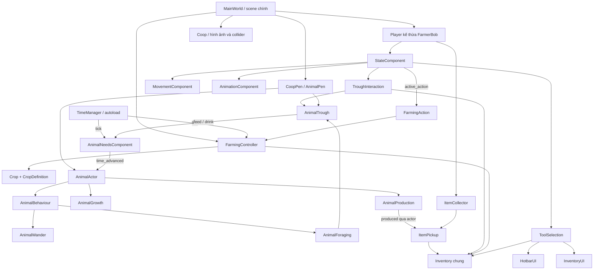
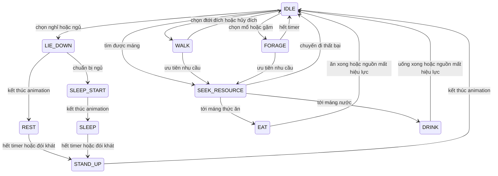

# Fantasy Farm — Phân tích hệ thống và tra cứu script runtime

Cập nhật theo source ngày **19/10/2026**. Tài liệu mô tả code hiện có, không phải bản thiết kế cho các tính năng tương lai.

## 1. Phạm vi và cách đọc

Phạm vi là **31 script do project sở hữu**, đi tới được từ `project.godot`: scene chính `world/main_world.tscn`, autoload TimeManager, scene kế thừa/instance, resource, preload và kiểu `class_name` mà chúng sử dụng. Script đang được gắn nhưng node bị ẩn vẫn thuộc phạm vi vì `_ready`, signal và logic của nó vẫn được nạp.

Không trình bày addon, plugin/skill, test, script sinh asset/chạy thiết lập hoặc file không nằm trong chuỗi runtime trên. Việc một scene khác chưa có trong farm hiện tại không tự động chứng minh nó là “dead” trên toàn repository; tài liệu này chỉ phân tích cấu hình game chính hiện tại. Không có danh mục API của các file bị loại.

Quy ước:

| Ký hiệu/khái niệm | Ý nghĩa trong tài liệu |
|---|---|
| `class_name` | Tên kiểu đăng ký toàn cục của Godot. Nếu script không khai báo, tên như AnimalActor/Inventory ở đây chỉ là tên vai trò; code thường dùng `const X = preload(...)` để tham chiếu kiểu script. |
| `extends` | Kiểu Node/Resource của Godot mà script kế thừa. Không liệt kê lại toàn bộ API có sẵn của engine. |
| `@export` | Cấu hình được sửa qua Inspector hoặc ghi đè trong `.tscn`/`.tres`. Mặc định trong script không luôn là giá trị trên scene. |
| `@onready` | Tham chiếu node được resolve khi node sẵn sàng; đường dẫn `$...` phụ thuộc cấu trúc scene. |
| Property bắt đầu `_` | Trạng thái nội bộ, nên thay qua method thay vì sửa trực tiếp. Dấu `_` không tự tạo private access trong GDScript. |
| `const X = preload(...)` | Alias cho script/resource được nạp sẵn, không phải một instance đã tạo. Được liệt kê cùng đường dẫn dưới mỗi class. |
| `signal` | Thông báo cho nơi khác nghe; callback có thể không xuất hiện như một lời gọi trực tiếp trong call graph. |
| `_ready`, `_process`, `_physics_process`, input/drag callbacks | Entry point do engine gọi. Không có caller trực tiếp không đồng nghĩa method chết. |
| `timestamp`, `elapsed`, `delta` | Timestamp là mốc Unix; elapsed là hiệu hai mốc; delta là thời gian một frame. Tuổi/cây/sản xuất dùng elapsed từ clock; vận động và timer hành vi dùng delta. |
| Đơn vị stock / gói thức ăn / điểm nhu cầu | Ba đại lượng khác nhau: một gói mặc định nạp 300 stock; một bữa thường tốn 1 stock; 1 stock hồi 40 điểm nhu cầu theo cấu hình máng. |

Mỗi phần class có vai trò, cấu hình/trạng thái, signal/enum/constant và tất cả method được script đó tự khai báo. Khai báo có chữ `gán khi chạy` nghĩa là source không đặt giá trị ban đầu tường minh; không phải mọi node reference đều dùng được trước `_ready()`.

## 2. Bản đồ hệ thống



### Cấu trúc node quan trọng

```text
/root
├── TimeManager
└── MainWorld
    ├── Player (CharacterBody2D, kế thừa farmer_bob.tscn)
    │   ├── AnimatedSprite2D + CollisionShape2D
    │   ├── MovementComponent + AnimationComponent + StateComponent
    │   ├── Camera2D + DustParticles
    │   ├── FarmingActionComponent + SoilFocus
    │   ├── ToolSelection
    │   │   └── Inventory (được tạo nếu không inject kho sẵn)
    │   ├── Hotbar + InventoryUI
    │   ├── ItemCollector
    │   └── TroughInteraction / Prompt
    ├── FarmingController (script quản lý các TileMapLayer đất)
    ├── Coop (StaticBody2D, script đổi ngoại hình)
    └── CoopPen (AnimalPen)
        ├── Chicken / Rooster (cùng kế thừa animal.tscn)
        │   ├── MovementComponent + AnimationComponent
        │   ├── NeedsComponent + GrowthComponent + ProductionComponent
        │   ├── WanderComponent + BehaviourComponent + ForagingComponent
        │   └── NeedsDisplay
        ├── FeedTrough ×2
        ├── WaterTrough ×2
        └── ItemPickup (được tạo lúc animal có đầu ra)
```

Đây là sơ đồ các nhánh logic; các layer nền, hàng rào và node trang trí được lược bớt. Camera2D và các thanh NeedsDisplay là node engine, không có class script riêng cần tra cứu.

### Quyền sở hữu dữ liệu

| Dữ liệu | Nơi sở hữu | Nơi chỉ đọc/điều phối |
|---|---|---|
| Định nghĩa loài/cây/item/chu kỳ | Resource `.tres` qua các class Definition | Actor, controller và UI đọc cấu hình |
| Stack, slot và số lượng trong kho | Inventory | Hotbar, túi, pickup, nạp máng, farming cùng dùng một kho |
| Lựa chọn 6 ô và cờ mở túi | ToolSelection | StateComponent cùng hai UI |
| Vận tốc và đích di chuyển | MovementComponent / CharacterBody2D | FSM player, Wander và Foraging đưa lệnh |
| Tuổi, nhu cầu, tiến độ phụ phẩm | Các component riêng của từng animal | AnimalActor nối signal và điều phối |
| Stock và điểm đứng trên máng | AnimalTrough | Foraging giữ/release chỗ; người chơi nạp |
| Cây theo ô và quyền trồng trọt | FarmingController + TileMapLayer | FarmingAction thực thi theo frame, SoilFocus hiển thị |
| Item đang nằm ngoài đất | ItemPickup | ItemCollector đề nghị chuyển vào Inventory |

Không ghi tuổi/nhu cầu của cá thể lên Resource dùng chung: nếu làm vậy nhiều animal cùng definition sẽ vô tình dùng chung trạng thái.

## 3. Các luồng hoạt động

### 3.1. Di chuyển, chọn vật phẩm và ưu tiên tương tác

1. HotbarUI đổi `ToolSelection.selected_index` từ click, phím 1–6 hoặc con lăn; việc chọn không tự dùng công cụ.
2. StateComponent nhận hướng di chuyển, chuột trái đặt đích; phím hướng hủy đích tự động.
3. E/Space/chuột phải được gom thành yêu cầu xử lý ở physics tick. Mở túi hoặc đang TOOL/WATER thì không bắt đầu thao tác mới.
4. `use_selected_tool()` gọi `TroughInteraction.prepare_action()` trước. Có máng mà không nạp được thì chặn thao tác đất và hiện lý do. Không có máng thì mới xử lý cuốc/tưới/gieo/thu hoạch.
5. State TOOL/WATER phát animation; adapter chờ frame 3 để sửa dữ liệu. Kết thúc animation mới quay về IDLE/WALK.

`active_action` diễn tả **việc làm**, còn state TOOL/WATER diễn tả **nhóm hoạt ảnh/khóa vận động**. Vì thế hành động nạp nước dùng state WATER nhưng không gọi tưới đất.

### 3.2. Cuốc → tưới/gieo → lớn → thu hoạch

`FarmingAction` chốt ô theo vị trí/hướng người chơi và chốt seed/slot nếu gieo. Tới frame chạm, `FarmingController` kiểm tra quyền custom data của tile, đối tượng chiếm ô, các layer có `blocks_farming` và collider trước khi sửa terrain hoặc tạo cây.

`Crop.configure()` ghi thời điểm gieo và hạn trưởng thành. Clock phát tick, controller gọi `Crop.refresh(timestamp)`, cây chọn một trong 4 texture theo tiến độ. Thu hoạch yêu cầu cây chín, sản phẩm hợp lệ và kho đủ chứa **cả lô**, rồi mới thêm đồ và xóa cây.

Trạng thái WET hiện là thông tin đất hiển thị/kiểm tra hành động. Chưa có cơ chế bắt buộc đủ nước để cây tăng trưởng, tự khô, theo mùa hoặc héo trong các script này.

### 3.3. Animal tìm máng và ăn/uống



Nếu không có `sleep_start` one-shot nhưng có sleep, chuỗi đi thẳng từ LIE_DOWN sang SLEEP. Những animation nằm/đứng không có đủ điều kiện thì hành vi nghỉ/ngủ không được chọn.

Foraging chỉ xét máng **cùng pen**, đúng loài, đủ khẩu phần, có slot đứng trống trong biên và đường thẳng thông. Nhu cầu thấp hơn được ưu tiên; bằng nhau thì nước trước. Khi không có nguồn cho nhu cầu đầu, vẫn thử nhu cầu còn lại. Reservation được release khi hủy/rời tree; chưa trừ stock ở bước giữ chỗ hay di chuyển.

Đến serving point, Behaviour đợi `serving_seconds` rồi gọi `serve()`. Máng kiểm tra lại stock/reservation/khoảng cách trước khi hồi nhu cầu và trừ khẩu phần. FORAGE thông thường chỉ là animation, không phải một nguồn thức ăn vô hạn.

### 3.4. Tuổi và phụ phẩm theo thời gian

Với một khoảng elapsed, Needs tính phần thời gian cả no và nước còn dương **trước khi** trừ nhu cầu. Actor lấy `juvenile_seconds` ở đầu khoảng và thực hiện:

```text
age += elapsed
eligible_seconds = max(0, supplied_seconds - juvenile_seconds)
production.advance(eligible_seconds)
```

Ví dụ còn 5 giây mới trưởng thành, elapsed=20 và cả hai nhu cầu chỉ đủ cho 12 giây đầu: tuổi tăng 20, production chỉ nhận `12 - 5 = 7` giây. Tick dài không sinh phụ phẩm trong đoạn trước trưởng thành hay sau khi đã hết một nhu cầu.

Production giữ phần tiến độ dư khi tạm ngừng. WORLD_DROP chuyển đầu ra sang một đống pickup đang tồn tại của cá thể; các chu kỳ sau cộng vào đống đó tại vị trí thả ban đầu. DIRECT_COLLECTION giữ trong component và được thu bằng `AnimalActor.collect_produce(inventory)`; chưa có input tương tác riêng cho mode này.

Không có juvenile art hợp lệ thì dùng adult art, tiếp tục giữ skin cá thể nếu có. Trưởng thành thật về dữ liệu không phụ thuộc việc sprite có đổi hình hay không; nếu có art để đổi thì actor đợi IDLE trước khi thay.

### 3.5. Người chơi nạp máng và nhặt phụ phẩm

Nạp máng chốt target khi bắt đầu; tới frame chạm kiểm tra lại reach, vật cản, inventory và action. FOOD lấy gói nguyên theo `feed_item`; WATER cần bình tưới ở slot đã chốt và thêm tối đa `water_per_use`. Đổi hotbar không chuyển lần nạp sang công cụ khác; mở túi hủy lần nạp đang chờ.

ItemCollector dùng Area2D để phát hiện ItemPickup. Pickup gọi `Inventory.add()` và chỉ giảm `amount` theo lượng thực nhận; phần dư vẫn nằm trên đất. Khi inventory đổi, collector thử lại các đống còn trong vùng. Các khóa `_collecting`/`_refilling` ngăn signal đồng bộ gọi lồng nhau và giao đồ hai lần.

## 4. Tra cứu class, property và method

Các giá trị dưới đây được trích từ khai báo source; phần diễn giải giải thích cách sử dụng. `Default trong script` và giá trị scene hiện tại được phân biệt trong mô tả.

### Chỉ mục script

| Nhóm | Class/vai trò |
|---|---|
| Dữ liệu cấu hình | [ItemDefinition](#item-definition), [CropDefinition](#crop-definition), [AnimalTypes](#animal-types), [AnimalDefinition](#animal-definition), [AnimalProductionDefination](#animal-production-definition) |
| Thời gian, vận động và người chơi | [TimeManager](#time-manager), [MovementComponent](#movement-component), [AnimationComponent](#animation-component), [StateComponent](#state-component) |
| Kho đồ và giao diện | [Inventory](#inventory-component), [ToolSelection](#tool-selection-component), [InventorySlot](#inventory-slot), [HotbarUI](#hotbar-ui), [InventoryUI](#inventory-ui) |
| Trồng trọt | [FarmingController](#farming-controller), [FarmingAction](#farming-action-component), [SoilFocus](#soil-focus-component), [Crop](#crop) |
| Chăn nuôi | [AnimalPen](#animal-pen), [AnimalActor](#animal-actor), [AnimalNeedsComponent](#animal-needs-component), [AnimalGrowthComponent](#animal-growth-component), [AnimalProductionComponent](#animal-production-component), [AnimalBehaviourComponent](#animal-behaviour-component), [AnimalWanderComponent](#animal-wander-component), [AnimalForagingComponent](#animal-foraging-component), [AnimalTrough](#animal-trough), [TroughInteraction](#trough-interaction-component) |
| Vật phẩm ngoài thế giới và chuồng | [ItemPickup](#item-pickup), [ItemCollector](#item-collector), [CoopAppearance](#coop) |

### 4.1. Dữ liệu cấu hình

<a id="item-definition"></a>

#### ItemDefinition

**Source:** [scripts/item_definition.gd](/home/dungnguyen/Projects/test-js/scripts/item_definition.gd). **Kế thừa:** `Resource`. **class_name:** `ItemDefinition`.

Resource mô tả một loại vật phẩm. Các stack giữ tham chiếu tới Resource này; số lượng thuộc Inventory, không nằm trên định nghĩa.

**Property và trạng thái**

| Property | Kiểu / mặc định trong script | Ý nghĩa |
|---|---|---|
| `item_id` | `StringName` | Khóa nhận diện vật phẩm; dùng để so khớp, đếm và trừ xuyên nhiều stack. Không được rỗng khi thêm vào kho. |
| `display_name` | `String` | Tên hiển thị trong hotbar, tooltip, túi đồ và thông báo thiếu thức ăn. |
| `icon` | `Texture2D` | Texture hiển thị ở ô đồ và pickup ngoài thế giới. |
| `item_type` | `ItemType = ItemType.TOOL` | Nhóm công cụ, hạt giống, sản phẩm hoặc thức ăn; quyết định hành động và giới hạn stack. |
| `tool_type` | `ToolType = ToolType.HOE` | Phân biệt cuốc với bình tưới khi item là công cụ. |
| `crop` | `Resource` | Resource CropDefinition cho hạt giống; FarmingController kiểm tra kiểu trước khi gieo. |
| `max_stack` | `int = 99` | Giới hạn gộp stack cho vật phẩm thường. Công cụ vẫn bị giới hạn 1. |
| `food_units_per_item` | `int = 300` | Số đơn vị thức ăn của một gói; mặc định 300, dùng khi nạp máng. |

**Enum**

| Enum | Ý nghĩa |
|---|---|
| `ItemType` | TOOL=0, SEED=1, PRODUCE=2, FEED=3, HOE=4. HOE là giá trị tương thích cũ vẫn được các nhánh xử lý công cụ chấp nhận. |
| `ToolType` | HOE=0, WATERING_CAN=1; chỉ có ý nghĩa trong ngữ cảnh công cụ. |

**Method**

| Chữ ký trong source | Ý nghĩa, điều kiện và kết quả |
|---|---|
| `get_stack_limit() -> int` | Trả 1 với TOOL/HOE; các loại khác trả max(1, max_stack). |
| `matches(other: Resource) -> bool` | Trả true khi đối tượng kia là ItemDefinition và có cùng item_id không rỗng. Không so bằng tên hiển thị hoặc icon. |

<a id="crop-definition"></a>

#### CropDefinition

**Source:** [scripts/crop_definition.gd](/home/dungnguyen/Projects/test-js/scripts/crop_definition.gd). **Kế thừa:** `Resource`. **class_name:** `CropDefinition`.

Resource chứa quy tắc chung của một giống cây, tách khỏi tuổi và tiến độ của từng cây đã trồng.

**Property và trạng thái**

| Property | Kiểu / mặc định trong script | Ý nghĩa |
|---|---|---|
| `crop_id` | `StringName` | Mã giống cây, hiện là metadata; is_valid() không bắt buộc khóa này khác rỗng. |
| `stage_textures` | `Array[Texture2D] = []` | Đúng 4 texture, theo thứ tự từ cây non đến sẵn sàng thu hoạch. |
| `growth_seconds` | `float = 1200.0` | Thời gian từ gieo đến trưởng thành, tính bằng giây timestamp. |
| `harvest_item` | `Resource` | Resource sản phẩm; được ép/kiểm tra là ItemDefinition khi thu hoạch. |
| `harvest_amount` | `int = 1` | Số sản phẩm nhận cho mỗi cây; phải dương để thu hoạch được. |

**Constant và dependency nạp sẵn**

| Constant / alias | Ý nghĩa / nguồn |
|---|---|
| `Item` | Alias kiểu script [scripts/item_definition.gd](/home/dungnguyen/Projects/test-js/scripts/item_definition.gd). |

**Method**

| Chữ ký trong source | Ý nghĩa, điều kiện và kết quả |
|---|---|
| `is_valid() -> bool` | Kiểm tra thời gian lớn hơn 0, đủ 4 texture và không có texture null; chưa kiểm tra sản phẩm thu hoạch. |
| `has_valid_harvest() -> bool` | Kiểm tra harvest_item là ItemDefinition loại PRODUCE và harvest_amount > 0. |

<a id="animal-types"></a>

#### AnimalTypes

**Source:** [scripts/animals/animal_types.gd](/home/dungnguyen/Projects/test-js/scripts/animals/animal_types.gd). **Kế thừa:** `RefCounted`. **class_name:** `AnimalTypes`.

RefCounted chứa enum loài dùng chung giữa định nghĩa animal và giới hạn loài trên máng. Không có trạng thái instance, property hay method tự khai báo.

**Enum**

| Enum | Ý nghĩa |
|---|---|
| `Species` | CHICKEN=0, DUCK=1, COW=2, SHEEP=3, PIG=4, GOOSE=5, HORSE=6. Danh sách enum không đồng nghĩa mọi loài đều đã được đặt trong scene chính. |

<a id="animal-definition"></a>

#### AnimalDefinition

**Source:** [scripts/animals/animal_definition.gd](/home/dungnguyen/Projects/test-js/scripts/animals/animal_definition.gd). **Kế thừa:** `Resource`. **class_name:** `AnimalDefinition`.

Resource cấu hình loài: ngoại hình, vận động, trọng số hành vi, nhu cầu, tuổi trưởng thành và phụ phẩm. Nhiều con có thể chia sẻ cùng Resource mà vẫn giữ tuổi/nhu cầu/tiến độ riêng.

**Property và trạng thái**

| Property | Kiểu / mặc định trong script | Ý nghĩa |
|---|---|---|
| `animal_id` | `StringName` | Mã loài/định nghĩa; is_valid() yêu cầu không rỗng. |
| `display_name` | `String` | Tên để hiển thị hoặc tham khảo; actor hiện không tự tạo nameplate từ trường này. |
| `species` | `Types.Species = Types.Species.CHICKEN` | Giá trị AnimalTypes.Species, dùng kiểm tra allowed_species của máng. |
| `move_speed` | `float = 28.0` | Tốc độ áp vào MovementComponent của từng animal khi actor khởi tạo. |
| `idle_seconds` | `Vector2 = Vector2(0.6, 1.8)` | Khoảng min/max giây đứng chờ; cũng được truyền sang Wander. |
| `footprint` | `Vector2 = Vector2(10, 6)` | Kích thước RectangleShape2D ở chân; actor tạo shape riêng theo kích thước này. |
| `pen_margin` | `float = 12.0` | Khoảng lùi khỏi biên pen; actor lấy ít nhất nửa độ dài đường chéo footprint. |
| `walk_weight` | `float = 5.0` | Trọng số chọn đi dạo khi hết thời gian IDLE. |
| `forage_weight` | `float = 3.0` | Trọng số chọn hành vi mổ/gặm; chỉ có hiệu lực khi có animation phù hợp. |
| `rest_weight` | `float = 1.0` | Trọng số nghỉ; chỉ dùng khi có chuỗi nằm xuống/đứng lên không lặp. |
| `sleep_weight` | `float = 1.0` | Trọng số ngủ; còn đòi hỏi animation sleep. |
| `forage_seconds` | `Vector2 = Vector2(1.5, 3.5)` | Khoảng thời gian thực hiện hành vi mổ/gặm tự do. |
| `rest_seconds` | `Vector2 = Vector2(2.0, 4.0)` | Khoảng thời gian giữ tư thế nghỉ. |
| `sleep_seconds` | `Vector2 = Vector2(4.0, 8.0)` | Khoảng thời gian ngủ trước khi tự đứng dậy. |
| `forage_action` | `StringName = &""` | Tên hành động cụ thể; rỗng thì chọn lần lượt peck, graze, chew có sẵn. |
| `lie_down_action` | `StringName = &""` | Tên hành động nằm/ngồi; rỗng thì chọn sit hoặc lie_down có sẵn. |
| `satiety_depletion_seconds` | `float = 600.0` | Số giây để mức thức ăn đầy giảm từ 100 về 0 nếu không ăn. |
| `hydration_depletion_seconds` | `float = 600.0` | Số giây để nước đầy giảm từ 100 về 0 nếu không uống. |
| `food_per_meal` | `int = 1` | Số đơn vị stock bị tiêu thụ trong một bữa thức ăn; ít nhất 1 khi máng tính khẩu phần. |
| `water_per_drink` | `int = 1` | Số đơn vị stock bị tiêu thụ trong một lần uống. |
| `food_seek_threshold` | `float = 50.0` | Satiety <= ngưỡng này thì bắt đầu cần tìm thức ăn. |
| `water_seek_threshold` | `float = 50.0` | Hydration <= ngưỡng này thì bắt đầu cần tìm nước. |
| `adult_frames` | `SpriteFrames` | SpriteFrames gốc bắt buộc có idle_down và walk_down với ít nhất một frame. |
| `juvenile_frames` | `SpriteFrames` | SpriteFrames con non tùy chọn; thiếu hoặc không hợp lệ thì dùng adult_frames. |
| `faces_left` | `bool = true` | Ảnh gốc nhìn trái hay phải, áp vào cơ chế lật sprite một hướng của animal. |
| `maturity_seconds` | `float = 120.0` | Ngưỡng tuổi để trưởng thành. Tuổi vẫn tăng khi đói/khát theo code hiện tại. |
| `production` | `Production` | AnimalProductionDefination cấu hình phụ phẩm; null nghĩa là không có sản xuất hợp lệ. |

**Constant và dependency nạp sẵn**

| Constant / alias | Ý nghĩa / nguồn |
|---|---|
| `Types` | Alias kiểu script [scripts/animals/animal_types.gd](/home/dungnguyen/Projects/test-js/scripts/animals/animal_types.gd). |
| `Production` | Alias kiểu script [scripts/animals/animal_production_definition.gd](/home/dungnguyen/Projects/test-js/scripts/animals/animal_production_definition.gd). |

**Method**

| Chữ ký trong source | Ý nghĩa, điều kiện và kết quả |
|---|---|
| `is_valid() -> bool` | Kiểm tra ID, frame đi/đứng của bản trưởng thành, tốc độ, footprint, thời gian giảm nhu cầu và khoảng idle; không xác nhận toàn bộ animation nghỉ/ngủ hay production. |
| `has_movement_frames(frames: SpriteFrames) -> bool` | Kiểm tra resource khác null, có idle_down/walk_down và mỗi animation có frame. |
| `get_frames_for_stage(is_adult: bool) -> SpriteFrames` | Trả adult_frames nếu đã trưởng thành hoặc juvenile_frames không hợp lệ; còn lại trả juvenile_frames. Skin riêng được actor áp tiếp sau bước này. |

<a id="animal-production-definition"></a>

#### AnimalProductionDefination

**Source:** [scripts/animals/animal_production_definition.gd](/home/dungnguyen/Projects/test-js/scripts/animals/animal_production_definition.gd). **Kế thừa:** `Resource`. **class_name:** `AnimalProductionDefination`.

Resource cấu hình phụ phẩm. Tên class_name trong code là **AnimalProductionDefination**, có lỗi chính tả được giữ để tương thích các .tres hiện có. Đây là định nghĩa dùng chung; tiến độ của từng con thuộc AnimalProductionComponent.

**Property và trạng thái**

| Property | Kiểu / mặc định trong script | Ý nghĩa |
|---|---|---|
| `production_item` | `Item` | ItemDefinition của phụ phẩm; is_valid() yêu cầu loại PRODUCE. |
| `production_amount` | `int = 1` | Số lượng mỗi chu kỳ hoàn tất. |
| `production_seconds` | `float = 1.0` | Độ dài một chu kỳ tính theo thời gian đủ điều kiện, không phải mọi giây đã sống. |
| `collection_mode` | `CollectionMode = CollectionMode.WORLD_DROP` | WORLD_DROP tạo pickup ngoài đất; DIRECT_COLLECTION giữ kho nội bộ để được thu qua API. |

**Enum**

| Enum | Ý nghĩa |
|---|---|
| `CollectionMode` | WORLD_DROP=0; DIRECT_COLLECTION=1. AnimalActor quyết định cách giao sản phẩm theo giá trị này. |

**Constant và dependency nạp sẵn**

| Constant / alias | Ý nghĩa / nguồn |
|---|---|
| `Item` | Alias kiểu script [scripts/item_definition.gd](/home/dungnguyen/Projects/test-js/scripts/item_definition.gd). |

**Method**

| Chữ ký trong source | Ý nghĩa, điều kiện và kết quả |
|---|---|
| `is_valid() -> bool` | Chấp nhận cấu hình có sản phẩm loại PRODUCE, số lượng > 0 và thời gian chu kỳ > 0. |


### 4.2. Thời gian, vận động và người chơi

<a id="time-manager"></a>

#### TimeManager

**Source:** [components/time_manager.gd](/home/dungnguyen/Projects/test-js/components/time_manager.gd). **Kế thừa:** `Node`. Không khai báo `class_name`; tên mục này là tên vai trò.

Autoload /root/TimeManager cung cấp timestamp Unix dùng chung. Là nguồn thời gian cho cây và animal; delta chỉ điều tiết tần suất phát tick.

**Property và trạng thái**

| Property | Kiểu / mặc định trong script | Ý nghĩa |
|---|---|---|
| `refresh_interval` | `float = 0.1` | Khoảng giây giữa hai lần phát tick trong _process, mặc định 0.1. |
| `clock_source` | `Callable = Time.get_unix_time_from_system` | Callable đọc thời gian hệ thống; có thể thay bằng clock giả khi kiểm thử. |
| `_last_timestamp` | `float = 0.0` | Mốc lớn nhất đã trả về, tránh tua lùi tiến độ khi đồng hồ hệ thống lùi. |
| `_poll_elapsed` | `float = 0.0` | Thời gian delta đã tích lũy từ lần phát tick gần nhất. |

**Signal**

| Signal | Khi nào / ý nghĩa |
|---|---|
| `tick(timestamp: float)` | Timestamp mới để FarmingController và AnimalNeedsComponent đồng bộ. Không tự cung cấp save/load hay bù thời gian giữa hai phiên chạy. |

**Method**

| Chữ ký trong source | Ý nghĩa, điều kiện và kết quả |
|---|---|
| `now() -> float` | Gọi clock_source và lấy max với _last_timestamp; trả timestamp không giảm trong phiên hiện tại. |
| `_process(delta: float) -> void` | Cộng delta; đủ refresh_interval thì reset bộ đếm và gọi refresh(). Không phát một tick cho từng khoảng bị bỏ lỡ. |
| `refresh() -> void` | Phát tick(now()); bên nhận tự tính thời gian thực đã trôi qua. |

<a id="movement-component"></a>

#### MovementComponent

**Source:** [components/movement_component.gd](/home/dungnguyen/Projects/test-js/components/movement_component.gd). **Kế thừa:** `Node`. **class_name:** `MovementComponent`.

Node con trực tiếp của CharacterBody2D, dùng chung cho người chơi và animal. Chịu trách nhiệm vận tốc, va chạm và di chuyển thẳng đến đích; không tự tìm đường vòng.

**Property và trạng thái**

| Property | Kiểu / mặc định trong script | Ý nghĩa |
|---|---|---|
| `speed` | `float = 150.0` | Tốc độ trần mặc định của body; animal ghi đè theo definition. |
| `acceleration` | `float = 1200.0` | Tốc độ tiến vận tốc về vận tốc đích khi đang có hướng di chuyển. |
| `friction` | `float = 1600` | Tốc độ giảm vận tốc khi hướng bằng zero. |
| `arrival_distance` | `float = 2.0` | Bán kính coi là đã đến đích. |
| `body` | `CharacterBody2D` | CharacterBody2D cha được resolve trong _ready(). |
| `has_target` | `bool = false` | Có đích di chuyển tự động hay không; không thể hiện trạng thái FSM. |
| `target_position` | `Vector2 = Vector2.ZERO` | Tọa độ thế giới của đích hiện tại. |
| `_blocked_time` | `float = 0.0` | Thời gian body gần như không dịch chuyển khi đi tới đích; đủ 0.2 giây thì hủy đích. |

**Method**

| Chữ ký trong source | Ý nghĩa, điều kiện và kết quả |
|---|---|
| `_ready() -> void` | Lấy body từ node cha và assert đúng kiểu CharacterBody2D. |
| `move(dir: Vector2, delta: float, speed_limit: float = -1.0) -> void` | Giới hạn độ dài hướng, tiến vận tốc theo acceleration/friction và gọi move_and_slide(); speed_limit tùy chọn không cho vượt tốc độ được phép. |
| `set_target(world_position: Vector2) -> void` | Gán đích thế giới, bật has_target và reset thời gian kẹt. |
| `cancel_target() -> void` | Tắt has_target và reset bộ đếm kẹt; không tự xóa velocity. |
| `target_direction() -> Vector2` | Trả hướng chuẩn hóa tới đích, hoặc zero khi không có đích/đã đủ gần. |
| `move_to_target(delta: float) -> void` | Đi thẳng tới đích, giới hạn bước theo khoảng cách để không vượt đích; đến nơi hoặc kẹt >= 0.2 giây thì hủy đích và dừng. |
| `stop() -> void` | Đặt velocity của body về zero; không tự hủy has_target. |

<a id="animation-component"></a>

#### AnimationComponent

**Source:** [components/animation_component.gd](/home/dungnguyen/Projects/test-js/components/animation_component.gd). **Kế thừa:** `Node`. **class_name:** `AnimationComponent`.

Node chuyển tên hành động và hướng nhìn thành animation action_direction, áp dụng flip_h và fallback. Người chơi dùng nhiều hướng; animal dùng single_direction.

**Property và trạng thái**

| Property | Kiểu / mặc định trong script | Ý nghĩa |
|---|---|---|
| `animated_sprite` | `AnimatedSprite2D` | AnimatedSprite2D được điều khiển; bắt buộc gán qua scene. |
| `fallback_animation` | `StringName = &"idle_down"` | Animation dùng khi action_direction không tồn tại; mặc định idle_down. |
| `flip_left` | `bool = true` | Nếu không dùng single_direction, lấy frame hướng phải và lật để thể hiện hướng trái. |
| `single_direction` | `bool = false` | Chỉ dùng animation hậu tố down và lật ngang để thể hiện trái/phải. |
| `single_direction_faces_left` | `bool = true` | Cho biết sprite gốc một hướng nhìn trái hay phải để tính flip_h đúng. |
| `facing_direction` | `StringName = &"down"` | Hướng nhìn logic đang giữ; hướng zero không thay đổi giá trị này. |
| `current_action` | `String = ""` | Tên action gần nhất được yêu cầu, ví dụ idle, walk, tool hoặc peck. |
| `_warned` | `Dictionary[StringName, bool] = {}` | Tập tên animation đã cảnh báo thiếu để không spam log. |
| `facing_vector` | `Vector2` | Property chỉ đọc chuyển facing_direction thành vector đơn vị qua DIR_VECTORS. |

**Constant và dependency nạp sẵn**

| Constant / alias | Ý nghĩa / nguồn |
|---|---|
| `DIR_VECTORS` | Bảng down/up/left/right sang Vector2; nguồn cho facing_vector. |

**Signal**

| Signal | Khi nào / ý nghĩa |
|---|---|
| `action_finished(action: String)` | Báo một animation không lặp đã kết thúc để FSM người chơi/animal chuyển trạng thái. |

**Method**

| Chữ ký trong source | Ý nghĩa, điều kiện và kết quả |
|---|---|
| `_ready() -> void` | Assert sprite đã được gán và nối animation_finished sang callback của component. |
| `play(action: String, force_restart: bool = false) -> void` | Chọn action_direction, áp dụng lật/fallback; tránh phát lại cùng animation đang chạy trừ khi force_restart=true. |
| `_warn_once(animation_name: StringName)` | Ghi nhận và cảnh báo một lần cho mỗi tên animation bị thiếu. |
| `_on_animation_finished()` | Phát action_finished với current_action; đây là action logic, không phải tên animation có hậu tố hướng. |
| `update_facing_direction(dir: Vector2) -> bool` | Cập nhật hướng theo vector; ưu tiên trục lớn hơn, giữ hướng hợp lệ khi đi chéo đều. Trả true nếu hướng đổi. |
| `face(dir: Vector2) ->void` | Cập nhật hướng và phát lại current_action khi cần đổi hướng nhìn. |

<a id="state-component"></a>

#### StateComponent

**Source:** [components/state_component.gd](/home/dungnguyen/Projects/test-js/components/state_component.gd). **Kế thừa:** `Node`. **class_name:** `StateComponent`.

FSM người chơi: tập hợp input, ưu tiên nạp máng, chọn hành động trồng trọt và khóa di chuyển trong hoạt ảnh thao tác. Không trực tiếp sửa tile, trừ hạt giống hay nạp máng.

**Property và trạng thái**

| Property | Kiểu / mặc định trong script | Ý nghĩa |
|---|---|---|
| `movement` | `MovementComponent` | Component vận động người chơi. |
| `animation` | `AnimationComponent` | Component hoạt ảnh người chơi. |
| `action_left` | `StringName = &"move_left"` | Tên action InputMap cho bốn hướng di chuyển; được Input.get_vector() đọc. |
| `action_right` | `StringName = &"move_right"` | Tên action InputMap cho bốn hướng di chuyển; được Input.get_vector() đọc. |
| `action_up` | `StringName = &"move_up"` | Tên action InputMap cho bốn hướng di chuyển; được Input.get_vector() đọc. |
| `action_down` | `StringName = &"move_down"` | Tên action InputMap cho bốn hướng di chuyển; được Input.get_vector() đọc. |
| `action_use_item` | `StringName = &"use_item"` | Tên action InputMap dùng vật phẩm, mặc định use_item (Space trong cấu hình hiện tại). |
| `tool_selection` | `ToolSelection` | Nguồn vật phẩm được chọn và trạng thái mở túi. |
| `trough_interaction` | `Node` | Adapter nạp máng được gán bằng Node; cần cung cấp prepare_action() và focused_trough. |
| `dust_particles` | `GPUParticles2D` | Hiệu ứng bụi tùy chọn khi đi bộ đủ nhanh. |
| `current_state` | `State = State.IDLE` | Trạng thái IDLE/WALK/TOOL/WATER hiện tại. |
| `_initialized` | `bool = false` | Phân biệt khởi tạo đầu tiên để vẫn phát/play IDLE khi _ready chạy. |
| `_use_requested` | `bool = false` | Cờ input dùng vật phẩm, được xử lý một lần trong physics tick tiếp theo. |
| `active_action` | `StringName = &""` | Ý định thao tác cụ thể: tool, water, plant, harvest, refill_food hoặc refill_water. Khác với trạng thái TOOL/WATER. |
| `_harvest_requested` | `bool = false` | Cờ E; ngoài phạm vi máng trở thành yêu cầu harvest. |

**Enum**

| Enum | Ý nghĩa |
|---|---|
| `State` | IDLE=0, WALK=1, TOOL=2, WATER=3. TOOL còn phục vụ plant/harvest/refill_food; WATER còn phục vụ refill_water thông qua active_action. |

**Constant và dependency nạp sẵn**

| Constant / alias | Ý nghĩa / nguồn |
|---|---|
| `ToolSelection` | Alias kiểu script [components/tool_selection_component.gd](/home/dungnguyen/Projects/test-js/components/tool_selection_component.gd). |
| `STATE_NAMES` | Ánh xạ chỉ số enum State sang idle/walk/tool/water cho hoạt ảnh và signal. |

**Signal**

| Signal | Khi nào / ý nghĩa |
|---|---|
| `state_changed(previous: StringName, current: StringName)` | Phát tên state trước/sau; FarmingAction và TroughInteraction nghe để chuẩn bị hoặc hủy lần thao tác. |

**Method**

| Chữ ký trong source | Ý nghĩa, điều kiện và kết quả |
|---|---|
| `_ready() -> void` | Kiểm tra các component bắt buộc, nối kết thúc hoạt ảnh/đổi trạng thái túi và vào IDLE. |
| `_physics_process(delta: float) -> void` | Chặn thao tác khi túi mở/đang hành động; đọc hướng, xử lý E rồi yêu cầu dùng đồ, cuối cùng cập nhật vận động, FSM và bụi. |
| `_unhandled_input(event: InputEvent) -> void` | Gom E/Space/chuột phải thành cờ thao tác; chuột trái đặt đích di chuyển sau khi chuyển tọa độ qua canvas transform. Bỏ input khi túi mở hoặc đang TOOL/WATER. |
| `get_selected_tool_action() -> StringName` | Ủy quyền ToolSelection.get_selected_action(); thiếu selection thì trả chuỗi rỗng. |
| `use_selected_tool(requested_action: StringName = &"") -> bool` | Từ chối khi bận/mở túi. Thử nạp máng trước: blocked tiêu thụ yêu cầu mà không chuyển trạng thái; refill_* vào TOOL/WATER. Nếu không có máng thì chọn tool/plant/harvest/water và trả có bắt đầu được hay không. |
| `_on_inventory_visibility_changed(open: bool) -> void` | Khi mở túi, xóa yêu cầu, hủy đích, dừng vận động và về IDLE để hủy thao tác đang chờ. |
| `transition_to(next_state: State) -> void` | Đổi state, reset active_action ngoài state thao tác, hủy/dừng di chuyển khi dùng công cụ, phát hoạt ảnh và state_changed; tránh đổi lại cùng state đã khởi tạo. |
| `_update_dust(emitting: bool) -> void` | Bật/tắt bụi; hướng bụi theo vận tốc thực khi process material hỗ trợ. |
| `_movement_direction() -> Vector2` | Đọc bốn action hướng từ InputMap. |
| `_on_action_finished(action: String) -> void` | Chỉ nhận kết thúc animation tương ứng state thao tác hiện tại; sau đó cập nhật hướng và về IDLE/WALK. |


### 4.3. Kho đồ và giao diện

<a id="inventory-component"></a>

#### Inventory

**Source:** [components/inventory_component.gd](/home/dungnguyen/Projects/test-js/components/inventory_component.gd). **Kế thừa:** `Node`. Không khai báo `class_name`; tên mục này là tên vai trò.

Node chứa các stack theo ô cố định. Là nguồn dữ liệu duy nhất cho hotbar, túi đồ, pickup, gieo trồng và nạp máng.

**Property và trạng thái**

| Property | Kiểu / mặc định trong script | Ý nghĩa |
|---|---|---|
| `slot_count` | `int = 24` | Số ô cấp khi _ensure_slots() chạy lần đầu; mặc định 24, tối thiểu một ô. Đổi sau khi khởi tạo không tự resize _slots. |
| `starting_tools` | `bool = true` | Nếu true khi khởi tạo, ô 0 nhận cuốc và ô 1 nhận bình tưới nếu có ô thứ hai. |
| `_slots` | `Array[Dictionary] = []` | Array Dictionary với dạng {item: ItemDefinition hoặc null, count: int}. Không nên sửa từ bên ngoài; slot() trả bản sao dictionary. |

**Constant và dependency nạp sẵn**

| Constant / alias | Ý nghĩa / nguồn |
|---|---|
| `Item` | Alias kiểu script [scripts/item_definition.gd](/home/dungnguyen/Projects/test-js/scripts/item_definition.gd). |
| `HOE` | Resource dùng sẵn [items/tools/hoe.tres](/home/dungnguyen/Projects/test-js/items/tools/hoe.tres). |
| `WATER` | Resource dùng sẵn [items/tools/watering_can.tres](/home/dungnguyen/Projects/test-js/items/tools/watering_can.tres). |

**Signal**

| Signal | Khi nào / ý nghĩa |
|---|---|
| `changed` | Phát khi kho thực sự đổi để UI cập nhật và ItemCollector thử nhặt phần còn nằm trong vùng cảm biến. |

**Method**

| Chữ ký trong source | Ý nghĩa, điều kiện và kết quả |
|---|---|
| `_ready() -> void` | Đảm bảo các ô đã được tạo. |
| `_ensure_slots() -> void` | Khởi tạo duy nhất một lần và cấp công cụ ban đầu theo cấu hình. |
| `slot(index: int) -> Dictionary` | Trả bản sao dictionary của ô; index sai trả stack rỗng. Resource item bên trong vẫn là tham chiếu chung. |
| `add(item: Item, amount: int = 1) -> int` | Gộp vào stack cùng ID trước, rồi dùng ô rỗng; trả lượng thực nhận, có thể ít hơn yêu cầu khi đầy. Phát changed nếu có thêm được. |
| `remove(item_id: StringName, amount: int = 1) -> int` | Trừ theo item_id xuyên nhiều stack; trả lượng thực đã lấy và dọn ô có count=0. |
| `remove_from_slot(index: int, amount: int = 1) -> int` | Chỉ trừ một ô đã chỉ định, giới hạn bởi số lượng đang có; trả lượng thực đã lấy. |
| `capacity_for(item: Item) -> int` | Tính tổng chỗ trống cho loại item dựa vào ô trống và phần còn thiếu ở stack cùng ID. |
| `count_item(item_id: StringName) -> int` | Tổng count của mọi ô có cùng item_id. |
| `move_slot(source: int, target: int) -> bool` | Cùng loại thì gộp theo giới hạn stack; khác loại hoặc ô đích trống thì đổi hai ô. Trả false khi index sai, nguồn rỗng hoặc stack đích cùng loại đã đầy. |

Các API thêm/trừ trả **số lượng thực chuyển**, không trả bool. Thu hoạch cây đòi đủ chỗ cho cả lô; pickup và thu phụ phẩm trực tiếp cho phép chuyển một phần.

<a id="tool-selection-component"></a>

#### ToolSelection

**Source:** [components/tool_selection_component.gd](/home/dungnguyen/Projects/test-js/components/tool_selection_component.gd). **Kế thừa:** `Node`. Không khai báo `class_name`; tên mục này là tên vai trò.

Node quản lý lựa chọn 6 ô hotbar, trạng thái mở túi và tham chiếu Inventory duy nhất dùng chung giữa các giao diện và tương tác.

**Property và trạng thái**

| Property | Kiểu / mặc định trong script | Ý nghĩa |
|---|---|---|
| `inventory` | `Inventory` | Kho được inject hoặc tạo mới trong _ready(); không tạo kho riêng cho từng UI. |
| `starting_seeds` | `Array[Item] = []` | Danh sách ItemDefinition hạt giống được cấp khi tạo kho mới. |
| `starting_feed` | `Item` | Resource thức ăn cấp khởi đầu khi tạo kho mới; có thể null. |
| `starting_feed_amount` | `int = 5` | Số gói thức ăn khởi đầu, mặc định 5. |
| `starting_seed_amount` | `int = 12` | Số lượng cho mỗi loại hạt giống khởi đầu, mặc định 12. |
| `selected_index` | `int = 0` | Index hotbar đang chọn, 0..5; không bị thay đổi bởi việc chỉ xem ô túi thứ 7 trở đi. |
| `inventory_open` | `bool = false` | Trạng thái túi để UI và StateComponent cùng dùng. |

**Constant và dependency nạp sẵn**

| Constant / alias | Ý nghĩa / nguồn |
|---|---|
| `Inventory` | Alias kiểu script [components/inventory_component.gd](/home/dungnguyen/Projects/test-js/components/inventory_component.gd). |
| `Item` | Alias kiểu script [scripts/item_definition.gd](/home/dungnguyen/Projects/test-js/scripts/item_definition.gd). |
| `HOTBAR_SIZE` | 6; các ô đầu của Inventory dùng làm hotbar, không phải một kho riêng. |

**Signal**

| Signal | Khi nào / ý nghĩa |
|---|---|
| `selection_changed(index: int, tool: StringName)` | Index và item_id của ô đang chọn; tên tham số tool còn được giữ nhưng dữ liệu không chỉ giới hạn công cụ. |
| `inventory_visibility_changed(open: bool)` | Thông báo túi mở/đóng để StateComponent và InventoryUI đồng bộ. |

**Method**

| Chữ ký trong source | Ý nghĩa, điều kiện và kết quả |
|---|---|
| `_ready() -> void` | Nếu chưa có inventory thì tạo node Inventory, cấp hạt giống/thức ăn; sau đó nghe inventory.changed. Kho inject sẵn không được cấp lại đồ. |
| `set_inventory_open(open: bool) -> void` | Chỉ thay đổi và phát signal khi trạng thái mở túi thực sự đổi. |
| `get_selected_item() -> Item` | Trả item ở selected_index hoặc null nếu không có inventory/item. |
| `_on_inventory_changed() -> void` | Phát selection_changed với index và item_id hiện tại, kể cả khi chỉ số ô không đổi. |
| `select_slot(index: int) -> bool` | Chấp nhận index 0..5, cập nhật và phát thay đổi khi cần; trả false với chỉ số ngoài hotbar. |
| `cycle_selection(step: int) -> void` | Dịch lựa chọn theo step, dùng posmod để quay vòng 6 ô. |
| `get_selected_action() -> StringName` | SEED -> plant; TOOL/HOE -> water nếu là bình tưới, còn lại tool; vật phẩm khác/ô trống -> chuỗi rỗng. |
| `get_selected_name() -> String` | Trả tên vật phẩm hoặc thông báo Ô trống. |

<a id="inventory-slot"></a>

#### InventorySlot

**Source:** [components/inventory_slot.gd](/home/dungnguyen/Projects/test-js/components/inventory_slot.gd). **Kế thừa:** `TextureButton`. Không khai báo `class_name`; tên mục này là tên vai trò.

TextureButton được tạo bằng code, dùng cho cả hotbar lẫn lưới túi đồ. Chỉ là view/adapter kéo thả, không sở hữu bản sao kho.

**Property và trạng thái**

| Property | Kiểu / mặc định trong script | Ý nghĩa |
|---|---|---|
| `inventory` | `Inventory` | Inventory chung mà ô này hiển thị và thao tác. |
| `slot_index` | `int = 0` | Chỉ số stack thật trong Inventory. |
| `compact` | `bool = false` | Chọn bố cục nhỏ 52×56 cho túi; false dùng 78×84 cho hotbar. |
| `show_shortcut` | `bool = false` | Có hiển thị số phím tắt slot_index+1 hay không. |
| `_icon` | `TextureRect` | TextureRect được tạo trong _ready để hiện icon. |
| `_count` | `Label` | Label được tạo trong _ready; chỉ hiện số lượng lớn hơn 1. |

**Constant và dependency nạp sẵn**

| Constant / alias | Ý nghĩa / nguồn |
|---|---|
| `Inventory` | Alias kiểu script [components/inventory_component.gd](/home/dungnguyen/Projects/test-js/components/inventory_component.gd). |
| `NORMAL` | Resource dùng sẵn [resources/ui/hotbar_slot.tres](/home/dungnguyen/Projects/test-js/resources/ui/hotbar_slot.tres). |
| `SELECTED` | Resource dùng sẵn [resources/ui/hotbar_selected.tres](/home/dungnguyen/Projects/test-js/resources/ui/hotbar_selected.tres). |
| `FOCUS` | Resource dùng sẵn [resources/ui/soil_focus.tres](/home/dungnguyen/Projects/test-js/resources/ui/soil_focus.tres). |

**Method**

| Chữ ký trong source | Ý nghĩa, điều kiện và kết quả |
|---|---|
| `_ready() -> void` | Tạo nền ô, icon, selection frame, shortcut và count; cấu hình input rồi nối inventory.changed -> refresh(). |
| `refresh() -> void` | Đọc snapshot của ô, cập nhật icon, số lượng và tooltip. |
| `_get_drag_data(_at_position: Vector2) -> Variant` | Trả null nếu ô rỗng; nếu có đồ, tạo drag preview và payload gồm inventory, slot, item_id. |
| `_can_drop_data(_at_position: Vector2, data: Variant) -> bool` | Chỉ nhận payload của cùng Inventory, khác ô đích, index là int và item nguồn vẫn khớp item_id để tránh kéo dữ liệu đã đổi. |
| `_drop_data(_at_position: Vector2, data: Variant) -> void` | Kiểm tra lại payload rồi gọi Inventory.move_slot() để gộp/đổi ô. |

<a id="hotbar-ui"></a>

#### HotbarUI

**Source:** [components/hotbar_ui.gd](/home/dungnguyen/Projects/test-js/components/hotbar_ui.gd). **Kế thừa:** `CanvasLayer`. Không khai báo `class_name`; tên mục này là tên vai trò.

CanvasLayer hiện 6 ô đầu của Inventory và nhận phím số/con lăn. Việc click ô chỉ đổi lựa chọn; không trực tiếp dùng công cụ.

**Property và trạng thái**

| Property | Kiểu / mặc định trong script | Ý nghĩa |
|---|---|---|
| `selection` | `ToolSelection` | ToolSelection dùng chung với player và InventoryUI. |
| `slots` | `HBoxContainer = $Root/Bottom/Column/Slots` | HBoxContainer chứa các InventorySlot được sinh lúc _ready. |
| `selected_name` | `Label = $Root/Bottom/Column/SelectedName` | Label tên vật phẩm đang chọn. |
| `buttons` | `Array[TextureButton] = []` | Danh sách 6 TextureButton/InventorySlot để cập nhật frame chọn. |

**Constant và dependency nạp sẵn**

| Constant / alias | Ý nghĩa / nguồn |
|---|---|
| `ToolSelection` | Alias kiểu script [components/tool_selection_component.gd](/home/dungnguyen/Projects/test-js/components/tool_selection_component.gd). |
| `Slot` | Alias kiểu script [components/inventory_slot.gd](/home/dungnguyen/Projects/test-js/components/inventory_slot.gd). |
| `SLOT_ACTIONS` | Tên sáu action InputMap hotbar_1 đến hotbar_6, ánh xạ sang index 0..5. |

**Method**

| Chữ ký trong source | Ý nghĩa, điều kiện và kết quả |
|---|---|
| `_ready() -> void` | Tạo 6 ô từ selection.inventory, nối sự kiện click và selection_changed, rồi đồng bộ lựa chọn ban đầu. |
| `_select_slot(index: int) -> void` | Đổi selection khi click và cập nhật frame/tên. |
| `_on_selection_changed(index: int, _tool: StringName) -> void` | Bật frame đúng ô đang chọn, tắt các ô khác và hiện tên vật phẩm. |
| `_unhandled_input(event: InputEvent) -> void` | Nếu túi đóng, nhận hotbar_1..6 và con lăn để chọn ô; đánh dấu input đã xử lý để không gây hành động khác. |

<a id="inventory-ui"></a>

#### InventoryUI

**Source:** [components/inventory_ui.gd](/home/dungnguyen/Projects/test-js/components/inventory_ui.gd). **Kế thừa:** `CanvasLayer`. Không khai báo `class_name`; tên mục này là tên vai trò.

CanvasLayer lưới 24 ô của Inventory dùng chung; quản lý mở/đóng, xem vật phẩm và kéo thả qua InventorySlot.

**Property và trạng thái**

| Property | Kiểu / mặc định trong script | Ý nghĩa |
|---|---|---|
| `selection` | `Selection` | ToolSelection cung cấp inventory và cờ inventory_open. |
| `root` | `Control = $Root` | Control gốc được bật/tắt bởi trạng thái mở túi. |
| `panel` | `PanelContainer = $Root/Center/Panel` | PanelContainer được _fit_panel() yêu cầu kích thước nhỏ hơn viewport. |
| `grid` | `GridContainer = $Root/Center/Panel/Body/Scroll/Center/Grid` | GridContainer chứa các ô, 6 cột trong scene hiện tại. |
| `details` | `Label = $Root/Center/Panel/Body/Details` | Label tên/số lượng của ô đang xem. |
| `capacity` | `Label = $Root/Center/Panel/Body/Footer/Capacity` | Label số ô có đồ trên tổng số ô; không phải tổng khối lượng hay tổng count. |
| `buttons` | `Array[TextureButton] = []` | Danh sách ô UI đã tạo cho inventory.slot_count. |
| `inspected_index` | `int = 0` | Ô đang xem trong túi; có thể nằm ngoài 6 ô hotbar. |

**Constant và dependency nạp sẵn**

| Constant / alias | Ý nghĩa / nguồn |
|---|---|
| `Selection` | Alias kiểu script [components/tool_selection_component.gd](/home/dungnguyen/Projects/test-js/components/tool_selection_component.gd). |
| `Slot` | Alias kiểu script [components/inventory_slot.gd](/home/dungnguyen/Projects/test-js/components/inventory_slot.gd). |

**Method**

| Chữ ký trong source | Ý nghĩa, điều kiện và kết quả |
|---|---|
| `_ready() -> void` | Ẩn root, tạo các ô compact, nối nút đóng/visibility/inventory/root resized và đồng bộ layout/nội dung. |
| `_fit_panel() -> void` | Đặt custom_minimum_size theo min(520, viewport_width-32) và min(540, viewport_height-32); nội dung con vẫn có thể ép panel lớn hơn. |
| `open() -> void` | Yêu cầu ToolSelection mở túi; không tự tạo inventory mới. |
| `close() -> void` | Yêu cầu ToolSelection đóng túi. |
| `_on_visibility_changed(value: bool) -> void` | Hiện/ẩn root; lúc mở gọi fit và refresh lại. |
| `_inspect_slot(index: int) -> void` | Đổi ô đang xem; chỉ đổi hotbar nếu index thuộc 6 ô đầu. |
| `_refresh() -> void` | Cập nhật frame chọn, đếm ô có đồ, tên/số lượng ô đang xem và nhãn capacity. |
| `_input(event: InputEvent) -> void` | Tab/toggle_inventory hoặc I đổi trạng thái túi; Escape đóng. Khi mở túi, chặn các phím khác đi xuống gameplay. |

Giới hạn hiện tại: player.tscn đặt CanvasLayer Hotbar và InventoryUI `visible=false`; code mở túi chỉ đổi `root.visible`. Ngoài ra kích thước tối thiểu của nội dung chưa phù hợp viewport 400×400. Vì vậy cấu trúc/API UI đang được nối thật, nhưng không nên hiểu tài liệu là xác nhận UI đã hiển thị và co giãn hoàn chỉnh.


### 4.4. Trồng trọt

<a id="farming-controller"></a>

#### FarmingController

**Source:** [components/farming_controller.gd](/home/dungnguyen/Projects/test-js/components/farming_controller.gd). **Kế thừa:** `Node`. Không khai báo `class_name`; tên mục này là tên vai trò.

Node dịch vụ trồng trọt gắn trong MainWorld. Quản lý quyền tác động lên ô, trạng thái đất, cây đang trồng, gieo và thu hoạch.

**Property và trạng thái**

| Property | Kiểu / mặc định trong script | Ý nghĩa |
|---|---|---|
| `farmland` | `TileMapLayer` | TileMapLayer chuẩn để định nghĩa tọa độ ô và đọc custom data can_till/can_water/can_plant. |
| `dry_soil` | `TileMapLayer` | Layer vẽ terrain đất đã cuốc, giữ lớp nền bên dưới đất ướt. |
| `wet_soil` | `TileMapLayer` | Layer terrain đất ướt; được ưu tiên khi suy ra Soil. |
| `dry_terrain_set` | `int = 0` | Index terrain set và terrain ID dùng trên layer đất khô; không phải source ID của atlas. |
| `dry_terrain` | `int = 0` | Index terrain set và terrain ID dùng trên layer đất khô; không phải source ID của atlas. |
| `wet_terrain_set` | `int = 0` | Index terrain set và terrain ID dùng trên layer đất ướt. |
| `wet_terrain` | `int = 0` | Index terrain set và terrain ID dùng trên layer đất ướt. |
| `obstacle_mask` | `int = 1` | Mask vật lý kiểm tra vật cản khi tác động đất, mặc định layer World (giá trị 1). |
| `time_manager` | `Clock` | Clock được inject hoặc lấy từ /root/TimeManager để tính tuổi cây. |
| `_crops` | `Dictionary[Vector2i, Crop] = {}` | Bảng tọa độ ô -> Crop đang sống, là chỉ mục cây trong phiên hiện tại. |
| `_occupied` | `Dictionary[Vector2i, bool] = {}` | Đánh dấu ô chiếm dụng logic cho đối tượng không có physics body; true thì cấm trồng trọt. |

**Enum**

| Enum | Ý nghĩa |
|---|---|
| `Soil` | UNTILLED=0, DRY=1, WET=2. Trạng thái được suy ra từ terrain trên layer, không có dictionary đất riêng. |

**Constant và dependency nạp sẵn**

| Constant / alias | Ý nghĩa / nguồn |
|---|---|
| `Crop` | Alias kiểu script [components/crop.gd](/home/dungnguyen/Projects/test-js/components/crop.gd). |
| `CropDefinitionResource` | Alias kiểu script [scripts/crop_definition.gd](/home/dungnguyen/Projects/test-js/scripts/crop_definition.gd). |
| `Item` | Alias kiểu script [scripts/item_definition.gd](/home/dungnguyen/Projects/test-js/scripts/item_definition.gd). |
| `Inventory` | Alias kiểu script [components/inventory_component.gd](/home/dungnguyen/Projects/test-js/components/inventory_component.gd). |
| `Clock` | Alias kiểu script [components/time_manager.gd](/home/dungnguyen/Projects/test-js/components/time_manager.gd). |
| `CROP_SCENE` | Scene tạo instance [scenes/crops/crop.tscn](/home/dungnguyen/Projects/test-js/scenes/crops/crop.tscn). |

**Signal**

| Signal | Khi nào / ý nghĩa |
|---|---|
| `soil_changed(cell: Vector2i, previous: int, current: int)` | Tọa độ ô và trạng thái đất trước/sau khi cuốc hoặc tưới thành công. |
| `crop_planted(cell: Vector2i, crop: Node2D)` | Ô cùng instance Crop vừa được gieo thành công. |
| `crop_harvested(cell: Vector2i)` | Ô vừa thu hoạch và xóa cây. |

**Method**

| Chữ ký trong source | Ý nghĩa, điều kiện và kết quả |
|---|---|
| `_ready() -> void` | Đăng ký group farming_controller, resolve clock và nối tick -> _refresh_crops(). |
| `world_to_cell(world_position: Vector2) -> Vector2i` | Đổi tọa độ thế giới sang tọa độ ô của farmland, có xét transform của layer. |
| `get_soil_state(cell: Vector2i) -> Soil` | Đọc terrain: có đất ướt thì WET, nếu không có thì xét DRY, còn lại UNTILLED. |
| `can_till(cell: Vector2i, actor: PhysicsBody2D = null) -> bool` | Đòi quyền can_till, không bị chặn và đất chưa cuốc. |
| `can_water(cell: Vector2i, actor: PhysicsBody2D = null) -> bool` | Đòi quyền can_water, không bị chặn và đất đang DRY. |
| `can_plant(cell: Vector2i, actor: PhysicsBody2D = null) -> bool` | Đòi chưa có cây, quyền can_plant, không bị chặn và đất đã cuốc; cả DRY và WET đều được gieo. |
| `get_crop(cell: Vector2i) -> Crop` | Lấy Crop trong _crops nếu instance còn hợp lệ; còn lại trả null. |
| `plant(cell: Vector2i, inventory: Inventory, slot_index: int, actor: PhysicsBody2D = null) -> bool` | Kiểm tra ô, inventory, clock, seed và CropDefinition; tạo Crop, căn chân vào ô, cấu hình timestamp, ghi _crops, trừ 1 hạt từ đúng slot rồi phát crop_planted. Trả bool thành công. |
| `can_harvest(cell: Vector2i) -> bool` | Đồng bộ cây theo clock hiện tại; đòi cây chín và định nghĩa sản phẩm thu hoạch hợp lệ. |
| `harvest(cell: Vector2i, inventory: Inventory) -> bool` | Đòi kho chứa đủ toàn bộ lô; thêm sản phẩm, xóa cây khỏi _crops, queue_free và phát crop_harvested. Không thu một phần lô cây. |
| `_refresh_crops(timestamp: float) -> void` | Mỗi tick cập nhật các cây còn sống và chưa chín; cây chín giữ nguyên. |
| `set_cell_occupied(cell: Vector2i, occupied: bool) -> void` | Thêm/xóa cờ chiếm dụng logic của một ô; không sinh collision hay đối tượng. |
| `till(cell: Vector2i, actor: PhysicsBody2D = null) -> bool` | Kiểm tra cấu hình terrain và can_till, vẽ terrain khô, xác nhận trạng thái rồi phát soil_changed. Trả bool. |
| `water(cell: Vector2i, actor: PhysicsBody2D = null) -> bool` | Kiểm tra terrain và can_water, thêm terrain ướt nhưng giữ nền đất khô, xác nhận trạng thái rồi phát soil_changed. |
| `_layer_cell(layer: TileMapLayer, cell: Vector2i) -> Vector2i` | Quy đổi ô farmland sang ô tương ứng của layer khác bằng tọa độ thế giới. |
| `_has_terrain(layer: TileMapLayer, cell: Vector2i, set_id: int, terrain_id: int) -> bool` | Kiểm tra tile tại ô quy đổi có đúng terrain set và terrain ID; thiếu layer/tile set trả false. |
| `_valid_terrain(layer: TileMapLayer, set_id: int, terrain_id: int) -> bool` | Kiểm tra index terrain set/terrain nằm trong TileSet để tránh truy cập sai. |
| `_allowed(cell: Vector2i, permission: StringName, actor: PhysicsBody2D) -> bool` | Mặc định từ chối nếu thiếu quyền custom data. Kiểm tra _occupied, mọi tile layer anh em có blocks_farming và physics shape phủ 80% ô; loại actor khỏi phép thử. |

Tưới hiện làm đổi trạng thái đất; Crop.refresh() tăng trưởng chỉ dựa timestamp. Chưa có nhánh bắt buộc tưới để cây tăng trưởng, đất tự khô hay héo cây.

<a id="farming-action-component"></a>

#### FarmingAction

**Source:** [components/farming_action_component.gd](/home/dungnguyen/Projects/test-js/components/farming_action_component.gd). **Kế thừa:** `Node`. Không khai báo `class_name`; tên mục này là tên vai trò.

Adapter giữa hoạt ảnh người chơi và FarmingController. Chốt ô/vật phẩm lúc bắt đầu rồi thực thi một lần khi tới frame chạm.

**Property và trạng thái**

| Property | Kiểu / mặc định trong script | Ý nghĩa |
|---|---|---|
| `animation` | `AnimationComponent` | Nguồn frame_changed của sprite và hướng nhìn để chọn ô phía trước. |
| `state` | `StateComponent` | Nguồn state_changed và active_action. |
| `impact_frame` | `int = 3` | Frame bắt đầu có hiệu lực, mặc định 3 (chỉ số frame bắt đầu từ 0). |
| `_farming` | `FarmingController` | Cache FarmingController lấy từ group, resolve lại nếu instance hết hợp lệ. |
| `_cell` | `Vector2i` | Ô đích đã chốt khi vào TOOL/WATER. |
| `_action` | `StringName = &""` | Hành động chờ thực thi một lần; bị xóa trước khi sửa thế giới để tránh frame callback lặp. |
| `_seed` | `Item` | Resource hạt giống đã chốt khi bắt đầu gieo. |
| `_slot_index` | `int = -1` | Slot chứa hạt đã chốt; đổi hotbar giữa hoạt ảnh không được trừ nhầm ô khác. |

**Constant và dependency nạp sẵn**

| Constant / alias | Ý nghĩa / nguồn |
|---|---|
| `FarmingController` | Alias kiểu script [components/farming_controller.gd](/home/dungnguyen/Projects/test-js/components/farming_controller.gd). |
| `Item` | Alias kiểu script [scripts/item_definition.gd](/home/dungnguyen/Projects/test-js/scripts/item_definition.gd). |

**Method**

| Chữ ký trong source | Ý nghĩa, điều kiện và kết quả |
|---|---|
| `_ready() -> void` | Assert animation/state và nối state_changed cùng frame_changed. |
| `_on_state_changed(_previous: StringName, current: StringName) -> void` | Xóa lệnh cũ; khi vào tool/water thì resolve controller, chốt ô phía trước và active_action; với plant chốt seed/slot. |
| `get_farming_controller() -> FarmingController` | Tìm controller đầu tiên trong group farming_controller nếu cache không còn hợp lệ. |
| `get_focused_cell() -> Vector2i` | Trong hoạt ảnh thao tác trả ô đã chốt; ngoài thao tác trả ô phía trước, thiếu controller trả Vector2i.ZERO. |
| `_cell_ahead() -> Vector2i` | Tính ô chứa actor rồi cộng hướng facing_vector của AnimationComponent. |
| `_on_frame_changed() -> void` | Tới impact_frame thì xóa lệnh chờ và gọi till/water/plant/harvest theo state/action. Plant chỉ chạy nếu item ở slot gốc vẫn là _seed. Action refill_* không khớp nhánh nào nên không tác động đất. |
| `get_action() -> StringName` | Trả action đang chờ, hoặc state.active_action khi lệnh đã được thực thi. |

<a id="soil-focus-component"></a>

#### SoilFocus

**Source:** [components/soil_focus_component.gd](/home/dungnguyen/Projects/test-js/components/soil_focus_component.gd). **Kế thừa:** `Node2D`. Không khai báo `class_name`; tên mục này là tên vai trò.

Node2D hiển thị marker ô phía trước người chơi và màu hợp lệ/không hợp lệ. Chỉ trình bày kết quả kiểm tra, không tự sửa đất.

**Property và trạng thái**

| Property | Kiểu / mặc định trong script | Ý nghĩa |
|---|---|---|
| `actions` | `FarmingActions` | FarmingAction cung cấp controller, ô đích và state hiện tại. |
| `available_color` | `Color = Color.WHITE` | Màu marker khi thao tác hợp lệ. |
| `blocked_color` | `Color = Color(1.0, 0.35, 0.35, 0.9)` | Màu marker khi ô có thể hiển thị nhưng thao tác bị chặn. |
| `focused_cell` | `Vector2i = Vector2i.ZERO` | Ô đang được marker theo dõi. |
| `actionable` | `bool = false` | Kết quả phép kiểm tra cuối cùng khi marker được cập nhật; khi marker ẩn không nên dùng giá trị cũ làm quyền thực thi. |
| `marker` | `Sprite2D = $Marker` | Sprite2D con hiển thị khung lựa chọn, được scale theo kích thước tile. |

**Constant và dependency nạp sẵn**

| Constant / alias | Ý nghĩa / nguồn |
|---|---|
| `FarmingActions` | Alias kiểu script [components/farming_action_component.gd](/home/dungnguyen/Projects/test-js/components/farming_action_component.gd). |
| `Farming` | Alias kiểu script [components/farming_controller.gd](/home/dungnguyen/Projects/test-js/components/farming_controller.gd). |

**Method**

| Chữ ký trong source | Ý nghĩa, điều kiện và kết quả |
|---|---|
| `_ready() -> void` | Ẩn marker trước lần refresh hợp lệ đầu tiên. |
| `_physics_process(_delta: float) -> void` | Refresh marker mỗi physics tick. |
| `refresh() -> void` | Ẩn khi thiếu dependency, túi mở, đang focus máng hoặc ô không nằm trên Ground; căn transform marker vào ô, gọi can_* theo action và tô màu. Không nhận action hợp lệ thì ẩn. |

<a id="crop"></a>

#### Crop

**Source:** [components/crop.gd](/home/dungnguyen/Projects/test-js/components/crop.gd). **Kế thừa:** `Node2D`. Không khai báo `class_name`; tên mục này là tên vai trò.

Node2D cho một cây đã trồng: giữ timestamp, tiến độ, giai đoạn hình ảnh và thanh tăng trưởng. CropDefinition là dữ liệu giống dùng chung.

**Property và trạng thái**

| Property | Kiểu / mặc định trong script | Ý nghĩa |
|---|---|---|
| `definition` | `Definition` | Định nghĩa giống cây đã được gán khi configure. |
| `planted_at` | `float = 0.0` | Timestamp lúc gieo cây. |
| `matures_at` | `float = 0.0` | Timestamp hạn trưởng thành, bằng planted_at + growth_seconds. |
| `progress` | `float = 0.0` | Tiến độ 0..1, chỉ tăng; timestamp lùi không làm cây trẻ lại. |
| `stage` | `int = 0` | Index texture 0..3, chỉ đạt 3 khi progress đạt 1. |
| `sprite` | `Sprite2D = $Sprite` | Sprite2D con hiển thị texture của giai đoạn hiện tại. |
| `progress_bar` | `ProgressBar = $Progress/Bar` | ProgressBar con nhận progress và đổi màu khi chín. |
| `progress_frame` | `Control = $Progress` | Control chứa thanh tiến độ, được đặt theo phần lá thật thay vì vùng ảnh trong suốt. |

**Constant và dependency nạp sẵn**

| Constant / alias | Ý nghĩa / nguồn |
|---|---|
| `Definition` | Alias kiểu script [scripts/crop_definition.gd](/home/dungnguyen/Projects/test-js/scripts/crop_definition.gd). |

**Signal**

| Signal | Khi nào / ý nghĩa |
|---|---|
| `matured` | Phát một lần khi refresh làm cây chuyển từ chưa chín sang chín; không tự thu hoạch. |

**Method**

| Chữ ký trong source | Ý nghĩa, điều kiện và kết quả |
|---|---|
| `configure(crop: Definition, timestamp: float) -> void` | Gán định nghĩa, mốc gieo và hạn trưởng thành rồi refresh ngay. |
| `refresh(timestamp: float) -> void` | Tính tiến độ theo timestamp, giữ max với tiến độ cũ; chọn texture, căn thanh tiến độ theo used rect và phát matured khi lần đầu đạt 1. |
| `is_mature() -> bool` | Trả true khi progress >= 1. |


### 4.5. Chăn nuôi

<a id="animal-pen"></a>

#### AnimalPen

**Source:** [components/animals/animal_pen.gd](/home/dungnguyen/Projects/test-js/components/animals/animal_pen.gd). **Kế thừa:** `Node2D`. Không khai báo `class_name`; tên mục này là tên vai trò.

Node2D @tool biểu diễn vùng giới hạn đi lại bằng Rect2 local. Nhiều animal và máng chia sẻ cùng pen; pen không phải hàng rào vật lý.

**Property và trạng thái**

| Property | Kiểu / mặc định trong script | Ý nghĩa |
|---|---|---|
| `bounds` | `Rect2 = Rect2(0, 0, 384, 256)` | Rect2 local, mặc định 384×256 tại gốc; setter chuyển về rect kích thước dương và yêu cầu vẽ lại trong editor. |

**Method**

| Chữ ký trong source | Ý nghĩa, điều kiện và kết quả |
|---|---|
| `allowed_bounds(margin: float = 0.0) -> Rect2` | Co bounds vào theo margin không âm; margin tối đa nửa kích thước để rect không đảo chiều. |
| `contains_world(point: Vector2, margin: float = 0.0) -> bool` | Đổi điểm thế giới về local rồi kiểm tra nằm trong allowed_bounds; cho sai số 0.0001 ở biên do transform số thực. |
| `clamp_world(point: Vector2, margin: float = 0.0) -> Vector2` | Kẹp điểm vào vùng hợp lệ và trả lại tọa độ thế giới. |
| `sample_world(rng: RandomNumberGenerator, margin: float = 0.0) -> Vector2` | Chọn ngẫu nhiên một điểm trong vùng hợp lệ bằng RNG được truyền vào. |
| `_draw() -> void` | Chỉ vẽ vùng bounds trong editor; runtime không hiện overlay pen từ method này. |

<a id="animal-actor"></a>

#### AnimalActor

**Source:** [components/animals/animal_actor.gd](/home/dungnguyen/Projects/test-js/components/animals/animal_actor.gd). **Kế thừa:** `CharacterBody2D`. Không khai báo `class_name`; tên mục này là tên vai trò.

CharacterBody2D gốc của animal, đóng vai trò lắp ráp các component và giao sản phẩm ra thế giới. Scene chicken/rooster kế thừa cùng animal.tscn.

**Property và trạng thái**

| Property | Kiểu / mặc định trong script | Ý nghĩa |
|---|---|---|
| `definition` | `Definition` | AnimalDefinition cấu hình chung cho cá thể. |
| `pen` | `Pen` | AnimalPen giới hạn vận động; nếu chưa gán thì thử lấy node cha. |
| `skin_frames` | `SpriteFrames` | Bộ frame riêng của cá thể; chỉ áp khi đang dùng bản adult/fallback và có idle/walk hợp lệ. |
| `show_needs` | `bool = true` | Cho hiện/ẩn cụm thanh thức ăn/nước khi _ready. |
| `initial_age_seconds` | `float = 0.0` | Tuổi khởi tạo của riêng cá thể; 0 là con non, >= maturity_seconds là trưởng thành. |
| `sprite` | `AnimatedSprite2D = $AnimatedSprite2D` | AnimatedSprite2D con được thay SpriteFrames theo tuổi/skin. |
| `movement` | `MovementComponent = $MovementComponent` | MovementComponent dùng chung, actor cấu hình tốc độ theo loài. |
| `animation` | `AnimationComponent = $AnimationComponent` | AnimationComponent, actor cấu hình hướng ảnh gốc. |
| `needs` | `Needs = $NeedsComponent` | AnimalNeedsComponent giữ mức no/nước và phát thời gian đã trôi. |
| `wander` | `Wander = $WanderComponent` | AnimalWanderComponent giữ đích đi dạo, pen và margin. |
| `behaviour` | `Behaviour = $BehaviourComponent` | AnimalBehaviourComponent quyết định trạng thái và chuỗi hoạt ảnh. |
| `foraging` | `Foraging = $ForagingComponent` | AnimalForagingComponent tìm máng, giữ chỗ và đi ăn/uống. |
| `growth` | `Growth = $GrowthComponent` | AnimalGrowthComponent giữ tuổi riêng. |
| `production` | `Production = $ProductionComponent` | AnimalProductionComponent giữ tiến độ và sản phẩm chưa chuyển ra ngoài. |
| `_product_pickup` | `Pickup` | Pickup đang chứa đầu ra của cá thể; các chu kỳ tiếp theo cộng vào cùng đống cho tới khi đống bị nhặt hết/xóa. |
| `_stage_visual_pending` | `bool = false` | Cờ chờ đổi art khi đã trưởng thành; chỉ áp lúc behavior IDLE để không cắt chuỗi nằm/ngủ/ăn. |

**Constant và dependency nạp sẵn**

| Constant / alias | Ý nghĩa / nguồn |
|---|---|
| `Definition` | Alias kiểu script [scripts/animals/animal_definition.gd](/home/dungnguyen/Projects/test-js/scripts/animals/animal_definition.gd). |
| `Pen` | Alias kiểu script [components/animals/animal_pen.gd](/home/dungnguyen/Projects/test-js/components/animals/animal_pen.gd). |
| `Needs` | Alias kiểu script [components/animals/animal_needs_component.gd](/home/dungnguyen/Projects/test-js/components/animals/animal_needs_component.gd). |
| `Wander` | Alias kiểu script [components/animals/animal_wander_component.gd](/home/dungnguyen/Projects/test-js/components/animals/animal_wander_component.gd). |
| `Behaviour` | Alias kiểu script [components/animals/animal_behaviour_component.gd](/home/dungnguyen/Projects/test-js/components/animals/animal_behaviour_component.gd). |
| `Foraging` | Alias kiểu script [components/animals/animal_foraging_component.gd](/home/dungnguyen/Projects/test-js/components/animals/animal_foraging_component.gd). |
| `Growth` | Alias kiểu script [components/animals/animal_growth_component.gd](/home/dungnguyen/Projects/test-js/components/animals/animal_growth_component.gd). |
| `Production` | Alias kiểu script [components/animals/animal_production_component.gd](/home/dungnguyen/Projects/test-js/components/animals/animal_production_component.gd). |
| `ProductionDefinition` | Alias kiểu script [scripts/animals/animal_production_definition.gd](/home/dungnguyen/Projects/test-js/scripts/animals/animal_production_definition.gd). |
| `Pickup` | Alias kiểu script [components/item_pickup.gd](/home/dungnguyen/Projects/test-js/components/item_pickup.gd). |
| `Inventory` | Alias kiểu script [components/inventory_component.gd](/home/dungnguyen/Projects/test-js/components/inventory_component.gd). |
| `PICKUP_SCENE` | Scene tạo instance [scenes/objects/item_pickup.tscn](/home/dungnguyen/Projects/test-js/scenes/objects/item_pickup.tscn). |

**Method**

| Chữ ký trong source | Ý nghĩa, điều kiện và kết quả |
|---|---|
| `_ready() -> void` | Resolve pen và kiểm tra definition; cấu hình tốc độ, collider riêng, nhu cầu, wander, tuổi và sản xuất. Nối signal, áp sprite, rồi configure foraging/behaviour. Definition lỗi thì dừng xử lý wander và thoát khởi tạo. |
| `_physics_process(_delta: float) -> void` | Nếu có art chờ đổi và animal đã về IDLE thì áp frame mới và configure lại behavior. |
| `_apply_stage_visuals() -> void` | Chọn juvenile/adult theo tuổi, áp skin nếu đủ điều kiện, căn chân và NeedsDisplay theo vùng pixel có nội dung. |
| `_on_matured() -> void` | So sánh bộ frame trưởng thành/skin với frame hiện tại; chỉ đặt cờ chờ nếu có thay đổi thực. |
| `_advance_lifecycle(_timestamp: float, elapsed: float, supplied_seconds: float) -> void` | Lấy số giây còn non ở đầu khoảng, cộng toàn bộ elapsed vào tuổi, rồi cấp max(0, supplied_seconds - juvenile_seconds) cho production để không sản xuất trước trưởng thành hoặc sau khi hết thức ăn/nước. |
| `_on_produced(_amount: int) -> void` | Chỉ xử lý WORLD_DROP; tạo pickup anh em trong pen/world ở vị trí thả ban đầu hoặc cộng vào đống hiện có, đồng thời take_output để không nhân đôi đầu ra. |
| `collect_produce(inventory: Inventory) -> int` | API thu vào inventory dành cho DIRECT_COLLECTION; mode khác hoặc không có cấu hình thì trả 0. |
| `_update_needs_display(food: float, water: float) -> void` | Gán hai ProgressBar từ giá trị satiety/hydration mới. |

Pickup là node anh em của animal, vì vậy xóa animal không tự xóa đống sản phẩm đã thả. Khi dùng skin fallback, con non vẫn có thể nhìn y hệt con trưởng thành nhưng tuổi và điều kiện sản xuất vẫn được tách riêng.

<a id="animal-needs-component"></a>

#### AnimalNeedsComponent

**Source:** [components/animals/animal_needs_component.gd](/home/dungnguyen/Projects/test-js/components/animals/animal_needs_component.gd). **Kế thừa:** `Node`. Không khai báo `class_name`; tên mục này là tên vai trò.

Node giữ mức thức ăn/nước và đo khoảng thời gian cả hai còn dương. Dữ liệu này là nguồn cho UI và điều kiện sản xuất của actor.

**Property và trạng thái**

| Property | Kiểu / mặc định trong script | Ý nghĩa |
|---|---|---|
| `time_manager` | `Clock` | Clock inject hoặc /root/TimeManager; nếu thiếu thì phải gọi update_at() bằng nguồn thời gian khác. |
| `satiety` | `float = 100.0` | Mức no 0..100, khởi tạo 100. |
| `hydration` | `float = 100.0` | Mức nước 0..100, khởi tạo 100. |
| `satiety_depletion_seconds` | `float = 600.0` | Thời gian từ no 100 về 0; configure ép tối thiểu 1 giây. |
| `hydration_depletion_seconds` | `float = 600.0` | Thời gian từ nước 100 về 0; configure ép tối thiểu 1 giây. |
| `_updated_at` | `float = 0.0` | Timestamp lớn nhất đã xử lý; tránh trừ hoặc phát thời gian hai lần khi clock lặp/lùi. |

**Constant và dependency nạp sẵn**

| Constant / alias | Ý nghĩa / nguồn |
|---|---|
| `Clock` | Alias kiểu script [components/time_manager.gd](/home/dungnguyen/Projects/test-js/components/time_manager.gd). |

**Signal**

| Signal | Khi nào / ý nghĩa |
|---|---|
| `changed(satiety: float, hydration: float)` | Hai mức mới cho thanh nhu cầu của animal. |
| `time_advanced(timestamp: float, elapsed: float, supplied_seconds: float)` | Timestamp, elapsed và supplied_seconds để actor tính tuổi/production. supplied_seconds tính trước khi trừ và có thể là phần lẻ của tick cuối cùng. |

**Method**

| Chữ ký trong source | Ý nghĩa, điều kiện và kết quả |
|---|---|
| `_ready() -> void` | Resolve clock, ghi timestamp ban đầu và nối tick -> update_at(). |
| `configure(food_seconds: float, water_seconds: float) -> void` | Gán thời gian giảm hai nhu cầu, giới hạn tối thiểu 1 giây; không reset giá trị nhu cầu. |
| `update_at(timestamp: float) -> void` | Tính elapsed không âm; trước khi giảm nhu cầu, tính supplied_seconds là phần đầu của khoảng mà cả hai còn đủ. Clamp mức mới và phát time_advanced khi elapsed > 0. |
| `feed(amount: float) -> float` | Đồng bộ thời gian trước, cộng lượng không âm vào satiety và trả số điểm thực được hồi, tối đa 100. |
| `drink(amount: float) -> float` | Tương tự feed nhưng áp cho hydration. |
| `_sync() -> void` | Nếu có clock thì xử lý đến now() trước khi phục hồi nhu cầu, tránh hồi tố sản xuất trong khoảng đói/khát. |
| `_set_values(food: float, water: float) -> void` | Clamp hai mức về 0..100; chỉ phát changed nếu ít nhất một mức đổi. |

Công thức: `supplied_seconds = min(elapsed, satiety * food_depletion / 100, hydration * water_depletion / 100)`. Vì nhu cầu chỉ giảm trong khoảng này, thời gian đủ ăn/uống là một đoạn liên tục ở đầu khoảng.

<a id="animal-growth-component"></a>

#### AnimalGrowthComponent

**Source:** [components/animals/animal_growth_component.gd](/home/dungnguyen/Projects/test-js/components/animals/animal_growth_component.gd). **Kế thừa:** `Node`. Không khai báo `class_name`; tên mục này là tên vai trò.

Node model tuổi của từng animal. Không đọc sprite, không tìm máng và không kiểm tra nhu cầu khi tăng tuổi.

**Property và trạng thái**

| Property | Kiểu / mặc định trong script | Ý nghĩa |
|---|---|---|
| `age_seconds` | `float = 0.0` | Tuổi tích lũy riêng của cá thể, tính bằng giây. |
| `maturity_seconds` | `float = 120.0` | Ngưỡng tuổi trưởng thành, mặc định 120; 0 nghĩa là trưởng thành ngay. |

**Signal**

| Signal | Khi nào / ý nghĩa |
|---|---|
| `matured` | Thông báo lần chuyển từ con non sang trưởng thành để actor lên lịch đổi hình ảnh. |
| `age_changed(age_seconds: float)` | Tuổi mới sau advance(); API cho UI/quan sát, hiện actor không cần signal này để tính production. |

**Method**

| Chữ ký trong source | Ý nghĩa, điều kiện và kết quả |
|---|---|
| `configure(duration: float, initial_age: float = 0.0) -> void` | Gán ngưỡng và tuổi ban đầu không âm; không phát matured khi chỉ cấu hình một con vốn đã trưởng thành. |
| `is_adult() -> bool` | So sánh age_seconds >= maturity_seconds. |
| `seconds_until_adult() -> float` | Số giây còn thiếu để trưởng thành, không âm. |
| `progress_ratio() -> float` | Tỉ lệ tuổi/ngưỡng clamp 0..1; ngưỡng 0 trả 1. |
| `advance(elapsed: float) -> void` | Bỏ qua elapsed <= 0; tăng tuổi, phát matured khi mới vượt ngưỡng và age_changed khi có tăng. |

<a id="animal-production-component"></a>

#### AnimalProductionComponent

**Source:** [components/animals/animal_production_component.gd](/home/dungnguyen/Projects/test-js/components/animals/animal_production_component.gd). **Kế thừa:** `Node`. Không khai báo `class_name`; tên mục này là tên vai trò.

Node model tích lũy thời gian đủ điều kiện và đầu ra. Actor quyết định giây nào đủ điều kiện và giao sản phẩm theo collection_mode.

**Property và trạng thái**

| Property | Kiểu / mặc định trong script | Ý nghĩa |
|---|---|---|
| `definition` | `Definition` | AnimalProductionDefination chứa loại item, chu kỳ và lượng mỗi đợt. |
| `progress_seconds` | `float = 0.0` | Phần thời gian đủ điều kiện còn dư của chu kỳ chưa hoàn tất; được giữ lại khi tạm ngừng. |
| `stored_amount` | `int = 0` | Sản phẩm đã tạo nhưng chưa chuyển sang pickup/inventory. |
| `_collecting` | `bool = false` | Khóa chống gọi collect() lồng nhau từ signal inventory.changed, tránh giao trùng. |

**Constant và dependency nạp sẵn**

| Constant / alias | Ý nghĩa / nguồn |
|---|---|
| `Definition` | Alias kiểu script [scripts/animals/animal_production_definition.gd](/home/dungnguyen/Projects/test-js/scripts/animals/animal_production_definition.gd). |
| `Inventory` | Alias kiểu script [components/inventory_component.gd](/home/dungnguyen/Projects/test-js/components/inventory_component.gd). |

**Signal**

| Signal | Khi nào / ý nghĩa |
|---|---|
| `produced(amount: int)` | Lượng mới tạo trong lần advance; actor nghe để giao WORLD_DROP. |
| `stock_changed(amount: int)` | Số đầu ra đang được giữ sau khi tạo hoặc lấy ra. |

**Method**

| Chữ ký trong source | Ý nghĩa, điều kiện và kết quả |
|---|---|
| `configure(data: Definition) -> void` | Gán định nghĩa, reset tiến độ và kho đầu ra về 0; không dùng để cập nhật thường xuyên nếu muốn giữ tiến độ. |
| `progress_ratio() -> float` | Tỉ lệ tiến độ/chu kỳ khi cấu hình hợp lệ, còn lại trả 0. |
| `advance(eligible_seconds: float) -> int` | Nhận eligible_seconds > 0; tính số chu kỳ hoàn tất bằng phép chia có epsilon, cộng đầu ra theo lô và giữ thời gian dư. Trả tổng lượng tạo, phát produced một lần cho cả lô. |
| `take_output(amount: int) -> int` | Lấy tối đa số đã lưu, không chấp nhận số âm; cập nhật stock_changed và trả lượng thực lấy. |
| `collect(inventory: Inventory) -> int` | Thử thêm toàn bộ kho đầu ra vào Inventory, chỉ trừ lượng inventory thực nhận; phần chưa nhận được giữ lại, trả lượng chuyển. |

Không có vòng lặp cho từng chu kỳ khi một tick rất dài. Component này không tự biết adult hay satiety; truyền elapsed thô vào advance() ở nơi khác sẽ bỏ qua điều kiện mà actor đang bảo đảm.

<a id="animal-behaviour-component"></a>

#### AnimalBehaviourComponent

**Source:** [components/animals/animal_behaviour_component.gd](/home/dungnguyen/Projects/test-js/components/animals/animal_behaviour_component.gd). **Kế thừa:** `Node`. Không khai báo `class_name`; tên mục này là tên vai trò.

FSM quyết định hành vi thường ngày, ưu tiên nhu cầu và bảo toàn chuỗi nằm/ngủ/đứng dậy. Foraging xử lý hành trình; Wander/Movement xử lý vị trí/vật lý.

**Property và trạng thái**

| Property | Kiểu / mặc định trong script | Ý nghĩa |
|---|---|---|
| `wander` | `Wander = $"../WanderComponent"` | Node Wander anh em, chứa movement/animation/pen. |
| `foraging` | `Foraging = $"../ForagingComponent"` | Node Foraging anh em phục vụ tìm máng và tiêu thụ. |
| `current_state` | `State = State.IDLE` | State hiện tại của FSM animal. |
| `definition` | `Definition` | Cấu hình trọng số, thời lượng và action của loài. |
| `_remaining` | `float = 0.0` | Thời lượng còn lại của idle/forage/rest/sleep hoặc bữa ăn/uống. |
| `_rng` | `RandomNumberGenerator = RandomNumberGenerator.new()` | RNG chọn hành vi/thời lượng; seed độc lập với Wander, bằng random_seed+1 khi có seed xác định. |
| `_forage_action` | `StringName = &""` | Action mổ/gặm thực có trong SpriteFrames, hoặc rỗng nếu không có. |
| `_lie_down_action` | `StringName = &""` | Action ngồi/nằm được resolve, hoặc rỗng. |
| `_expected_action` | `StringName = &""` | Action phải kết thúc trước khi chuỗi chuyển tiếp được tiến; tránh nhận callback của action khác. |
| `_sleep_after_lying` | `bool = false` | Sau khi nằm xuống sẽ vào ngủ hay chỉ nghỉ. |
| `_first_decision` | `bool = true` | Cho lần chọn hành vi đầu tiên ưu tiên thử đi dạo. |

**Enum**

| Enum | Ý nghĩa |
|---|---|
| `State` | IDLE, WALK, FORAGE, LIE_DOWN, REST, SLEEP_START, SLEEP, STAND_UP, SEEK_RESOURCE, EAT, DRINK; thứ tự chỉ số 0..10 như code. |

**Constant và dependency nạp sẵn**

| Constant / alias | Ý nghĩa / nguồn |
|---|---|
| `Definition` | Alias kiểu script [scripts/animals/animal_definition.gd](/home/dungnguyen/Projects/test-js/scripts/animals/animal_definition.gd). |
| `Wander` | Alias kiểu script [components/animals/animal_wander_component.gd](/home/dungnguyen/Projects/test-js/components/animals/animal_wander_component.gd). |
| `Foraging` | Alias kiểu script [components/animals/animal_foraging_component.gd](/home/dungnguyen/Projects/test-js/components/animals/animal_foraging_component.gd). |
| `Trough` | Alias kiểu script [components/animals/animal_trough.gd](/home/dungnguyen/Projects/test-js/components/animals/animal_trough.gd). |
| `STATE_NAMES` | Bảng tên logic cùng thứ tự enum State; tên forage/eat/drink không nhất thiết trùng tên sprite animation. |

**Signal**

| Signal | Khi nào / ý nghĩa |
|---|---|
| `state_changed(previous: StringName, current: StringName)` | Tên state trước/sau cho quan sát hoặc tích hợp khác; không thay thế callback kết thúc one-shot. |

**Method**

| Chữ ký trong source | Ý nghĩa, điều kiện và kết quả |
|---|---|
| `_ready() -> void` | Nối AnimationComponent.action_finished với callback FSM. |
| `configure(data: Definition) -> void` | Gán definition, tắt physics riêng của Wander, khởi tạo RNG, resolve action theo bộ frame hiện tại và vào IDLE với thời gian chờ đầu bằng 0. |
| `_physics_process(delta: float) -> void` | Cập nhật cooldown/biên pen; xử lý SEEK_RESOURCE/EAT/DRINK trước, ưu tiên tìm máng khi đang đứng/đi/mổ. Nghỉ/ngủ mà có nhu cầu thì wake; các state one-shot chỉ tiến khi animation kết thúc. |
| `request_behaviour(action: StringName) -> bool` | API yêu cầu walk/idle/forage/rest/sleep khi đang đứng/đi/mổ. Kiểm tra action và đường/pen cần thiết; không cắt ngang chuỗi nằm hoặc bữa ăn. |
| `wake() -> bool` | Chỉ nhận REST/SLEEP, chuyển sang STAND_UP; state khác trả false. |
| `_choose_behaviour() -> void` | Lần đầu thử walk; sau đó bốc trọng số từ các hành vi có animation hỗ trợ, không chọn được thì về IDLE. |
| `_enter(next: State) -> void` | Đổi state, dừng vận động khi cần, gán timer/animation tương ứng và phát state_changed nếu tên state đổi. |
| `_on_animation_finished(action: String) -> void` | Chỉ nhận action đang chờ; tiến chuỗi LIE_DOWN -> REST hoặc SLEEP_START/SLEEP, SLEEP_START -> SLEEP, STAND_UP -> IDLE. |
| `_play(action: StringName) -> void` | Ghi action chờ và buộc AnimationComponent phát lại từ đầu. |
| `_stop() -> void` | Hủy movement target và đặt vận tốc về zero. |
| `_has_action(action: StringName) -> bool` | Kiểm tra animation action_down có tồn tại và có frame trong bộ frame hiện tại. |
| `_one_shot(action: StringName) -> bool` | Kiểm tra action có frame và được cấu hình không loop. |
| `_can_rest() -> bool` | Đòi action nằm/ngồi và stand_up đều là one-shot trước khi cho nghỉ/ngủ. |
| `_resolve_action(configured: StringName, candidates: Array[StringName]) -> StringName` | Nếu tên action được cấu hình thì kiểm tra trực tiếp; nếu rỗng thì chọn candidate đầu tiên có hỗ trợ. |
| `_duration(seconds: Vector2) -> float` | Bốc thời lượng trong Vector2 min/max, bảo đảm cận dưới >= 0.05 và cận trên >= cận dưới. |

FORAGE là hành vi mổ/gặm trình diễn và **không phục hồi** nhu cầu. EAT/DRINK mới gọi Foraging.finish() khi hết serving_seconds. Animal đang ngủ không bật thẳng sang đi ăn: phải STAND_UP xong mới tìm máng.

<a id="animal-wander-component"></a>

#### AnimalWanderComponent

**Source:** [components/animals/animal_wander_component.gd](/home/dungnguyen/Projects/test-js/components/animals/animal_wander_component.gd). **Kế thừa:** `Node`. Không khai báo `class_name`; tên mục này là tên vai trò.

Node chọn đích đi dạo trong pen và vận động bằng Movement/Animation chung. Khi có Behaviour, physics riêng của Wander bị tắt để tránh hai bộ điều khiển chạy đồng thời.

**Property và trạng thái**

| Property | Kiểu / mặc định trong script | Ý nghĩa |
|---|---|---|
| `movement` | `MovementComponent` | Component vật lý và đích tự động của animal. |
| `animation` | `AnimationComponent` | Component đổi hướng và phát idle/walk. |
| `collision` | `CollisionShape2D` | Shape ở chân dùng kiểm tra đích có nằm trong vật cản không. |
| `pen` | `Pen` | Vùng giới hạn animal được di chuyển. |
| `random_seed` | `int = 0` | 0 dùng randomize(); khác 0 tạo chuỗi ngẫu nhiên xác định cho test/tái hiện. |
| `idle_seconds` | `Vector2 = Vector2(0.6, 1.8)` | Khoảng chờ giữa các chuyến đi; actor lấy từ definition. |
| `margin` | `float = 12.0` | Khoảng cách tránh mép pen; actor tính theo pen_margin và footprint. |
| `_wait_remaining` | `float = 0.0` | Thời gian chờ còn lại trước lần chọn đích mới. |
| `_rng` | `RandomNumberGenerator = RandomNumberGenerator.new()` | RNG riêng dùng lấy thời gian chờ và vị trí đích. |

**Constant và dependency nạp sẵn**

| Constant / alias | Ý nghĩa / nguồn |
|---|---|
| `Pen` | Alias kiểu script [components/animals/animal_pen.gd](/home/dungnguyen/Projects/test-js/components/animals/animal_pen.gd). |

**Method**

| Chữ ký trong source | Ý nghĩa, điều kiện và kết quả |
|---|---|
| `_ready() -> void` | Khởi tạo RNG theo random_seed. |
| `_physics_process(delta: float) -> void` | Gọi step() khi Wander được dùng độc lập; Behaviour.configure() tắt callback này khi behavior nắm quyền. |
| `step(delta: float) -> void` | Không có pen thì hủy/dừng và idle; nếu có pen thì giữ trong biên, xử lý chờ/chọn đích, di chuyển, cập nhật hướng/animation theo dịch chuyển thật. |
| `choose_target() -> bool` | Thử tối đa 16 điểm ngẫu nhiên trong pen, tránh quá gần và tránh collider ở đích; thành công thì gán movement target. |
| `_keep_inside() -> void` | Kẹp body về pen nếu ra ngoài; hủy đích khi body hoặc đích vi phạm bounds/margin. |
| `_target_is_clear(point: Vector2) -> bool` | Dịch shape chân tới điểm đích, query va chạm theo body.collision_mask và loại body khỏi kết quả; chỉ kiểm tra điểm cuối. |

<a id="animal-foraging-component"></a>

#### AnimalForagingComponent

**Source:** [components/animals/animal_foraging_component.gd](/home/dungnguyen/Projects/test-js/components/animals/animal_foraging_component.gd). **Kế thừa:** `Node`. Không khai báo `class_name`; tên mục này là tên vai trò.

Node dùng chung mọi loài để chọn máng, giữ điểm đứng, đi tới, kiểm tra chuyến đi và thực hiện ăn/uống. Không tự quyết chuỗi animation nghỉ/ngủ.

**Property và trạng thái**

| Property | Kiểu / mặc định trong script | Ý nghĩa |
|---|---|---|
| `definition` | `Definition` | Cấu hình nhu cầu, loài và khẩu phần. |
| `needs` | `Needs` | Model satiety/hydration để quyết định ưu tiên và nhận phục hồi. |
| `wander` | `Wander` | Nguồn pen, margin, collider, movement và animation của animal. |
| `target` | `Trough` | Máng được chọn cho chuyến đi hiện tại. |
| `target_slot` | `int = -1` | Index điểm đứng đã giữ trên máng; -1 khi chưa có. |
| `_retry_remaining` | `float = 0.0` | Cooldown tìm lại máng, mỗi lần thử đặt 0.75 giây. |
| `_travel_remaining` | `float = 0.0` | Thời gian cho phép còn lại của chuyến đi, dựa khoảng cách/tốc độ và tối thiểu 5 giây. |
| `_blocked` | `Dictionary[int, float] = {}` | Instance ID máng -> số giây tạm bỏ qua sau thất bại; mặc định 3 giây. |

**Enum**

| Enum | Ý nghĩa |
|---|---|
| `Travel` | MOVING=0, ARRIVED=1, FAILED=2; kết quả được AnimalBehaviourComponent chuyển thành state phù hợp. |

**Constant và dependency nạp sẵn**

| Constant / alias | Ý nghĩa / nguồn |
|---|---|
| `Definition` | Alias kiểu script [scripts/animals/animal_definition.gd](/home/dungnguyen/Projects/test-js/scripts/animals/animal_definition.gd). |
| `Needs` | Alias kiểu script [components/animals/animal_needs_component.gd](/home/dungnguyen/Projects/test-js/components/animals/animal_needs_component.gd). |
| `Wander` | Alias kiểu script [components/animals/animal_wander_component.gd](/home/dungnguyen/Projects/test-js/components/animals/animal_wander_component.gd). |
| `Trough` | Alias kiểu script [components/animals/animal_trough.gd](/home/dungnguyen/Projects/test-js/components/animals/animal_trough.gd). |

**Method**

| Chữ ký trong source | Ý nghĩa, điều kiện và kết quả |
|---|---|
| `configure(data: Definition, needs_component: Needs, wander_component: Wander) -> void` | Gán definition, needs và wander; không tự tìm đích hay bật FSM. |
| `advance(delta: float) -> void` | Giảm retry cooldown và các thời gian blacklist; xóa mục hết hạn. |
| `has_need() -> bool` | True nếu có definition và ít nhất một nhu cầu <= ngưỡng tìm tương ứng. |
| `priority_kinds() -> Array[int]` | Liệt kê nhu cầu cần phục vụ; giá trị thấp hơn đứng trước, bằng nhau thì nước trước. |
| `try_begin() -> bool` | Sau cooldown, tìm slot gần nhất của máng cùng pen, đúng kind/loài, đủ stock và không bị blacklist; slot phải trong pen, trống và có đường thẳng thông. Giữ chỗ, gán đích và timeout; trả bool. |
| `target_is_valid() -> bool` | Kiểm tra máng/pen còn tồn tại, stock/loài còn phù hợp, reservation còn thuộc animal và slot vẫn nằm trong pen. |
| `step(delta: float) -> Travel` | Trả FAILED nếu target mất hiệu lực, di chuyển máng làm đích cũ sai, bị hủy target hoặc hết giờ. Đủ gần thì dừng, quay mặt về máng và trả ARRIVED; còn lại di chuyển và trả MOVING. |
| `finish() -> float` | Nếu target còn hợp lệ thì gọi Trough.serve() và trả điểm nhu cầu thực được hồi; chưa tự release chỗ. |
| `cancel(failed: bool = false) -> void` | Nếu failed thì blacklist máng 3 giây; release chỗ, xóa target/slot và hủy/dừng vận động. |
| `_exit_tree() -> void` | Release/chấm dứt chuyến đi khi component rời cây scene. |
| `_path_is_clear(point: Vector2) -> bool` | Cast chuyển động của chính shape chân tới điểm đích, theo mask của body và loại body khỏi query; chỉ chấp nhận hành trình thẳng hoàn toàn thông. |

Chưa có A* hay navigation đi vòng. Máng bị chắn đường thẳng có thể bị bỏ qua dù vẫn có một đường vòng đi được.

<a id="animal-trough"></a>

#### AnimalTrough

**Source:** [components/animals/animal_trough.gd](/home/dungnguyen/Projects/test-js/components/animals/animal_trough.gd). **Kế thừa:** `StaticBody2D`. Không khai báo `class_name`; tên mục này là tên vai trò.

StaticBody2D dùng chung cho máng thức ăn và nước: giữ stock hữu hạn, giới hạn loài, chia điểm đứng, phục vụ animal và nhận vật phẩm nạp từ người chơi.

**Property và trạng thái**

| Property | Kiểu / mặc định trong script | Ý nghĩa |
|---|---|---|
| `kind` | `Kind = Kind.WATER` | FOOD hoặc WATER, quyết định nhu cầu được phục hồi và khẩu phần lấy từ definition. |
| `pen` | `Pen` | Pen mà máng phục vụ; tự lấy cha nếu chưa gán. Foraging chỉ chọn máng cùng pen với animal. |
| `capacity` | `int = 120` | Sức chứa stock; mặc định script 120, feed_trough.tscn ghi đè 600. |
| `stock` | `int = 120` | Lượng hiện có, setter clamp 0..capacity, phát stock_changed và cập nhật hình khi node ready. Cả hai scene bắt đầu stock=120. |
| `restoration_per_unit` | `float = 40.0` | Số điểm no/nước trên một đơn vị khẩu phần, mặc định 40; không phải lượng gói thức ăn nạp vào. |
| `serving_seconds` | `float = 1.5` | Thời gian đứng ăn/uống trước khi phục hồi và trừ stock, mặc định 1.5 giây. |
| `allowed_species` | `Array[int] = []` | Danh sách số nguyên Species được phép dùng; rỗng chấp nhận mọi loài. |
| `access_offsets` | `Array[Vector2]; mặc định xem source` | 6 điểm đứng mặc định quanh máng theo tọa độ local. Đây là slot đứng, không phải kho vật phẩm. |
| `full_texture` | `Texture2D` | Texture dùng khi stock > 0 hoặc bằng 0; không có nhiều mức hình cho stock trung gian. |
| `empty_texture` | `Texture2D` | Texture dùng khi stock > 0 hoặc bằng 0; không có nhiều mức hình cho stock trung gian. |
| `feed_item` | `Item` | ItemDefinition loại FEED được phép nạp vào máng; quyết định ID và đơn vị/gói, không hardcode gia cầm trong method. |
| `water_per_use` | `int = 30` | Nước thêm tối đa mỗi lần dùng bình tưới, mặc định 30. |
| `_occupants` | `Dictionary[int, WeakRef] = {}` | Bảng slot đứng -> WeakRef animal, giúp không giữ sống animal chỉ vì reservation. |
| `_refilling` | `bool = false` | Khóa chống refill_from_inventory() lồng nhau do signal thay đổi inventory. |

**Enum**

| Enum | Ý nghĩa |
|---|---|
| `Kind` | FOOD=0, WATER=1. FeedTrough kế thừa WaterTrough scene và đổi kind/cấu hình/atlas. |

**Constant và dependency nạp sẵn**

| Constant / alias | Ý nghĩa / nguồn |
|---|---|
| `Definition` | Alias kiểu script [scripts/animals/animal_definition.gd](/home/dungnguyen/Projects/test-js/scripts/animals/animal_definition.gd). |
| `Needs` | Alias kiểu script [components/animals/animal_needs_component.gd](/home/dungnguyen/Projects/test-js/components/animals/animal_needs_component.gd). |
| `Pen` | Alias kiểu script [components/animals/animal_pen.gd](/home/dungnguyen/Projects/test-js/components/animals/animal_pen.gd). |
| `Inventory` | Alias kiểu script [components/inventory_component.gd](/home/dungnguyen/Projects/test-js/components/inventory_component.gd). |
| `Item` | Alias kiểu script [scripts/item_definition.gd](/home/dungnguyen/Projects/test-js/scripts/item_definition.gd). |

**Signal**

| Signal | Khi nào / ý nghĩa |
|---|---|
| `stock_changed(amount: int)` | Số stock mới sau setter; không có nghĩa là thay đổi số gói trong Inventory. |

**Method**

| Chữ ký trong source | Ý nghĩa, điều kiện và kết quả |
|---|---|
| `feed_items_needed(inventory: Inventory) -> int` | Trả số gói nguyên tối đa có thể nạp, giới hạn bởi chỗ trống và số gói trong inventory; kind sai, thiếu feed hoặc feed không phải FEED thì trả 0. |
| `refill_from_inventory(inventory: Inventory) -> int` | Giữ khóa, trừ đúng số gói được phép từ inventory rồi cộng đơn vị stock. Trả đơn vị thực đã nạp, không phải số gói. |
| `_ready() -> void` | Resolve pen, clamp stock, đăng ký group animal_troughs và đồng bộ texture. |
| `portion_size(data: Definition) -> int` | Đọc food_per_meal hoặc water_per_drink theo kind và bảo đảm ít nhất 1. |
| `can_supply(data: Definition) -> bool` | True khi có definition, restoration dương, stock đủ cả khẩu phần và loài được phép; chưa kiểm tra pen/đường đi/chỗ đứng. |
| `access_position(slot: int) -> Vector2` | Chuyển access_offsets[slot] sang tọa độ thế giới; caller phải bảo đảm index hợp lệ. |
| `slot_available(slot: int, animal: Node2D = null) -> bool` | Kiểm tra index và reservation; tự dọn WeakRef chết/animal rời tree. Slot đang thuộc chính animal được coi là dùng được. |
| `claim(animal: Node2D, slot: int, data: Definition) -> bool` | Chỉ giữ chỗ nếu animal tồn tại trong tree, máng cấp được và slot trống/đã thuộc animal; không trừ stock hay dành riêng một phần stock. |
| `owns_slot(animal: Node2D, slot: int) -> bool` | Kiểm tra WeakRef của slot có còn trỏ đúng animal. |
| `release(animal: Node2D) -> void` | Bỏ các slot thuộc animal hoặc WeakRef đã chết. |
| `serve(animal: Node2D, needs: Needs, data: Definition, slot: int) -> float` | Đòi đủ nguồn, reservation và animal cách serving point <= 3 pixel; hồi đúng nhu cầu, chỉ trừ cả khẩu phần nếu thực sự hồi được > 0; trả số điểm thực phục hồi. |
| `refill(units: int) -> int` | Cộng đơn vị không âm, setter giới hạn capacity; trả phần stock thực tăng. |
| `_update_visual() -> void` | Nếu có Sprite2D con thì chọn full_texture/empty_texture theo stock. |

Reservation bảo vệ **điểm đứng**, không cam kết còn stock lúc ăn xong: những con khác có thể ăn trước, vì vậy serve() kiểm tra lại. Nạp thức ăn nhận gói nguyên để không mất phần dư: stock 120/capacity 600, gói 300 -> nạp 1 gói và dừng ở 420.

<a id="trough-interaction-component"></a>

#### TroughInteraction

**Source:** [components/animals/trough_interaction_component.gd](/home/dungnguyen/Projects/test-js/components/animals/trough_interaction_component.gd). **Kế thừa:** `Node2D`. Không khai báo `class_name`; tên mục này là tên vai trò.

Node2D gắn trên player để tìm máng gần, hiển thị lượng còn lại và thực hiện nạp tại frame chạm. StateComponent nhận input và điều khiển FSM.

**Property và trạng thái**

| Property | Kiểu / mặc định trong script | Ý nghĩa |
|---|---|---|
| `selection` | `Selection` | Nguồn Inventory và vật phẩm đang chọn. |
| `animation` | `AnimationComponent` | Nguồn frame_changed và cập nhật hướng nhìn về máng. |
| `state` | `StateComponent` | FSM player; cần active_action để xác nhận callback vẫn thuộc lần nạp đang chờ. |
| `reach` | `float = 30.0` | Khoảng cách tâm người chơi tới tâm máng tối đa, mặc định 30 pixel thế giới. |
| `impact_frame` | `int = 3` | Frame thực thi lần nạp, mặc định 3; không phải thời gian theo giây. |
| `prompt` | `Label = $Prompt` | Label con hiện stock/capacity, hướng dẫn hoặc phản hồi gần nhất. |
| `focused_trough` | `Trough` | Máng gần nhất hiện có thể với tới; null khi không có hoặc mở túi. |
| `_pending` | `Trough` | Máng đã chốt cho hoạt ảnh đang chờ; khác với focus có thể đổi mỗi tick. |
| `_action` | `StringName = &""` | refill_food/refill_water đang chờ hoặc chuỗi rỗng; xóa trước khi commit để chỉ thực thi một lần. |
| `_water_item` | `Item` | Resource bình tưới đã chốt lúc bắt đầu; dùng bảo vệ slot khi thay đổi kho. |
| `_water_slot` | `int = -1` | Slot gốc của bình tưới đã chốt; đổi lựa chọn hotbar không đổi slot này. |
| `_feedback` | `String = ""` | Thông báo kết quả nạp gần nhất. |
| `_feedback_until` | `int = 0` | Hạn hiển thị phản hồi theo Time.get_ticks_msec(), tối đa 1000 ms sau lần chạm. |

**Constant và dependency nạp sẵn**

| Constant / alias | Ý nghĩa / nguồn |
|---|---|
| `Trough` | Alias kiểu script [components/animals/animal_trough.gd](/home/dungnguyen/Projects/test-js/components/animals/animal_trough.gd). |
| `Selection` | Alias kiểu script [components/tool_selection_component.gd](/home/dungnguyen/Projects/test-js/components/tool_selection_component.gd). |
| `Item` | Alias kiểu script [scripts/item_definition.gd](/home/dungnguyen/Projects/test-js/scripts/item_definition.gd). |

**Method**

| Chữ ký trong source | Ý nghĩa, điều kiện và kết quả |
|---|---|
| `_ready() -> void` | Nối state_changed và frame_changed, rồi refresh lời nhắc. |
| `_physics_process(_delta: float) -> void` | Refresh focus/lời nhắc mỗi physics tick. |
| `can_reach(trough: Trough) -> bool` | Đòi máng còn trong tree, chưa xóa, khoảng cách <= reach; ray theo World mask=1 từ player tới vùng thân máng, loại actor. Chấp nhận ray trống hoặc đụng chính máng. |
| `find_trough() -> Trough` | Duyệt group animal_troughs, chọn máng gần nhất thỏa can_reach(); người chơi không bị giới hạn phải cùng một pen. |
| `has_watering_can() -> bool` | Kiểm tra item đang chọn là TOOL và tool_type=WATERING_CAN. |
| `refill_hint(trough: Trough) -> String` | Tạo lời nhắc đầy máng, thiếu bình tưới, thiếu cấu hình/thức ăn, thiếu chỗ cho một gói hoặc phím E để nạp. |
| `can_refill(trough: Trough) -> bool` | Đòi còn chỗ; WATER cần bình tưới đang chọn, FOOD cần ít nhất một gói có thể nạp từ inventory. |
| `refresh() -> void` | Ẩn khi mở túi/không có máng; còn lại cập nhật focused_trough và label hai dòng với lượng stock/capacity và hint/phản hồi. |
| `prepare_action() -> StringName` | Xóa lệnh cũ, refresh rồi trả chuỗi rỗng nếu không có máng, blocked nếu có mà không nạp được, hoặc chốt máng/công cụ/slot, quay mặt và trả refill_food/refill_water. |
| `_on_state_changed(_previous: StringName, current: StringName) -> void` | Hủy _pending/_action khi player rời tool/water, bao gồm mở túi để hủy thao tác. |
| `_on_frame_changed() -> void` | Tới impact thì xác nhận target còn sống, còn reach, túi đóng và active_action đúng; FOOD gọi refill_from_inventory(), WATER chỉ thêm nếu slot gốc vẫn giữ cùng công cụ. Ghi phản hồi, không tiêu thụ bình tưới. |

Cần phân biệt ba kết quả prepare_action(): rỗng cho phép thao tác đất tiếp tục; blocked tiêu thụ input nhưng không chạy hoạt ảnh; refill_* bắt đầu hoạt ảnh nạp. Chưa có dung tích bình tưới hữu hạn trong hệ thống hiện tại.


### 4.6. Vật phẩm ngoài thế giới và chuồng

<a id="item-pickup"></a>

#### ItemPickup

**Source:** [components/item_pickup.gd](/home/dungnguyen/Projects/test-js/components/item_pickup.gd). **Kế thừa:** `Area2D`. Không khai báo `class_name`; tên mục này là tên vai trò.

Area2D đại diện một đống vật phẩm ngoài thế giới. Chỉ giảm số lượng theo phần Inventory thực nhận và giữ phần dư khi kho đầy.

**Property và trạng thái**

| Property | Kiểu / mặc định trong script | Ý nghĩa |
|---|---|---|
| `item` | `Item` | ItemDefinition dùng cho icon, ID và thêm vào kho. |
| `amount` | `int = 1` | Số lượng trong đống, setter không cho âm và cập nhật hiển thị khi ready. |
| `_collecting` | `bool = false` | Khóa chống callback inventory.changed hay area callback gọi collect() lồng nhau và lấy trùng. |

**Constant và dependency nạp sẵn**

| Constant / alias | Ý nghĩa / nguồn |
|---|---|
| `Item` | Alias kiểu script [scripts/item_definition.gd](/home/dungnguyen/Projects/test-js/scripts/item_definition.gd). |
| `Inventory` | Alias kiểu script [components/inventory_component.gd](/home/dungnguyen/Projects/test-js/components/inventory_component.gd). |

**Signal**

| Signal | Khi nào / ý nghĩa |
|---|---|
| `collected(item: Item, amount: int)` | Resource item và số lượng thực người chơi nhận trong lần collect, có thể nhỏ hơn amount ban đầu. |

**Method**

| Chữ ký trong source | Ý nghĩa, điều kiện và kết quả |
|---|---|
| `_ready() -> void` | Đăng ký group item_pickups và cập nhật icon/count. |
| `add_amount(count: int) -> void` | Cộng lượng không âm vào cùng đống, dùng gộp các chu kỳ phụ phẩm của một animal. |
| `collect(inventory: Inventory) -> int` | Từ chối khi đang chuyển, chờ xóa hoặc dữ liệu không hợp lệ. Gọi inventory.add(), trừ đúng lượng thực nhận, chỉ queue_free khi hết và phát collected khi có nhận được. Trả lượng đã chuyển. |
| `_update_display() -> void` | Gán Sprite2D.texture từ item.icon; label Quantity chỉ hiện khi amount > 1 và dùng 999+ khi quá 999. |

<a id="item-collector"></a>

#### ItemCollector

**Source:** [components/item_collector.gd](/home/dungnguyen/Projects/test-js/components/item_collector.gd). **Kế thừa:** `Area2D`. Không khai báo `class_name`; tên mục này là tên vai trò.

Area2D cảm biến nhặt đồ gắn trên player. Dùng được với bất kỳ Inventory hoặc node nào công khai property inventory.

**Property và trạng thái**

| Property | Kiểu / mặc định trong script | Ý nghĩa |
|---|---|---|
| `inventory` | `Inventory` | Inventory đích trực tiếp, được ưu tiên nếu đã gán. |
| `inventory_source` | `Node` | Node nguồn để resolve inventory: chính Inventory hoặc provider có property inventory (trên player là ToolSelection). |
| `_collecting` | `bool = false` | Khóa chống vòng gọi inventory.changed -> collect overlaps -> collect -> inventory.changed. |

**Constant và dependency nạp sẵn**

| Constant / alias | Ý nghĩa / nguồn |
|---|---|
| `Inventory` | Alias kiểu script [components/inventory_component.gd](/home/dungnguyen/Projects/test-js/components/inventory_component.gd). |
| `Pickup` | Alias kiểu script [components/item_pickup.gd](/home/dungnguyen/Projects/test-js/components/item_pickup.gd). |

**Method**

| Chữ ký trong source | Ý nghĩa, điều kiện và kết quả |
|---|---|
| `_ready() -> void` | Resolve Inventory, nối area_entered để nhặt đồ và inventory.changed để thử lại đồ còn chạm khi có chỗ trống. |
| `_on_area_entered(area: Area2D) -> void` | Chỉ xử lý Area2D kiểu ItemPickup và có inventory; gọi pickup.collect(). |
| `_collect_overlaps() -> void` | Nếu không bị khóa và còn trong tree thì duyệt các area đang chạm, thử collect lại; không cần người chơi đi ra rồi đi vào khi vừa giải phóng chỗ kho. |

<a id="coop"></a>

#### CoopAppearance

**Source:** [scenes/buildings/unique_buildings/coop.gd](/home/dungnguyen/Projects/test-js/scenes/buildings/unique_buildings/coop.gd). **Kế thừa:** `StaticBody2D`. Không khai báo `class_name`; tên mục này là tên vai trò.

Script @tool trên StaticBody2D chuồng gà trong scene chính. Hiện chỉ đổi biến thể hình ảnh; không quản lý sức chứa, cửa, trú đêm hay danh sách gà.

**Property và trạng thái**

| Property | Kiểu / mặc định trong script | Ý nghĩa |
|---|---|---|
| `variant` | `Variant = Variant.BASE_BLACK_FRAME_1` | Một trong 27 tổ hợp biến thể; setter cập nhật Sprite2D ngay khi node con đã tồn tại. Mặc định BASE_BLACK_FRAME_1. |

**Enum**

| Enum | Ý nghĩa |
|---|---|
| `Variant` | 27 giá trị theo ba trục: nhóm BASE/GREEN/RED × màu BLACK/BLUE/RED × FRAME_1/2/3. Tên enum Variant cục bộ thuộc script chuồng, khác ý nghĩa kiểu Variant chung của GDScript. |

**Constant và dependency nạp sẵn**

| Constant / alias | Ý nghĩa / nguồn |
|---|---|
| `VARIANTS` | Dictionary enum -> {texture, frame}. 9 atlas màu, mỗi atlas có 3 frame tương ứng lựa chọn biến thể; frame không phải hoạt ảnh cửa chạy tự động. |

**Method**

| Chữ ký trong source | Ý nghĩa, điều kiện và kết quả |
|---|---|
| `_ready() -> void` | Áp hình ảnh của biến thể hiện tại khi scene sẵn sàng. |
| `_update_sprite() -> void` | Nếu tìm thấy Sprite2D thì gán texture và chỉ số frame từ VARIANTS; giữ collider cố định của scene. |

## 5. Các hợp đồng tích hợp cần giữ

| Hợp đồng | Lý do |
|---|---|
| MovementComponent là con trực tiếp của CharacterBody2D | `_ready()` lấy body từ parent và assert kiểu. |
| AnimalActor có các component đúng tên trong animal.tscn | `@onready` và các đường dẫn anh em của Behaviour/Foraging phụ thuộc chúng. |
| Đặt animal/máng cùng AnimalPen hoặc gán cùng pen reference | AnimalForaging so sánh reference pen, không suy ra bằng khoảng cách hay hàng rào nhìn thấy. |
| Giữ các action animation `idle_down`, `walk_down` | Đây là mức tối thiểu definition kiểm tra; nghỉ/ngủ còn kiểm tra one-shot nằm/đứng riêng. |
| Chỉ một bộ điều khiển gọi movement cho animal ở một thời điểm | Behaviour tắt physics của Wander rồi gọi step theo state; bật cả hai sẽ chồng lệnh. |
| Alias preload là kiểu, không phải instance | Muốn dùng state của một cá thể phải lấy node/component thật hoặc gọi `.new()`/instantiate scene. |
| Thực thi gameplay qua method, không sửa dictionary từ `Inventory.slot()` | slot() trả bản sao; sửa bản sao không đổi kho, cũng không phát signal. |
| Kiểm tra giá trị trả về của add/remove/collect/refill | Các method này có thể chỉ thực hiện một phần và trả số lượng thực, không phải luôn trả lượng yêu cầu. |
| Chỉ commit thao tác frame một lần | Frame signal có thể phát nhiều lần; adapter xóa `_action` trước khi thay đổi dữ liệu. |
| Giữ khóa chống gọi lồng nhau quanh chuyển item | inventory.changed phát đồng bộ, có thể kích hoạt collector hoặc callback khác ngay giữa lần chuyển. |
| Không lấy graph “caller=0” làm tiêu chí xóa method | Engine callback, signal callback và API gọi từ ngoài không luôn được nối đúng trong graph. |

### Group và collision layer

| Tên/giá trị | Nơi dùng |
|---|---|
| `farming_controller` | FarmingController tự đăng ký; FarmingAction tìm instance đầu tiên. |
| `animal_troughs` | Máng tự đăng ký; Foraging và TroughInteraction duyệt. |
| `item_pickups` | Pickup tự đăng ký; hiện collector bắt qua Area2D, không cần duyệt group này. |
| World — bit 1, mask 1 | Vật cản thế giới; player và animal va chạm theo mask, farming/reach query cũng dùng World. |
| Player — bit 2, giá trị 2 | Body người chơi. |
| Animal — bit 3, giá trị 4 | Body animal; scene mặc định chỉ xét World nên animal không tự chặn nhau bằng body. Slot máng mới bảo vệ điểm đứng dùng chung. |
| Interactable — bit 4, giá trị 8 | ItemPickup phát hiện được bởi ItemCollector: pickup layer=8/mask=0, collector layer=0/mask=8. |

## 6. Cấu hình farm đang sử dụng và giới hạn thực tế

| Mục | Giá trị/hành vi hiện tại |
|---|---|
| Viewport/window mặc định | 400×400, canvas_items + aspect keep. |
| Camera người chơi | Zoom 2.5×2.5; nếu không có transform khác, vùng thế giới thấy được khoảng 160×160 đơn vị. Camera vẫn có giới hạn map và smoothing trong scene. |
| Kho mặc định | 24 ô; 6 ô đầu làm hotbar. Có cuốc, bình tưới, 12 hạt cà rốt và 5 gói thức ăn gia cầm khi tạo Inventory mới theo Player scene. |
| Animal trên farm | 9 Chicken và 9 Rooster; Chicken_8/Chicken_9 có tuổi mặc định 0, các cá thể còn lại được đặt tuổi 120 giây. |
| Định nghĩa Rooster | Đang dùng cùng chicken.tres, chỉ đổi skin_frames. Chưa có quy tắc giới tính/sản phẩm riêng nên cũng dùng cấu hình phụ phẩm trứng của gà. |
| Nhu cầu gà | Mặc định loài từ source: food_depletion=600 giây; chicken.tres ghi đè hydration_depletion=300 giây. Đây là thời gian cạn từ 100 nếu không được phục hồi. |
| Tuổi trưởng thành | Mặc định 120 giây; không có cơ chế dừng tuổi do đói/khát. |
| Phụ phẩm gà | 1 trứng mỗi 30 giây đủ điều kiện; WORLD_DROP. Các enum/Resource có thể cấu hình loài khác nhưng scene chính hiện chỉ đặt gà và rooster. |
| Máng | 2 máng thức ăn capacity=600/stock=120; 2 máng nước capacity=120/stock=120. Gói thức ăn mặc định 300 stock; nước thêm tối đa 30/lần. |
| Nước trong bình | Chưa có dung tích, trạng thái cạn hay cơ chế lấy nước; bình tưới không bị tiêu thụ khi nạp máng. |
| Điều hướng animal | Đi thẳng, kiểm tra điểm/shape và timeout; chưa có tìm đường vòng. |
| Thu trực tiếp | Có API DIRECT_COLLECTION; chưa có input/proximity tương tác riêng để người chơi gọi nó. |
| Cây trồng | Tăng trưởng bằng timestamp; chưa có yêu cầu nước liên tục, héo hay mùa vụ. |
| Chuồng Coop | Biến thể hình và collision; chưa có logic trú đêm, ra/vào, sức chứa hoặc tự quản lý pen. |
| UI tại 400×400 | Hiện còn giới hạn visibility/layout đã nêu ở InventoryUI; `_fit_panel()` không đủ bảo đảm toàn bộ nội dung vừa màn hình. |
| Lưu/đọc lại | Các script trong phạm vi chưa có save/load tuổi, nhu cầu, cây, stock máng, pickup hoặc inventory giữa các phiên. Clock Unix tự nó không tạo lưu trữ hay offline progression. |

## 7. Cơ sở kiểm chứng và cách cập nhật

Phạm vi được đối chiếu từ graph project `home-dungnguyen-Projects-test-js` và source trong workspace. Generation graph được kiểm tra là `2026-10-19T06:16:34Z`; các đường dẫn 31 script không có gap được index ghi nhận. Metadata scene/config không được graph theo dõi đầy đủ nên đã đọc trực tiếp `.tscn`, `.tres`, `project.godot`, resolve UID của autoload, scene kế thừa và các đường dẫn preload.

Call graph được dùng để lần hai chiều các luồng thao tác player, gieo cây, nạp máng, lifecycle và pickup. Những cạnh suy đoán trùng tên method không được dùng làm bằng chứng dependency; nối signal và callback đã được đối chiếu trong source. “Không ghi nhận gap” chỉ là tín hiệu hỗ trợ, không chứng minh graph đầy đủ.

Danh sách class và bảng member được kiểm tra với khai báo top-level của source: mỗi property, method, signal và enum tự khai báo đều có diễn giải; constant preload có nguồn cụ thể, constant logic có ý nghĩa riêng. Chỉ khai báo trên class được tính, không biến cục bộ bên trong method hay API kế thừa của Godot.

Khi thêm tính năng, cập nhật từ entry point trước: `project.godot` → main scene/autoload → scene/resource/script phụ thuộc → wiring signal và các nhánh tạo object. Sau đó bổ sung class/member mới và sửa luồng nghiệp vụ tương ứng. Không tự đưa một file vào tài liệu chỉ vì nó nằm trong thư mục `components` hoặc có tên giống hệ thống đang dùng.
