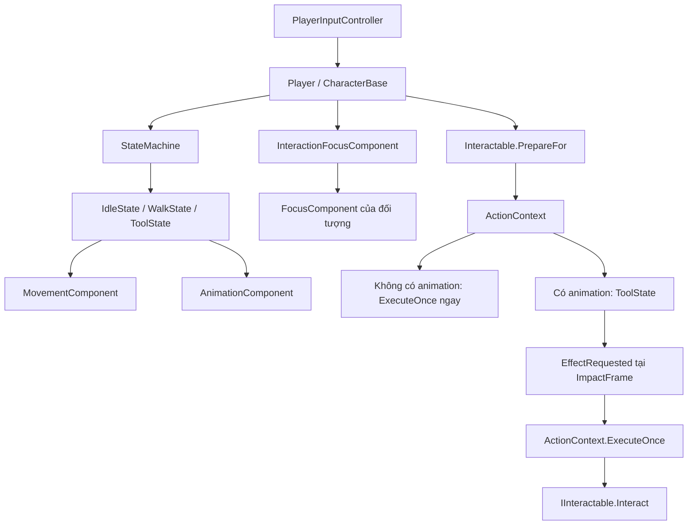

# Sổ tay mã C# trong `src`

Ngày đối chiếu: **14/10/2026**. Mốc mã nguồn: commit `2060a8afb8020b7d563e133dc081bdb7c5dca870` (`to cs`), nhánh `rebuild/c-sharp`.

Tài liệu giải thích code đang có: trách nhiệm từng kiểu, ý nghĩa property/field, hàm, sự kiện và luồng xử lý. Giá trị mặc định dưới đây là giá trị **trong C#**; scene và Resource có thể ghi đè các thuộc tính `[Export]`. Không coi một trường cấu hình đã tồn tại là bằng chứng tính năng tương ứng đã hoạt động.

Phạm vi: **63 file C#, 62 class, 5 interface và 7 enum** trong `src`. Bao gồm kiểu generic, abstract/base class và enum lồng nhau; không đếm delegate signal như một class gameplay. Không bao gồm `tools`, `tests`, addon hoặc toàn bộ API kế thừa của Godot. Các section mô tả thành viên khai báo trong code dự án; thành viên kế thừa từ lớp của dự án được dẫn về lớp cha.

## Mục lục

- [Cách đọc C# sau GDScript](#cach-doc-cs)
- [Bản đồ trách nhiệm và luồng chạy](#ban-do)
- [Tra nhanh 74 kiểu](#tra-nhanh)
- [Core — model và quy tắc thuần C#](#core)
- [Data — Resource cấu hình](#data)
- [Characters — actor, input, animation, state](#characters)
- [Interactions — chọn mục tiêu và hành động](#interactions)
- [Farming — ô đất và ruộng](#farming)
- [Animals — gà, nhu cầu và máng](#animals)
- [Inventory — kho sản phẩm](#inventory)
- [UI — giao diện kho và hotbar](#ui)
- [World — công trình và con trỏ](#world)
- [Theo dõi thay đổi từ GDScript](#migration)
- [Những điểm dễ hiểu nhầm và cách tra sửa](#tracking)

<a id="cach-doc-cs"></a>
## 1. Cách đọc C# sau GDScript

| Cú pháp/khái niệm | Nghĩa trong dự án | Liên hệ GDScript |
|---|---|---|
| `class` / instance | Class là khuôn mẫu; mỗi instance giữ trạng thái riêng, trừ dữ liệu `static` hoặc Resource dùng chung | `class_name` và instance Node/Resource |
| `namespace FantasyFarm.*` | Nhóm tên để tránh trùng và chỉ rõ module | Không tương đương một node trong scene |
| `partial class` | Cho phép compiler/Godot sinh thêm phần của cùng class | Không có nghĩa mỗi class là nhiều đối tượng |
| `sealed` | Không cho kế thừa class; dùng cho các model lõi | Quyết định thiết kế C# |
| `public`, `private`, `protected`, `internal` | Truy cập từ ngoài, chỉ trong class, từ class con, hoặc trong assembly | Phạm vi truy cập rõ hơn tiền tố `_` |
| Field, ví dụ `_focused` | Biến lưu dữ liệu trực tiếp | `var _focused` |
| Property, ví dụ `Quantity { get; set; }` | Cổng đọc/ghi; setter có thể chạy logic hoặc chỉ gán | `var quantity` với getter/setter |
| `get; private set;` | Bên ngoài đọc được, chỉ class sở hữu được gán | Không phải Resource bất biến hoàn toàn |
| `=>` | Viết gọn getter hoặc hàm trả về biểu thức | `return ...` trong hàm ngắn |
| `T?`, `?.`, `??`, `??=` | Cho phép null; gọi nếu khác null; dùng giá trị dự phòng; gán khi null | Các kiểm tra `if x != null` |
| `null!`, `item!` | Tắt cảnh báo nullable của compiler | **Không** kiểm tra null lúc chạy; phải gán dependency đúng |
| `new()` / `new(...)` | Tạo đối tượng, compiler suy kiểu từ vị trí sử dụng | `SomeClass.new()` |
| `virtual`, `override` | Hàm/property có thể được class con thay thế; `override` là phần thay thế | Ghi đè hàm lớp cha |
| `base._Ready()` | Gọi logic `_Ready` của lớp cha trước phần của lớp con | `super._ready()` |
| `[Export]` | Hiện/serialize thuộc tính trong Inspector | `@export` |
| `[Export(PropertyHint.Range, ...)]` | Gợi ý nhập giá trị trong Inspector | Không tự bảo vệ mọi phép gán từ code |
| `[Tool]`, `[GlobalClass]` | Chạy trong editor; đăng ký loại Godot cho Inspector/tạo Resource | `@tool`, `class_name` |
| `GetNode<T>("...")` | Lấy node có kiểu; tên đường dẫn là hợp đồng với scene | `$Node` / `@onready`; ở đây thường gán trong `_Ready()` |
| `_Ready`, `_Process`, `_PhysicsProcess`, `_ExitTree` | Khởi tạo, cập nhật mỗi frame, tick physics, dọn kết nối khi rời tree | `_ready`, `_process`, `_physics_process`, `_exit_tree` |
| `[Signal] ... EventHandler` | Khai báo signal để Godot sinh event và `SignalName` | `signal ...` |
| `+=`, `-=` | Đăng ký/hủy callback của event hoặc signal | `connect`, `disconnect` |
| `Action`, `Func<bool>`, `Predicate<T>` | Callback không trả kết quả; trả bool; xét chấp nhận item | `Callable` theo các chữ ký khác nhau |
| `IInventoryStore<T>` | Interface generic: dùng chung logic kho cho loại item `T` | Hợp đồng được kiểm tra bằng compiler |
| `where T : class, IItemSpec` | `T` phải là kiểu tham chiếu và cung cấp hợp đồng item | Ràng buộc kiểu cho model kho |
| `ReferenceEquals(a, b)` | Cùng một instance, không phải chỉ cùng `ItemId` | Quan trọng khi cộng dồn Resource item |
| `is not (IdleState or WalkState)` | Kiểm tra kiểu state bằng pattern matching | Thay chuỗi điều kiện kiểu/trạng thái |
| `async` / `await ToSignal(...)` | Tạm nhường thực thi để chờ signal; không phải tự tạo thread mới | `await node.ready` |
| `StringName` và `string` | Tên Godot và chuỗi C#; chuyển đổi khi gọi API | Tên animation vẫn là chuỗi, không phải enum |

<a id="ban-do"></a>
## 2. Bản đồ trách nhiệm và luồng chạy

| Module | Class | Interface | Enum | Trách nhiệm |
|---|---:|---:|---:|---|
| `Core` | 5 | 2 | 1 | Tăng trưởng, nhu cầu, stack, sức chứa, chống thực thi lặp |
| `Data` | 5 | 0 | 3 | Cấu hình item/cây/vật nuôi/sản phẩm; slot Resource |
| `Characters` | 12 | 2 | 1 | Input, di chuyển, animation và state machine |
| `Interactions` | 4 | 1 | 1 | Focus, chuẩn bị và thực thi hành động |
| `Farming` | 3 | 0 | 0 | Tạo ruộng, hiển thị ô đất, gieo/tưới/thu hoạch |
| `Animals` | 9 | 0 | 1 | AI gà, needs tick, máng và nạp máng |
| `Inventory` | 1 | 0 | 0 | Node kho kết nối model và signal |
| `UI` | 5 | 0 | 0 | Hotbar, kho, slot view, điều phối UI, debug |
| `World` | 18 | 0 | 0 | Biến thể hình công trình và cursor |
| **Tổng** | **62** | **5** | **7** | **74 kiểu** |

<a id="tra-nhanh"></a>
### Tra nhanh 74 kiểu

Tên dưới đây dẫn tới mục giải thích riêng. Các enum lồng nhau được ghi tên lớp cha; kiểu generic giữ ký hiệu `<T>`.

| Kiểu | Loại | File |
|---|---|---|
| [`CropProgress`](#type-cropprogress) | Class | [src/Core/CropProgress.cs](../src/Core/CropProgress.cs) |
| [`ActionGate`](#type-actiongate) | Class | [src/Core/CropProgress.cs](../src/Core/CropProgress.cs) |
| [`ItemCategory`](#type-itemcategory) | Enum | [src/Core/InventoryStore.cs](../src/Core/InventoryStore.cs) |
| [`IItemSpec`](#type-iitemspec) | Interface | [src/Core/InventoryStore.cs](../src/Core/InventoryStore.cs) |
| [`ItemStack<T>`](#type-itemstack) | Class | [src/Core/InventoryStore.cs](../src/Core/InventoryStore.cs) |
| [`IInventoryStore<T>`](#type-iinventorystore) | Interface | [src/Core/InventoryStore.cs](../src/Core/InventoryStore.cs) |
| [`InventoryStore<T>`](#type-inventorystore) | Class | [src/Core/InventoryStore.cs](../src/Core/InventoryStore.cs) |
| [`AnimalNeeds`](#type-animalneeds) | Class | [src/Core/AnimalNeeds.cs](../src/Core/AnimalNeeds.cs) |
| [`CropDefinition`](#type-cropdefinition) | Class | [src/Data/CropDefinition.cs](../src/Data/CropDefinition.cs) |
| [`ItemDefinition`](#type-itemdefinition) | Class | [src/Data/ItemDefinition.cs](../src/Data/ItemDefinition.cs) |
| [`ItemDefinition.ToolKind`](#type-itemdefinition-toolkind) | Enum | [src/Data/ItemDefinition.cs](../src/Data/ItemDefinition.cs) |
| [`ItemSlot`](#type-itemslot) | Class | [src/Data/ItemSlot.cs](../src/Data/ItemSlot.cs) |
| [`AnimalSpecies`](#type-animalspecies) | Enum | [src/Data/AnimalSpecies.cs](../src/Data/AnimalSpecies.cs) |
| [`AnimalDefinition`](#type-animaldefinition) | Class | [src/Data/AnimalDefinition.cs](../src/Data/AnimalDefinition.cs) |
| [`AnimalProductionDefinition`](#type-animalproductiondefinition) | Class | [src/Data/AnimalProductionDefinition.cs](../src/Data/AnimalProductionDefinition.cs) |
| [`AnimalProductionDefinition.CollectionKind`](#type-animalproductiondefinition-collectionkind) | Enum | [src/Data/AnimalProductionDefinition.cs](../src/Data/AnimalProductionDefinition.cs) |
| [`CharacterBase`](#type-characterbase) | Class | [src/Characters/CharacterBase.cs](../src/Characters/CharacterBase.cs) |
| [`Controller`](#type-controller) | Class | [src/Characters/Controller.cs](../src/Characters/Controller.cs) |
| [`ICharacterController`](#type-icharactercontroller) | Interface | [src/Characters/IState.cs](../src/Characters/IState.cs) |
| [`PlayerInputController`](#type-playerinputcontroller) | Class | [src/Characters/PlayerInputController.cs](../src/Characters/PlayerInputController.cs) |
| [`MovementComponent`](#type-movementcomponent) | Class | [src/Characters/MovementComponent.cs](../src/Characters/MovementComponent.cs) |
| [`AnimationComponent`](#type-animationcomponent) | Class | [src/Characters/AnimationComponent.cs](../src/Characters/AnimationComponent.cs) |
| [`StateId`](#type-stateid) | Enum | [src/Characters/IState.cs](../src/Characters/IState.cs) |
| [`IState`](#type-istate) | Interface | [src/Characters/IState.cs](../src/Characters/IState.cs) |
| [`State`](#type-state) | Class | [src/Characters/State.cs](../src/Characters/State.cs) |
| [`StateMachine`](#type-statemachine) | Class | [src/Characters/StateMachine.cs](../src/Characters/StateMachine.cs) |
| [`IdleState`](#type-idlestate) | Class | [src/Characters/IdleState.cs](../src/Characters/IdleState.cs) |
| [`WalkState`](#type-walkstate) | Class | [src/Characters/WalkState.cs](../src/Characters/WalkState.cs) |
| [`ToolState`](#type-toolstate) | Class | [src/Characters/ToolState.cs](../src/Characters/ToolState.cs) |
| [`WaterState`](#type-waterstate) | Class | [src/Characters/WaterState.cs](../src/Characters/WaterState.cs) |
| [`Player`](#type-player) | Class | [src/Characters/Player.cs](../src/Characters/Player.cs) |
| [`ActionKind`](#type-actionkind) | Enum | [src/Interactions/IInteractable.cs](../src/Interactions/IInteractable.cs) |
| [`IInteractable`](#type-iinteractable) | Interface | [src/Interactions/IInteractable.cs](../src/Interactions/IInteractable.cs) |
| [`Interactable`](#type-interactable) | Class | [src/Interactions/Interactable.cs](../src/Interactions/Interactable.cs) |
| [`ActionContext`](#type-actioncontext) | Class | [src/Interactions/ActionContext.cs](../src/Interactions/ActionContext.cs) |
| [`FocusComponent`](#type-focuscomponent) | Class | [src/Interactions/FocusComponent.cs](../src/Interactions/FocusComponent.cs) |
| [`InteractionFocusComponent`](#type-interactionfocuscomponent) | Class | [src/Interactions/InteractionFocusComponent.cs](../src/Interactions/InteractionFocusComponent.cs) |
| [`FarmLand`](#type-farmland) | Class | [src/Farming/FarmLand.cs](../src/Farming/FarmLand.cs) |
| [`FarmPlot`](#type-farmplot) | Class | [src/Farming/FarmPlot.cs](../src/Farming/FarmPlot.cs) |
| [`FarmPlotInteractable`](#type-farmplotinteractable) | Class | [src/Farming/FarmPlotInteractable.cs](../src/Farming/FarmPlotInteractable.cs) |
| [`Chicken`](#type-chicken) | Class | [src/Animals/Chicken.cs](../src/Animals/Chicken.cs) |
| [`AnimalNeedsComponent`](#type-animalneedscomponent) | Class | [src/Animals/AnimalNeedsComponent.cs](../src/Animals/AnimalNeedsComponent.cs) |
| [`ChickenCoop`](#type-chickencoop) | Class | [src/Animals/ChickenCoop.cs](../src/Animals/ChickenCoop.cs) |
| [`ChickenAIController`](#type-chickenaicontroller) | Class | [src/Animals/ChickenAIController.cs](../src/Animals/ChickenAIController.cs) |
| [`ChickenActionState`](#type-chickenactionstate) | Class | [src/Animals/ChickenActionState.cs](../src/Animals/ChickenActionState.cs) |
| [`ChickenActionState.Phase`](#type-chickenactionstate-phase) | Enum | [src/Animals/ChickenActionState.cs](../src/Animals/ChickenActionState.cs) |
| [`FeedTrough`](#type-feedtrough) | Class | [src/Animals/FeedTrough.cs](../src/Animals/FeedTrough.cs) |
| [`FeedTroughInteractable`](#type-feedtroughinteractable) | Class | [src/Animals/FeedTroughInteractable.cs](../src/Animals/FeedTroughInteractable.cs) |
| [`WaterTrough`](#type-watertrough) | Class | [src/Animals/WaterTrough.cs](../src/Animals/WaterTrough.cs) |
| [`WaterTroughInteractable`](#type-watertroughinteractable) | Class | [src/Animals/WaterTroughInteractable.cs](../src/Animals/WaterTroughInteractable.cs) |
| [`Inventory`](#type-inventory) | Class | [src/Inventory/Inventory.cs](../src/Inventory/Inventory.cs) |
| [`ItemSlotView`](#type-itemslotview) | Class | [src/UI/ItemSlotView.cs](../src/UI/ItemSlotView.cs) |
| [`Hotbar`](#type-hotbar) | Class | [src/UI/Hotbar.cs](../src/UI/Hotbar.cs) |
| [`InventoryPanel`](#type-inventorypanel) | Class | [src/UI/InventoryPanel.cs](../src/UI/InventoryPanel.cs) |
| [`PlayerUIComponent`](#type-playeruicomponent) | Class | [src/UI/PlayerUIComponent.cs](../src/UI/PlayerUIComponent.cs) |
| [`GameDebugPanel`](#type-gamedebugpanel) | Class | [src/UI/GameDebugPanel.cs](../src/UI/GameDebugPanel.cs) |
| [`BuildingVariant`](#type-buildingvariant) | Class | [src/World/BuildingVariant.cs](../src/World/BuildingVariant.cs) |
| [`CursorController`](#type-cursorcontroller) | Class | [src/World/CursorController.cs](../src/World/CursorController.cs) |
| [`Barn`](#type-barn) | Class | [src/World/Buildings/Barn.cs](../src/World/Buildings/Barn.cs) |
| [`BlacksmithHouse`](#type-blacksmithhouse) | Class | [src/World/Buildings/BlacksmithHouse.cs](../src/World/Buildings/BlacksmithHouse.cs) |
| [`Church`](#type-church) | Class | [src/World/Buildings/Church.cs](../src/World/Buildings/Church.cs) |
| [`Coop`](#type-coop) | Class | [src/World/Buildings/Coop.cs](../src/World/Buildings/Coop.cs) |
| [`FishermanHouse`](#type-fishermanhouse) | Class | [src/World/Buildings/FishermanHouse.cs](../src/World/Buildings/FishermanHouse.cs) |
| [`Greenhouse`](#type-greenhouse) | Class | [src/World/Buildings/Greenhouse.cs](../src/World/Buildings/Greenhouse.cs) |
| [`House1`](#type-house1) | Class | [src/World/Buildings/House1.cs](../src/World/Buildings/House1.cs) |
| [`House2`](#type-house2) | Class | [src/World/Buildings/House2.cs](../src/World/Buildings/House2.cs) |
| [`House3`](#type-house3) | Class | [src/World/Buildings/House3.cs](../src/World/Buildings/House3.cs) |
| [`House4`](#type-house4) | Class | [src/World/Buildings/House4.cs](../src/World/Buildings/House4.cs) |
| [`House5`](#type-house5) | Class | [src/World/Buildings/House5.cs](../src/World/Buildings/House5.cs) |
| [`Inn`](#type-inn) | Class | [src/World/Buildings/Inn.cs](../src/World/Buildings/Inn.cs) |
| [`MarketStalls`](#type-marketstalls) | Class | [src/World/Buildings/MarketStalls.cs](../src/World/Buildings/MarketStalls.cs) |
| [`Shed`](#type-shed) | Class | [src/World/Buildings/Shed.cs](../src/World/Buildings/Shed.cs) |
| [`Silo`](#type-silo) | Class | [src/World/Buildings/Silo.cs](../src/World/Buildings/Silo.cs) |
| [`Windmill`](#type-windmill) | Class | [src/World/Buildings/Windmill.cs](../src/World/Buildings/Windmill.cs) |

### 2.1. Di chuyển và hành động của người chơi



Signal `EffectRequested` được `Player.OnEffect()` nối với context đang chờ. Gieo, tưới và nạp máng dùng animation; thu hoạch được chuẩn bị với chuỗi animation rỗng nên chạy ngay. `WaterState` có class riêng nhưng không phải đường thực thi tưới của `Player.UseSelectedItem()`.

### 2.2. Cấu hình, trạng thái và hiển thị

```text
CropDefinition → FarmPlot.Crop + CropProgress → sprite/thanh tiến độ
ItemDefinition → ItemSlot → ItemStack<ItemDefinition> → InventoryStore
InventoryStore → Model.Changed → Inventory/Hotbar → ItemSlotView
AnimalDefinition → AnimalNeedsComponent → AnimalNeeds
ChickenCoop._Process → AdvanceTime → AnimalNeeds.Advance → signal needs
```

`Core` không lấy node hoặc điều khiển UI. Các Node/Resource Godot làm cầu nối giữa model và scene. Interface không tạo thêm Node trong tree.

<a id="core"></a>
## 3. Core — model và quy tắc thuần C#

<a id="type-cropprogress"></a>
### 3.1. `CropProgress`

Nguồn: [src/Core/CropProgress.cs](../src/Core/CropProgress.cs). `sealed class`, giữ tiến độ cho một cây/ô đất; không biết texture hoặc item.

| Property | Ý nghĩa |
|---|---|
| `Duration` | Tổng giây cần để chín; 0 là chưa có cây. Chỉ model được gán |
| `Elapsed` | Giây tiến độ đã tích lũy; bao gồm bonus tưới |
| `WetRemaining` | Giây đất còn ướt; độc lập với việc có cây |
| `HasCrop` | `Duration > 0` |
| `Mature` | Có cây và `Elapsed >= Duration` |
| `Wet` | `WetRemaining > 0` |
| `Stage` | Trống: -1; chưa chín: 0–2; chín: 3 |

| Hàm | Điều kiện, thay đổi và kết quả |
|---|---|
| `Plant(double duration)` | Từ chối nếu đã có cây, thời gian không hữu hạn hoặc ≤0; thành công gán `Duration`, reset `Elapsed`, trả true |
| `Advance(double seconds)` | Bỏ qua thời gian không hữu hạn hoặc ≤0; trừ độ ướt đến tối thiểu 0; cây chưa chín được cộng tiến độ đến tối đa `Duration` |
| `Water(double wetDuration = 5)` | Đang ướt thì false; đặt độ ướt và cộng `Duration * 0.05` cho cây chưa chín; trả true |
| `Harvest()` | Chỉ chín mới thành công; reset `Duration` và `Elapsed` về 0 |

**Logic:** `Stage = clamp((int)(Elapsed / Duration * 3), 0, 2)` cho cây chưa chín. Các mốc là 0%, khoảng 33,33%, 66,67%; texture thứ tư chỉ dùng ở 100%. Tăng trưởng không phụ thuộc `Wet`. Gieo và thu hoạch giữ độ ướt hiện tại. `Water` không kiểm tra tính hợp lệ của đối số `wetDuration`; đường gọi từ `FarmPlot` dùng mặc định 5.

<a id="type-actiongate"></a>
### 3.2. `ActionGate`

Nguồn: [src/Core/CropProgress.cs](../src/Core/CropProgress.cs), cùng file với `CropProgress`. `sealed class`, khóa một lần thử thực thi.

- `Attempted`: đã thử chạy callback hay chưa; bên ngoài chỉ đọc.
- `Execute(Func<bool> action)`: nếu đã thử thì false; nếu chưa, đặt `Attempted = true` **trước** khi gọi callback và trả kết quả callback.

**Logic:** hành động thất bại cũng tiêu thụ lần thử; phải tạo context/gate mới để thử lại. Gate không rollback thay đổi và không phải khóa thread. `ActionContext` sở hữu gate này.

<a id="type-itemcategory"></a>
### 3.3. `ItemCategory` — enum

Nguồn: [src/Core/InventoryStore.cs](../src/Core/InventoryStore.cs).

| Giá trị | Số | Nghĩa |
|---|---:|---|
| `Tool` | 0 | Công cụ; `ItemDefinition.StackLimit` luôn là 1 |
| `Seed` | 1 | Hạt giống |
| `Produce` | 2 | Sản phẩm được kho chính chấp nhận |
| `Feed` | 3 | Thức ăn nạp máng |
| `Hoe` | 4 | Category riêng còn được nhánh fallback `PrepareFor` chấp nhận để vung công cụ |

`Hoe` ở đây khác `ItemDefinition.ToolKind.Hoe`. Quy tắc giới hạn stack 1 xét category `Tool`, không tự áp dụng cho category `Hoe`. Thứ tự số enum ảnh hưởng dữ liệu đã serialize.

<a id="type-iitemspec"></a>
### 3.4. `IItemSpec` — interface

Nguồn: [src/Core/InventoryStore.cs](../src/Core/InventoryStore.cs). Hợp đồng tối thiểu mà model kho cần.

- `Category { get; }`: loại vật phẩm.
- `StackLimit { get; }`: số lượng tối đa một stack.

Không có hàm, không giữ icon/tên/Resource. `ItemDefinition` triển khai interface này; model test có thể dùng một kiểu C# đơn giản khác.

<a id="type-itemstack"></a>
### 3.5. `ItemStack<T>`

Nguồn: [src/Core/InventoryStore.cs](../src/Core/InventoryStore.cs). Một stack runtime; `T` phải là class triển khai `IItemSpec`.

| Thành viên | Nghĩa |
|---|---|
| `Item` | Tham chiếu item; có thể null; getter/setter public |
| `Quantity` | Số lượng; getter/setter public |
| `IsEmpty` | Item null **hoặc** số lượng ≤0 |
| `Changed` | Event không tham số, báo stack được sửa qua các hàm có phát event |

| Hàm | Logic |
|---|---|
| `Set(T? item, int amount)` | Từ chối item null, amount ≤0 hoặc vượt `StackLimit`; thành công gán và phát `Changed` |
| `Consume(int amount)` | Từ chối stack trống, lượng ≤0 hoặc vượt lượng có; trừ, đặt Item null khi về 0, phát event |
| `Increase(int amount)` | Hàm `internal`, cộng và phát event; không tự kiểm tra giới hạn, caller phải kiểm soát |

**Lưu ý:** gán trực tiếp `Item` hoặc `Quantity` không validate và không phát `Changed`. Các hàm `Set`/`Consume` là đường thay đổi có kiểm tra; property setter không tương đương các hàm này.

<a id="type-iinventorystore"></a>
### 3.6. `IInventoryStore<T>` — interface

Nguồn: [src/Core/InventoryStore.cs](../src/Core/InventoryStore.cs).

- `Stacks`: danh sách chỉ đọc về cấu trúc danh sách; từng `ItemStack` vẫn sửa được.
- `Add(T? item, int amount)`: cho phép nhận một phần, trả **số lượng chưa nhận**.
- `TryAdd(T? item, int amount)`: yêu cầu nhận toàn bộ; trả true/false.

Consumer tương tác chỉ cần hợp đồng này, không cần biết Node `Inventory` hay UI. `CapacityFor` là API của implementation, không thuộc interface.

<a id="type-inventorystore"></a>
### 3.7. `InventoryStore<T>`

Nguồn: [src/Core/InventoryStore.cs](../src/Core/InventoryStore.cs). `sealed class`, triển khai hợp đồng kho.

| Thành viên | Nghĩa |
|---|---|
| `Stacks` | Các stack được truyền vào constructor; không tự tạo slot |
| `_accepts` | Predicate quyết định kho có nhận item này hay không |

| Hàm | Logic |
|---|---|
| `InventoryStore(stacks, accepts)` | Gắn danh sách và chính sách nhận item |
| `CapacityFor(T item)` | Ô trống cộng cả `StackLimit`; ô cùng instance item cộng phần thiếu; ô khác item không tính |
| `Add(item, amount)` | Từ chối item sai/null; điền stack cùng item trước, sau đó ô trống; trả phần còn lại |
| `TryAdd(item, amount)` | Kiểm tra item, amount, predicate và đủ sức chứa trước khi gọi `Add`; true khi không còn phần dư |

**Logic:** cộng dồn dùng `ReferenceEquals`, không so `ItemId`. Hai Resource khác instance dù cùng ID vẫn có thể chiếm hai stack. `CapacityFor` không tự xét `_accepts`; `TryAdd` có xét. `Add` trả amount dương ban đầu nếu item bị từ chối, và 0 nếu amount ≤0. Bảo đảm nhận toàn bộ của `TryAdd` dựa vào kiểm tra sức chứa trước khi thay đổi, không có cơ chế transaction/rollback trước callback tùy ý.

<a id="type-animalneeds"></a>
### 3.8. `AnimalNeeds`

Nguồn: [src/Core/AnimalNeeds.cs](../src/Core/AnimalNeeds.cs). `sealed class`, model no/nước độc lập Godot.

| Thành viên | Nghĩa |
|---|---|
| `Satiety`, `Hydration` | Mức no/nước 0–100; ban đầu 100; model kiểm soát setter |
| `Threshold` | Ngưỡng tìm thức ăn/nước, mặc định 100; public setter |
| `Initialized` | Đã nạp thời gian cạn và chỉ số ban đầu |
| `Hungry`, `Thirsty` | Mức tương ứng **≤** Threshold |
| `CanGrow` | Đã khởi tạo và cả hai mức >0; chỉ là cờ, không tự tăng trưởng |
| `_satietyDuration`, `_hydrationDuration` | Tổng giây để hao hết 100 điểm |
| `Changed` | Event mỗi khi giá trị nhu cầu thay đổi |
| `FlagsChanged` | Event lúc khởi tạo hoặc khi Hungry/Thirsty đổi |

| Hàm | Logic |
|---|---|
| `Initialize(satietyDuration, hydrationDuration, satiety, hydration)` | Kiểm tra hai duration hữu hạn và >0; clamp chỉ số 0–100; đặt Initialized; phát cả hai event |
| `Advance(seconds)` | Nếu đã khởi tạo và thời gian hữu hạn >0, giảm mỗi mức theo `100 / depletionDuration * seconds` |
| `RestoreFood()` | Đã khởi tạo thì đưa no về 100, giữ nước |
| `RestoreWater()` | Đã khởi tạo thì đưa nước về 100, giữ no |
| `Set(food, water)` | Hàm private clamp giá trị, bỏ qua khi không đổi; phát Changed và chỉ phát FlagsChanged khi cờ đổi |

**Logic:** `Threshold = 100` khiến cờ Hungry/Thirsty đúng ngay cả ở 100. Đây là phép so sánh đang có, không phải kiểm tra “đã hết thức ăn”. Duration được kiểm tra số hữu hạn; chỉ số khởi tạo và Threshold không được kiểm tra hữu hạn tường minh. Model không tự tìm máng hoặc tiêu thụ vật phẩm.

<a id="data"></a>
## 4. Data — Resource cấu hình

Các Resource class trong nhóm này dùng `[Tool, GlobalClass]`. Dữ liệu cấu hình có thể được dùng chung; không nên nhầm definition với trạng thái runtime từng vật nuôi/cây.

<a id="type-cropdefinition"></a>
### 4.1. `CropDefinition`

Nguồn: [src/Data/CropDefinition.cs](../src/Data/CropDefinition.cs). Kế thừa `Resource`.

| Property | Nghĩa / mặc định |
|---|---|
| `CropId` | ID cây, `StringName` rỗng ban đầu |
| `StageTextures` | Mảng Godot texture, cần đúng bốn phần tử, theo stage 0–3 |
| `GrowthSeconds` | Giây cần để chín; mặc định 1200 |
| `HarvestItem` | Item trả về sau thu hoạch; có thể null |
| `HarvestAmount` | Sản lượng; mặc định 1 |

- `IsValid()`: duration hữu hạn và >0, đủ bốn texture không null. Không kiểm tra CropId hoặc sản phẩm.
- `HasValidHarvest()`: HarvestItem có category Produce và sản lượng >0.

**Logic:** điều kiện trồng và thu hoạch được tách. Cây hợp lệ để trồng chưa chắc hợp lệ để thu hoạch. `FarmPlot.Plant` chỉ gọi `IsValid`; adapter thu hoạch gọi `HasValidHarvest`.

<a id="type-itemdefinition"></a>
### 4.2. `ItemDefinition`

Nguồn: [src/Data/ItemDefinition.cs](../src/Data/ItemDefinition.cs). Kế thừa `Resource`, triển khai `IItemSpec`.

| Thành viên | Nghĩa / mặc định |
|---|---|
| `ItemId`, `DisplayName` | ID và tên tooltip, mặc định rỗng |
| `Icon` | Texture hiển thị trong slot |
| `_itemType`, `ItemType` | Field lưu category; setter gọi `NotifyPropertyListChanged()` để Inspector cập nhật |
| `ToolType` | Loại công cụ trong enum `ToolKind` |
| `Crop` | Definition cây khi item là hạt |
| `MaxStack` | Giới hạn thông thường, mặc định 99 |
| `FoodUnitsPerItem` | Đơn vị thức ăn một item nạp vào máng, mặc định 300 |
| `Category` | Alias `ItemType` cho `IItemSpec` |
| `StackLimit` | Category Tool: 1; các loại khác: MaxStack |

`_ValidateProperty(property)` sửa cờ hiển thị Inspector: chỉ hiện `ToolType` cho Tool, `Crop` cho Seed và `FoodUnitsPerItem` cho Feed. Hàm này **không** xóa dữ liệu của field bị ẩn và không kiểm tra item hợp lệ tổng thể.

<a id="type-itemdefinition-toolkind"></a>
### 4.3. `ItemDefinition.ToolKind` — enum lồng nhau

Nguồn: [src/Data/ItemDefinition.cs](../src/Data/ItemDefinition.cs).

- `Hoe = 0`: cuốc; nhánh công cụ chung có thể chạy animation vung.
- `WateringCan = 1`: bình tưới; adapter ruộng/máng nước dùng để chuẩn bị hành động.

Không nhầm `ToolKind.Hoe` với `ItemCategory.Hoe`: một cái là phân loại con của công cụ, một cái là category riêng.

<a id="type-itemslot"></a>
### 4.4. `ItemSlot`

Nguồn: [src/Data/ItemSlot.cs](../src/Data/ItemSlot.cs). Resource làm cầu nối giữa cấu hình Godot và `ItemStack<ItemDefinition>`.

| Property | Nghĩa |
|---|---|
| `Model` | Stack C# riêng của slot, tạo ngay bằng `new()` |
| `Item` | Export; đọc/ghi trực tiếp `Model.Item` |
| `Quantity` | Export; đọc/ghi trực tiếp `Model.Quantity` |

| Hàm | Logic |
|---|---|
| `ItemSlot()` | Nối `Model.Changed` với `Resource.EmitChanged` |
| `IsEmpty()` | Trả Model.IsEmpty |
| `SetItem(item, amount = 1)` | Gọi Model.Set, có validate và thông báo |
| `Consume(amount = 1)` | Gọi Model.Consume |
| `ConsumeSeed(amount = 1)` | Chỉ tiêu thụ nếu ItemType là Seed |

**Logic:** dùng `SetItem`/`Consume` để UI được thông báo. Gán trực tiếp hai property export không phát `Model.Changed`. Slot khác definition: quantity là trạng thái, definition chỉ mô tả loại item.

<a id="type-animalspecies"></a>
### 4.5. `AnimalSpecies` — enum

Nguồn: [src/Data/AnimalSpecies.cs](../src/Data/AnimalSpecies.cs). Giá trị tuần tự: `Chicken = 0` (gà), `Duck = 1` (vịt), `Cow = 2` (bò), `Sheep = 3` (cừu), `Pig = 4` (heo), `Goose = 5` (ngỗng), `Horse = 6` (ngựa).

Đây là danh mục dữ liệu, không chứng minh mỗi loài có controller/runtime riêng. Trong `src/Animals` hiện có actor cụ thể `Chicken`.

<a id="type-animaldefinition"></a>
### 4.6. `AnimalDefinition`

Nguồn: [src/Data/AnimalDefinition.cs](../src/Data/AnimalDefinition.cs). Resource cấu hình vật nuôi.

| Property | Nghĩa / mặc định |
|---|---|
| `AnimalId`, `DisplayName` | ID và tên hiển thị |
| `Species` | Loài trong AnimalSpecies |
| `MaturitySeconds` | Thời gian trưởng thành, mặc định 120; đã có cấu hình nhưng chưa có bộ đếm trưởng thành trong actor hiện tại |
| `SatietyDepletionSeconds` | Giây hao hết no, mặc định 600; được needs model dùng |
| `HydrationDepletionSeconds` | Giây hao hết nước, mặc định 600; được needs model dùng |
| `FoodPerMeal`, `WaterPerDrink` | Lượng tiêu thụ mỗi lần, mặc định 1; chưa được AI gà gọi để ăn/uống |
| `Production` | Resource mô tả sản phẩm, có thể null |
| `AdultFrames`, `JuvenileFrames` | SpriteFrames lớn/nhỏ; actor hiện tại chưa tự đổi theo tuổi |

`IsValid()` yêu cầu ID không rỗng, MaturitySeconds ≥0, hai duration nhu cầu >0, hai lượng tiêu thụ >0, AdultFrames khác null và Production hợp lệ nếu được gán. Không yêu cầu DisplayName/Species/JuvenileFrames; không có kiểm tra `IsFinite` tường minh cho các duration tại hàm này.

**Logic:** `Chicken._Ready` chuyển definition vào needs. Các field tuổi/hình/sản phẩm đang là dữ liệu; class này không có tick hoặc hàm sinh sản phẩm.

<a id="type-animalproductiondefinition"></a>
### 4.7. `AnimalProductionDefinition`

Nguồn: [src/Data/AnimalProductionDefinition.cs](../src/Data/AnimalProductionDefinition.cs). Resource mô tả một sản phẩm vật nuôi.

| Property | Nghĩa / mặc định |
|---|---|
| `ProductionItem` | Item sản phẩm |
| `ProductionAmount` | Lượng mỗi lần, mặc định 1 |
| `ProductionSeconds` | Giây mỗi chu kỳ, mặc định 1 |
| `CollectionMode` | Cách thu sản phẩm theo enum CollectionKind |

`IsValid()` yêu cầu item loại Produce, amount >0 và seconds >0. Không chạy timer, không spawn vật phẩm, không cập nhật kho. `CollectionMode` không được kiểm tra tính hợp lệ trong hàm này.

<a id="type-animalproductiondefinition-collectionkind"></a>
### 4.8. `AnimalProductionDefinition.CollectionKind` — enum lồng nhau

Nguồn: [src/Data/AnimalProductionDefinition.cs](../src/Data/AnimalProductionDefinition.cs).

- `WorldDrop = 0`: ý nghĩa cấu hình là thả sản phẩm ra thế giới.
- `DirectInteraction = 1`: ý nghĩa cấu hình là nhận qua tương tác.

Hai giá trị mô tả cách thu dự kiến trong dữ liệu; chưa có consumer thực hiện chu kỳ sản xuất trong code `src` đã đối chiếu.

<a id="characters"></a>
## 5. Characters — actor, input, animation, state

<a id="type-characterbase"></a>
### 5.1. `CharacterBase`

Nguồn: [src/Characters/CharacterBase.cs](../src/Characters/CharacterBase.cs). Kế thừa `CharacterBody2D`, phần nền chung của Player và Chicken.

| Property | Nghĩa |
|---|---|
| `AnimationComponent` | Component animation, chỉ class sở hữu setter |
| `StateMachine` | Bộ quản lý state |
| `MovementComponent` | Bộ áp vận tốc và collision |
| `MovementVector` | Hướng/ý định di chuyển do controller ghi; không phải vận tốc thực tế |

- `_Ready()`: lấy ba child cùng tên và gọi `StateMachine.Initialize(this)`.
- `HasMoveIntent()`: true khi bình phương độ dài MovementVector >0,01; tránh đổi state vì vector rất nhỏ.

**Logic:** controller ghi ý định, state quyết định có được di chuyển hay không, movement thực hiện physics. Scene phải có đúng tên/kiểu child; `null!` không thay kiểm tra dependency.

<a id="type-controller"></a>
### 5.2. `Controller`

Nguồn: [src/Characters/Controller.cs](../src/Characters/Controller.cs). Kế thừa `Node`, triển khai `ICharacterController`; base class của input và AI.

- `Actor`: CharacterBase cha, setter private.
- `_Ready()`: lấy parent có kiểu CharacterBase; đặt `ProcessPhysicsPriority = -10` để controller được cập nhật sớm hơn các node có priority mặc định.

Class này chưa tự tạo MovementVector. Class con triển khai input/AI.

<a id="type-icharactercontroller"></a>
### 5.3. `ICharacterController` — interface

Nguồn: [src/Characters/IState.cs](../src/Characters/IState.cs). Chỉ khai báo `CharacterBase Actor { get; }`; diễn đạt controller thuộc actor nào. Không khai báo Update/Input và không tự quyết định thứ tự physics.

<a id="type-playerinputcontroller"></a>
### 5.4. `PlayerInputController`

Nguồn: [src/Characters/PlayerInputController.cs](../src/Characters/PlayerInputController.cs). Kế thừa Controller, nhận Input Map.

| Thành viên | Nghĩa / mặc định |
|---|---|
| `ActionLeft`, `ActionRight`, `ActionUp`, `ActionDown` | Export StringName: `ui_left`, `ui_right`, `ui_up`, `ui_down` |
| `ActionUseItem` | Tên action `use_item` |
| `ActionToggleInventory` | Tên action `toggle_inventory` |
| `_player` | Actor được cast sang Player sau khi base khởi tạo |
| `HotbarActions` | Mảng static readonly `hotbar_1` … `hotbar_9`, `hotbar_0`; slot index 0–9 |

| Hàm | Logic |
|---|---|
| `_Ready()` | Gọi base, lấy Player |
| `_PhysicsProcess(delta)` | Kho mở: MovementVector.Zero; kho đóng: Input.GetVector theo bốn action |
| `_UnhandledKeyInput(event)` | Bỏ key echo; xét chọn hotbar trước, sau đó dùng item; đánh dấu viewport đã xử lý input |
| `_Input(event)` | Nhận mở/đóng kho, bỏ echo và đánh dấu input đã xử lý |

**Logic:** chọn hotbar/use item chỉ nhận key chưa bị UI xử lý; toggle kho đi qua `_Input`. `delta` không dùng trong hàm đọc input. Chọn slot được UIController kiểm tra trạng thái kho.

<a id="type-movementcomponent"></a>
### 5.5. `MovementComponent`

Nguồn: [src/Characters/MovementComponent.cs](../src/Characters/MovementComponent.cs). Node phụ trách physics của CharacterBody2D cha.

| Thành viên | Nghĩa / mặc định |
|---|---|
| `Speed` | Tốc độ mục tiêu, 150 đơn vị/giây |
| `Acceleration` | Mức thay đổi vận tốc khi có input, 1200 |
| `Friction` | Mức giảm vận tốc khi input bằng 0, 1600 |
| `_body` | CharacterBody2D parent |

- `_Ready()`: lấy parent.
- `Move(direction, delta)`: giới hạn độ dài vector tối đa 1, nhân Speed; dùng Velocity.MoveToward với Acceleration hoặc Friction nhân delta; gọi MoveAndSlide.
- `Stop()`: đặt Velocity.Zero ngay; không gọi MoveAndSlide.

**Logic:** di chuyển chéo không nhanh hơn thẳng. `Move(Vector2.Zero, delta)` giảm tốc từ từ; `Stop()` dừng ngay. Tốc độ thực được lấy ở đây, không phải `WalkState.Speed`.

<a id="type-animationcomponent"></a>
### 5.6. `AnimationComponent`

Nguồn: [src/Characters/AnimationComponent.cs](../src/Characters/AnimationComponent.cs). Node chuyển action + hướng thành tên animation.

| Thành viên | Nghĩa / mặc định |
|---|---|
| `AnimatedSprite` | AnimatedSprite2D được gán qua Inspector |
| `FallbackAnimation` | Tên dự phòng, `idle_down` |
| `FlipLeft` | Nếu true, hướng trái dùng animation hướng phải rồi flip; mặc định true |
| `SingleDirection` | Bộ ảnh chỉ có hướng down, dùng flip để thể hiện trái/phải |
| `SingleDirectionFacesLeft` | Bộ ảnh một hướng vốn quay trái; mặc định true |
| `FacingDirection` | Chuỗi `up/down/left/right`, mặc định down; setter private |
| `CurrentAction` | Action hiện tại, ban đầu rỗng |
| `FacingVector` | Vector đơn vị suy ra từ FacingDirection; mặc định Down nếu tên không thuộc ba nhánh còn lại |
| `_warned` | HashSet tên animation đã cảnh báo, tránh spam log |
| `ActionFinished(action)` | Signal phát action hiện tại khi AnimatedSprite báo AnimationFinished |

| Hàm | Logic |
|---|---|
| `_Ready()` / `_ExitTree()` | Đăng ký/hủy `AnimatedSprite.AnimationFinished` |
| `OnAnimationFinished()` | Phát ActionFinished với CurrentAction |
| `Play(action, restart = false)` | Thiếu SpriteFrames thì return; ghép `action_direction`, chọn flip; thiếu tên thì cảnh báo một lần và dùng fallback; tránh phát lại animation đang chạy nếu không restart |
| `UpdateFacingDirection(direction)` | Vector gần 0: false; một hướng chỉ xét X; nhiều hướng chọn trục lớn hơn; đường chéo bằng nhau giữ hướng cũ nếu đã khớp một trục; trả hướng có đổi không |
| `Face(direction)` | Nếu hướng đổi và đang có action, gọi Play(CurrentAction) |

**Logic:** tên animation vẫn là hợp đồng chuỗi với SpriteFrames. `restart = true` Stop rồi Play để reset. ActionFinished chỉ phát khi animation thực tế kết thúc; animation loop hoặc fallback không phù hợp có thể khiến state chờ lâu. Cờ SingleDirection thay cách chọn texture animation, không đổi vector di chuyển.

<a id="type-stateid"></a>
### 5.7. `StateId` — enum

Nguồn: [src/Characters/IState.cs](../src/Characters/IState.cs).

| Giá trị | Số | Ý nghĩa |
|---|---:|---|
| `Idle` | 0 | Đứng yên |
| `Walk` | 1 | Đi bộ |
| `Tool` | 2 | Dùng công cụ, phát hiệu lực |
| `Water` | 3 | State animation tưới riêng |
| `Peck` | 4 | Hành động mổ của gà |
| `Rest` | 5 | Nghỉ |
| `Sleep` | 6 | Ngủ |

StateMachine ánh xạ enum tới instance State. ID của mỗi node state phải duy nhất trong cùng machine; gà có thể dùng nhiều instance ChickenActionState với ID khác nhau.

<a id="type-istate"></a>
### 5.8. `IState` — interface

Nguồn: [src/Characters/IState.cs](../src/Characters/IState.cs).

- `Enter()`: bắt đầu state.
- `Exit()`: dọn state cũ, đặc biệt callback.
- `Update(delta)`: cập nhật theo frame.
- `PhysicsUpdate(delta)`: cập nhật physics.

Không giữ Actor/Id; các dependency đó được base class State cung cấp. Machine hiện giữ các instance `State` cụ thể.

<a id="type-state"></a>
### 5.9. `State`

Nguồn: [src/Characters/State.cs](../src/Characters/State.cs). Kế thừa Node, triển khai IState; base class có các hàm mặc định rỗng.

| Property | Nghĩa |
|---|---|
| `Id` | Export StateId để machine đăng ký |
| `Actor`, `Machine` | Protected; gán khi Setup |
| `Animation`, `Movement` | Protected getter lấy component từ Actor |

- `Setup(actor, machine)`: gắn hai dependency.
- `Enter`, `Exit`, `Update(delta)`, `PhysicsUpdate(delta)`: virtual no-op, class con ghi đè tùy nhu cầu.

Các state không phải tự chạy `_Process`; StateMachine gọi hàm của state hiện tại.

<a id="type-statemachine"></a>
### 5.10. `StateMachine`

Nguồn: [src/Characters/StateMachine.cs](../src/Characters/StateMachine.cs). Node điều phối state.

| Thành viên | Nghĩa |
|---|---|
| `InitialState` | Export, state lúc khởi tạo, có thể null |
| `DefaultState` | Export, state quay về; nếu null sẽ dùng InitialState |
| `CurrentState` | State đang chạy, setter private |
| `_states` | Dictionary<StateId, State> của child state |
| `StateChanged(from, to)` | Signal sau khi chuyển; from có thể null ở lần đầu |

| Hàm | Logic |
|---|---|
| `Initialize(actor)` | Duyệt child State, thêm theo Id và Setup; đặt default dự phòng; thiếu initial thì warning, có thì TransitionTo |
| `_Process(delta)` | Gọi CurrentState.Update nếu có |
| `_PhysicsProcess(delta)` | Gọi CurrentState.PhysicsUpdate nếu có |
| `ChangeState(id)` | Tra dictionary; thiếu ID thì warning |
| `ChangeToDefault()` | Chuyển khi DefaultState khác null |
| `TransitionTo(target)` | Cùng instance thì bỏ qua; Exit state cũ → gán CurrentState → Enter state mới → phát signal |
| `_ExitTree()` | Exit state hiện tại và xóa tham chiếu |

**Logic:** machine dùng dictionary `Add`, nên ID trùng sẽ gây exception, không tự ghi đè. Initialize không xóa dictionary trước khi đăng ký; không phải API để gọi lại tùy ý. Đổi state dựa vào instance, không tự reset nếu chọn lại đúng state hiện tại.

<a id="type-idlestate"></a>
### 5.11. `IdleState`

Nguồn: [src/Characters/IdleState.cs](../src/Characters/IdleState.cs). Kế thừa State, không thêm property/field.

- `Enter()`: phát action idle.
- `PhysicsUpdate(delta)`: Move(Zero, delta) để giảm tốc; có ý định di chuyển thì đổi sang Walk.

Di chuyển bắt đầu qua state Walk ở tick kế tiếp, vì idle chỉ đổi state sau lần Move(Zero).

<a id="type-walkstate"></a>
### 5.12. `WalkState`

Nguồn: [src/Characters/WalkState.cs](../src/Characters/WalkState.cs). Kế thừa State.

- `Speed`: export mặc định 120 nhưng **không được dùng** trong Enter/PhysicsUpdate.
- `Enter()`: cập nhật hướng từ MovementVector và phát walk.
- `PhysicsUpdate(delta)`: hết ý định thì về default; còn thì Face rồi Movement.Move.

Muốn đổi tốc độ đi thực tế phải tra `MovementComponent.Speed`. Các property Actor/Machine/Animation/Movement được kế thừa từ State.

<a id="type-toolstate"></a>
### 5.13. `ToolState`

Nguồn: [src/Characters/ToolState.cs](../src/Characters/ToolState.cs). State animation công cụ có frame hiệu lực.

| Thành viên | Nghĩa / mặc định |
|---|---|
| `Action` | Export StringName, action animation `tool`; Player có thể đổi thành `water` |
| `ImpactFrame` | Frame bắt đầu cho phép hiệu lực, mặc định 3; frame index bắt đầu từ 0 |
| `_effectApplied` | Đã phát tín hiệu hiệu lực trong lần Enter này |
| `_connected` | Đã nối callback animation |
| `ActionStarted`, `EffectRequested`, `ActionEnded` | Ba signal không tham số: bắt đầu, yêu cầu hiệu lực, kết thúc |

| Hàm | Logic |
|---|---|
| `Enter()` | Reset cờ hiệu lực, Stop movement, nối callback, phát Started, Play restart, kiểm tra frame hiện tại |
| `OnFrameChanged()` | Chỉ khi machine vẫn ở state này, chưa phát hiệu lực và Frame ≥ImpactFrame; đánh dấu trước rồi phát EffectRequested |
| `PhysicsUpdate(delta)` | Stop movement mỗi physics tick |
| `OnActionFinished(action)` | Chỉ nhận đúng action và đúng state; có input thì Walk, không thì default |
| `Exit()` | Nếu đã nối thì hủy hai callback, reset connected và phát Ended |

**Logic:** ToolState chỉ phát yêu cầu; nó không biết hạt/cây/máng. Player sở hữu context thực thi. Có hai tầng chống lặp: `_effectApplied` ngăn signal lặp, ActionGate ngăn context chạy lại. Animation không đạt ImpactFrame sẽ không tạo hiệu lực.

<a id="type-waterstate"></a>
### 5.14. `WaterState`

Nguồn: [src/Characters/WaterState.cs](../src/Characters/WaterState.cs). Kế thừa State, animation tưới riêng.

- `Action`: string export `water`; `_connected`: cờ nối callback.
- `Enter()`: Stop, nối ActionFinished, phát animation restart.
- `PhysicsUpdate(delta)`: Stop.
- `OnFinished(action)`: đúng state/action thì Walk hoặc default theo ý định di chuyển.
- `Exit()`: hủy callback nếu đã nối.

**Logic:** không có EffectRequested/ImpactFrame và không tưới đất. Player đang dùng ToolState với Action water, nên không nên nối thêm tưới vào WaterState khi chưa đổi đường gọi.

<a id="type-player"></a>
### 5.15. `Player`

Nguồn: [src/Characters/Player.cs](../src/Characters/Player.cs). Kế thừa CharacterBase.

| Thành viên | Nghĩa |
|---|---|
| `Inventory` | Export Node kho sản phẩm |
| `UIController` | PlayerUIComponent child, setter private |
| `_toolState` | ToolState child trong StateMachine |
| `_focus` | Bộ chọn mục tiêu của player |
| `_pending` | Context chờ frame hiệu lực, có thể null |

| Hàm | Logic |
|---|---|
| `_Ready()` | Khởi tạo base; lấy UI/focus/tool state, nối signal và áp trạng thái kho hiện tại |
| `OnStarted()` | Khóa focus |
| `OnEnded()` | Xóa pending và mở khóa focus |
| `OnEffect()` | Nếu có pending, gọi ExecuteOnce; kết quả bool hiện không được hiển thị ra UI |
| `OnInventoryChanged(open)` | Đặt focus.Active thành !open |
| `UseSelectedItem()` | Chặn khi kho mở hoặc không ở Idle/Walk; refresh focus; chuẩn bị context; không cần animation thì chạy ngay; có thì lưu pending, đặt Action và chuyển ToolState |
| `_ExitTree()` | Xóa pending, hủy các subscription còn hợp lệ |

**Logic:** Item/Slot/Target được context chụp ở lúc chuẩn bị. Thay selected index không tự thay context đang chờ; sửa item trong slot đã chụp khiến ExecuteOnce bị hủy. Player không tự trồng/tưới/thu hoạch. MovementVector và các component chính được kế thừa CharacterBase.

<a id="interactions"></a>
## 6. Interactions — chọn mục tiêu và hành động

<a id="type-actionkind"></a>
### 6.1. `ActionKind` — enum

Nguồn: [src/Interactions/IInteractable.cs](../src/Interactions/IInteractable.cs).

| Giá trị | Số | Nghĩa |
|---|---:|---|
| `Swing` | 0 | Vung công cụ không có target nghiệp vụ |
| `Plant` | 1 | Gieo hạt |
| `WaterSoil` | 2 | Tưới ô đất |
| `FillWater` | 3 | Nạp máng nước |
| `FillFeed` | 4 | Nạp thức ăn |
| `Harvest` | 5 | Thu hoạch cây |

Enum chọn nghiệp vụ; `AnimationAction` là chuỗi chọn hình chuyển động. Một animation tool có thể phục vụ Swing, Plant hoặc FillFeed.

<a id="type-iinteractable"></a>
### 6.2. `IInteractable` — interface

Nguồn: [src/Interactions/IInteractable.cs](../src/Interactions/IInteractable.cs).

- `PrepareAction(ItemSlot? slot, IInventoryStore<ItemDefinition>? inventory)`: xét điều kiện, trả context hoặc null; chưa áp hiệu lực.
- `Interact(ActionContext context)`: áp hiệu lực, trả thành công/thất bại.

Hai bước tách nhau để animation có thể chạy giữa thời điểm chọn và thời điểm sửa dữ liệu. Consumer cần kiểm tra điều kiện còn đúng lúc thực thi.

<a id="type-interactable"></a>
### 6.3. `Interactable`

Nguồn: [src/Interactions/Interactable.cs](../src/Interactions/Interactable.cs). Node base triển khai IInteractable; không thêm property/field.

- `PrepareAction(...)`: virtual mặc định null.
- `Interact(...)`: virtual mặc định false.
- `PrepareFor(target, slot, inventory)`: static; tìm child tên `Interactable` trên target còn sống; nếu child triển khai interface và chuẩn bị được action thì dùng action đó; nếu không, slot Tool/Hoe có thể tạo Swing với target null và animation tool.

**Logic:** node target là đối tượng cha, còn context.Target thường là component Interactable. Fallback chỉ vung animation, không cuốc đất hay tác động thế giới. Hạt không có fallback Swing. Target có component nhưng từ chối hành động vẫn có thể nhận fallback công cụ.

<a id="type-actioncontext"></a>
### 6.4. `ActionContext`

Nguồn: [src/Interactions/ActionContext.cs](../src/Interactions/ActionContext.cs). `sealed class` thuần C#, gói một hành động đã chuẩn bị.

| Thành viên | Nghĩa |
|---|---|
| `Kind` | Nghiệp vụ ActionKind |
| `Target` | IInteractable nhận hiệu lực, có thể null với Swing |
| `Slot` | Slot đã chọn khi chuẩn bị; đây là tham chiếu, quantity không được copy |
| `Item` | Tham chiếu slot.Item chụp trong constructor |
| `Inventory` | Kho nhận sản phẩm, có thể null |
| `AnimationAction` | Chuỗi animation, mặc định rỗng |
| `RequiresAnimation` | Chuỗi animation dài hơn 0 |
| `_gate` | ActionGate riêng cho context |

- `ActionContext(target, kind, slot, inventory, animation = "")`: gắn thông tin và chụp Item từ Slot.
- `ExecuteOnce()`: đi qua gate; ngoài Harvest phải còn slot/item và Slot.Item bằng Item; Swing trả true mà không gọi target; target Godot đã free thì false; còn lại gọi Target.Interact hoặc false nếu null.

**Logic:** các property chỉ đọc giữ thông tin lựa chọn, không làm các đối tượng được tham chiếu thành bất biến. Harvest không cần item/slot. Kiểm tra target chỉ xử lý lifetime Godot nếu target thực sự là GodotObject. Context thất bại cũng không được retry; tạo hành động mới.

<a id="type-focuscomponent"></a>
### 6.5. `FocusComponent`

Nguồn: [src/Interactions/FocusComponent.cs](../src/Interactions/FocusComponent.cs). Area2D gắn vào đối tượng có thể được focus.

| Thành viên | Nghĩa / mặc định |
|---|---|
| `FocusEnabled` | Có được chọn/hiển thị focus, true |
| `BobHeight` | Độ nhún pointer, 3 |
| `BobDuration` | Thời gian mỗi nửa nhún, 0,35 giây |
| `_marker`, `_pointer` | Child FocusMarker và Sprite2D FocusMarker/Pointer |
| `_rest` | Vị trí pointer gốc |
| `_focused` | Trạng thái focus nội bộ |
| `_tween` | Tween lặp đang chạy hoặc null |
| `FocusChanged(focused)` | Signal cho chủ thể như FarmPlot cập nhật thanh tiến độ |

- `_Ready()`: lấy child, lưu vị trí gốc, ẩn marker.
- `GetInteractionTarget()`: parent nếu là Node2D, nếu không null.
- `SetFocused(value)`: AND với FocusEnabled; không đổi thì return; hiện/ẩn marker; dừng tween cũ; nếu focus thì tạo tween Sine InOut lên/xuống lặp; phát signal.
- `StopBobbing()`: Kill tween, xóa tham chiếu, reset vị trí nếu pointer còn sống.
- `_ExitTree()`: dừng tween.

**Logic:** component không tự chọn mình; InteractionFocusComponent chọn. Focus chỉ xác nhận vị trí/khả năng chọn, không chứng minh có hành động hợp lệ với item đang cầm.

<a id="type-interactionfocuscomponent"></a>
### 6.6. `InteractionFocusComponent`

Nguồn: [src/Interactions/InteractionFocusComponent.cs](../src/Interactions/InteractionFocusComponent.cs). Area2D trên actor, chọn một FocusComponent trong vùng chồng lấn.

| Thành viên | Nghĩa / mặc định |
|---|---|
| `UpdateInterval` | Giây giữa lần chấm lại tự động, 0,1 |
| `FacingWeight` | Trọng số ưu tiên phía đang nhìn, 12 |
| `SwitchMargin` | Mức tốt hơn cần có để đổi target đang hợp lệ, 4 |
| `Active` | Bật chọn mục tiêu, true |
| `Locked` | Giữ lựa chọn trong animation |
| `_actor` | CharacterBase cha |
| `_candidates` | Danh sách FocusComponent nằm trong vùng |
| `_focused` | Component đang được chọn |
| `_elapsed` | Thời gian tích lũy trước lần refresh |

| Hàm | Logic |
|---|---|
| `_Ready()` | Lấy actor; nối AreaEntered/AreaExited |
| `_PhysicsProcess(delta)` | Không Active: reset timer và bỏ focus; Locked: return; đủ interval: reset timer và RefreshFocus |
| `Eligible(candidate)` | Static; component còn sống, FocusEnabled, parent target còn sống |
| `RefreshFocus()` | Khi Active và không Locked: xóa candidate đã free, bỏ ứng viên không hợp lệ, chọn score thấp nhất; giữ target cũ nếu ứng viên mới chưa tốt hơn đủ margin |
| `Score(candidate)` | Khoảng cách trừ dot hướng nhìn nhân FacingWeight; gần 0 trả 0 |
| `SetFocused(next)` | Tắt marker cũ còn sống, đổi tham chiếu, bật marker mới |
| `OnEntered(area)` | Thêm FocusComponent nếu chưa có |
| `OnExited(area)` | Xóa candidate và bỏ focus nếu đó là target hiện tại |
| `GetFocusedTarget()` | Active và focused hợp lệ thì trả parent Node2D; khác thì null |
| `_ExitTree()` | Hủy signal area và bỏ focus |

**Phân tích score:** `distance - dot(facing, normalizedOffset) * FacingWeight`. Target phía trước được giảm score, phía sau bị tăng; thấp hơn là tốt hơn. Giữ target cũ khi `bestScore >= oldScore - SwitchMargin`, nên ứng viên mới phải tốt hơn **hơn** margin mới chuyển.

**Logic khóa:** Locked ngăn chấm lại định kỳ và RefreshFocus, nhưng OnExited vẫn có thể xóa focus. Context đã chuẩn bị vẫn giữ target riêng; Active=false được xử lý ở physics tick để tắt marker, còn GetFocusedTarget trả null ngay.

<a id="farming"></a>
## 7. Farming — ô đất và ruộng

<a id="type-farmland"></a>
### 7.1. `FarmLand`

Nguồn: [src/Farming/FarmLand.cs](../src/Farming/FarmLand.cs). `[Tool, GlobalClass]`, kế thừa Node2D; tạo lưới instance FarmPlot trong editor/runtime.

| Thành viên | Nghĩa / mặc định |
|---|---|
| `PlotScene`, `_plotScene` | PackedScene mẫu và field lưu; có thể null |
| `Rows`, `_rows` | Số hàng, mặc định 6 |
| `Cols`, `_cols` | Số cột, mặc định 6 |
| `Gap`, `_gap` | Khoảng cách các ô, mặc định Vector2(16,16) |
| `_pending` | Có một rebuild đã được xếp deferred hay chưa |

Setter của bốn property export đều gọi RequestRebuild.

- `_Ready()`: yêu cầu rebuild.
- `RequestRebuild()`: chưa Ready hoặc đã pending thì bỏ qua; đặt pending và CallDeferred(CreateGrid).
- `CreateGrid()`: reset pending; ngoài tree thì return; xóa chỉ child có metadata `generated_plot`; nếu có mẫu, tạo Rows × Cols FarmPlot, đặt ID `plot_<col>_<row>`, vị trí `(col * Gap.X + 8, row * Gap.Y + 16)`, đánh metadata và AddChild.

**Logic:** giữ child không do generator sinh, ví dụ TileMapLayer. Rebuild xóa instance cũ và trạng thái cây cũ; đây không phải resize bảo toàn cây. Rows/Cols không clamp trong setter; số âm làm vòng lặp không tạo ô. ID duy nhất trong một lưới, không chứa ID của FarmLand nên chưa bảo đảm duy nhất giữa nhiều ruộng.

<a id="type-farmplot"></a>
### 7.2. `FarmPlot`

Nguồn: [src/Farming/FarmPlot.cs](../src/Farming/FarmPlot.cs). `[Tool, GlobalClass]`, Node2D làm cầu nối cây/đất với model và sprite.

| Thành viên | Nghĩa |
|---|---|
| `DryTexture`, `WetTexture` | Export texture đất khô/ướt |
| `PlotId` | ID được FarmLand gán; không phải export/lưu trạng thái tự động |
| `Crop` | Definition cây đang trồng, null khi trống; setter private |
| `Progress` | CropProgress riêng của ô, getter-only |
| `_soil`, `_plant` | Sprite2D child SoilSprite/CropSprite |
| `_bar` | ProgressBar CropSprite/GrowthBar |
| `_focus` | FocusComponent child |
| `_focused` | Cờ hiển thị tiến độ |
| `_normal`, `_mature` | Style thanh bình thường và thanh chín; màu chín #34eb4c |

| Hàm | Logic |
|---|---|
| `_Ready()` | Lấy sprite/bar; ẩn bar, tạo style; editor thì tắt process và return; runtime nối FocusChanged và Refresh |
| `_Process(delta)` | Runtime gọi Progress.Advance rồi Refresh |
| `Plant(crop)` | Từ chối editor/null/definition sai/model không nhận; gán Crop và Refresh khi thành công |
| `Water()` | Từ chối editor hoặc model đang ướt; thành công Refresh |
| `IsMature()` | Trả Progress.Mature |
| `HasCrop()` | Kiểm tra Crop khác null |
| `Harvest()` | Từ chối editor hoặc model chưa chín; thành công xóa Crop và Refresh |
| `SetFocused(focused)` | Gán cờ và RefreshBar |
| `Refresh()` | Đổi texture đất; ẩn/hiện cây và chọn StageTextures; refresh bar; chỉ process khi cây đang lớn hoặc đất ướt |
| `RefreshBar()` | Không focus/cây trống thì hide; khác thì tính `% = Elapsed / Crop.GrowthSeconds * 100`, chọn style theo chín, show |
| `_ExitTree()` | Hủy FocusChanged khi component còn sống |

**Logic:** `FarmPlot.HasCrop()` dùng Crop, còn `Progress.HasCrop` dùng Duration. Các hàm Plant/Harvest bình thường giữ chúng đồng bộ; property Progress public cho phép caller sửa model trực tiếp, nên có thể phá đồng bộ nếu dùng sai. Model lưu duration lúc gieo, nhưng bar chia theo definition hiện tại: sửa GrowthSeconds của Resource trong khi cây đang lớn có thể khiến bar và mốc chín lệch nhau.

Plot không tự tiêu thụ hạt hoặc chuyển sản phẩm. Cây chín đất khô tắt process; gọi Plant/Water/Harvest sẽ Refresh để bật lại khi cần. Thời gian chỉ Advance theo tick chạy hiện tại, không có bù thời gian offline ở class này.

<a id="type-farmplotinteractable"></a>
### 7.3. `FarmPlotInteractable`

Nguồn: [src/Farming/FarmPlotInteractable.cs](../src/Farming/FarmPlotInteractable.cs). Kế thừa Interactable; field `_plot` giữ FarmPlot parent.

- `_Ready()`: lấy parent có kiểu FarmPlot.
- `PrepareAction(slot, inventory)`: chín thì ưu tiên Harvest nếu có kho và sản phẩm hợp lệ; chưa chín thì cần slot không trống; Seed + ô trống + definition hợp lệ tạo Plant/tool; Tool/WateringCan tạo WaterSoil/water; còn lại null.
- `Interact(context)`: switch Kind; các nhánh xử lý bên dưới; Kind không hỗ trợ trả false.

| Nhánh | Thứ tự sửa dữ liệu |
|---|---|
| `Plant` | Kiểm tra slot, item Seed, Crop và ô trống → `_plot.Plant` → `ConsumeSeed()` một hạt |
| `WaterSoil` | `_plot.Water()`; không trừ item bình tưới |
| `Harvest` | Kiểm tra chín, sản phẩm, kho → `TryAdd` toàn bộ sản lượng → `_plot.Harvest()` xóa cây |

**Logic:** độ ướt được kiểm tra lúc thực thi Water, không phải lúc PrepareAction; vì vậy có thể chạy animation trên ô còn ướt rồi hiệu lực false. Harvest ưu tiên hơn tưới/gieo dù đang cầm gì. Plant sửa ô trước khi tiêu thụ hạt; validation của context/slot là điều kiện để ConsumeSeed thành công, không có rollback riêng nếu gọi trực tiếp với context sai hoặc callback làm slot đổi giữa chừng. Đường gọi chuẩn đi qua ExecuteOnce để kiểm tra item và lifetime.

<a id="animals"></a>
## 8. Animals — gà, nhu cầu và máng

<a id="type-chicken"></a>
### 8.1. `Chicken`

Nguồn: [src/Animals/Chicken.cs](../src/Animals/Chicken.cs). Kế thừa CharacterBase.

- `Definition`: export AnimalDefinition nullable.
- `_Ready()`: gọi base khởi tạo actor/state machine, rồi lấy AnimalNeedsComponent child và Initialize(Definition).

Không thêm property tuổi hay bộ đếm sản xuất. Di chuyển, animation, state được kế thừa; Initialize thất bại được component báo lỗi, Chicken không tự retry.

<a id="type-animalneedscomponent"></a>
### 8.2. `AnimalNeedsComponent`

Nguồn: [src/Animals/AnimalNeedsComponent.cs](../src/Animals/AnimalNeedsComponent.cs). Node bọc model AnimalNeeds và chuyển event C# thành signal Godot.

| Thành viên | Nghĩa / mặc định |
|---|---|
| `InitialSatiety`, `InitialHydration` | No/nước lúc khởi tạo, 100 |
| `SeekThreshold` | Ngưỡng Hungry/Thirsty, 100 |
| `Model` | AnimalNeeds riêng |
| `_subscribed` | Đã nối event model, tránh nối trùng khi Initialize |
| `NeedsChanged(satiety, hydration)` | Signal giá trị nhu cầu |
| `NeedFlagsChanged(hungry, thirsty)` | Signal cờ đói/khát |

- `Initialize(definition)`: definition không hợp lệ thì PushError/false; gán Threshold, đăng ký event một lần, nạp duration/chỉ số vào model.
- `OnNeeds()`: phát NeedsChanged.
- `OnFlags()`: phát NeedFlagsChanged.
- `AdvanceTime(seconds)`: Model.Advance.
- `RestoreSatiety()`: Model.RestoreFood.
- `RestoreHydration()`: Model.RestoreWater.
- `_ExitTree()`: hủy hai event, reset subscribed.

**Logic:** không có `_Process` riêng. ChickenCoop gọi AdvanceTime theo nhịp tập trung. SeekThreshold được copy vào Model khi Initialize; thay property component sau đó không tự sửa Threshold model.

<a id="type-chickencoop"></a>
### 8.3. `ChickenCoop`

Nguồn: [src/Animals/ChickenCoop.cs](../src/Animals/ChickenCoop.cs). Node2D cập nhật nhu cầu của các component được đăng ký.

- `NeedsTickSeconds`: export, mặc định 1 giây.
- `_needs`: List<AnimalNeedsComponent>; `_elapsed`: giây tích lũy.
- `_Ready()`: Collect(this).
- `Collect(node)`: đệ quy qua children, RegisterNeeds khi gặp component, rồi tiếp tục đi xuống.
- `RegisterNeeds(needs)`: chỉ thêm component còn sống, Model.Initialized và chưa có trong danh sách.
- `_Process(delta)`: tích lũy; chưa tới interval thì return; tới thì dùng toàn bộ `_elapsed`, reset về 0; duyệt ngược, xóa component đã free, AdvanceTime các component còn sống.

**Logic:** tick trễ không mất giây vì dùng toàn bộ thời gian tích lũy, nhưng không chạy nhiều tick nhỏ để bù. Vật nuôi thêm sau Collect không được tự phát hiện; caller có thể RegisterNeeds. Component chưa Initialized lúc Collect sẽ bị bỏ qua, không tự retry. Class không gọi TryConsume của máng để cho gà ăn/uống.

<a id="type-chickenaicontroller"></a>
### 8.4. `ChickenAIController`

Nguồn: [src/Animals/ChickenAIController.cs](../src/Animals/ChickenAIController.cs). Kế thừa Controller; chọn hoạt động ngẫu nhiên và giữ gà trong hình chữ nhật.

| Thành viên | Nghĩa / mặc định |
|---|---|
| `WanderArea` | Export Area2D giới hạn |
| `BoundaryMargin` | Thu hẹp vùng đi vào phía trong, 8 |
| `_boundary` | CollisionShape2D của vùng |
| `_bounds` | Rect2 local của boundary, đã trừ margin |
| `_timer` | Timer child quyết định hành động |

- `_Ready()`: base lấy actor; cast shape sang RectangleShape2D; tạo bounds; vùng bị margin thu hết thì exception; đặt physics priority 10, nối Timer.Timeout, one-shot và bắt đầu 1 giây.
- `Choose()`: hẹn lần tiếp theo 2–4 giây; nếu không đang Walk/Idle thì không đổi; chọn ngẫu nhiên 5 nhánh Idle, hướng Walk ngẫu nhiên, Peck, Rest, Sleep.
- `_PhysicsProcess(delta)`: đổi tọa độ actor sang boundary-local; clamp vào bounds; ngoài vùng thì dịch vào trong và Stop; nếu Walk thì đảo thành phần hướng về phía trong, normalize và Face; nếu state khác thì xóa MovementVector.
- `_ExitTree()`: hủy timeout callback nếu timer còn sống.

**Logic:** physics priority 10 để sửa biên sau các node có priority mặc định; shape phải hình chữ nhật. Timer không chen ngang ChickenActionState; Choose vẫn hẹn tick mới trước khi return. Không đọc Hungry/Thirsty để tìm máng; AI hiện tại là đi lang thang/mổ/nghỉ/ngủ.

<a id="type-chickenactionstate"></a>
### 8.5. `ChickenActionState`

Nguồn: [src/Animals/ChickenActionState.cs](../src/Animals/ChickenActionState.cs). Kế thừa State, dùng chung cho hoạt động có đoạn bắt đầu/giữ/kết thúc.

| Thành viên | Nghĩa / mặc định |
|---|---|
| `StartAction` | Tên animation vào trạng thái, rỗng thì bỏ qua |
| `HoldAction` | Animation trong lúc giữ, rỗng thì không phát mới |
| `FinishAction` | Animation kết thúc, rỗng thì về default ngay |
| `HoldSeconds` | Giây giữ; mặc định số 0 |
| `_phase` | Phase nội bộ hiện tại |
| `_remaining` | Thời gian giữ còn lại |
| `_connected` | Đã nối ActionFinished |

| Hàm | Logic |
|---|---|
| `Enter()` | Xóa ý định, Stop, nối callback; không StartAction thì BeginHold; có thì phase Start và Play restart |
| `OnFinished(action)` | Chỉ khi còn là state hiện tại; Start đúng action → BeginHold; Finish đúng action → default |
| `BeginHold()` | Đặt Hold, nạp HoldSeconds; phát HoldAction nếu có; thời gian ≤0 thì BeginFinish |
| `Update(delta)` | Chỉ phase Hold mới giảm remaining; về 0 thì BeginFinish |
| `BeginFinish()` | Không FinishAction thì default; có thì phase Finish và Play restart |
| `PhysicsUpdate(delta)` | Stop |
| `Exit()` | Hủy callback nếu đã nối |

**Logic:** Start/Finish chờ signal animation, Hold chờ timer frame; không chờ animation Hold kết thúc. Các action trong scene quyết định instance là mổ/nghỉ/ngủ. Class này không tự tìm hay tiêu thụ thức ăn.

<a id="type-chickenactionstate-phase"></a>
### 8.6. `ChickenActionState.Phase` — enum private lồng nhau

Nguồn: [src/Animals/ChickenActionState.cs](../src/Animals/ChickenActionState.cs). `Start = 0`: đợi animation vào; `Hold = 1`: đếm thời gian giữ; `Finish = 2`: đợi animation kết thúc. Chỉ dùng nội bộ class, không phải StateId trong machine và không export.

<a id="type-feedtrough"></a>
### 8.7. `FeedTrough`

Nguồn: [src/Animals/FeedTrough.cs](../src/Animals/FeedTrough.cs). StaticBody2D quản lý lượng thức ăn và hình máng.

| Thành viên | Nghĩa / mặc định |
|---|---|
| `AnimalSpecies` | Export loài dùng máng; class chưa tự lọc vật nuôi |
| `Capacity` | Sức chứa 32000 |
| `EmptyRegion` | Vùng sprite trống Rect2(144,0,16,32) |
| `FilledRegion` | Vùng sprite có thức ăn Rect2(96,0,16,32) |
| `_amount`, `FoodAmount` | Lượng thức ăn; setter clamp 0–Capacity; khi đã Ready thì đổi hình và phát signal |
| `_sprite` | Sprite2D child |
| `EatPoint` | Marker2D vị trí ăn, setter private; chưa được AI hiện tại dẫn tới |
| `FoodChanged(amount, capacity)` | Signal lượng và sức chứa |

- `_Ready()`: lấy sprite/marker, cập nhật hình, phát trạng thái ban đầu.
- `UpdateVisual()`: có lượng >0 dùng FilledRegion, còn lại EmptyRegion.
- `GetFreeCapacity()`: max(0, Capacity - amount).
- `HasFood(amount = 1)`: lượng yêu cầu >0 và đủ.
- `TryConsume(amount)`: đủ thì giảm FoodAmount, trả true; thiếu thì false.
- `AddFood(amount)`: clamp lượng nhận từ 0 tới chỗ trống; cộng nếu >0; trả **lượng đã nhận**.

**Logic:** AddFood khác InventoryStore.Add về nghĩa kết quả: đã nhận so với còn dư. Setter Capacity không tự clamp lại FoodAmount đã có; đổi Capacity ở runtime cần chú ý. Class chứa API tiêu thụ nhưng không tự gọi nó theo thời gian.

<a id="type-feedtroughinteractable"></a>
### 8.8. `FeedTroughInteractable`

Nguồn: [src/Animals/FeedTroughInteractable.cs](../src/Animals/FeedTroughInteractable.cs). Kế thừa Interactable.

- `RefillAmount`: export 100 nhưng **không được Interact dùng**; lượng nạp lấy từ item.FoodUnitsPerItem.
- `_trough`: FeedTrough parent; `_Ready()` lấy parent.
- `PrepareAction(slot, inventory)`: slot Feed còn item, FoodUnitsPerItem >0, máng còn chỗ → FillFeed với animation tool; khác thì null.
- `Interact(context)`: cần Kind FillFeed, Item và Slot; tính min(FoodUnitsPerItem, chỗ trống); amount >0 thì Consume một item rồi AddFood; trả true khi máng nhận >0.

**Logic:** máng chỉ còn ít chỗ vẫn tiêu thụ trọn một item, phần đơn vị thức ăn vượt chỗ trống không được giữ lại. Inventory parameter chỉ được chuyển vào context, không dùng để nạp. Đường chuẩn ExecuteOnce kiểm tra item chưa bị đổi; gọi Interact trực tiếp không có toàn bộ guard của context.

<a id="type-watertrough"></a>
### 8.9. `WaterTrough`

Nguồn: [src/Animals/WaterTrough.cs](../src/Animals/WaterTrough.cs). StaticBody2D, cấu trúc tương tự FeedTrough nhưng giữ nước.

| Thành viên | Nghĩa / mặc định |
|---|---|
| `AnimalSpecies` | Loài trong cấu hình, chưa tự lọc |
| `Capacity` | Sức chứa 32000 |
| `EmptyRegion`, `FilledRegion` | Hai Rect2 mặc định rỗng; scene phải gán vùng hình thích hợp |
| `_amount`, `WaterAmount` | Lượng nước; setter clamp, đổi hình/phát signal khi Ready |
| `_sprite` | Sprite2D child |
| `DrinkPoint` | Marker2D điểm uống |
| `WaterChanged(amount, capacity)` | Signal lượng nước |

- `_Ready()`: lấy child, cập nhật hình và phát trạng thái đầu.
- `UpdateVisual()`: chọn vùng đầy/trống theo amount >0.
- `GetFreeCapacity()`: chỗ trống không âm.
- `HasWater(amount = 1)`: lượng yêu cầu dương và đủ.
- `TryConsume(amount)`: đủ thì trừ WaterAmount.
- `AddWater(amount)`: cộng tối đa chỗ trống, trả lượng nhận.

Không có bộ đếm tự hao hoặc AI uống trong class. Capacity đổi không tự sửa lượng cũ ngay.

<a id="type-watertroughinteractable"></a>
### 8.10. `WaterTroughInteractable`

Nguồn: [src/Animals/WaterTroughInteractable.cs](../src/Animals/WaterTroughInteractable.cs). Kế thừa Interactable.

- `RefillAmount`: export 100, **được dùng** để nạp nước.
- `_trough`: WaterTrough parent; `_Ready()` lấy parent.
- `PrepareAction(slot, inventory)`: slot Tool/WateringCan và máng còn chỗ → FillWater/water.
- `Interact(context)`: Kind đúng FillWater và AddWater(RefillAmount) >0 thì true.

**Logic:** không Consume bình tưới, không đọc lượng nước dự trữ của bình. Kiểm tra item nằm ở PrepareAction và ExecuteOnce; Interact riêng chỉ kiểm tra Kind và lượng máng nhận. Khác FeedTroughInteractable: RefillAmount có hiệu lực ở đây.

<a id="inventory"></a>
## 9. Inventory — kho sản phẩm

<a id="type-inventory"></a>
### 9.1. `Inventory`

Nguồn: [src/Inventory/Inventory.cs](../src/Inventory/Inventory.cs). Node2D tạo slot runtime và nối model với UI.

| Thành viên | Nghĩa |
|---|---|
| `SlotCount` | Hằng số 16 |
| `Slots` | Mảng ItemSlot; ban đầu rỗng, tạo ở Ready; setter private |
| `Store` | IInventoryStore<ItemDefinition> kết nối Models của Slots |
| `_handlers` | Mảng callback theo index để có thể hủy đúng callback khi thoát |
| `SlotChanged(index)` | Signal slot sản phẩm vừa đổi |

- `_Ready()`: tạo 16 ItemSlot riêng; nối từng Model.Changed tới signal có index; tạo InventoryStore chỉ nhận ItemCategory.Produce.
- `AddItem(item, amount)`: Store.Add, trả lượng chưa nhận.
- `TryAddItem(item, amount)`: Store.TryAdd, nhận toàn bộ hoặc thất bại theo sức chứa.
- `_ExitTree()`: hủy từng handler khỏi model slot.

**Logic:** kho chính chỉ chứa sản phẩm, hotbar chứa nhóm còn lại. Mảng Slots và danh sách Store cùng trỏ tới các model của slot; không có bản sao số lượng tách biệt. Đọc Store trước Ready chưa có instance hợp lệ. Lambda dùng biến `index` riêng mỗi vòng để signal không báo nhầm tất cả về index cuối.

<a id="ui"></a>
## 10. UI — giao diện kho và hotbar

<a id="type-itemslotview"></a>
### 10.1. `ItemSlotView`

Nguồn: [src/UI/ItemSlotView.cs](../src/UI/ItemSlotView.cs). Button hiển thị item; không giữ inventory model riêng.

- `_icon`: TextureRect child Icon; `_quantity`: Label child Quantity.
- `_Ready()`: lấy hai child.
- `DisplaySlot(slot)`: xóa icon/text/tooltip cũ trước; null/trống thì dừng; có item thì hiện Icon và DisplayName; chỉ hiện số lượng khi category không phải Tool.

**Logic:** caller chủ động refresh; view không tự subscribe vào slot. Class không triển khai kéo thả, di chuyển item hoặc tiêu thụ khi click. TooltipText/ThemeTypeVariation/Pressed là API Button được consumer dùng.

<a id="type-hotbar"></a>
### 10.2. `Hotbar`

Nguồn: [src/UI/Hotbar.cs](../src/UI/Hotbar.cs). HBoxContainer vừa giữ slot runtime vừa dựng dãy button.

| Thành viên | Nghĩa |
|---|---|
| `Slots` | Export Array<ItemSlot>; đầu vào cấu hình được thay bằng slot runtime trong Ready |
| `SelectedIndex` | Index đang chọn, ban đầu -1; setter private |
| `Store` | Kho trên các model hotbar, nhận mọi category trừ Produce |
| `_buttons` | Các ItemSlotView đã dựng |
| `_handlers` | Callback Model.Changed theo slot |
| `SlotSelected(index)` | Signal khi index chọn thực sự thay đổi |

| Hàm | Logic |
|---|---|
| `_Ready()` | Nạp item_slot_view scene; mỗi config tạo ItemSlot mới rồi copy item/quantity có kiểm tra; thay phần tử Slots bằng runtime slot; tạo view, nối click và Changed; tạo Store; chọn 0 nếu có slot |
| `SelectSlot(index)` | Bỏ index sai hoặc cùng index; gán SelectedIndex, refresh cũ/mới, phát SlotSelected |
| `RefreshSlot(index)` | Chọn theme `SelectedItemSlotButton` hoặc `ItemSlotButton`; DisplaySlot |
| `GetSelectedSlot()` | Index hợp lệ trả slot, khác trả null |
| `TryAddItem(item, amount)` | Store.TryAdd |
| `_ExitTree()` | Hủy callback model |

**Logic:** slot/quantity được tạo riêng khi Ready, tránh sửa trực tiếp Resource slot cấu hình. Definition item vẫn được tham chiếu dùng chung. Số slot phụ thuộc Slots.Count, không phải một hằng 10; input hiện có 10 action chọn slot. `Hotbar.Store` có thể nhận category Hoe, Feed và Seed. Các API phải gọi sau Ready.

<a id="type-inventorypanel"></a>
### 10.3. `InventoryPanel`

Nguồn: [src/UI/InventoryPanel.cs](../src/UI/InventoryPanel.cs). PanelContainer hiển thị kho chính.

- `Inventory`: export Node kho; `_buttons`: các view theo index; `_connected`: đã nối signal kho.
- `_Ready()` async: Hide; kiểm tra dependency; chờ Inventory.Ready nếu cần; kiểm tra panel vẫn ở tree/kho còn sống; lấy grid child, đặt 4 cột; tạo view cho mỗi slot; refresh; nối SlotChanged.
- `RefreshSlot(index)`: kiểm tra kho còn sống và index trong cả view/slot rồi DisplaySlot.
- `Toggle()`: đang hiện thì Hide; đang ẩn thì refresh toàn bộ view rồi Show.
- `_ExitTree()`: hủy SlotChanged nếu đã nối và kho còn sống.

**Logic:** await xử lý thứ tự khởi tạo giữa Node UI và Node kho, không phải thread chạy inventory. Mỗi view ở panel không được nối click để chuyển item trong class này. Visibility là trạng thái mở kho mà PlayerUIComponent đọc.

<a id="type-playeruicomponent"></a>
### 10.4. `PlayerUIComponent`

Nguồn: [src/UI/PlayerUIComponent.cs](../src/UI/PlayerUIComponent.cs). Node điều phối UI thuộc actor.

| Thành viên | Nghĩa |
|---|---|
| `Hotbar`, `InventoryPanel`, `InventoryButton` | Export tham chiếu UI |
| `_actor` | CharacterBase parent |
| `InventoryOpenChanged(isOpen)` | Signal trạng thái kho để Player cập nhật focus |

- `_Ready()`: lấy actor, nối InventoryButton.Pressed và InventoryPanel.VisibilityChanged.
- `IsInventoryOpen()`: trả InventoryPanel.Visible.
- `ToggleInventory()`: mở kho chỉ khi Idle/Walk; nếu kho đang mở thì vẫn cho đóng; gọi Panel.Toggle.
- `OnVisibleChanged()`: kho mở thì MovementVector.Zero; phát InventoryOpenChanged.
- `SelectHotbarSlot(index)`: kho đóng mới gọi Hotbar.SelectSlot.
- `_ExitTree()`: hủy callback UI nếu node còn sống.

**Logic:** ngăn mở kho giữa hành động; không pause SceneTree hay model cây. Khóa chọn qua phương thức này không phải khóa mọi đường gọi Hotbar.SelectSlot, vì button hotbar được Hotbar nối trực tiếp. Code dừng ý định di chuyển; IdleState/MovementComponent xử lý vận tốc tiếp theo.

<a id="type-gamedebugpanel"></a>
### 10.5. `GameDebugPanel`

Nguồn: [src/UI/GameDebugPanel.cs](../src/UI/GameDebugPanel.cs). PanelContainer hỗ trợ thử kho.

- `Inventory`: export kho cần nạp.
- `_Ready()` async: không phải debug build thì Hide/return; lấy Status label; thiếu kho thì ghi “Chưa gán Inventory”; chờ Ready nếu cần; panel rời tree thì return; tạo button “+10.000 wheat”, bỏ focus, đặt cursor/font; click nạp resource lúa mì 10000 bằng AddItem và cập nhật status theo lượng dư; thêm button vào Actions container.

Không thêm field lưu button/status; chúng là local trong Ready và lambda. Class chỉ hỗ trợ debug, không có gameplay bán hàng hoặc tạo item theo chu kỳ. Giới hạn và chính sách kho vẫn do InventoryStore xử lý.

<a id="world"></a>
## 11. World — công trình và con trỏ

<a id="type-buildingvariant"></a>
### 11.1. `BuildingVariant`

Nguồn: [src/World/BuildingVariant.cs](../src/World/BuildingVariant.cs). `[Tool]`, StaticBody2D base cho 16 class công trình.

| Thành viên | Nghĩa |
|---|---|
| `Textures` | Protected virtual string[]; đường dẫn texture theo index, mặc định mảng rỗng |
| `Frames` | Protected virtual int[]; frame sprite theo index, mặc định mảng rỗng |
| `Labels` | Protected virtual string; nhãn dropdown Variant, mặc định rỗng |
| `_variant`, `Variant` | Index lựa chọn, mặc định số 0; export setter gọi UpdateSprite |

- `_Ready()`: UpdateSprite.
- `_ValidateProperty(property)`: khi property là Variant, đặt hint Enum và hint_string bằng Labels.
- `UpdateSprite()`: lấy child Sprite2D nếu có; thiếu child hoặc index ngoài Textures thì return; GD.Load texture tại index; có Frames[index] thì gán sprite.Frame.

**Logic:** các class con chỉ cung cấp bảng dữ liệu; dùng chung hàm đổi hình của base. Variant là int có dropdown, không phải enum C# riêng. Khi Frames rỗng, giữ frame đã có trong scene. Frame là lựa chọn hình tĩnh trên sheet, không có timer animation ở đây. Không sửa collision, không mở cửa/đổi map, không quản lý mua bán/chăn nuôi chỉ vì tên công trình.

<a id="type-cursorcontroller"></a>
### 11.2. `CursorController`

Nguồn: [src/World/CursorController.cs](../src/World/CursorController.cs). Kế thừa Node; không có field/property khai báo riêng.

`_Ready()`: GD.Load texture con trỏ bàn chân mèo, gọi Input.SetCustomMouseCursor cho CursorShape.PointingHand với hotspot Vector2(16,3). Chỉ đặt hình cho kiểu cursor này; không đọc click hoặc điều khiển player.

### 11.3. Quy tắc chung của 16 class trong `World/Buildings`

Tất cả kế thừa `BuildingVariant` và dùng `[Tool, GlobalClass]`. Mỗi class ghi đè ba getter: `Textures`, `Frames`, `Labels`; không khai báo hàm riêng. Kế thừa `Variant`, `_Ready`, `_ValidateProperty` và logic UpdateSprite của base. Bảng từng class phía dưới là mapping index thật trong C#; tên PNG giúp lần lại source khi sửa hình.

Không nhầm class `Coop` đổi hình công trình với `ChickenCoop` tick nhu cầu vật nuôi. Tên như MarketStalls, Greenhouse, Silo diễn tả hình công trình; các class này chưa thêm logic kinh tế, môi trường trồng hoặc lưu trữ.

<a id="type-barn"></a>
### 11.4. `Barn`

Nguồn: [src/World/Buildings/Barn.cs](../src/World/Buildings/Barn.cs). Nhà kho/chuồng lớn; kế thừa BuildingVariant.

- `Textures`: 9 đường dẫn theo thứ tự bảng.
- `Frames`: chọn frame tương ứng theo bảng.
- `Labels`: các nhãn dropdown theo cột dưới; `Variant` kế thừa dùng index này.
- **Hàm:** không khai báo riêng; đổi hình qua setter Variant và _Ready của base. Không thêm nghiệp vụ riêng cho công trình.

| Variant | Labels | Texture PNG | Frame |
|---:|---|---|---:|
| 0 | `BASE_BLACK` | `Barn_Base_Black.png` | 0 |
| 1 | `BASE_BLUE` | `Barn_Base_Blue.png` | 0 |
| 2 | `BASE_RED` | `Barn_Base_Red.png` | 0 |
| 3 | `GREEN_BLACK` | `Barn_Green_Black.png` | 0 |
| 4 | `GREEN_BLUE` | `Barn_Green_Blue.png` | 0 |
| 5 | `GREEN_RED` | `Barn_Green_Red.png` | 0 |
| 6 | `RED_BLACK` | `Barn_Red_Black.png` | 0 |
| 7 | `RED_BLUE` | `Barn_Red_Blue.png` | 0 |
| 8 | `RED_RED` | `Barn_Red_Red.png` | 0 |

<a id="type-blacksmithhouse"></a>
### 11.5. `BlacksmithHouse`

Nguồn: [src/World/Buildings/BlacksmithHouse.cs](../src/World/Buildings/BlacksmithHouse.cs). Nhà thợ rèn; kế thừa BuildingVariant.

- `Textures`: 3 đường dẫn theo thứ tự bảng.
- `Frames`: chọn frame tương ứng theo bảng.
- `Labels`: các nhãn dropdown theo cột dưới; `Variant` kế thừa dùng index này.
- **Hàm:** không khai báo riêng; đổi hình qua setter Variant và _Ready của base. Không thêm nghiệp vụ riêng cho công trình.

| Variant | Labels | Texture PNG | Frame |
|---:|---|---|---:|
| 0 | `BLACK` | `Blacksmith_House_Black.png` | 0 |
| 1 | `BLUE` | `Blacksmith_House_Blue.png` | 0 |
| 2 | `RED` | `Blacksmith_House_Red.png` | 0 |

<a id="type-church"></a>
### 11.6. `Church`

Nguồn: [src/World/Buildings/Church.cs](../src/World/Buildings/Church.cs). Nhà thờ; kế thừa BuildingVariant.

- `Textures`: 12 đường dẫn theo thứ tự bảng.
- `Frames`: chọn frame tương ứng theo bảng.
- `Labels`: các nhãn dropdown theo cột dưới; `Variant` kế thừa dùng index này.
- **Hàm:** không khai báo riêng; đổi hình qua setter Variant và _Ready của base. Không thêm nghiệp vụ riêng cho công trình.

| Variant | Labels | Texture PNG | Frame |
|---:|---|---|---:|
| 0 | `BLACK_FRAME_1` | `Church_Black.png` | 0 |
| 1 | `BLACK_FRAME_2` | `Church_Black.png` | 1 |
| 2 | `BLACK_FRAME_3` | `Church_Black.png` | 2 |
| 3 | `BLACK_FRAME_4` | `Church_Black.png` | 3 |
| 4 | `BLUE_FRAME_1` | `Church_Blue.png` | 0 |
| 5 | `BLUE_FRAME_2` | `Church_Blue.png` | 1 |
| 6 | `BLUE_FRAME_3` | `Church_Blue.png` | 2 |
| 7 | `BLUE_FRAME_4` | `Church_Blue.png` | 3 |
| 8 | `RED_FRAME_1` | `Church_Red.png` | 0 |
| 9 | `RED_FRAME_2` | `Church_Red.png` | 1 |
| 10 | `RED_FRAME_3` | `Church_Red.png` | 2 |
| 11 | `RED_FRAME_4` | `Church_Red.png` | 3 |

<a id="type-coop"></a>
### 11.7. `Coop`

Nguồn: [src/World/Buildings/Coop.cs](../src/World/Buildings/Coop.cs). Hình công trình chuồng gia cầm; kế thừa BuildingVariant.

- `Textures`: 27 đường dẫn theo thứ tự bảng.
- `Frames`: chọn frame tương ứng theo bảng.
- `Labels`: các nhãn dropdown theo cột dưới; `Variant` kế thừa dùng index này.
- **Hàm:** không khai báo riêng; đổi hình qua setter Variant và _Ready của base. Không thêm nghiệp vụ riêng cho công trình.

| Variant | Labels | Texture PNG | Frame |
|---:|---|---|---:|
| 0 | `BASE_BLACK_FRAME_1` | `Coop_Base_Black.png` | 0 |
| 1 | `BASE_BLACK_FRAME_2` | `Coop_Base_Black.png` | 1 |
| 2 | `BASE_BLACK_FRAME_3` | `Coop_Base_Black.png` | 2 |
| 3 | `BASE_BLUE_FRAME_1` | `Coop_Base_Blue.png` | 0 |
| 4 | `BASE_BLUE_FRAME_2` | `Coop_Base_Blue.png` | 1 |
| 5 | `BASE_BLUE_FRAME_3` | `Coop_Base_Blue.png` | 2 |
| 6 | `BASE_RED_FRAME_1` | `Coop_Base_Red.png` | 0 |
| 7 | `BASE_RED_FRAME_2` | `Coop_Base_Red.png` | 1 |
| 8 | `BASE_RED_FRAME_3` | `Coop_Base_Red.png` | 2 |
| 9 | `GREEN_BLACK_FRAME_1` | `Coop_Green_Black.png` | 0 |
| 10 | `GREEN_BLACK_FRAME_2` | `Coop_Green_Black.png` | 1 |
| 11 | `GREEN_BLACK_FRAME_3` | `Coop_Green_Black.png` | 2 |
| 12 | `GREEN_BLUE_FRAME_1` | `Coop_Green_Blue.png` | 0 |
| 13 | `GREEN_BLUE_FRAME_2` | `Coop_Green_Blue.png` | 1 |
| 14 | `GREEN_BLUE_FRAME_3` | `Coop_Green_Blue.png` | 2 |
| 15 | `GREEN_RED_FRAME_1` | `Coop_Green_Red.png` | 0 |
| 16 | `GREEN_RED_FRAME_2` | `Coop_Green_Red.png` | 1 |
| 17 | `GREEN_RED_FRAME_3` | `Coop_Green_Red.png` | 2 |
| 18 | `RED_BLACK_FRAME_1` | `Coop_Red_Black.png` | 0 |
| 19 | `RED_BLACK_FRAME_2` | `Coop_Red_Black.png` | 1 |
| 20 | `RED_BLACK_FRAME_3` | `Coop_Red_Black.png` | 2 |
| 21 | `RED_BLUE_FRAME_1` | `Coop_Red_Blue.png` | 0 |
| 22 | `RED_BLUE_FRAME_2` | `Coop_Red_Blue.png` | 1 |
| 23 | `RED_BLUE_FRAME_3` | `Coop_Red_Blue.png` | 2 |
| 24 | `RED_RED_FRAME_1` | `Coop_Red_Red.png` | 0 |
| 25 | `RED_RED_FRAME_2` | `Coop_Red_Red.png` | 1 |
| 26 | `RED_RED_FRAME_3` | `Coop_Red_Red.png` | 2 |

<a id="type-fishermanhouse"></a>
### 11.8. `FishermanHouse`

Nguồn: [src/World/Buildings/FishermanHouse.cs](../src/World/Buildings/FishermanHouse.cs). Nhà ngư dân; kế thừa BuildingVariant.

- `Textures`: 9 đường dẫn theo thứ tự bảng.
- `Frames`: chọn frame tương ứng theo bảng.
- `Labels`: các nhãn dropdown theo cột dưới; `Variant` kế thừa dùng index này.
- **Hàm:** không khai báo riêng; đổi hình qua setter Variant và _Ready của base. Không thêm nghiệp vụ riêng cho công trình.

| Variant | Labels | Texture PNG | Frame |
|---:|---|---|---:|
| 0 | `BASE_BLACK` | `Fisherman_House_Base_Black.png` | 0 |
| 1 | `BASE_BLUE` | `Fisherman_House_Base_Blue.png` | 0 |
| 2 | `BASE_RED` | `Fisherman_House_Base_Red.png` | 0 |
| 3 | `GREEN_BLACK` | `Fisherman_House_Green_Black.png` | 0 |
| 4 | `GREEN_BLUE` | `Fisherman_House_Green_Blue.png` | 0 |
| 5 | `GREEN_RED` | `Fisherman_House_Green_Red.png` | 0 |
| 6 | `RED_BLACK` | `Fisherman_House_Red_Black.png` | 0 |
| 7 | `RED_BLUE` | `Fisherman_House_Red_Blue.png` | 0 |
| 8 | `RED_RED` | `Fisherman_House_Red_Red.png` | 0 |

<a id="type-greenhouse"></a>
### 11.9. `Greenhouse`

Nguồn: [src/World/Buildings/Greenhouse.cs](../src/World/Buildings/Greenhouse.cs). Nhà kính; kế thừa BuildingVariant.

- `Textures`: 12 đường dẫn theo thứ tự bảng.
- `Frames`: chọn frame tương ứng theo bảng.
- `Labels`: các nhãn dropdown theo cột dưới; `Variant` kế thừa dùng index này.
- **Hàm:** không khai báo riêng; đổi hình qua setter Variant và _Ready của base. Không thêm nghiệp vụ riêng cho công trình.

| Variant | Labels | Texture PNG | Frame |
|---:|---|---|---:|
| 0 | `GREEN_FRAME_1` | `GreenHouse_Green.png` | 0 |
| 1 | `GREEN_FRAME_2` | `GreenHouse_Green.png` | 1 |
| 2 | `GREEN_FRAME_3` | `GreenHouse_Green.png` | 2 |
| 3 | `GREEN_FRAME_4` | `GreenHouse_Green.png` | 3 |
| 4 | `METAL_FRAME_1` | `GreenHouse_Metal.png` | 0 |
| 5 | `METAL_FRAME_2` | `GreenHouse_Metal.png` | 1 |
| 6 | `METAL_FRAME_3` | `GreenHouse_Metal.png` | 2 |
| 7 | `METAL_FRAME_4` | `GreenHouse_Metal.png` | 3 |
| 8 | `WOOD_FRAME_1` | `GreenHouse_Wood.png` | 0 |
| 9 | `WOOD_FRAME_2` | `GreenHouse_Wood.png` | 1 |
| 10 | `WOOD_FRAME_3` | `GreenHouse_Wood.png` | 2 |
| 11 | `WOOD_FRAME_4` | `GreenHouse_Wood.png` | 3 |

<a id="type-house1"></a>
### 11.10. `House1`

Nguồn: [src/World/Buildings/House1.cs](../src/World/Buildings/House1.cs). Nhà mẫu 1; kế thừa BuildingVariant.

- `Textures`: 21 đường dẫn theo thứ tự bảng.
- `Frames`: mảng rỗng; không ghi đè frame của Sprite2D.
- `Labels`: các nhãn dropdown theo cột dưới; `Variant` kế thừa dùng index này.
- **Hàm:** không khai báo riêng; đổi hình qua setter Variant và _Ready của base. Không thêm nghiệp vụ riêng cho công trình.

| Variant | Labels | Texture PNG | Frame |
|---:|---|---|---:|
| 0 | `LIMESTONE_BLACK` | `House_1_Limestone_Base_Black.png` | Giữ scene |
| 1 | `LIMESTONE_BLUE` | `House_1_Limestone_Base_Blue.png` | Giữ scene |
| 2 | `LIMESTONE_RED` | `House_1_Limestone_Base_Red.png` | Giữ scene |
| 3 | `STONE_BASE_BLACK` | `House_1_Stone_Base_Black.png` | Giữ scene |
| 4 | `STONE_BASE_BLUE` | `House_1_Stone_Base_Blue.png` | Giữ scene |
| 5 | `STONE_BASE_RED` | `House_1_Stone_Base_Red.png` | Giữ scene |
| 6 | `STONE_GREEN_BLACK` | `House_1_Stone_Green_Black.png` | Giữ scene |
| 7 | `STONE_GREEN_BLUE` | `House_1_Stone_Green_Blue.png` | Giữ scene |
| 8 | `STONE_GREEN_RED` | `House_1_Stone_Green_Red.png` | Giữ scene |
| 9 | `STONE_RED_BLACK` | `House_1_Stone_Red_Black.png` | Giữ scene |
| 10 | `STONE_RED_BLUE` | `House_1_Stone_Red_Blue.png` | Giữ scene |
| 11 | `STONE_RED_RED` | `House_1_Stone_Red_Red.png` | Giữ scene |
| 12 | `WOOD_BASE_BLACK` | `House_1_Wood_Base_Black.png` | Giữ scene |
| 13 | `WOOD_BASE_BLUE` | `House_1_Wood_Base_Blue.png` | Giữ scene |
| 14 | `WOOD_BASE_RED` | `House_1_Wood_Base_Red.png` | Giữ scene |
| 15 | `WOOD_GREEN_BLACK` | `House_1_Wood_Green_Black.png` | Giữ scene |
| 16 | `WOOD_GREEN_BLUE` | `House_1_Wood_Green_Blue.png` | Giữ scene |
| 17 | `WOOD_GREEN_RED` | `House_1_Wood_Green_Red.png` | Giữ scene |
| 18 | `WOOD_RED_BLACK` | `House_1_Wood_Red_Black.png` | Giữ scene |
| 19 | `WOOD_RED_BLUE` | `House_1_Wood_Red_Blue.png` | Giữ scene |
| 20 | `WOOD_RED_RED` | `House_1_Wood_Red_Red.png` | Giữ scene |

<a id="type-house2"></a>
### 11.11. `House2`

Nguồn: [src/World/Buildings/House2.cs](../src/World/Buildings/House2.cs). Nhà mẫu 2; kế thừa BuildingVariant.

- `Textures`: 21 đường dẫn theo thứ tự bảng.
- `Frames`: mảng rỗng; không ghi đè frame của Sprite2D.
- `Labels`: các nhãn dropdown theo cột dưới; `Variant` kế thừa dùng index này.
- **Hàm:** không khai báo riêng; đổi hình qua setter Variant và _Ready của base. Không thêm nghiệp vụ riêng cho công trình.

| Variant | Labels | Texture PNG | Frame |
|---:|---|---|---:|
| 0 | `LIMESTONE_BLACK` | `House_2_Limestone_Base_Black.png` | Giữ scene |
| 1 | `LIMESTONE_BLUE` | `House_2_Limestone_Base_Blue.png` | Giữ scene |
| 2 | `LIMESTONE_RED` | `House_2_Limestone_Base_Red.png` | Giữ scene |
| 3 | `STONE_BASE_BLACK` | `House_2_Stone_Base_Blackpng.png` | Giữ scene |
| 4 | `STONE_BASE_BLUE` | `House_2_Stone_Base_Blue.png` | Giữ scene |
| 5 | `STONE_BASE_RED` | `House_2_Stone_Base_Red.png` | Giữ scene |
| 6 | `STONE_GREEN_BLACK` | `House_2_Stone_Green_Black.png` | Giữ scene |
| 7 | `STONE_GREEN_BLUE` | `House_2_Stone_Green_Blue.png` | Giữ scene |
| 8 | `STONE_GREEN_RED` | `House_2_Stone_Green_Red.png` | Giữ scene |
| 9 | `STONE_RED_BLACK` | `House_2_Stone_Red_Black.png` | Giữ scene |
| 10 | `STONE_RED_BLUE` | `House_2_Stone_Red_Blue.png` | Giữ scene |
| 11 | `STONE_RED_RED` | `House_2_Stone_Red_Red.png` | Giữ scene |
| 12 | `WOOD_BASE_BLACK` | `House_2_Wood_Base_Black.png` | Giữ scene |
| 13 | `WOOD_BASE_BLUE` | `House_2_Wood_Base_Blue.png` | Giữ scene |
| 14 | `WOOD_BASE_RED` | `House_2_Wood_Base_Red.png` | Giữ scene |
| 15 | `WOOD_GREEN_BLACK` | `House_2_Wood_Green_Black.png` | Giữ scene |
| 16 | `WOOD_GREEN_BLUE` | `House_2_Wood_Green_Blue.png` | Giữ scene |
| 17 | `WOOD_GREEN_RED` | `House_2_Wood_Green_Red.png` | Giữ scene |
| 18 | `WOOD_RED_BLACK` | `House_2_Wood_Red_Black.png` | Giữ scene |
| 19 | `WOOD_RED_BLUE` | `House_2_Wood_Red_Blue.png` | Giữ scene |
| 20 | `WOOD_RED_RED` | `House_2_Wood_Red_Red.png` | Giữ scene |

<a id="type-house3"></a>
### 11.12. `House3`

Nguồn: [src/World/Buildings/House3.cs](../src/World/Buildings/House3.cs). Nhà mẫu 3; kế thừa BuildingVariant.

- `Textures`: 21 đường dẫn theo thứ tự bảng.
- `Frames`: mảng rỗng; không ghi đè frame của Sprite2D.
- `Labels`: các nhãn dropdown theo cột dưới; `Variant` kế thừa dùng index này.
- **Hàm:** không khai báo riêng; đổi hình qua setter Variant và _Ready của base. Không thêm nghiệp vụ riêng cho công trình.

| Variant | Labels | Texture PNG | Frame |
|---:|---|---|---:|
| 0 | `LIMESTONE_BLACK` | `House_3_Limestone_Base_Black.png` | Giữ scene |
| 1 | `LIMESTONE_BLUE` | `House_3_Limestone_Base_Blue.png` | Giữ scene |
| 2 | `LIMESTONE_RED` | `House_3_Limestone_Base_Red.png` | Giữ scene |
| 3 | `STONE_BASE_BLACK` | `House_3_Stone_Base_Black.png` | Giữ scene |
| 4 | `STONE_BASE_BLUE` | `House_3_Stone_Base_Blue.png` | Giữ scene |
| 5 | `STONE_BASE_RED` | `House_3_Stone_Base_Red.png` | Giữ scene |
| 6 | `STONE_GREEN_BLACK` | `House_3_Stone_Green_Black.png` | Giữ scene |
| 7 | `STONE_GREEN_BLUE` | `House_3_Stone_Green_Blue.png` | Giữ scene |
| 8 | `STONE_GREEN_RED` | `House_3_Stone_Green_Red.png` | Giữ scene |
| 9 | `STONE_RED_BLACK` | `House_3_Stone_Red_Black.png` | Giữ scene |
| 10 | `STONE_RED_BLUE` | `House_3_Stone_Red_Blue.png` | Giữ scene |
| 11 | `STONE_RED_RED` | `House_3_Stone_Red_Red.png` | Giữ scene |
| 12 | `WOOD_BASE_BLACK` | `House_3_Wood_Base_Black.png` | Giữ scene |
| 13 | `WOOD_BASE_BLUE` | `House_3_Wood_Base_Blue.png` | Giữ scene |
| 14 | `WOOD_BASE_RED` | `House_3_Wood_Base_Red.png` | Giữ scene |
| 15 | `WOOD_GREEN_BLACK` | `House_3_Wood_Green_Black.png` | Giữ scene |
| 16 | `WOOD_GREEN_BLUE` | `House_3_Wood_Green_Blue.png` | Giữ scene |
| 17 | `WOOD_GREEN_RED` | `House_3_Wood_Green_Red.png` | Giữ scene |
| 18 | `WOOD_RED_BLACK` | `House_3_Wood_Red_Black.png` | Giữ scene |
| 19 | `WOOD_RED_BLUE` | `House_3_Wood_Red_Blue.png` | Giữ scene |
| 20 | `WOOD_RED_RED` | `House_3_Wood_Red_Red.png` | Giữ scene |

<a id="type-house4"></a>
### 11.13. `House4`

Nguồn: [src/World/Buildings/House4.cs](../src/World/Buildings/House4.cs). Nhà mẫu 4; kế thừa BuildingVariant.

- `Textures`: 15 đường dẫn theo thứ tự bảng.
- `Frames`: mảng rỗng; không ghi đè frame của Sprite2D.
- `Labels`: các nhãn dropdown theo cột dưới; `Variant` kế thừa dùng index này.
- **Hàm:** không khai báo riêng; đổi hình qua setter Variant và _Ready của base. Không thêm nghiệp vụ riêng cho công trình.

| Variant | Labels | Texture PNG | Frame |
|---:|---|---|---:|
| 0 | `LIMESTONE_BLACK` | `House_4_Limestone_Base_Black.png` | Giữ scene |
| 1 | `LIMESTONE_BLUE` | `House_4_Limestone_Base_Blue.png` | Giữ scene |
| 2 | `LIMESTONE_RED` | `House_4_Limestone_Base_Red.png` | Giữ scene |
| 3 | `STONE_BASE_BLACK` | `House_4_Stone_Base_Black.png` | Giữ scene |
| 4 | `STONE_BASE_BLUE` | `House_4_Stone_Base_Blue.png` | Giữ scene |
| 5 | `STONE_BASE_RED` | `House_4_Stone_Base_Red.png` | Giữ scene |
| 6 | `WOOD_BASE_BLACK` | `House_4_Wood_Base_Black.png` | Giữ scene |
| 7 | `WOOD_BASE_BLUE` | `House_4_Wood_Base_Blue.png` | Giữ scene |
| 8 | `WOOD_BASE_RED` | `House_4_Wood_Base_Red.png` | Giữ scene |
| 9 | `WOOD_GREEN_BLACK` | `House_4_Wood_Green_Black.png` | Giữ scene |
| 10 | `WOOD_GREEN_BLUE` | `House_4_Wood_Green_Blue.png` | Giữ scene |
| 11 | `WOOD_GREEN_RED` | `House_4_Wood_Green_Red.png` | Giữ scene |
| 12 | `WOOD_RED_BLACK` | `House_4_Wood_Red_Black.png` | Giữ scene |
| 13 | `WOOD_RED_BLUE` | `House_4_Wood_Red_Blue.png` | Giữ scene |
| 14 | `WOOD_RED_RED` | `House_4_Wood_Red_Red.png` | Giữ scene |

<a id="type-house5"></a>
### 11.14. `House5`

Nguồn: [src/World/Buildings/House5.cs](../src/World/Buildings/House5.cs). Nhà mẫu 5; kế thừa BuildingVariant.

- `Textures`: 21 đường dẫn theo thứ tự bảng.
- `Frames`: mảng rỗng; không ghi đè frame của Sprite2D.
- `Labels`: các nhãn dropdown theo cột dưới; `Variant` kế thừa dùng index này.
- **Hàm:** không khai báo riêng; đổi hình qua setter Variant và _Ready của base. Không thêm nghiệp vụ riêng cho công trình.

| Variant | Labels | Texture PNG | Frame |
|---:|---|---|---:|
| 0 | `LIMESTONE_BLACK` | `House_5_Limestone_Base_Black.png` | Giữ scene |
| 1 | `LIMESTONE_BLUE` | `House_5_Limestone_Base_Blue.png` | Giữ scene |
| 2 | `LIMESTONE_RED` | `House_5_Limestone_Base_Red.png` | Giữ scene |
| 3 | `STONE_BASE_BLACK` | `House_5_Stone_Base_Black.png` | Giữ scene |
| 4 | `STONE_BASE_BLUE` | `House_5_Stone_Base_Blue.png` | Giữ scene |
| 5 | `STONE_BASE_RED` | `House_5_Stone_Base_Red.png` | Giữ scene |
| 6 | `STONE_GREEN_BLACK` | `House_5_Stone_Green_Black.png` | Giữ scene |
| 7 | `STONE_GREEN_BLUE` | `House_5_Stone_Green_Blue.png` | Giữ scene |
| 8 | `STONE_GREEN_RED` | `House_5_Stone_Green_Red.png` | Giữ scene |
| 9 | `STONE_RED_BLACK` | `House_5_Stone_Red_Black.png` | Giữ scene |
| 10 | `STONE_RED_BLUE` | `House_5_Stone_Red_Blue.png` | Giữ scene |
| 11 | `STONE_RED_RED` | `House_5_Stone_Red_Red.png` | Giữ scene |
| 12 | `WOOD_BASE_BLACK` | `House_5_Wood_Base_Black.png` | Giữ scene |
| 13 | `WOOD_BASE_BLUE` | `House_5_Wood_Base_Blue.png` | Giữ scene |
| 14 | `WOOD_BASE_RED` | `House_5_Wood_Base_Red.png` | Giữ scene |
| 15 | `WOOD_GREEN_BLACK` | `House_5_Wood_Green_Black.png` | Giữ scene |
| 16 | `WOOD_GREEN_BLUE` | `House_5_Wood_Green_Blue.png` | Giữ scene |
| 17 | `WOOD_GREEN_RED` | `House_5_Wood_Green_Red.png` | Giữ scene |
| 18 | `WOOD_RED_BLACK` | `House_5_Wood_Red_Black.png` | Giữ scene |
| 19 | `WOOD_RED_BLUE` | `House_5_Wood_Red_Blue.png` | Giữ scene |
| 20 | `WOOD_RED_RED` | `House_5_Wood_Red_Red.png` | Giữ scene |

<a id="type-inn"></a>
### 11.15. `Inn`

Nguồn: [src/World/Buildings/Inn.cs](../src/World/Buildings/Inn.cs). Quán trọ; kế thừa BuildingVariant.

- `Textures`: 3 đường dẫn theo thứ tự bảng.
- `Frames`: chọn frame tương ứng theo bảng.
- `Labels`: các nhãn dropdown theo cột dưới; `Variant` kế thừa dùng index này.
- **Hàm:** không khai báo riêng; đổi hình qua setter Variant và _Ready của base. Không thêm nghiệp vụ riêng cho công trình.

| Variant | Labels | Texture PNG | Frame |
|---:|---|---|---:|
| 0 | `BLACK` | `Inn_Black.png` | 0 |
| 1 | `BLUE` | `Inn_Blue.png` | 0 |
| 2 | `RED` | `Inn_Red.png` | 0 |

<a id="type-marketstalls"></a>
### 11.16. `MarketStalls`

Nguồn: [src/World/Buildings/MarketStalls.cs](../src/World/Buildings/MarketStalls.cs). Quầy chợ; kế thừa BuildingVariant.

- `Textures`: 4 đường dẫn theo thứ tự bảng.
- `Frames`: chọn frame tương ứng theo bảng.
- `Labels`: các nhãn dropdown theo cột dưới; `Variant` kế thừa dùng index này.
- **Hàm:** không khai báo riêng; đổi hình qua setter Variant và _Ready của base. Không thêm nghiệp vụ riêng cho công trình.

| Variant | Labels | Texture PNG | Frame |
|---:|---|---|---:|
| 0 | `RED` | `Market_Stalls.png` | 0 |
| 1 | `GREEN` | `Market_Stalls.png` | 1 |
| 2 | `BLUE` | `Market_Stalls.png` | 2 |
| 3 | `ORANGE` | `Market_Stalls.png` | 3 |

<a id="type-shed"></a>
### 11.17. `Shed`

Nguồn: [src/World/Buildings/Shed.cs](../src/World/Buildings/Shed.cs). Nhà chứa dụng cụ; kế thừa BuildingVariant.

- `Textures`: 9 đường dẫn theo thứ tự bảng.
- `Frames`: chọn frame tương ứng theo bảng.
- `Labels`: các nhãn dropdown theo cột dưới; `Variant` kế thừa dùng index này.
- **Hàm:** không khai báo riêng; đổi hình qua setter Variant và _Ready của base. Không thêm nghiệp vụ riêng cho công trình.

| Variant | Labels | Texture PNG | Frame |
|---:|---|---|---:|
| 0 | `BASE_BLACK` | `Shed_Base_Black.png` | 0 |
| 1 | `BASE_BLUE` | `Shed_Base_Blue.png` | 0 |
| 2 | `BASE_RED` | `Shed_Base_Red.png` | 0 |
| 3 | `GREEN_BLACK` | `Shed_Green_Black.png` | 0 |
| 4 | `GREEN_BLUE` | `Shed_Green_Blue.png` | 0 |
| 5 | `GREEN_RED` | `Shed_Green_Red.png` | 0 |
| 6 | `RED_BLACK` | `Shed_Red_Black.png` | 0 |
| 7 | `RED_BLUE` | `Shed_Red_Blue.png` | 0 |
| 8 | `RED_RED` | `Shed_Red_Red.png` | 0 |

<a id="type-silo"></a>
### 11.18. `Silo`

Nguồn: [src/World/Buildings/Silo.cs](../src/World/Buildings/Silo.cs). Tháp chứa; kế thừa BuildingVariant.

- `Textures`: 1 đường dẫn theo thứ tự bảng.
- `Frames`: chọn frame tương ứng theo bảng.
- `Labels`: các nhãn dropdown theo cột dưới; `Variant` kế thừa dùng index này.
- **Hàm:** không khai báo riêng; đổi hình qua setter Variant và _Ready của base. Không thêm nghiệp vụ riêng cho công trình.

| Variant | Labels | Texture PNG | Frame |
|---:|---|---|---:|
| 0 | `DEFAULT` | `Silo.png` | 0 |

<a id="type-windmill"></a>
### 11.19. `Windmill`

Nguồn: [src/World/Buildings/Windmill.cs](../src/World/Buildings/Windmill.cs). Cối xay gió; kế thừa BuildingVariant.

- `Textures`: 1 đường dẫn theo thứ tự bảng.
- `Frames`: chọn frame tương ứng theo bảng.
- `Labels`: các nhãn dropdown theo cột dưới; `Variant` kế thừa dùng index này.
- **Hàm:** không khai báo riêng; đổi hình qua setter Variant và _Ready của base. Không thêm nghiệp vụ riêng cho công trình.

| Variant | Labels | Texture PNG | Frame |
|---:|---|---|---:|
| 0 | `DEFAULT` | `Windmill.png` | 0 |


<a id="migration"></a>
## 12. Theo dõi thay đổi từ GDScript

### 12.1. Đổi cú pháp và đổi kiến trúc là hai việc khác nhau

Bản chuyển này đã tách model thuần C# và hợp đồng interface, nên không còn đối chiếu từng file theo kiểu thay cú pháp một-một. Kế hoạch ghi rõ việc tách trách nhiệm tại [csharp_rebuild_plan.md](csharp_rebuild_plan.md); mapping nguồn/đích nằm ở [migration_map.json](../tools/data/migration_map.json).

| GDScript cũ | C# hiện tại | Ý nghĩa khi đọc lại |
|---|---|---|
| `farm_plot.gd` chứa tiến độ/độ ướt và hiển thị | `FarmPlot` + `CropProgress` | Muốn sửa công thức thời gian đọc Core; muốn sửa sprite/bar đọc Farming |
| `growth_elapsed`, `wet_remaining` trên plot | `Progress.Elapsed`, `Progress.WetRemaining` | Trạng thái chuyển vào model riêng |
| `is_wet()`, `get_stage_index()` | `Progress.Wet`, `Progress.Stage` | Hàm truy vấn chuyển thành getter property |
| `wet_duration = 5.0` là biến trên plot | `CropProgress.Water(wetDuration = 5)` | FarmPlot gọi mặc định; không còn field wet_duration trên Node |
| `_refresh_soil`, `_refresh_crop`, `_update_processing` | `FarmPlot.Refresh` | Hàm chung cập nhật đất, cây, bar và bật/tắt process |
| `ItemSlot` tự giữ item/quantity và logic consume | `ItemSlot` bọc `ItemStack<ItemDefinition>` | Dữ liệu export vẫn ở Resource; quy tắc số lượng/event ở Core |
| `Inventory` và hotbar tự triển khai quy tắc cộng stack | `InventoryStore<T>` nhận predicate riêng | Dùng chung thuật toán; chính sách Produce/không Produce nằm ở nơi tạo store |
| Tham số `Inventory` cụ thể trong tương tác | `IInventoryStore<ItemDefinition>` | Adapter chỉ cần hợp đồng kho, không phụ thuộc UI/Node cụ thể |
| `ActionContext.Kind` enum lồng | `ActionKind` trong IInteractable.cs | Tìm Kind theo enum độc lập ở module Interactions |
| `ActionContext._executed` | `ActionContext._gate` + `ActionGate.Attempted` | Bảo đảm thử một lần được tách thành model |
| `interact_with_item(context)` | `Interact(context)` | Cùng vai trò áp hiệu lực, tên API đổi |
| `requires_animation()` | `RequiresAnimation` | Getter tính từ chuỗi animation |
| `@onready` / `$Child` | Gán `GetNode<T>` trong `_Ready` | Kiểm tra tên/kiểu node khi lỗi khởi tạo |
| `signal.connect` / `disconnect` | `+=` / `-=` | Cần theo dõi subscription và lifetime trong _ExitTree |
| `snake_case` field export | Property `PascalCase` | Scene/Resource phải trỏ tên export mới |
| Script biến thể công trình lặp logic đổi hình | `BuildingVariant` + class con chứa mapping | Sửa cơ chế đổi hình ở base, sửa lựa chọn ở class công trình |

Trong bảng này, các phần FarmPlot/ActionContext/ItemSlot/Inventory/Interactable đã được đối chiếu với nguồn GDScript tại commit trước `2060a8a`. Bảng mapping file còn lại mô tả nơi code được chuyển tới, không phải cam kết rằng mọi dòng và mọi trường hợp biên giống hệt.

### 12.2. Hành vi giữ lại và khác biệt đã xác nhận

- **Đã có trước C#:** ActionContext chụp item, thực thi một lần, delay tới frame hiệu lực, ưu tiên thu hoạch, cây lớn khi đất khô, bonus tưới 5%, ướt 5 giây, kho phải nhận đủ mới xóa cây. Các lớp interface mới không tạo ra một vòng gameplay hoàn toàn mới.
- **Đã có trước C#:** `WalkState.speed` trong GDScript cũng được khai báo nhưng hàm đi bộ không dùng nó. `WalkState.Speed` chưa dùng ở C# không tự chứng minh đây là regression do chuyển đổi.
- **Kết quả Add thay đổi:** GDScript Inventory.add_item trả 0 cho item null/sai category; C# InventoryStore.Add trả lượng dương chưa nhận. Đây là thay đổi nghĩa kết quả để tránh báo nhận thành công. Không nhầm với AddFood/AddWater, vốn trả lượng đã nhận.
- **Cập nhật hình được gom lại:** GDScript chỉ đổi texture cây khi khác texture hiện tại; C# Refresh gán texture đất/cây và style bar mỗi lần chạy. Quy tắc stage vẫn giữ, cách tổ chức cập nhật đã đổi.
- **Kiểm tra lúc gieo được tăng:** Interact của C# kiểm tra lại slot, loại item và ô có cây trước khi Plant; GDScript adapter cũ chuyển thẳng context.item.crop vào plot.plant. ActionContext vẫn là lớp kiểm tra item/lifetime chung.
- **Log kho đầy:** GDScript adapter thu hoạch có print “Kho không đủ chỗ nhận toàn bộ sản lượng”; adapter C# trả false khi TryAdd thất bại mà không print tương ứng. Player hiện cũng không đưa bool này ra UI.
- **WaterState:** báo cáo chuyển đổi ghi node trước đây chưa gắn script được nối C# và enum ID. Đường tưới chính hiện vẫn là ToolState; không suy ra WaterState đang phát hiệu lực tưới.

### 12.3. Class/hợp đồng được tách ra để lần lại code cũ

| Kiểu hiện tại | Nơi tìm trách nhiệm tương ứng trước đó |
|---|---|
| `CropProgress` | Phần tiến độ, stage, wet và water trong farm_plot.gd |
| `ActionGate` | Cờ _executed trong action_context.gd |
| `ItemStack<T>` | Dữ liệu và Set/Consume của item_slot.gd |
| `InventoryStore<T>`, `IInventoryStore<T>` | Thuật toán kho/hotbar; truyền kho vào tương tác |
| `IItemSpec` | Các getter phân loại và giới hạn stack trên ItemDefinition |
| `AnimalNeeds` | Quy tắc giảm no/nước, được Node AnimalNeedsComponent bọc lại |
| `IState`, `ICharacterController` | Hợp đồng được đưa ra rõ hơn cho state/controller |
| `IInteractable` | Hai bước chuẩn bị/thực thi của Interactable |
| `BuildingVariant` | Logic preview/đổi hình dùng chung của script công trình |

Những kiểu này không cần có một node mới tương ứng trong scene. Model là instance C# nằm trong Node/Resource; interface chỉ là hợp đồng kiểu.

### 12.4. Mapping file GDScript → C# trong src

Các đường dẫn GDScript dưới đây là **đường dẫn lịch sử**, đã được gỡ trong bản hiện tại. Đọc chúng bằng Git ở commit trước đợt chuyển; không tìm file đó trong working tree. Bảng lấy các entry trỏ vào src từ migration_map.json. Các kiểu mới được tách thêm đã mô tả ở mục 12.3.


| GDScript lịch sử | File C# hiện tại |
|---|---|
| `components/animal_needs_component.gd` | [src/Animals/AnimalNeedsComponent.cs](../src/Animals/AnimalNeedsComponent.cs) |
| `components/animation_component.gd` | [src/Characters/AnimationComponent.cs](../src/Characters/AnimationComponent.cs) |
| `components/controllers/chicken_ai_controller.gd` | [src/Animals/ChickenAIController.cs](../src/Animals/ChickenAIController.cs) |
| `components/controllers/controller.gd` | [src/Characters/Controller.cs](../src/Characters/Controller.cs) |
| `components/controllers/player_input_controller.gd` | [src/Characters/PlayerInputController.cs](../src/Characters/PlayerInputController.cs) |
| `components/controllers/player_ui_component.gd` | [src/UI/PlayerUIComponent.cs](../src/UI/PlayerUIComponent.cs) |
| `components/focus_component.gd` | [src/Interactions/FocusComponent.cs](../src/Interactions/FocusComponent.cs) |
| `components/interaction_focus_component.gd` | [src/Interactions/InteractionFocusComponent.cs](../src/Interactions/InteractionFocusComponent.cs) |
| `components/movement_component.gd` | [src/Characters/MovementComponent.cs](../src/Characters/MovementComponent.cs) |
| `scenes/buildings/houses/house_1.gd` | [src/World/Buildings/House1.cs](../src/World/Buildings/House1.cs) |
| `scenes/buildings/houses/house_2.gd` | [src/World/Buildings/House2.cs](../src/World/Buildings/House2.cs) |
| `scenes/buildings/houses/house_3.gd` | [src/World/Buildings/House3.cs](../src/World/Buildings/House3.cs) |
| `scenes/buildings/houses/house_4.gd` | [src/World/Buildings/House4.cs](../src/World/Buildings/House4.cs) |
| `scenes/buildings/houses/house_5.gd` | [src/World/Buildings/House5.cs](../src/World/Buildings/House5.cs) |
| `scenes/buildings/unique_buildings/barn.gd` | [src/World/Buildings/Barn.cs](../src/World/Buildings/Barn.cs) |
| `scenes/buildings/unique_buildings/blacksmith_house.gd` | [src/World/Buildings/BlacksmithHouse.cs](../src/World/Buildings/BlacksmithHouse.cs) |
| `scenes/buildings/unique_buildings/church.gd` | [src/World/Buildings/Church.cs](../src/World/Buildings/Church.cs) |
| `scenes/buildings/unique_buildings/coop.gd` | [src/World/Buildings/Coop.cs](../src/World/Buildings/Coop.cs) |
| `scenes/buildings/unique_buildings/fisherman_house.gd` | [src/World/Buildings/FishermanHouse.cs](../src/World/Buildings/FishermanHouse.cs) |
| `scenes/buildings/unique_buildings/greenhouse.gd` | [src/World/Buildings/Greenhouse.cs](../src/World/Buildings/Greenhouse.cs) |
| `scenes/buildings/unique_buildings/inn.gd` | [src/World/Buildings/Inn.cs](../src/World/Buildings/Inn.cs) |
| `scenes/buildings/unique_buildings/market_stalls.gd` | [src/World/Buildings/MarketStalls.cs](../src/World/Buildings/MarketStalls.cs) |
| `scenes/buildings/unique_buildings/shed.gd` | [src/World/Buildings/Shed.cs](../src/World/Buildings/Shed.cs) |
| `scenes/buildings/unique_buildings/silo.gd` | [src/World/Buildings/Silo.cs](../src/World/Buildings/Silo.cs) |
| `scenes/buildings/unique_buildings/windmill.gd` | [src/World/Buildings/Windmill.cs](../src/World/Buildings/Windmill.cs) |
| `scenes/chicken.gd` | [src/Animals/Chicken.cs](../src/Animals/Chicken.cs) |
| `scripts/animals/animal_definition.gd` | [src/Data/AnimalDefinition.cs](../src/Data/AnimalDefinition.cs) |
| `scripts/animals/animal_production_definition.gd` | [src/Data/AnimalProductionDefinition.cs](../src/Data/AnimalProductionDefinition.cs) |
| `scripts/animals/animal_types.gd` | [src/Data/AnimalSpecies.cs](../src/Data/AnimalSpecies.cs) |
| `scripts/character_base.gd` | [src/Characters/CharacterBase.cs](../src/Characters/CharacterBase.cs) |
| `scripts/chicken_coop.gd` | [src/Animals/ChickenCoop.cs](../src/Animals/ChickenCoop.cs) |
| `scripts/crop_definition.gd` | [src/Data/CropDefinition.cs](../src/Data/CropDefinition.cs) |
| `scripts/cursor_controller.gd` | [src/World/CursorController.cs](../src/World/CursorController.cs) |
| `scripts/farm_land.gd` | [src/Farming/FarmLand.cs](../src/Farming/FarmLand.cs) |
| `scripts/farm_plot.gd` | [src/Farming/FarmPlot.cs](../src/Farming/FarmPlot.cs) |
| `scripts/farm_plot_interactable.gd` | [src/Farming/FarmPlotInteractable.cs](../src/Farming/FarmPlotInteractable.cs) |
| `scripts/feed_trough.gd` | [src/Animals/FeedTrough.cs](../src/Animals/FeedTrough.cs) |
| `scripts/feed_trough_interactable.gd` | [src/Animals/FeedTroughInteractable.cs](../src/Animals/FeedTroughInteractable.cs) |
| `scripts/game_debug_panel.gd` | [src/UI/GameDebugPanel.cs](../src/UI/GameDebugPanel.cs) |
| `scripts/hotbar.gd` | [src/UI/Hotbar.cs](../src/UI/Hotbar.cs) |
| `scripts/interactions/action_context.gd` | [src/Interactions/ActionContext.cs](../src/Interactions/ActionContext.cs) |
| `scripts/interactions/interactable.gd` | [src/Interactions/Interactable.cs](../src/Interactions/Interactable.cs) |
| `scripts/inventory.gd` | [src/Inventory/Inventory.cs](../src/Inventory/Inventory.cs) |
| `scripts/inventory_panel.gd` | [src/UI/InventoryPanel.cs](../src/UI/InventoryPanel.cs) |
| `scripts/item_definition.gd` | [src/Data/ItemDefinition.cs](../src/Data/ItemDefinition.cs) |
| `scripts/item_slot.gd` | [src/Data/ItemSlot.cs](../src/Data/ItemSlot.cs) |
| `scripts/item_slot_view.gd` | [src/UI/ItemSlotView.cs](../src/UI/ItemSlotView.cs) |
| `scripts/player.gd` | [src/Characters/Player.cs](../src/Characters/Player.cs) |
| `scripts/state.gd` | [src/Characters/State.cs](../src/Characters/State.cs) |
| `scripts/state_machine.gd` | [src/Characters/StateMachine.cs](../src/Characters/StateMachine.cs) |
| `scripts/states/chicken_action_state.gd` | [src/Animals/ChickenActionState.cs](../src/Animals/ChickenActionState.cs) |
| `scripts/states/idle_state.gd` | [src/Characters/IdleState.cs](../src/Characters/IdleState.cs) |
| `scripts/states/tool_state.gd` | [src/Characters/ToolState.cs](../src/Characters/ToolState.cs) |
| `scripts/states/walk_state.gd` | [src/Characters/WalkState.cs](../src/Characters/WalkState.cs) |
| `scripts/states/water_state.gd` | [src/Characters/WaterState.cs](../src/Characters/WaterState.cs) |
| `scripts/water_trough.gd` | [src/Animals/WaterTrough.cs](../src/Animals/WaterTrough.cs) |
| `scripts/water_trough_interactable.gd` | [src/Animals/WaterTroughInteractable.cs](../src/Animals/WaterTroughInteractable.cs) |

<a id="tracking"></a>
## 13. Những điểm dễ hiểu nhầm và cách tra sửa

### 13.1. Theo dõi những chỗ khai báo chưa đồng nghĩa với được sử dụng

| Thành viên / tình huống | Code hiện tại làm gì | Khi đọc hoặc sửa cần lần tới |
|---|---|---|
| `WalkState.Speed` | Chỉ export, không áp vào movement | MovementComponent.Speed |
| `FeedTroughInteractable.RefillAmount` | Chỉ export, không chọn lượng nạp | ItemDefinition.FoodUnitsPerItem và Interact |
| `WaterTroughInteractable.RefillAmount` | Có áp khi nạp nước | WaterTrough.AddWater |
| `AnimalDefinition.MaturitySeconds` | Cấu hình/validation, chưa có bộ đếm trưởng thành | Chicken, AnimalNeedsComponent |
| `FoodPerMeal`, `WaterPerDrink` | Cấu hình/validation, AI chưa gọi ăn/uống | ChickenAIController và API máng |
| `Production`, `ProductionSeconds`, `CollectionMode` | Mô tả/validation sản phẩm, chưa có tick tạo sản phẩm | AnimalProductionDefinition |
| `AnimalNeeds.CanGrow` | Cờ đủ no/nước, không tự tăng tuổi | Model và consumer nếu thêm logic sau |
| `EatPoint`, `DrinkPoint` | Marker có sẵn, chưa có AI dẫn tới | FeedTrough/WaterTrough và controller |
| `Coop` vs `ChickenCoop` | Một class đổi hình; một class tick needs | World/Buildings vs Animals |
| `WaterState` | Chỉ chạy animation, không phát hiệu lực tưới | Player → ToolState → ActionContext |
| `CropId`, `ItemId` | ID cấu hình, không phải khóa gộp stack | InventoryStore.ReferenceEquals |
| `FocusEnabled` | Cho phép target được chọn, không bảo đảm có action | PrepareAction của adapter |

### 13.2. Quy ước kết quả và lifetime

- **Hàm `bool`:** thường cho biết điều kiện/thay đổi thành công, không phải số lượng. False từ Player.OnEffect hiện chưa có thông báo UI. Context cũ false không được retry do ActionGate.
- **`Inventory.AddItem` / `InventoryStore.Add`:** trả số **chưa nhận**, 0 nghĩa không còn dư với yêu cầu hợp lệ.
- **`FeedTrough.AddFood` / `WaterTrough.AddWater`:** trả số **đã nhận**, 0 nghĩa không thêm được.
- **Đổi item và đổi slot chọn khác nhau:** context giữ slot cũ và item lúc chuẩn bị. Sửa Item trong slot cũ hủy hiệu lực; chỉ chọn index khác không cập nhật context.
- **Resource và model khác nhau:** ItemDefinition/CropDefinition có thể được tham chiếu dùng chung; ItemStack/CropProgress là trạng thái của slot/ô. ItemSlot là Resource nhưng mang quantity runtime; Hotbar tạo slot mới từ cấu hình khi Ready.
- **Getter-only không có nghĩa bất biến sâu:** Progress/Model/Stacks không cho đổi tham chiếu qua getter nhưng dữ liệu bên trong vẫn có API sửa. ItemStack.Item/Quantity public setter không phát event.
- **GodotObject đã free khác null C#:** Godot.IsInstanceValid cần cho wrapper Node/Resource; `null!` chỉ tắt compiler warning. GetNode<T> giả định scene có node đúng kiểu/tên.
- **Đăng ký callback:** cần đọc cả nơi `+=` và `_ExitTree`/`Exit` nơi `-=`. ToolState/ChickenActionState đăng ký theo lần Enter; UI và component đăng ký theo vòng đời Node/model.

### 13.3. Ranh giới và điều kiện biên đang có

- FarmLand rebuild không giữ trạng thái cây; PlotId chỉ duy nhất trong một ruộng. Cơ chế giữ child không sinh tự động đã có từ GDScript.
- CropDefinition.IsValid không kiểm tra sản phẩm; có thể gieo cây hợp lệ về hình/thời gian nhưng không thu hoạch được do HasValidHarvest false.
- FarmPlot.Crop và Progress cần đồng bộ. Thay GrowthSeconds của definition đang dùng không đổi Duration đã chụp lúc gieo, nhưng bar lại đọc GrowthSeconds hiện tại.
- Tưới được phép ở ô trống; gieo/thu hoạch giữ độ ướt. Chuẩn bị tưới không chặn đất đang ướt; hiệu lực mới chặn. Cây chín luôn được ưu tiên thu hoạch ở adapter.
- StateMachine cần State.Id không trùng; Initialize không phải hàm reset machine. Animation công cụ cần đạt ImpactFrame và kết thúc đúng action để luồng hiệu lực/thoát state đầy đủ.
- ChickenCoop chỉ đăng ký component đã Initialized và thu thập descendants ở Ready. Vật nuôi thêm sau đó cần RegisterNeeds; node đã free được loại ở lần tick tiếp theo.
- Nạp thức ăn tiêu thụ một item kể cả máng chỉ nhận được một phần đơn vị thức ăn. Nạp nước không tiêu thụ bình tưới.
- Setter Capacity của máng không tự giảm lượng đang chứa. Getter/setter Item/Quantity không tự validate; dùng các hàm model nếu muốn có kiểm tra và event.
- Mở kho không pause cây hoặc vật nuôi. Điều kiện kho khóa di chuyển/use item ở các consumer cụ thể, không phải khóa toàn bộ SceneTree.

Đây là mô tả hành vi/giới hạn hiện có, không phải danh sách thay đổi đã triển khai trong lần viết tài liệu này.

### 13.4. Đường đọc code theo nhiệm vụ

| Muốn lần lại phần nào | Thứ tự đọc |
|---|---|
| Cách tăng trưởng/tưới/stage | CropDefinition → CropProgress → FarmPlot |
| Hạt bị trừ, kho nhận sản phẩm | FarmPlotInteractable → ActionContext → ItemSlot/InventoryStore |
| Bấm dùng item nhưng chưa có hiệu lực | PlayerInputController → Player → ToolState → ActionContext → adapter |
| Chọn mục tiêu sai/nhấp nháy | InteractionFocusComponent.Score/RefreshFocus → FocusComponent |
| Tốc độ và chuyển idle/walk | PlayerInputController/ChickenAIController → StateMachine → IdleState/WalkState → MovementComponent |
| Sai animation hoặc hướng quay | AnimationComponent.Play/UpdateFacingDirection → SpriteFrames được gán |
| Số lượng item không cập nhật UI | ItemStack event → Inventory.SlotChanged hoặc Hotbar handler → ItemSlotView |
| Không mở được kho | PlayerUIComponent.ToggleInventory → StateMachine.CurrentState |
| No/nước không giảm | Chicken._Ready → AnimalNeedsComponent.Initialize → ChickenCoop.RegisterNeeds/_Process → AnimalNeeds.Advance |
| Nạp máng sai lượng | ItemDefinition/RefillAmount → FeedTroughInteractable/WaterTroughInteractable → máng |
| Công trình đổi hình sai | Class công trình.Textures/Frames/Labels → BuildingVariant.Variant/UpdateSprite |

### 13.5. Căn cứ và cách cập nhật tài liệu

Inventory kiểu/file được lấy từ graph của project `home-dungnguyen-Projects-test-js`, generation `2026-10-13T09:41:20Z`; đã kiểm tra coverage cho đủ 63 đường dẫn src, không có gap được ghi nhận và metadata khớp. Đã đọc source của các class/interface, các enum và trace những đường chính Player/tương tác/needs/kho. Callback signal và lời gọi qua interface được đối chiếu source; số caller bằng 0 trong graph không có nghĩa hàm không được dùng.

Đối chiếu tên source hiện tại và các heading bảo đảm tài liệu có mục cho 62 class, 5 interface, 7 enum. Tên property/field/hàm khai báo được kiểm tra theo section; đường dẫn và anchor nội bộ được kiểm tra khi tạo tài liệu. Coverage là tín hiệu hỗ trợ, không phải chứng minh mọi liên kết runtime của Godot hoàn chỉnh. Lần này không sửa gameplay và không dùng tài liệu thay cho kiểm thử scene/animation trực tiếp.

Khi code đổi, cập nhật section của class, các enum liên quan và bảng luồng/điểm dễ nhầm. Khi thêm một kiểu/file vào src, cập nhật bảng số lượng và mục tra nhanh. Giữ khác biệt giữa giá trị mặc định C# và giá trị ghi đè trong scene/Resource.
