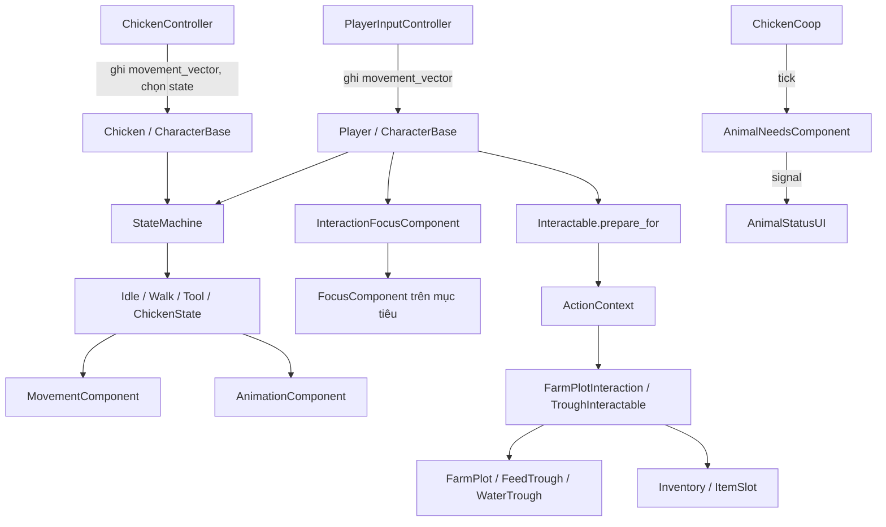
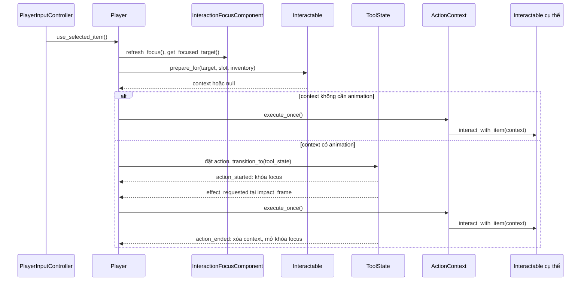

# Thiết kế hệ thống GDScript hiện tại

Ảnh chụp thiết kế ngày **15/10/2026**, đối chiếu code nhánh **`main`**, commit **`83ee633`**. Tài liệu mô tả những gì code hiện tại thực hiện, gồm cả các phần đang dang dở.

Phạm vi: **61 file `.gd`**, gồm 35 file trong `scripts`, 9 file trong `components` và 17 file trong `scenes`; giải thích **206 property khai báo trực tiếp**, cùng các enum, hằng số và signal liên quan. Bỏ qua toàn bộ `addons/` và `scripts/setup/`. Không phân tích nội dung `.tscn`, `.tres`, asset hay file ngôn ngữ khác; các đường dẫn scene/resource xuất hiện bên dưới là tham chiếu được ghi ngay trong GDScript.

Đi tới [mục lục class/file](#catalog), [nhân vật và state](#characters), [tương tác](#interactions), [kho đồ](#inventory), [trồng trọt](#farming), [vật nuôi](#animals), [UI/công cụ](#utilities), [công trình](#buildings), [điểm cần nhớ](#current-limits).

## 1. Cách hệ thống được tổ chức

Game tách **cấu hình**, **trạng thái runtime**, **điều khiển** và **hiển thị** bằng Resource, Node và component. `ItemDefinition`, `CropDefinition`, `AnimalDefinition`, `AnimalProductionDefination` giữ dữ liệu cấu hình. `ItemSlot`, `FarmPlot`, `AnimalNeedsComponent` giữ dữ liệu thay đổi của từng đối tượng. Controller ghi ý định; state machine quyết định hành vi; UI nghe signal để phản ánh dữ liệu.

Trong tài liệu, “property” là member của script: `@export` chỉnh qua Inspector, `@onready` lấy tham chiếu khi node sẵn sàng, biến thường giữ trạng thái runtime, getter trả giá trị suy ra. Bảng liệt kê property khai báo trong từng file; property của lớp game cha được giải thích ở mục lớp cha, không lặp lại. Các property kế thừa sẵn từ Godot không được liệt kê. Giá trị trong bảng là **giá trị khai báo trong `.gd`**, có thể bị Inspector/resource ghi đè; ô chỉ có kiểu nghĩa là code không gán initializer rõ ràng. Tên bắt đầu `_` thể hiện cách dùng nội bộ theo quy ước, không phải cơ chế private.

### 1.1. Vòng lặp nhân vật và state

`CharacterBase._ready()` gọi `StateMachine.init(self)`. Máy trạng thái tìm các node `State` con trực tiếp, gọi `setup(actor, machine)` để truyền tham chiếu và chuyển vào `initial_state`. `_process()` của máy chuyển tiếp sang `State.update(delta)`; `_physics_process()` chuyển tiếp sang `State.physics_update(delta)`.

Controller ghi `movement_vector`; `WalkState` dùng vector đó để quay mặt và gọi `MovementComponent.move()`. `IdleState` gọi movement với vector ZERO để giảm tốc. Khi chuyển state, thứ tự là `exit()` state cũ → gán state mới → `enter()` → phát `state_changed`.

Tên state được chuẩn hóa thành chữ thường và bỏ hậu tố `state`: `IdleState` → `idle`, `WalkState` → `walk`. Các node `PeckState`, `RestState`, `SleepState` có thể dùng chung class `ChickenState`; logic chọn hành vi của AI gọi các key này. Đây là yêu cầu tên node trong code, không phải xác nhận cấu hình của scene.

`Controller` đặt physics priority = -10 để chạy trước máy trạng thái; riêng `ChickenController` đổi lại thành 10. Tốc độ thực tế lấy từ `MovementComponent.speed`, mặc định 150; export `WalkState.speed = 120` hiện chưa được đọc.

### 1.2. Dùng item và chốt thời điểm tác động

`ActionContext` giữ mục tiêu, slot và ItemDefinition tại lúc chuẩn bị. Trước thực thi, nó kiểm tra slot vẫn có cùng item, trừ thao tác HARVEST. Hai cờ `ToolState._effect_applied` và `ActionContext._executed` ngăn phát tác động lặp. Context được đánh dấu đã thực thi ngay cả khi thao tác thất bại. `SWING` chỉ chạy động tác, không gọi mục tiêu.

Focus dùng điểm `distance - alignment × facing_weight`, ưu tiên điểm thấp. `switch_margin` yêu cầu mục tiêu mới tốt hơn đủ mức mới đổi. Khi kho mở, Player tắt focus và controller đặt ý định di chuyển về ZERO. Khi dùng công cụ, Player khóa việc chọn lại focus; context đã chốt vẫn giữ mục tiêu riêng và không tự kiểm tra lại khoảng cách khi áp dụng tác động.

### 1.3. Quyền sở hữu dữ liệu kho và cây

| Dữ liệu | Nơi giữ | Cách cập nhật |
| --- | --- | --- |
| Cấu hình vật phẩm/cây | `ItemDefinition`, `CropDefinition` | Resource tham chiếu dùng chung; thao tác trồng không sửa resource |
| Số lượng trong một ô | `ItemSlot` | `set_item()`/`consume()` phát `changed` |
| Slot công cụ/hạt/thức ăn | `Hotbar.slots` | Thay cấu hình slot bằng slot runtime mới khi ready; nhận item không phải PRODUCE |
| Kho nông sản | `Inventory.slots` | Tạo 16 slot mới; chỉ nhận PRODUCE, phát `slot_changed(index)` |
| Cây và đồng hồ của một ô đất | `FarmPlot` | Tự tăng thời gian ở `_process()`; không có manager cập nhật từng cây |
| Nhu cầu của một vật nuôi | `AnimalNeedsComponent` | `ChickenCoop` truyền thời gian đã trôi qua theo tick |

Hotbar và Inventory có các slot độc lập. Chưa có luồng chuyển slot qua lại giữa hai nơi trong những script này.

Trồng cây: chọn SEED hợp lệ → animation tool → `plot.plant(crop)` → trừ một hạt. Tưới: chỉ đất khô nhận nước; đất ướt 5 giây theo giá trị khai báo hiện tại, cây nhận bonus **5% tổng thời gian tăng trưởng** nếu chưa chín. Cây vẫn lớn khi khô. Bốn stage có index 0–3: ba khoảng trước trưởng thành chia đều, index 3 xuất hiện ở 100%.

Thu hoạch được ưu tiên khi cây chín và thực thi ngay. `FarmPlotInteraction` gọi `Inventory.try_add_item()` để nhận đủ sản lượng trước, rồi gọi `FarmPlot.harvest()` xóa cây. Túi thiếu chỗ giữ nguyên cây. Thu hoạch giữ trạng thái ướt/khô của đất.

### 1.4. Vật nuôi và ranh giới phần đã triển khai

`Chicken` khởi tạo `AnimalNeedsComponent` bằng `AnimalDefinition`. `ChickenCoop` thu thập các component đã initialize, cập nhật theo `needs_tick_seconds`; mức hao = `(100 / depletion_seconds) × seconds`. UI nghe `needs_changed` và `state_changed` để cập nhật.

`ChickenController` so sánh độ no/nước, tìm máng đủ lượng cần dùng và đi tới marker trong vùng được phép. Nếu không có mục tiêu máng, AI có thể đứng nghỉ, đi dạo, mổ đất, nghỉ hoặc ngủ. Khi tới máng, code hiện chỉ dừng và chuyển về idle. Chưa nối tiêu thụ thức ăn/nước, phục hồi nhu cầu, tăng tuổi hoặc sinh sản phẩm. `maturity_seconds` và `production` hiện là cấu hình cho phần đó.

## 2. Mục lục tra cứu

### [3. Nhân vật, controller và state machine](#characters)

- [CharacterBase — scripts/character_base.gd](#gd-01)
- [Player — scripts/player.gd](#gd-02)
- [Controller — components/controllers/controller.gd](#gd-03)
- [PlayerInputController — components/controllers/player_input_controller.gd](#gd-04)
- [MovementComponent — components/movement_component.gd](#gd-05)
- [AnimationComponent — components/animation_component.gd](#gd-06)
- [State — scripts/state.gd](#gd-07)
- [StateMachine — scripts/state_machine.gd](#gd-08)
- [IdleState — scripts/states/idle_state.gd](#gd-09)
- [WalkState — scripts/states/walk_state.gd](#gd-10)
- [ToolState — scripts/states/tool_state.gd](#gd-11)
- [WaterState — scripts/states/water_state.gd](#gd-12)
- [ChickenState — scripts/states/chicken_action_state.gd](#gd-13)

### [4. Focus và tương tác](#interactions)

- [InteractionFocusComponent — components/interaction_focus_component.gd](#gd-14)
- [FocusComponent — components/focus_component.gd](#gd-15)
- [Interactable — scripts/interactions/interactable.gd](#gd-16)
- [ActionContext — scripts/interactions/action_context.gd](#gd-17)

### [5. Vật phẩm, hotbar và kho](#inventory)

- [ItemDefinition — scripts/item_definition.gd](#gd-18)
- [ItemSlot — scripts/item_slot.gd](#gd-19)
- [Inventory — scripts/inventory.gd](#gd-20)
- [Hotbar — scripts/hotbar.gd](#gd-21)
- [ItemSlotView — scripts/item_slot_view.gd](#gd-22)
- [InventoryPanel — scripts/inventory_panel.gd](#gd-23)
- [PlayerUIComponent — components/controllers/player_ui_component.gd](#gd-24)

### [6. Trồng trọt](#farming)

- [CropDefinition — scripts/crop_definition.gd](#gd-25)
- [FarmLand — scripts/farm_land.gd](#gd-26)
- [FarmPlot — scripts/farm_plot.gd](#gd-27)
- [FarmPlotInteraction — scripts/farm_plot_interactable.gd](#gd-28)

### [7. Vật nuôi và máng](#animals)

- [AnimalTypes — scripts/animals/animal_types.gd](#gd-29)
- [AnimalDefinition — scripts/animals/animal_definition.gd](#gd-30)
- [AnimalProductionDefination — scripts/animals/animal_production_definition.gd](#gd-31)
- [AnimalNeedsComponent — components/animal_needs_component.gd](#gd-32)
- [Chicken — scenes/chicken.gd](#gd-33)
- [ChickenCoop — scripts/chicken_coop.gd](#gd-34)
- [ChickenController — components/controllers/chicken_ai_controller.gd](#gd-35)
- [FeedTrough — scripts/feed_trough.gd](#gd-36)
- [WaterTrough — scripts/water_trough.gd](#gd-37)
- [FeedTroughInteractable — scripts/feed_trough_interactable.gd](#gd-38)
- [WaterTroughInteractable — scripts/water_trough_interactable.gd](#gd-39)
- [scripts/animal_status_ui.gd](#gd-40)

### [8. UI phụ trợ và công cụ editor](#utilities)

- [ProgressBarDisplay — scripts/progress_bar_display.gd](#gd-41)
- [GameDebugPanel — scripts/game_debug_panel.gd](#gd-42)
- [scripts/cursor_controller.gd](#gd-43)
- [CharacterUtils — scripts/utils/character_utils.gd](#gd-44)
- [scripts/merge_tilesets.gd](#gd-45)

### [9. Hình ảnh công trình](#buildings)

- [scenes/buildings/houses/house_1.gd](#gd-46)
- [scenes/buildings/houses/house_2.gd](#gd-47)
- [scenes/buildings/houses/house_3.gd](#gd-48)
- [scenes/buildings/houses/house_4.gd](#gd-49)
- [scenes/buildings/houses/house_5.gd](#gd-50)
- [scenes/buildings/unique_buildings/barn.gd](#gd-51)
- [scenes/buildings/unique_buildings/blacksmith_house.gd](#gd-52)
- [scenes/buildings/unique_buildings/church.gd](#gd-53)
- [scenes/buildings/unique_buildings/coop.gd](#gd-54)
- [scenes/buildings/unique_buildings/fisherman_house.gd](#gd-55)
- [scenes/buildings/unique_buildings/greenhouse.gd](#gd-56)
- [scenes/buildings/unique_buildings/inn.gd](#gd-57)
- [scenes/buildings/unique_buildings/market_stalls.gd](#gd-58)
- [scenes/buildings/unique_buildings/shed.gd](#gd-59)
- [scenes/buildings/unique_buildings/silo.gd](#gd-60)
- [scenes/buildings/unique_buildings/windmill.gd](#gd-61)

## 3. Nhân vật, controller và state machine

### CharacterBase

Nguồn: [scripts/character_base.gd](../scripts/character_base.gd). Kế thừa: `CharacterBody2D`.

Lớp nền của Player và Chicken. Ghép movement, animation và state machine; gọi init(self) khi sẵn sàng.

| Property | Nguồn | Kiểu / giá trị khai báo | Ý nghĩa |
| --- | --- | --- | --- |
| `animation_component` | onready | `AnimationComponent = $AnimationComponent` | Component chọn animation và hướng nhìn của nhân vật. |
| `state_machine` | onready | `StateMachine = $StateMachine` | Máy trạng thái của nhân vật. |
| `movement_component` | onready | `MovementComponent = $MovementComponent` | Component cập nhật vận tốc và va chạm của nhân vật. |
| `movement_vector` | runtime | `Vector2 = Vector2.ZERO` | Ý định di chuyển; controller ghi vào, state đọc và quyết định có di chuyển hay không. |

**Hằng số:**

- `MOVE_DEADZONE_SQ`: Ngưỡng bình phương độ dài ý định di chuyển: 0.01.

**Hành vi và lưu ý:** has_move_intent() so sánh bình phương độ dài với MOVE_DEADZONE_SQ = 0.01. Đây là ý định, không phải vận tốc vật lý.

### Player

Nguồn: [scripts/player.gd](../scripts/player.gd). Kế thừa: `CharacterBase`.

Điều phối sử dụng slot đang chọn và giữ ActionContext trong thời gian animation công cụ chạy.

| Property | Nguồn | Kiểu / giá trị khai báo | Ý nghĩa |
| --- | --- | --- | --- |
| `inventory` | Inspector | `Inventory` | Kho nhận nông sản; phải được gán trước khi thu hoạch hoặc thêm vật phẩm. |
| `tool_state` | onready | `ToolState = $StateMachine/ToolState` | State công cụ; phát tín hiệu bắt đầu, frame tác động và kết thúc. |
| `interaction_focus` | onready | `InteractionFocusComponent = $InteractionFocusComponent` | Bộ chọn mục tiêu gần nhân vật; bị khóa khi dùng công cụ, tắt khi mở kho. |
| `ui_controller` | onready | `PlayerUIComponent = $PlayerUIController` | Điều phối hotbar, cửa sổ kho và nút mở kho. |
| `_pending_action` | runtime | `ActionContext` | Context đã chốt mục tiêu, slot và item; được thực thi ở effect_requested và xóa khi kết thúc hoặc rời cây node. |

**Hành vi và lưu ý:** use_selected_item() chỉ nhận thao tác khi kho đóng và state là IdleState/WalkState. Thu hoạch không có animation nên thực thi ngay; trồng/tưới/châm máng đi qua ToolState.

### Controller

Nguồn: [components/controllers/controller.gd](../components/controllers/controller.gd). Kế thừa: `Node`.

Lớp nền controller. Tìm CharacterBase ở node cha trực tiếp và đặt physics priority = -10 để ghi ý định trước state machine.

| Property | Nguồn | Kiểu / giá trị khai báo | Ý nghĩa |
| --- | --- | --- | --- |
| `actor` | runtime | `CharacterBase` | Nhân vật sở hữu component hoặc state; cung cấp ý định di chuyển và các component dùng chung. |

### PlayerInputController

Nguồn: [components/controllers/player_input_controller.gd](../components/controllers/player_input_controller.gd). Kế thừa: `Controller`.

Đọc InputMap để điều khiển Player; chọn slot bằng hotbar_1…hotbar_0 và đánh dấu sự kiện đã xử lý.

| Property | Nguồn | Kiểu / giá trị khai báo | Ý nghĩa |
| --- | --- | --- | --- |
| `action_left` | Inspector | `StringName = &"ui_left"` | Tên action InputMap đi trái. |
| `action_right` | Inspector | `StringName = &"ui_right"` | Tên action InputMap đi phải. |
| `action_up` | Inspector | `StringName = &"ui_up"` | Tên action InputMap đi lên. |
| `action_down` | Inspector | `StringName = &"ui_down"` | Tên action InputMap đi xuống. |
| `action_use_item` | Inspector | `StringName = &"use_item"` | Tên action sử dụng item đang chọn. |
| `action_toggle_inventory` | Inspector | `StringName = &"toggle_inventory"` | Tên action đóng/mở kho. |
| `player` | runtime | `Player` | Tham chiếu actor đã ép về Player để gọi UI và sử dụng item. |

**Hằng số:**

- `HOTBAR_ACTIONS`: Thứ tự hotbar_1…hotbar_9, hotbar_0 ánh xạ sang index 0…9.

**Hành vi và lưu ý:** Khi kho mở, movement_vector = ZERO. _input() xử lý đóng/mở kho; _unhandled_key_input() xử lý slot và dùng item, bỏ qua key echo.

### MovementComponent

Nguồn: [components/movement_component.gd](../components/movement_component.gd). Kế thừa: `Node`.

Chuyển ý định di chuyển thành velocity; gọi move_and_slide() trên CharacterBody2D cha.

| Property | Nguồn | Kiểu / giá trị khai báo | Ý nghĩa |
| --- | --- | --- | --- |
| `speed` | Inspector | `float = 150.0` | Tốc độ đích, đơn vị khoảng cách/giây. Đây là tốc độ thực sự được WalkState sử dụng. |
| `acceleration` | Inspector | `float = 1200.0` | Mức tăng/đổi vận tốc mỗi giây khi có hướng di chuyển. |
| `friction` | Inspector | `float = 1600` | Mức giảm vận tốc mỗi giây khi hướng bằng ZERO. |
| `body` | runtime | `CharacterBody2D` | CharacterBody2D cha trực tiếp; nơi giữ velocity và xử lý va chạm. |

**Hành vi và lưu ý:** move() giới hạn độ dài hướng về tối đa 1 để đi chéo không nhanh hơn. stop() đưa velocity về ZERO ngay.

### AnimationComponent

Nguồn: [components/animation_component.gd](../components/animation_component.gd). Kế thừa: `Node`.

Ghép tên animation theo action_direction, xử lý hướng trái bằng flip và phát action_finished.

| Property | Nguồn | Kiểu / giá trị khai báo | Ý nghĩa |
| --- | --- | --- | --- |
| `animated_sprite` | Inspector | `AnimatedSprite2D` | AnimatedSprite2D thực sự phát animation; bắt buộc phải gán. |
| `fallback_animation` | Inspector | `StringName = &"idle_down"` | Tên animation dùng khi thiếu action/hướng yêu cầu. |
| `flip_left` | Inspector | `bool = true` | Dùng animation right rồi lật ngang khi nhìn trái. |
| `single_direction` | Inspector | `bool = false` | Dùng bộ animation hậu tố down cho sprite chỉ có một hướng gốc. |
| `single_direction_faces_left` | Inspector | `bool = true` | Cho biết sprite một hướng vốn nhìn trái để xác định chiều flip. |
| `facing_direction` | runtime | `StringName = &"down"` | Tên hướng nhìn hiện tại: down/up/left/right. |
| `current_action` | runtime | `String = ""` | Action gần nhất được yêu cầu, dùng khi đổi hướng hoặc phát tín hiệu hoàn tất. |
| `_warned` | runtime | `Dictionary[StringName, bool] = {}` | Tập tên animation đã cảnh báo thiếu; mỗi tên chỉ cảnh báo một lần. |
| `facing_vector` | runtime | `Vector2 (getter)` | Property chỉ đọc, tra vector hướng trong DIR_VECTORS. |

**Hằng số:**

- `DIR_VECTORS`: Bảng down/up/left/right → Vector2.DOWN/UP/LEFT/RIGHT; phục vụ facing_vector.

**Signal:**

- `action_finished(action: String)`: Chuyển tiếp AnimatedSprite2D.animation_finished cùng current_action; các state dùng để đổi pha/kết thúc.

**Hành vi và lưu ý:** play(action, force_restart) có thể khởi động lại animation. face() chỉ phát lại nếu hướng đổi. Class hiện không khai báo stop().

### State

Nguồn: [scripts/state.gd](../scripts/state.gd). Kế thừa: `Node`.

Giao diện state nền. setup() nhận actor và cache các component; enter/exit/update/physics_update mặc định không làm gì.

| Property | Nguồn | Kiểu / giá trị khai báo | Ý nghĩa |
| --- | --- | --- | --- |
| `actor` | runtime | `CharacterBase` | Nhân vật sở hữu component hoặc state; cung cấp ý định di chuyển và các component dùng chung. |
| `state_machine` | runtime | `StateMachine` | Máy trạng thái của nhân vật. |
| `animation_component` | runtime | `AnimationComponent` | Component chọn animation và hướng nhìn của nhân vật. |
| `movement_component` | runtime | `MovementComponent` | Component cập nhật vận tốc và va chạm của nhân vật. |

### StateMachine

Nguồn: [scripts/state_machine.gd](../scripts/state_machine.gd). Kế thừa: `Node`.

Đăng ký các node State con trực tiếp, chuyển trạng thái và chuyển tiếp vòng lặp Godot cho state hiện tại.

| Property | Nguồn | Kiểu / giá trị khai báo | Ý nghĩa |
| --- | --- | --- | --- |
| `initial_state` | Inspector | `State` | State được vào sau init(); thiếu thì chỉ cảnh báo. |
| `default_state` | Inspector | `State` | State quay về khi kết thúc hành động; nếu chưa gán sẽ lấy initial_state. |
| `current_state` | runtime | `State` | State đang chạy; chỉ state này nhận update và physics_update. |
| `states` | runtime | `Dictionary = {}` | Bảng key → State; key là tên node viết thường và bỏ hậu tố state. |

**Signal:**

- `state_changed(from: State, to: State)`: Phát sau enter() của state mới; AnimalStatusUI cập nhật tên hành vi.

**Hành vi và lưu ý:** transition_to() gọi previous.exit(), gán current_state, gọi enter(), rồi phát state_changed(previous, current). Bỏ qua null hoặc chính state hiện tại.

### IdleState

Nguồn: [scripts/states/idle_state.gd](../scripts/states/idle_state.gd). Kế thừa: `State`.

State đứng yên: phát idle, giảm vận tốc bằng movement.move(ZERO), chuyển sang walk khi có ý định. Không khai báo property riêng; dùng các member kế thừa từ State.

Không khai báo property riêng. Các tham chiếu actor/component nằm ở `State`.

### WalkState

Nguồn: [scripts/states/walk_state.gd](../scripts/states/walk_state.gd). Kế thừa: `State`.

State đi bộ: cập nhật hướng nhìn, phát walk và gọi MovementComponent.move().

| Property | Nguồn | Kiểu / giá trị khai báo | Ý nghĩa |
| --- | --- | --- | --- |
| `speed` | Inspector | `float = 120.0` | Export hiện có nhưng chưa được đọc trong logic của state. Tốc độ thực tế nằm ở MovementComponent.speed. |

**Hành vi và lưu ý:** Khi không còn ý định di chuyển, đổi về default_state.

### ToolState

Nguồn: [scripts/states/tool_state.gd](../scripts/states/tool_state.gd). Kế thừa: `State`.

State hành động có animation và frame tác động. Chặn di chuyển trong suốt hành động.

| Property | Nguồn | Kiểu / giá trị khai báo | Ý nghĩa |
| --- | --- | --- | --- |
| `action` | Inspector | `StringName = ACTION_TOOL` | Tên action sẽ phát, mặc định ACTION_TOOL; context có thể đặt thành ACTION_WATER. |
| `impact_frame` | Inspector | `int = 3` | Index frame bắt đầu áp dụng tác động, mặc định 3; kiểm tra bằng frame >= impact_frame. |
| `_effect_applied` | runtime | `bool = false` | Chốt bảo đảm effect_requested chỉ phát một lần trong mỗi lần enter(). |

**Hằng số:**

- `ACTION_TOOL`: Tên action công cụ: &"tool".
- `ACTION_WATER`: Tên action tưới: &"water".

**Signal:**

- `action_started`: Phát trong ToolState.enter(), trước khi gọi play(); Player khóa focus.
- `effect_requested`: Phát một lần khi frame >= impact_frame; Player gọi context.execute_once().
- `action_ended`: Phát trong ToolState.exit(); Player xóa context và mở khóa focus.

**Hành vi và lưu ý:** action_started khóa focus qua Player. effect_requested thực thi context. exit() ngắt kết nối tín hiệu và phát action_ended. Animation phải kết thúc để state trở về walk/default.

### WaterState

Nguồn: [scripts/states/water_state.gd](../scripts/states/water_state.gd). Kế thừa: `State`.

State tưới riêng: chạy animation và dừng di chuyển; không phát effect_requested nên không tự tưới đất.

| Property | Nguồn | Kiểu / giá trị khai báo | Ý nghĩa |
| --- | --- | --- | --- |
| `action` | Inspector | `String = "water"` | Tên action cần chờ kết thúc, mặc định water. |

**Hành vi và lưu ý:** Nhánh có ý định di chuyển gọi change_state("water"); nếu đó chính state hiện tại thì transition_to() bỏ qua. Luồng dùng bình tưới của Player hiện đi qua ToolState.

### ChickenState

Nguồn: [scripts/states/chicken_action_state.gd](../scripts/states/chicken_action_state.gd). Kế thừa: `State`.

Class ChickenState dùng chung cho hành vi gà theo ba pha START → HOLD → FINISH.

| Property | Nguồn | Kiểu / giá trị khai báo | Ý nghĩa |
| --- | --- | --- | --- |
| `start_action` | Inspector | `String = ""` | Animation vào hành động; rỗng thì chuyển thẳng sang HOLD. |
| `hold_action` | Inspector | `String = ""` | Animation trong thời gian giữ; có thể để rỗng. |
| `finish_action` | Inspector | `String = ""` | Animation kết thúc; rỗng thì về default ngay. |
| `hold_seconds` | Inspector [0.0, 60.0] | `float = 0.0` | Thời gian giữ pha HOLD, tính bằng giây. |
| `_phase` | runtime | `Phase = Phase.HOLD` | Pha hiện tại trong enum Phase. |
| `_remaining` | runtime | `float = 0.0` | Số giây HOLD còn lại. |

**Enum:** `enum Phase { START, HOLD, FINISH }`.

**Hành vi và lưu ý:** START/FINISH chờ action_finished đúng tên. HOLD đếm ở update(). Mọi pha đều dừng movement; exit() ngắt tín hiệu.

## 4. Focus và tương tác

### InteractionFocusComponent

Nguồn: [components/interaction_focus_component.gd](../components/interaction_focus_component.gd). Kế thừa: `Area2D`.

Chọn một FocusComponent từ các Area2D đang chồng lấp, dựa trên khoảng cách và hướng nhìn.

| Property | Nguồn | Kiểu / giá trị khai báo | Ý nghĩa |
| --- | --- | --- | --- |
| `update_interval` | Inspector [0.05, 1.0] | `float = 0.1` | Chu kỳ chấm lại điểm mục tiêu, mặc định 0.1 giây. |
| `facing_weight` | Inspector [0.0, 32.0] | `float = 12.0` | Trọng số ưu tiên vật ở phía trước: score = distance - alignment × facing_weight; điểm thấp tốt hơn. |
| `switch_margin` | Inspector [0.0, 16.0] | `float = 4.0` | Mức cải thiện tối thiểu để chuyển khỏi mục tiêu hiện tại, giảm nhấp nháy focus. |
| `active` | runtime | `bool = true` | Cho phép chọn mục tiêu; false làm bỏ focus ở physics tick tiếp theo. |
| `locked` | runtime | `bool = false` | Giữ mục tiêu hiện tại trong lúc dùng công cụ; ngừng chấm lại điểm. |
| `_candidates` | runtime | `Array[FocusComponent] = []` | Các FocusComponent vào vùng phát hiện và chưa rời khỏi vùng. |
| `_focused` | runtime | `FocusComponent` | FocusComponent được chọn hiện tại. |
| `_elapsed` | runtime | `float = 0.0` | Thời gian tích lũy trước lần cập nhật định kỳ tiếp theo, tính bằng giây. |
| `actor` | onready | `CharacterBase = get_parent() as CharacterBase` | Nhân vật sở hữu component hoặc state; cung cấp ý định di chuyển và các component dùng chung. |

**Hành vi và lưu ý:** get_focused_target() trả node cha của FocusComponent nếu hợp lệ. area_exited vẫn bỏ mục tiêu đã rời vùng, kể cả khi khóa; context đã tạo giữ tham chiếu riêng.

### FocusComponent

Nguồn: [components/focus_component.gd](../components/focus_component.gd). Kế thừa: `Area2D`.

Component đặt trên vật có thể được chọn. Bật/tắt marker và tween con trỏ; mục tiêu tương tác là node cha.

| Property | Nguồn | Kiểu / giá trị khai báo | Ý nghĩa |
| --- | --- | --- | --- |
| `focus_marker` | onready | `Node2D = $FocusMarker` | Node chứa chỉ báo focus, ẩn lúc _ready(). |
| `pointer` | onready | `Sprite2D = $FocusMarker/Pointer` | Sprite con trỏ được tween lên xuống. |
| `_pointer_rest_position` | onready | `Vector2 = pointer.position` | Vị trí ban đầu của pointer để khôi phục khi bỏ focus. |
| `focus_enabled` | Inspector | `bool = true` | Cho phép đối tượng được chọn; set_focused(true) vẫn bị từ chối nếu false. |
| `bob_height` | Inspector [0.0, 8.0] | `float = 3.0` | Độ cao dao động của con trỏ. |
| `bob_duration` | Inspector [0.1, 1.0] | `float = 0.35` | Thời gian mỗi nửa chu kỳ lên/xuống, tính bằng giây. |
| `_focused` | runtime | `bool = false` | Trạng thái focus nội bộ, dùng để tránh cập nhật và phát tín hiệu lặp. |
| `_bob_tween` | runtime | `Tween` | Tween lặp của pointer; bị kill và xóa khi dừng focus. |

**Signal:**

- `focus_changed(focused: bool)`: Phát khi trạng thái focus đổi; FarmPlot dùng để bật/tắt thanh tăng trưởng.

### Interactable

Nguồn: [scripts/interactions/interactable.gd](../scripts/interactions/interactable.gd). Kế thừa: `Node`.

Giao diện tương tác: prepare_action() tạo context, interact_with_item() áp dụng thay đổi. Mặc định từ chối thao tác.

Không khai báo property riêng.

**Hằng số:**

- `COMPONENT_PATH`: NodePath ^"Interactable"; target phải có component con đúng tên để định tuyến tương tác.

**Hành vi và lưu ý:** prepare_for() tìm node con tên Interactable qua COMPONENT_PATH. Nếu component không có hành động phù hợp, item TOOL hoặc HOE vẫn tạo SWING chỉ có animation, không đổi world.

### ActionContext

Nguồn: [scripts/interactions/action_context.gd](../scripts/interactions/action_context.gd). Kế thừa: `RefCounted`.

Gói một hành động đã chuẩn bị để thực thi đúng một lần, độc lập với thao tác đổi focus sau đó.

| Property | Nguồn | Kiểu / giá trị khai báo | Ý nghĩa |
| --- | --- | --- | --- |
| `kind` | runtime | `Kind` | Loại thao tác trong Kind: SWING, PLANT, WATER_SOIL, FILL_WATER, FILL_FEED, HARVEST. |
| `target` | runtime | `Interactable` | Interactable sẽ nhận thao tác; SWING không cần target. |
| `slot` | runtime | `ItemSlot` | Slot đã chọn lúc tạo context; giữ object slot để kiểm tra và tiêu hao. |
| `item` | runtime | `ItemDefinition` | ItemDefinition được chụp từ slot lúc khởi tạo; phải vẫn trùng slot.item khi thực thi, trừ HARVEST. |
| `inventory` | runtime | `Inventory` | Kho nhận nông sản; phải được gán trước khi thu hoạch hoặc thêm vật phẩm. |
| `animation_action` | runtime | `StringName` | Tên animation; rỗng nghĩa là thực thi ngay, không qua ToolState. |
| `_executed` | runtime | `bool = false` | Chốt một lần; được đặt trước kiểm tra, nên thao tác thất bại cũng không được thử lại bằng context này. |

**Enum:** `enum Kind { SWING, PLANT, WATER_SOIL, FILL_WATER, FILL_FEED, HARVEST }`.

**Hành vi và lưu ý:** has_current_item() kiểm tra slot chưa rỗng và item còn cùng resource. execute_once() không tự kiểm tra lại khoảng cách hay hướng tới mục tiêu.

## 5. Vật phẩm, hotbar và kho

### ItemDefinition

Nguồn: [scripts/item_definition.gd](../scripts/item_definition.gd). Kế thừa: `Resource`. Có `@tool`.

Resource cấu hình loại vật phẩm, khả năng stack, cây từ hạt và lượng thức ăn.

| Property | Nguồn | Kiểu / giá trị khai báo | Ý nghĩa |
| --- | --- | --- | --- |
| `item_id` | Inspector | `StringName` | Mã định danh vật phẩm. |
| `display_name` | Inspector | `String` | Tên hiển thị trên tooltip/UI. |
| `icon` | Inspector | `Texture2D` | Texture biểu tượng trong slot. |
| `item_type` | Inspector | `ItemType = ItemType.TOOL (setter)` | Nhóm vật phẩm; setter cập nhật danh sách property trong Inspector. |
| `tool_type` | Inspector | `ToolType = ToolType.HOE` | Loại công cụ HOE/WATERING_CAN; chỉ hiển thị khi item_type = TOOL. |
| `crop` | Inspector | `CropDefinition` | Cấu hình cây được trồng bằng item SEED; chỉ hiển thị với hạt. |
| `max_stack` | Inspector [1, 32000] | `int = 99` | Giới hạn stack của các item không phải TOOL. |
| `food_units_per_item` | Inspector [1, 32000] | `int = 300` | Đơn vị thức ăn một FEED nạp vào máng; chỉ hiển thị với FEED. |

**Enum:** `enum ItemType { TOOL, SEED, PRODUCE, FEED, HOE }`.

**Enum:** `enum ToolType { HOE, WATERING_CAN }`.

**Hành vi và lưu ý:** get_stack_limit() trả 1 cho TOOL, còn lại max_stack. ItemType.HOE là một enum riêng vẫn được fallback SWING, khác ToolType.HOE.

### ItemSlot

Nguồn: [scripts/item_slot.gd](../scripts/item_slot.gd). Kế thừa: `Resource`.

Resource chứa item và số lượng; set_item()/consume() phát Resource.changed để UI cập nhật.

| Property | Nguồn | Kiểu / giá trị khai báo | Ý nghĩa |
| --- | --- | --- | --- |
| `item` | Inspector | `ItemDefinition` | Resource định nghĩa item trong slot; null khi hết vật phẩm. |
| `quantity` | Inspector [0, 32000] | `int = 0` | Số lượng trong stack. is_empty() cũng trả true khi quantity <= 0. |

**Hành vi và lưu ý:** set_item() từ chối số lượng ngoài (0, stack_limit]. consume_seed() yêu cầu SEED rồi gọi consume(); consume() xóa item khi quantity về 0.

### Inventory

Nguồn: [scripts/inventory.gd](../scripts/inventory.gd). Kế thừa: `Node2D`.

Kho 16 slot runtime dành cho PRODUCE; chuyển changed của mỗi slot thành slot_changed(index).

| Property | Nguồn | Kiểu / giá trị khai báo | Ý nghĩa |
| --- | --- | --- | --- |
| `slots` | runtime | `Array[ItemSlot] = []` | Các ItemSlot được tạo mới trong _ready(); không dùng chung slot với Hotbar. |

**Hằng số:**

- `SLOT_COUNT`: Số slot Inventory tạo lúc khởi động: 16.

**Signal:**

- `slot_changed(index: int)`: Phát lại Resource.changed của slot kèm index; InventoryPanel làm mới đúng ô.

**Hành vi và lưu ý:** add_item() lấp stack cùng ItemDefinition trước rồi dùng ô trống; trả phần dư. try_add_item() tính đủ sức chứa trước, chỉ thêm khi nhận được toàn bộ. add_item() cũng trả 0 cho đầu vào sai loại/không hợp lệ; không dùng riêng giá trị 0 để xác nhận đầu vào hợp lệ.

### Hotbar

Nguồn: [scripts/hotbar.gd](../scripts/hotbar.gd). Kế thừa: `HBoxContainer`.

Thanh slot công cụ, hạt và thức ăn; từ chối PRODUCE trong try_add_item().

| Property | Nguồn | Kiểu / giá trị khai báo | Ý nghĩa |
| --- | --- | --- | --- |
| `slots` | Inspector | `Array[ItemSlot] = []` | Cấu hình slot từ Inspector; _ready() thay từng phần tử bằng ItemSlot runtime mới và giữ lại ItemDefinition. |
| `selected_index` | runtime | `int = -1` | Index slot đang chọn; -1 nghĩa là chưa có lựa chọn. |
| `_buttons` | runtime | `Array[ItemSlotView] = []` | Các nút UI được tạo và giữ lại để cập nhật nội dung. |

**Hằng số:**

- `SLOT_VIEW_SCENE`: PackedScene res://scenes/item_slot_view.tscn dùng dựng nút slot.

**Signal:**

- `slot_selected(index: int)`: Phát khi selected_index đổi; thông báo lựa chọn hotbar.

**Hành vi và lưu ý:** Tạo ItemSlotView cho mỗi slot, cập nhật theme của slot chọn và phát slot_selected. try_add_item() kiểm tra đủ chỗ trước rồi mới thêm toàn bộ.

### ItemSlotView

Nguồn: [scripts/item_slot_view.gd](../scripts/item_slot_view.gd). Kế thừa: `Button`.

Button trình bày một ItemSlot; không giữ bản sao dữ liệu kho.

| Property | Nguồn | Kiểu / giá trị khai báo | Ý nghĩa |
| --- | --- | --- | --- |
| `item_icon` | onready | `TextureRect = $Icon` | TextureRect hiển thị icon; được xóa khi slot rỗng. |
| `quantity_label` | onready | `Label = $Quantity` | Label số lượng; TOOL không hiển thị số lượng. |

**Hành vi và lưu ý:** display_slot() cập nhật icon, số lượng và tooltip theo display_name.

### InventoryPanel

Nguồn: [scripts/inventory_panel.gd](../scripts/inventory_panel.gd). Kế thừa: `PanelContainer`.

Cửa sổ kho, dựng lưới bốn cột từ Inventory và làm mới slot khi có signal.

| Property | Nguồn | Kiểu / giá trị khai báo | Ý nghĩa |
| --- | --- | --- | --- |
| `inventory` | Inspector | `Inventory` | Kho nhận nông sản; phải được gán trước khi thu hoạch hoặc thêm vật phẩm. |
| `slots_grid` | onready | `GridContainer = $MarginContainer/VBoxContainer/SlotsGrid` | GridContainer chứa các ItemSlotView runtime. |
| `_buttons` | runtime | `Array[ItemSlotView] = []` | Các nút UI được tạo và giữ lại để cập nhật nội dung. |

**Hằng số:**

- `SLOT_VIEW_SCENE`: PackedScene res://scenes/item_slot_view.tscn dùng dựng nút slot.

**Hành vi và lưu ý:** _ready() ẩn panel và chờ inventory.ready nếu cần. toggle/open_inventory/close đổi visible; mở kho làm mới tất cả nút.

### PlayerUIComponent

Nguồn: [components/controllers/player_ui_component.gd](../components/controllers/player_ui_component.gd). Kế thừa: `Node`.

Điều phối UI của nhân vật và phát inventory_open_changed.

| Property | Nguồn | Kiểu / giá trị khai báo | Ý nghĩa |
| --- | --- | --- | --- |
| `hotbar` | Inspector | `Hotbar` | Thanh chọn item hiện tại. |
| `inventory_panel` | Inspector | `InventoryPanel` | Cửa sổ hiển thị Inventory. |
| `inventory_button` | Inspector | `BaseButton` | Nút đóng/mở inventory_panel. |
| `actor` | onready | `CharacterBase = get_parent() as CharacterBase` | Nhân vật sở hữu component hoặc state; cung cấp ý định di chuyển và các component dùng chung. |

**Signal:**

- `inventory_open_changed(is_open: bool)`: Phát khi visible của panel kho đổi; Player bật/tắt interaction_focus.active.

**Hành vi và lưu ý:** Chỉ mở kho khi actor ở IdleState/WalkState. Mở kho đặt movement_vector = ZERO; chọn slot bị bỏ qua khi kho đang mở.

## 6. Trồng trọt

### CropDefinition

Nguồn: [scripts/crop_definition.gd](../scripts/crop_definition.gd). Kế thừa: `Resource`.

Resource định nghĩa một giống cây; dữ liệu cấu hình được nhiều ô dùng chung.

| Property | Nguồn | Kiểu / giá trị khai báo | Ý nghĩa |
| --- | --- | --- | --- |
| `crop_id` | Inspector | `StringName` | Mã định danh giống cây. |
| `stage_textures` | Inspector | `Array[Texture2D] = []` | Đúng bốn texture không null, theo thứ tự stage 1 đến stage 4. |
| `growth_seconds` | Inspector [1.0, 86400.0] | `float = 1200.0` | Tổng thời gian để cây chín, mặc định 1.200 giây. |
| `harvest_item` | Inspector | `ItemDefinition` | ItemDefinition loại PRODUCE sẽ nhận khi thu hoạch. |
| `harvest_amount` | Inspector [0, 32000] | `int = 1` | Số lượng thu hoạch; phải > 0 khi kiểm tra has_valid_harvest(). |

**Hành vi và lưu ý:** is_valid() kiểm tra thời gian và texture; has_valid_harvest() kiểm tra sản phẩm riêng. Vì vậy một cấu hình cây hợp lệ để trồng chưa chắc hợp lệ để thu hoạch.

### FarmLand

Nguồn: [scripts/farm_land.gd](../scripts/farm_land.gd). Kế thừa: `Node2D`. Có `@tool`.

Node @tool sinh lưới FarmPlot cả trong editor và runtime; không phải bộ quản lý lookup ô theo tọa độ.

| Property | Nguồn | Kiểu / giá trị khai báo | Ý nghĩa |
| --- | --- | --- | --- |
| `plot_scene` | Inspector | `PackedScene (setter)` | PackedScene có root FarmPlot để instantiate. |
| `rows` | Inspector | `int = 6 (setter)` | Số hàng của lưới, mặc định 6. |
| `cols` | Inspector | `int = 6 (setter)` | Số cột của lưới, mặc định 6. |
| `gap` | Inspector | `Vector2 = Vector2(16,16) (setter)` | Khoảng cách hai ô kế nhau trên từng trục, mặc định (16,16). |
| `_rebuild_pending` | runtime | `bool = false` | Gộp nhiều thay đổi Inspector thành một create_grid.call_deferred(). |

**Hành vi và lưu ý:** Setter của bốn export yêu cầu rebuild. create_grid() xóa con có metadata generated_plot rồi sinh mới; giữ các con khác. ID là plot_col_row; vị trí = (col × gap.x + 8, row × gap.y + 16). Rebuild sẽ thay thế state runtime của các ô được sinh.

### FarmPlot

Nguồn: [scripts/farm_plot.gd](../scripts/farm_plot.gd). Kế thừa: `Node2D`. Có `@tool`.

Ô đất giữ đồng hồ ướt và tiến độ một cây; tự cập nhật hình đất, stage và thanh tiến độ.

| Property | Nguồn | Kiểu / giá trị khai báo | Ý nghĩa |
| --- | --- | --- | --- |
| `dry_texture` | Inspector | `Texture2D` | Hình đất khô, bắt buộc ở runtime. |
| `wet_texture` | Inspector | `Texture2D` | Hình đất ướt, bắt buộc ở runtime. |
| `soil_sprite` | onready | `Sprite2D = $SoilSprite` | Sprite vẽ hình đất theo is_wet(). |
| `crop_sprite` | onready | `Sprite2D = $CropSprite` | Sprite vẽ stage hiện tại; ẩn khi ô trống. |
| `growth_bar` | onready | `ProgressBar = $CropSprite/GrowthBar` | ProgressBar dưới CropSprite; hiện khi focus và ô có cây. |
| `focus_component` | onready | `FocusComponent = $FocusComponent` | Component phát focus_changed để bật/tắt thanh tiến độ. |
| `wet_duration` | runtime | `float = 5.0` | Thời gian một lần tưới giữ đất ướt; hiện là biến thường 5 giây, không export. |
| `plot_id` | runtime | `StringName` | ID được FarmLand đặt khi sinh lưới; chưa có logic lưu/khôi phục trong class. |
| `wet_remaining` | runtime | `float = 0.0` | Số giây còn ướt; > 0 là đất ướt. |
| `_focused` | runtime | `bool = false` | Cờ focus dùng để hiển thị thanh tiến độ. |
| `crop` | runtime | `CropDefinition` | CropDefinition đang trồng; null nghĩa là ô trống. |
| `growth_elapsed` | runtime | `float = 0.0` | Tiến độ tính bằng giây, gồm thời gian chạy và bonus tưới. |
| `_normal_progress_fill` | runtime | `StyleBox` | Style fill ban đầu của thanh tiến độ. |
| `_mature_progress_fill` | runtime | `StyleBoxFlat` | StyleBoxFlat màu xanh dùng khi cây chín. |

**Hành vi và lưu ý:** Cây vẫn lớn khi đất khô. Tưới chỉ hợp lệ khi khô, cộng 5% tổng growth_seconds cho cây chưa chín và không reset khi tưới lại đất ướt. Stage 0/1/2 ứng với ba khoảng trước 100%; stage 3 chỉ khi chín. harvest() chỉ xóa cây, giữ đất, trả bool; nhận sản phẩm nằm ở FarmPlotInteraction. Ô khô/trống hoặc khô/cây chín tự tắt _process().

### FarmPlotInteraction

Nguồn: [scripts/farm_plot_interactable.gd](../scripts/farm_plot_interactable.gd). Kế thừa: `Interactable`.

Class FarmPlotInteraction chuyển tương tác lên FarmPlot, ưu tiên thu hoạch cây chín trước hành động của item.

| Property | Nguồn | Kiểu / giá trị khai báo | Ý nghĩa |
| --- | --- | --- | --- |
| `plot` | onready | `FarmPlot = get_parent() as FarmPlot` | FarmPlot cha trực tiếp mà component thao tác. |

**Hành vi và lưu ý:** PLANT gọi plant() rồi consume_seed(1). WATER_SOIL gọi water(). HARVEST kiểm tra cấu hình, thêm toàn bộ sản lượng bằng inventory.try_add_item(), rồi mới harvest() xóa cây; túi đầy giữ nguyên cây. HARVEST không cần animation hoặc item hiện tại.

## 7. Vật nuôi và máng

### AnimalTypes

Nguồn: [scripts/animals/animal_types.gd](../scripts/animals/animal_types.gd). Kế thừa: `RefCounted`.

Nơi định nghĩa enum Species cho CHICKEN, DUCK, COW, SHEEP, PIG, GOOSE, HORSE; không có property riêng.

Không khai báo property riêng.

**Enum:** `enum Species { CHICKEN, DUCK, COW, SHEEP, PIG, GOOSE, HORSE }`.

### AnimalDefinition

Nguồn: [scripts/animals/animal_definition.gd](../scripts/animals/animal_definition.gd). Kế thừa: `Resource`.

Resource cấu hình loài vật: nhu cầu, trưởng thành, hình ảnh và sản phẩm.

| Property | Nguồn | Kiểu / giá trị khai báo | Ý nghĩa |
| --- | --- | --- | --- |
| `animal_id` | Inspector | `StringName` | Mã vật nuôi, không được rỗng khi is_valid(). |
| `display_name` | Inspector | `String` | Tên hiển thị của loại vật nuôi. |
| `species` | Inspector | `AnimalTypes.Species = AnimalTypes.Species.CHICKEN` | Loài, dùng lọc máng ăn phù hợp. |
| `maturity_seconds` | Inspector [0.0, 86400.0] | `float = 120.0` | Thời gian trưởng thành theo cấu hình; chưa có bộ đếm trưởng thành ở Chicken hiện tại. |
| `satiety_depletion_seconds` | Inspector [1.0, 86400.0] | `float = 600.0` | Thời gian giảm 100 điểm no nếu không được phục hồi. |
| `hydration_depletion_seconds` | Inspector [1.0, 86400.0] | `float = 600.0` | Thời gian giảm 100 điểm nước nếu không được phục hồi. |
| `food_per_meal` | Inspector [1, 32000] | `int = 1` | Lượng thức ăn yêu cầu khi tìm máng; phải > 0. |
| `water_per_drink` | Inspector [1, 32000] | `int = 1` | Lượng nước yêu cầu khi tìm máng; phải > 0. |
| `production` | Inspector | `AnimalProductionDefination` | Resource AnimalProductionDefination tùy chọn; nếu có phải hợp lệ. |
| `adult_frames` | Inspector | `SpriteFrames` | SpriteFrames trưởng thành, bắt buộc theo is_valid(). |
| `juvenile_frames` | Inspector | `SpriteFrames` | SpriteFrames con non; get_frames_for_stage(false) fallback về adult_frames nếu thiếu. |

**Hành vi và lưu ý:** get_frames_for_stage() chỉ trả dữ liệu hình; Chicken hiện chưa gọi hàm này để đổi sprite theo tuổi.

### AnimalProductionDefination

Nguồn: [scripts/animals/animal_production_definition.gd](../scripts/animals/animal_production_definition.gd). Kế thừa: `Resource`.

Class có tên hiện tại AnimalProductionDefination. Resource mô tả chu kỳ sản phẩm; chưa có logic tạo sản phẩm trong Chicken.

| Property | Nguồn | Kiểu / giá trị khai báo | Ý nghĩa |
| --- | --- | --- | --- |
| `production_item` | Inspector | `ItemDefinition` | ItemDefinition sản phẩm; phải là PRODUCE. |
| `production_amount` | Inspector [1, 32000] | `int = 1` | Số lượng mỗi lần sinh sản phẩm, phải > 0. |
| `production_seconds` | Inspector [1.0, 86400.0] | `float = 1.0` | Thời gian giữa hai lần tạo sản phẩm, phải > 0. |
| `collection_mode` | Inspector | `CollectionMode = CollectionMode.WORLD_DROP` | WORLD_DROP hoặc DIRECT_COLLECTION; mới là cấu hình, chưa có pipeline thu gom. |

**Enum:** `enum CollectionMode { WORLD_DROP, DIRECT_COLLECTION }`.

### AnimalNeedsComponent

Nguồn: [components/animal_needs_component.gd](../components/animal_needs_component.gd). Kế thừa: `Node`.

Giữ độ no và nước của từng vật nuôi; không tự chạy đồng hồ, nhận thời gian từ ChickenCoop.

| Property | Nguồn | Kiểu / giá trị khai báo | Ý nghĩa |
| --- | --- | --- | --- |
| `initial_satiety` | Inspector [0.0, 100.0] | `float = 100.0` | Độ no ban đầu khi initialize(), thang 0–100. |
| `initial_hydration` | Inspector [0.0, 100.0] | `float = 100.0` | Lượng nước ban đầu khi initialize(), thang 0–100. |
| `seek_threshold` | Inspector [0.0, 100.0] | `float = 100.0` | Ngưỡng bắt đầu tìm máng: satiety/hydration <= ngưỡng. Mặc định 100 nên cả giá trị 100 cũng được xem là cần tìm. |
| `satiety` | runtime | `float = 100.0` | Độ no hiện tại; _set_needs() clamp 0–100. |
| `hydration` | runtime | `float = 100.0` | Lượng nước hiện tại; _set_needs() clamp 0–100. |
| `_definition` | runtime | `AnimalDefinition` | AnimalDefinition đã validate, cung cấp tốc độ hao nhu cầu. |
| `_initialized` | runtime | `bool = false` | Đã initialize thành công; chặn cập nhật khi cấu hình chưa hợp lệ. |

**Signal:**

- `needs_changed(satiety: float, hydration: float)`: Phát khi initialize và khi giá trị no/nước đổi; UI cập nhật hai thanh nhu cầu.
- `need_flags_changed(hungry: bool, thirsty: bool)`: Phát khi initialize và khi cờ đói/khát đổi; Chicken hiện nhận để in log.

**Hành vi và lưu ý:** advance_time(s) trừ (100 / depletion_seconds) × s. restore_satiety()/restore_hydration() đưa một chỉ số lên 100. needs_changed báo số liệu; need_flags_changed chỉ báo lúc cờ đói/khát đổi (và khi initialize). can_support_growth_and_production() mới là điều kiện tham khảo.

### Chicken

Nguồn: [scenes/chicken.gd](../scenes/chicken.gd). Kế thừa: `CharacterBase`.

Nhân vật gà dùng CharacterBase. Khởi tạo nhu cầu từ definition và nối UI trạng thái.

| Property | Nguồn | Kiểu / giá trị khai báo | Ý nghĩa |
| --- | --- | --- | --- |
| `definition` | Inspector | `AnimalDefinition` | Cấu hình vật nuôi bắt buộc để initialize nhu cầu. |
| `needs_component` | onready | `AnimalNeedsComponent = $AnimalNeedsComponent` | AnimalNeedsComponent riêng của con gà. |
| `status_ui` | onready | `= $AnimalStatusUI` | Node AnimalStatusUI có setup(needs, machine). |

**Hành vi và lưu ý:** Gọi super._ready() để init state machine trước, sau đó initialize nhu cầu. _on_need_flags_changed() hiện chỉ in log.

### ChickenCoop

Nguồn: [scripts/chicken_coop.gd](../scripts/chicken_coop.gd). Kế thừa: `Node2D`.

Điều phối tick nhu cầu cho đàn gà và tìm máng gần nhất.

| Property | Nguồn | Kiểu / giá trị khai báo | Ý nghĩa |
| --- | --- | --- | --- |
| `needs_tick_seconds` | Inspector [0.1, 10.0] | `float = 1.0` | Chu kỳ cập nhật nhu cầu; mặc định 1 giây. |
| `_needs_components` | runtime | `Array[AnimalNeedsComponent] = []` | Các component đã initialize và đăng ký; tham chiếu hỏng được loại ở tick. |
| `_elapsed` | runtime | `float = 0.0` | Thời gian tích lũy trước lần cập nhật định kỳ tiếp theo, tính bằng giây. |

**Hành vi và lưu ý:** _ready() duyệt đệ quy để đăng ký nhu cầu; đối tượng sinh thêm cần register_needs(). Tick truyền toàn bộ thời gian tích lũy. Hàm tìm máng chỉ duyệt con trực tiếp: máng ăn phải cùng species và đủ food_per_meal; máng nước phải đủ water_per_drink. Khoảng cách đo tới eat_point/drink_point.

### ChickenController

Nguồn: [components/controllers/chicken_ai_controller.gd](../components/controllers/chicken_ai_controller.gd). Kế thừa: `Controller`.

Class ChickenController chọn hành vi ngẫu nhiên, tìm máng theo nhu cầu và giữ gà trong vùng chữ nhật.

| Property | Nguồn | Kiểu / giá trị khai báo | Ý nghĩa |
| --- | --- | --- | --- |
| `wander_area` | Inspector | `Area2D` | Area2D có CollisionShape2D dùng RectangleShape2D; xác định vùng được đi. |
| `coop` | Inspector | `ChickenCoop` | ChickenCoop cung cấp danh sách máng phù hợp. |
| `boundary_margin` | Inspector [0.0, 32.0] | `float = 8.0` | Khoảng co vùng được đi vào bên trong shape, mặc định 8. |
| `arrival_distance` | Inspector [1.0, 16.0] | `float = 3.0` | Khoảng cách được xem là đã tới marker, ít nhất bằng speed × delta để tránh vượt đích. |
| `decision_timer` | onready | `Timer = $Timer` | Timer one-shot chọn hành vi; lần đầu 1 giây, sau đó 2–4 giây. |
| `needs_component` | onready | `AnimalNeedsComponent = $"../AnimalNeedsComponent"` | Nhu cầu của gà để chọn ưu tiên FOOD/WATER. |
| `_boundary_shape` | runtime | `CollisionShape2D` | CollisionShape2D của wander_area, dùng đổi tọa độ local/global. |
| `_walk_bounds` | runtime | `Rect2` | Rect2 đã trừ boundary_margin trong hệ tọa độ của shape. |
| `_target_point` | runtime | `Marker2D` | Marker ăn/uống đã chọn. |
| `_target_need` | runtime | `NeedKind = NeedKind.NONE` | Nhu cầu đang theo đuổi: NONE/FOOD/WATER. |
| `_arrived` | runtime | `bool = false` | Đã chạm ngưỡng đích; ngừng cập nhật hướng đi tới máng. |

**Enum:** `enum NeedKind { NONE, FOOD, WATER }`.

**Hành vi và lưu ý:** Ưu tiên chỉ số thấp hơn; bằng nhau ưu tiên WATER. Chỉ nhận điểm máng trong _walk_bounds. Khi tới nơi đặt movement_vector = ZERO và vào idle; chưa tiêu thụ máng, chưa restore nhu cầu, chưa reset _target_need/_arrived. _cancel_seeking() hiện gọi actor.animation_component.stop(), nhưng AnimationComponent chưa có phương thức này. Physics priority bị đổi từ -10 của Controller thành 10.

### FeedTrough

Nguồn: [scripts/feed_trough.gd](../scripts/feed_trough.gd). Kế thừa: `StaticBody2D`.

Máng thức ăn có sức chứa, số lượng và marker ăn; cập nhật sprite theo rỗng/có thức ăn.

| Property | Nguồn | Kiểu / giá trị khai báo | Ý nghĩa |
| --- | --- | --- | --- |
| `animal_species` | Inspector | `AnimalTypes.Species = AnimalTypes.Species.CHICKEN` | Loài được phép sử dụng máng khi ChickenCoop tìm kiếm. |
| `capacity` | Inspector [1, 32000] | `int = 32000` | Sức chứa tối đa, mặc định 32.000 đơn vị. |
| `empty_region` | Inspector | `Rect2 = Rect2(144, 0, 16, 32)` | Vùng texture khi máng rỗng. |
| `filled_region` | Inspector | `Rect2 = Rect2(96, 0, 16, 32)` | Vùng texture khi food_amount > 0. |
| `food_amount` | Inspector [0, 32000] | `int = 0 (setter)` | Số đơn vị thức ăn; setter clamp theo capacity, đổi hình và phát food_changed sau ready. |
| `sprite` | onready | `Sprite2D = $Sprite2D` | Sprite hiển thị hình của đối tượng. |
| `eat_point` | onready | `Marker2D = $EatPoint` | Marker mục tiêu cho AI tới ăn. |

**Signal:**

- `food_changed(amount:int, capacity: int)`: Phát ở _ready() và khi food_amount thay đổi sau ready, kèm sức chứa.

**Hành vi và lưu ý:** add_food() trả lượng thực nhận; has_food()/try_consume() kiểm tra và trừ lượng yêu cầu. AI hiện mới tìm tới marker, chưa gọi try_consume().

### WaterTrough

Nguồn: [scripts/water_trough.gd](../scripts/water_trough.gd). Kế thừa: `StaticBody2D`.

Máng nước có sức chứa, lượng nước và marker uống; hoạt động tương tự FeedTrough.

| Property | Nguồn | Kiểu / giá trị khai báo | Ý nghĩa |
| --- | --- | --- | --- |
| `sprite` | onready | `Sprite2D = $Sprite2D` | Sprite hiển thị hình của đối tượng. |
| `drink_point` | onready | `Marker2D = $DrinkPoint` | Marker mục tiêu cho AI tới uống. |
| `empty_region` | Inspector | `Rect2` | Vùng texture lúc hết nước. |
| `filled_region` | Inspector | `Rect2` | Vùng texture lúc water_amount > 0. |
| `capacity` | Inspector [1, 32000] | `= 32000` | Sức chứa nước tối đa, mặc định 32.000 đơn vị. |
| `water_amount` | Inspector | `int = 0 (setter)` | Lượng nước; setter clamp, đổi hình và phát water_changed sau ready. |

**Signal:**

- `water_changed(amount:int, capacity: int)`: Phát ở _ready() và khi water_amount thay đổi sau ready, kèm sức chứa.

**Hành vi và lưu ý:** add_water() trả lượng nhận thực tế; try_consume() trừ nước nếu đủ. Class không có lọc species.

### FeedTroughInteractable

Nguồn: [scripts/feed_trough_interactable.gd](../scripts/feed_trough_interactable.gd). Kế thừa: `Interactable`.

Nhận item FEED để nạp thức ăn, thực thi sau animation tool.

| Property | Nguồn | Kiểu / giá trị khai báo | Ý nghĩa |
| --- | --- | --- | --- |
| `refill_amount` | Inspector [1,32000] | `int = 100` | Export còn tồn tại nhưng chưa được dùng; lượng nạp lấy từ context.item.food_units_per_item. |
| `trough` | onready | `FeedTrough = get_parent() as FeedTrough` | Máng cha mà component tương tác đang điều khiển. |

**Hành vi và lưu ý:** prepare_action() yêu cầu FEED, food_units_per_item > 0 và máng còn chỗ. Thực thi tiêu hao đúng một item, nạp min(food_units_per_item, chỗ trống); phần vượt sức chứa không được giữ lại.

### WaterTroughInteractable

Nguồn: [scripts/water_trough_interactable.gd](../scripts/water_trough_interactable.gd). Kế thừa: `Interactable`.

Nhận TOOL/WATERING_CAN để châm nước, dùng animation water.

| Property | Nguồn | Kiểu / giá trị khai báo | Ý nghĩa |
| --- | --- | --- | --- |
| `refill_amount` | Inspector [1,32000] | `int = 100` | Lượng nước đề nghị thêm mỗi lần, mặc định 100; lượng thực nhận bị giới hạn bởi sức chứa. |
| `trough` | onready | `WaterTrough = get_parent() as WaterTrough` | Máng cha mà component tương tác đang điều khiển. |

**Hành vi và lưu ý:** Không tiêu hao slot công cụ và chưa có bình chứa nước riêng cho Player; chỉ gọi trough.add_water(refill_amount).

### animal_status_ui (script không có class_name)

Nguồn: [scripts/animal_status_ui.gd](../scripts/animal_status_ui.gd). Kế thừa: `Node2D`.

Script Node2D không có class_name; hiển thị hành vi và hai thanh nhu cầu.

| Property | Nguồn | Kiểu / giá trị khai báo | Ý nghĩa |
| --- | --- | --- | --- |
| `status_label` | onready | `Label = $VBoxContainer/StatusLabel` | Label hiển thị trạng thái hoặc kết quả thao tác. |
| `satiety_display` | onready | `ProgressBarDisplay = $VBoxContainer/SatietyDisplay` | ProgressBarDisplay hiển thị độ no. |
| `hyration_display` | onready | `ProgressBarDisplay = $VBoxContainer/ProgressBarDisplay` | ProgressBarDisplay hiển thị nước; tên hiện tại viết là hyration_display. |
| `_needs` | runtime | `AnimalNeedsComponent` | Component nhu cầu đã nhận qua setup(). |
| `_action_text` | runtime | `String = "Đứng nghỉ"` | Chuỗi hành vi theo tên state; bị thay bằng thông báo đói/khát nếu cần. |

**Hành vi và lưu ý:** setup() nối needs_changed và state_changed rồi cập nhật ngay. Đói/khát có độ ưu tiên cao hơn nhãn Idle/Walk/Peck/Rest/Sleep.

## 8. UI phụ trợ và công cụ editor

### ProgressBarDisplay

Nguồn: [scripts/progress_bar_display.gd](../scripts/progress_bar_display.gd). Kế thừa: `Control`. Có `@tool`.

Control @tool đóng gói một ProgressBar 0–100 với màu fill riêng cho từng instance.

| Property | Nguồn | Kiểu / giá trị khai báo | Ý nghĩa |
| --- | --- | --- | --- |
| `fill_color` | Inspector | `Color = Color.WHITE (setter)` | Màu fill; setter cập nhật StyleBox sau khi node ready. |
| `progress_value` | Inspector [0.0, 100.0] | `float = 0.0 (setter)` | Giá trị clamp 0–100; setter cập nhật bar.value. |
| `bar` | onready | `ProgressBar = $Frame/InnerMargin/ProgressBar` | ProgressBar tại Frame/InnerMargin/ProgressBar. |
| `_fill_style_box` | runtime | `StyleBoxFlat` | Bản duplicate của style fill để đổi màu không tác động instance khác. |

### GameDebugPanel

Nguồn: [scripts/game_debug_panel.gd](../scripts/game_debug_panel.gd). Kế thừa: `PanelContainer`.

Panel công cụ debug, mặc định có nút thêm 10.000 wheat PRODUCE.

| Property | Nguồn | Kiểu / giá trị khai báo | Ý nghĩa |
| --- | --- | --- | --- |
| `inventory` | Inspector | `Inventory` | Kho nhận nông sản; phải được gán trước khi thu hoạch hoặc thêm vật phẩm. |
| `actions_container` | onready | `VBoxContainer = $MarginContainer/VBoxContainer/Actions` | Container chứa các button được tạo từ actions. |
| `status_label` | onready | `Label = $MarginContainer/VBoxContainer/Status` | Label hiển thị trạng thái hoặc kết quả thao tác. |
| `actions` | runtime | `Array[Dictionary] = […]` | Mảng dictionary text/callback mô tả các nút debug. |

**Hằng số:**

- `WHEAT_PRODUCE`: ItemDefinition res://items/harvest_produces/wheat_produces.tres cho nút debug.

**Hành vi và lưu ý:** Ẩn khi không phải debug build; chờ inventory.ready rồi dựng nút. Dùng add_item() nên có thể thêm một phần và báo không đủ chỗ.

### cursor_controller (script không có class_name)

Nguồn: [scripts/cursor_controller.gd](../scripts/cursor_controller.gd). Kế thừa: `Node`.

Script Node đặt custom cursor hình chân mèo cho CURSOR_POINTING_HAND, hotspot (16,3); không có property riêng.

Không khai báo property riêng.

**Hằng số:**

- `POINTING_CURSOR`: Texture res://assets/Ui/Mouse sprites/Catpaw pointing Mouse icon.png.

### CharacterUtils

Nguồn: [scripts/utils/character_utils.gd](../scripts/utils/character_utils.gd). Kế thừa: `không khai báo extends`.

Class CharacterUtils hiện là khung trống: phần hàm minh họa đã comment; không có property hay hành vi đang chạy.

Không khai báo property riêng.

### merge_tilesets (script không có class_name)

Nguồn: [scripts/merge_tilesets.gd](../scripts/merge_tilesets.gd). Kế thừa: `EditorScript`. Có `@tool`.

EditorScript @tool gộp atlas từ các TileSet .tres trong SOURCE_DIR vào TARGET_TILESET_PATH; nằm ngoài scripts/setup nên thuộc phạm vi tài liệu.

Không khai báo property riêng.

**Hằng số:**

- `TARGET_TILESET_PATH`: Tệp TileSet tổng hợp: res://tilesets/all_decor_tileset.tres.
- `SOURCE_DIR`: Thư mục nguồn quét trực tiếp: res://tilesets/.
- `TILE_SIZE`: Kích thước TileSet đích mới: Vector2i(16,16).

**Hành vi và lưu ý:** TILE_SIZE = (16,16) chỉ áp dụng khi tạo TileSet đích mới. Bỏ qua chính tệp đích, bỏ nguồn không phải atlas và tránh trùng texture; duplicate(true) giữ cấu hình của source. Không tự chạy trong gameplay.

## 9. Hình ảnh công trình

Cả 16 script công trình chỉ thay hình theo enum `Variant`; các hàm dùng `get_node_or_null("Sprite2D")`, nên nếu thiếu sprite thì bỏ qua cập nhật. Nhóm houses tra texture trực tiếp, nhóm unique_buildings tra cả texture và frame. Các property vật lý kế thừa từ `StaticBody2D` không được khai báo lại trong các file này.

### house_1 (script không có class_name)

Nguồn: [scenes/buildings/houses/house_1.gd](../scenes/buildings/houses/house_1.gd). Kế thừa: `StaticBody2D`. Có `@tool`.

Nhà mẫu 1, 21 biến thể vật liệu/màu. Script @tool kế thừa StaticBody2D, không khai báo class_name.

| Property | Nguồn | Kiểu / giá trị khai báo | Ý nghĩa |
| --- | --- | --- | --- |
| `variant` | Inspector | `Variant = Variant.LIMESTONE_BLACK (setter)` | Biến thể hình ảnh trong enum Variant; đổi giá trị cập nhật Sprite2D ngay trong editor và runtime. |

**Enum:** `enum Variant { LIMESTONE_BLACK, LIMESTONE_BLUE, LIMESTONE_RED, STONE_BASE_BLACK, STONE_BASE_BLUE, STONE_BASE_RED, STONE_GREEN_BLACK, STONE_GREEN_BLUE, STONE_GREEN_RED, STONE_RED_BLACK, STONE_RED_BLUE, STONE_RED_RED, WOOD_BASE_BLACK, WOOD_BASE_BLUE, WOOD_BASE_RED, WOOD_GREEN_BLACK, WOOD_GREEN_BLUE, WOOD_GREEN_RED, WOOD_RED_BLACK, WOOD_RED_BLUE, WOOD_RED_RED }`.

**Hằng số:**

- `VARIANT_TEXTURES`: Bảng enum Variant → texture được preload riêng cho mẫu nhà.

**Hành vi và lưu ý:** Setter variant và _ready() đều gọi _update_texture(); tra VARIANT_TEXTURES để thay Sprite2D.texture. Không có logic vào nhà, sản xuất hoặc quản lý vật nuôi trong script này; frame là lựa chọn hình tĩnh.

### house_2 (script không có class_name)

Nguồn: [scenes/buildings/houses/house_2.gd](../scenes/buildings/houses/house_2.gd). Kế thừa: `StaticBody2D`. Có `@tool`.

Nhà mẫu 2, 21 biến thể vật liệu/màu. Script @tool kế thừa StaticBody2D, không khai báo class_name.

| Property | Nguồn | Kiểu / giá trị khai báo | Ý nghĩa |
| --- | --- | --- | --- |
| `variant` | Inspector | `Variant = Variant.LIMESTONE_BLACK (setter)` | Biến thể hình ảnh trong enum Variant; đổi giá trị cập nhật Sprite2D ngay trong editor và runtime. |

**Enum:** `enum Variant { LIMESTONE_BLACK, LIMESTONE_BLUE, LIMESTONE_RED, STONE_BASE_BLACK, STONE_BASE_BLUE, STONE_BASE_RED, STONE_GREEN_BLACK, STONE_GREEN_BLUE, STONE_GREEN_RED, STONE_RED_BLACK, STONE_RED_BLUE, STONE_RED_RED, WOOD_BASE_BLACK, WOOD_BASE_BLUE, WOOD_BASE_RED, WOOD_GREEN_BLACK, WOOD_GREEN_BLUE, WOOD_GREEN_RED, WOOD_RED_BLACK, WOOD_RED_BLUE, WOOD_RED_RED }`.

**Hằng số:**

- `VARIANT_TEXTURES`: Bảng enum Variant → texture được preload riêng cho mẫu nhà.

**Hành vi và lưu ý:** Setter variant và _ready() đều gọi _update_texture(); tra VARIANT_TEXTURES để thay Sprite2D.texture. Không có logic vào nhà, sản xuất hoặc quản lý vật nuôi trong script này; frame là lựa chọn hình tĩnh.

### house_3 (script không có class_name)

Nguồn: [scenes/buildings/houses/house_3.gd](../scenes/buildings/houses/house_3.gd). Kế thừa: `StaticBody2D`. Có `@tool`.

Nhà mẫu 3, 21 biến thể vật liệu/màu. Script @tool kế thừa StaticBody2D, không khai báo class_name.

| Property | Nguồn | Kiểu / giá trị khai báo | Ý nghĩa |
| --- | --- | --- | --- |
| `variant` | Inspector | `Variant = Variant.LIMESTONE_BLACK (setter)` | Biến thể hình ảnh trong enum Variant; đổi giá trị cập nhật Sprite2D ngay trong editor và runtime. |

**Enum:** `enum Variant { LIMESTONE_BLACK, LIMESTONE_BLUE, LIMESTONE_RED, STONE_BASE_BLACK, STONE_BASE_BLUE, STONE_BASE_RED, STONE_GREEN_BLACK, STONE_GREEN_BLUE, STONE_GREEN_RED, STONE_RED_BLACK, STONE_RED_BLUE, STONE_RED_RED, WOOD_BASE_BLACK, WOOD_BASE_BLUE, WOOD_BASE_RED, WOOD_GREEN_BLACK, WOOD_GREEN_BLUE, WOOD_GREEN_RED, WOOD_RED_BLACK, WOOD_RED_BLUE, WOOD_RED_RED }`.

**Hằng số:**

- `VARIANT_TEXTURES`: Bảng enum Variant → texture được preload riêng cho mẫu nhà.

**Hành vi và lưu ý:** Setter variant và _ready() đều gọi _update_texture(); tra VARIANT_TEXTURES để thay Sprite2D.texture. Không có logic vào nhà, sản xuất hoặc quản lý vật nuôi trong script này; frame là lựa chọn hình tĩnh.

### house_4 (script không có class_name)

Nguồn: [scenes/buildings/houses/house_4.gd](../scenes/buildings/houses/house_4.gd). Kế thừa: `StaticBody2D`. Có `@tool`.

Nhà mẫu 4, 15 biến thể; không có các nhóm STONE_GREEN và STONE_RED. Script @tool kế thừa StaticBody2D, không khai báo class_name.

| Property | Nguồn | Kiểu / giá trị khai báo | Ý nghĩa |
| --- | --- | --- | --- |
| `variant` | Inspector | `Variant = Variant.LIMESTONE_BLACK (setter)` | Biến thể hình ảnh trong enum Variant; đổi giá trị cập nhật Sprite2D ngay trong editor và runtime. |

**Enum:** `enum Variant { LIMESTONE_BLACK, LIMESTONE_BLUE, LIMESTONE_RED, STONE_BASE_BLACK, STONE_BASE_BLUE, STONE_BASE_RED, WOOD_BASE_BLACK, WOOD_BASE_BLUE, WOOD_BASE_RED, WOOD_GREEN_BLACK, WOOD_GREEN_BLUE, WOOD_GREEN_RED, WOOD_RED_BLACK, WOOD_RED_BLUE, WOOD_RED_RED }`.

**Hằng số:**

- `VARIANT_TEXTURES`: Bảng enum Variant → texture được preload riêng cho mẫu nhà.

**Hành vi và lưu ý:** Setter variant và _ready() đều gọi _update_texture(); tra VARIANT_TEXTURES để thay Sprite2D.texture. Không có logic vào nhà, sản xuất hoặc quản lý vật nuôi trong script này; frame là lựa chọn hình tĩnh.

### house_5 (script không có class_name)

Nguồn: [scenes/buildings/houses/house_5.gd](../scenes/buildings/houses/house_5.gd). Kế thừa: `StaticBody2D`. Có `@tool`.

Nhà mẫu 5, 21 biến thể vật liệu/màu. Script @tool kế thừa StaticBody2D, không khai báo class_name.

| Property | Nguồn | Kiểu / giá trị khai báo | Ý nghĩa |
| --- | --- | --- | --- |
| `variant` | Inspector | `Variant = Variant.LIMESTONE_BLACK (setter)` | Biến thể hình ảnh trong enum Variant; đổi giá trị cập nhật Sprite2D ngay trong editor và runtime. |

**Enum:** `enum Variant { LIMESTONE_BLACK, LIMESTONE_BLUE, LIMESTONE_RED, STONE_BASE_BLACK, STONE_BASE_BLUE, STONE_BASE_RED, STONE_GREEN_BLACK, STONE_GREEN_BLUE, STONE_GREEN_RED, STONE_RED_BLACK, STONE_RED_BLUE, STONE_RED_RED, WOOD_BASE_BLACK, WOOD_BASE_BLUE, WOOD_BASE_RED, WOOD_GREEN_BLACK, WOOD_GREEN_BLUE, WOOD_GREEN_RED, WOOD_RED_BLACK, WOOD_RED_BLUE, WOOD_RED_RED }`.

**Hằng số:**

- `VARIANT_TEXTURES`: Bảng enum Variant → texture được preload riêng cho mẫu nhà.

**Hành vi và lưu ý:** Setter variant và _ready() đều gọi _update_texture(); tra VARIANT_TEXTURES để thay Sprite2D.texture. Không có logic vào nhà, sản xuất hoặc quản lý vật nuôi trong script này; frame là lựa chọn hình tĩnh.

### barn (script không có class_name)

Nguồn: [scenes/buildings/unique_buildings/barn.gd](../scenes/buildings/unique_buildings/barn.gd). Kế thừa: `StaticBody2D`. Có `@tool`.

Chuồng lớn, 9 biến thể: BASE/GREEN/RED × BLACK/BLUE/RED. Script @tool kế thừa StaticBody2D, không khai báo class_name.

| Property | Nguồn | Kiểu / giá trị khai báo | Ý nghĩa |
| --- | --- | --- | --- |
| `variant` | Inspector | `Variant = Variant.BASE_BLACK (setter)` | Biến thể hình ảnh trong enum Variant; đổi giá trị cập nhật Sprite2D ngay trong editor và runtime. |

**Enum:** `enum Variant { BASE_BLACK, BASE_BLUE, BASE_RED, GREEN_BLACK, GREEN_BLUE, GREEN_RED, RED_BLACK, RED_BLUE, RED_RED }`.

**Hằng số:**

- `VARIANTS`: Bảng enum Variant → dictionary {texture, frame}; frame trong code bắt đầu từ 0, tên FRAME_1 tương ứng frame = 0.

**Hành vi và lưu ý:** Setter variant và _ready() đều gọi _update_sprite(); tra VARIANTS để thay Sprite2D.texture và Sprite2D.frame. Không có logic vào nhà, sản xuất hoặc quản lý vật nuôi trong script này; frame là lựa chọn hình tĩnh.

### blacksmith_house (script không có class_name)

Nguồn: [scenes/buildings/unique_buildings/blacksmith_house.gd](../scenes/buildings/unique_buildings/blacksmith_house.gd). Kế thừa: `StaticBody2D`. Có `@tool`.

Nhà thợ rèn, 3 biến thể BLACK/BLUE/RED. Script @tool kế thừa StaticBody2D, không khai báo class_name.

| Property | Nguồn | Kiểu / giá trị khai báo | Ý nghĩa |
| --- | --- | --- | --- |
| `variant` | Inspector | `Variant = Variant.BLACK (setter)` | Biến thể hình ảnh trong enum Variant; đổi giá trị cập nhật Sprite2D ngay trong editor và runtime. |

**Enum:** `enum Variant { BLACK, BLUE, RED }`.

**Hằng số:**

- `VARIANTS`: Bảng enum Variant → dictionary {texture, frame}; frame trong code bắt đầu từ 0, tên FRAME_1 tương ứng frame = 0.

**Hành vi và lưu ý:** Setter variant và _ready() đều gọi _update_sprite(); tra VARIANTS để thay Sprite2D.texture và Sprite2D.frame. Không có logic vào nhà, sản xuất hoặc quản lý vật nuôi trong script này; frame là lựa chọn hình tĩnh.

### church (script không có class_name)

Nguồn: [scenes/buildings/unique_buildings/church.gd](../scenes/buildings/unique_buildings/church.gd). Kế thừa: `StaticBody2D`. Có `@tool`.

Nhà thờ, 12 biến thể: 3 màu BLACK/BLUE/RED × 4 frame. Script @tool kế thừa StaticBody2D, không khai báo class_name.

| Property | Nguồn | Kiểu / giá trị khai báo | Ý nghĩa |
| --- | --- | --- | --- |
| `variant` | Inspector | `Variant = Variant.BLACK_FRAME_1 (setter)` | Biến thể hình ảnh trong enum Variant; đổi giá trị cập nhật Sprite2D ngay trong editor và runtime. |

**Enum:** `enum Variant { BLACK_FRAME_1, BLACK_FRAME_2, BLACK_FRAME_3, BLACK_FRAME_4, BLUE_FRAME_1, BLUE_FRAME_2, BLUE_FRAME_3, BLUE_FRAME_4, RED_FRAME_1, RED_FRAME_2, RED_FRAME_3, RED_FRAME_4 }`.

**Hằng số:**

- `VARIANTS`: Bảng enum Variant → dictionary {texture, frame}; frame trong code bắt đầu từ 0, tên FRAME_1 tương ứng frame = 0.

**Hành vi và lưu ý:** Setter variant và _ready() đều gọi _update_sprite(); tra VARIANTS để thay Sprite2D.texture và Sprite2D.frame. Không có logic vào nhà, sản xuất hoặc quản lý vật nuôi trong script này; frame là lựa chọn hình tĩnh.

### coop (script không có class_name)

Nguồn: [scenes/buildings/unique_buildings/coop.gd](../scenes/buildings/unique_buildings/coop.gd). Kế thừa: `StaticBody2D`. Có `@tool`.

Hình công trình chuồng gà, 27 biến thể: 3 nhóm BASE/GREEN/RED × 3 màu × 3 frame. Script @tool kế thừa StaticBody2D, không khai báo class_name.

| Property | Nguồn | Kiểu / giá trị khai báo | Ý nghĩa |
| --- | --- | --- | --- |
| `variant` | Inspector | `Variant = Variant.BASE_BLACK_FRAME_1 (setter)` | Biến thể hình ảnh trong enum Variant; đổi giá trị cập nhật Sprite2D ngay trong editor và runtime. |

**Enum:** `enum Variant { BASE_BLACK_FRAME_1, BASE_BLACK_FRAME_2, BASE_BLACK_FRAME_3, BASE_BLUE_FRAME_1, BASE_BLUE_FRAME_2, BASE_BLUE_FRAME_3, BASE_RED_FRAME_1, BASE_RED_FRAME_2, BASE_RED_FRAME_3, GREEN_BLACK_FRAME_1, GREEN_BLACK_FRAME_2, GREEN_BLACK_FRAME_3, GREEN_BLUE_FRAME_1, GREEN_BLUE_FRAME_2, GREEN_BLUE_FRAME_3, GREEN_RED_FRAME_1, GREEN_RED_FRAME_2, GREEN_RED_FRAME_3, RED_BLACK_FRAME_1, RED_BLACK_FRAME_2, RED_BLACK_FRAME_3, RED_BLUE_FRAME_1, RED_BLUE_FRAME_2, RED_BLUE_FRAME_3, RED_RED_FRAME_1, RED_RED_FRAME_2, RED_RED_FRAME_3 }`.

**Hằng số:**

- `VARIANTS`: Bảng enum Variant → dictionary {texture, frame}; frame trong code bắt đầu từ 0, tên FRAME_1 tương ứng frame = 0.

**Hành vi và lưu ý:** Setter variant và _ready() đều gọi _update_sprite(); tra VARIANTS để thay Sprite2D.texture và Sprite2D.frame. Không có logic vào nhà, sản xuất hoặc quản lý vật nuôi trong script này; frame là lựa chọn hình tĩnh. Script này độc lập với class ChickenCoop trong scripts/chicken_coop.gd.

### fisherman_house (script không có class_name)

Nguồn: [scenes/buildings/unique_buildings/fisherman_house.gd](../scenes/buildings/unique_buildings/fisherman_house.gd). Kế thừa: `StaticBody2D`. Có `@tool`.

Nhà ngư dân, 9 biến thể: BASE/GREEN/RED × BLACK/BLUE/RED. Script @tool kế thừa StaticBody2D, không khai báo class_name.

| Property | Nguồn | Kiểu / giá trị khai báo | Ý nghĩa |
| --- | --- | --- | --- |
| `variant` | Inspector | `Variant = Variant.BASE_BLACK (setter)` | Biến thể hình ảnh trong enum Variant; đổi giá trị cập nhật Sprite2D ngay trong editor và runtime. |

**Enum:** `enum Variant { BASE_BLACK, BASE_BLUE, BASE_RED, GREEN_BLACK, GREEN_BLUE, GREEN_RED, RED_BLACK, RED_BLUE, RED_RED }`.

**Hằng số:**

- `VARIANTS`: Bảng enum Variant → dictionary {texture, frame}; frame trong code bắt đầu từ 0, tên FRAME_1 tương ứng frame = 0.

**Hành vi và lưu ý:** Setter variant và _ready() đều gọi _update_sprite(); tra VARIANTS để thay Sprite2D.texture và Sprite2D.frame. Không có logic vào nhà, sản xuất hoặc quản lý vật nuôi trong script này; frame là lựa chọn hình tĩnh.

### greenhouse (script không có class_name)

Nguồn: [scenes/buildings/unique_buildings/greenhouse.gd](../scenes/buildings/unique_buildings/greenhouse.gd). Kế thừa: `StaticBody2D`. Có `@tool`.

Nhà kính, 12 biến thể: GREEN/METAL/WOOD × 4 frame. Script @tool kế thừa StaticBody2D, không khai báo class_name.

| Property | Nguồn | Kiểu / giá trị khai báo | Ý nghĩa |
| --- | --- | --- | --- |
| `variant` | Inspector | `Variant = Variant.GREEN_FRAME_1 (setter)` | Biến thể hình ảnh trong enum Variant; đổi giá trị cập nhật Sprite2D ngay trong editor và runtime. |

**Enum:** `enum Variant { GREEN_FRAME_1, GREEN_FRAME_2, GREEN_FRAME_3, GREEN_FRAME_4, METAL_FRAME_1, METAL_FRAME_2, METAL_FRAME_3, METAL_FRAME_4, WOOD_FRAME_1, WOOD_FRAME_2, WOOD_FRAME_3, WOOD_FRAME_4 }`.

**Hằng số:**

- `VARIANTS`: Bảng enum Variant → dictionary {texture, frame}; frame trong code bắt đầu từ 0, tên FRAME_1 tương ứng frame = 0.

**Hành vi và lưu ý:** Setter variant và _ready() đều gọi _update_sprite(); tra VARIANTS để thay Sprite2D.texture và Sprite2D.frame. Không có logic vào nhà, sản xuất hoặc quản lý vật nuôi trong script này; frame là lựa chọn hình tĩnh.

### inn (script không có class_name)

Nguồn: [scenes/buildings/unique_buildings/inn.gd](../scenes/buildings/unique_buildings/inn.gd). Kế thừa: `StaticBody2D`. Có `@tool`.

Nhà trọ, 3 biến thể BLACK/BLUE/RED. Script @tool kế thừa StaticBody2D, không khai báo class_name.

| Property | Nguồn | Kiểu / giá trị khai báo | Ý nghĩa |
| --- | --- | --- | --- |
| `variant` | Inspector | `Variant = Variant.BLACK (setter)` | Biến thể hình ảnh trong enum Variant; đổi giá trị cập nhật Sprite2D ngay trong editor và runtime. |

**Enum:** `enum Variant { BLACK, BLUE, RED }`.

**Hằng số:**

- `VARIANTS`: Bảng enum Variant → dictionary {texture, frame}; frame trong code bắt đầu từ 0, tên FRAME_1 tương ứng frame = 0.

**Hành vi và lưu ý:** Setter variant và _ready() đều gọi _update_sprite(); tra VARIANTS để thay Sprite2D.texture và Sprite2D.frame. Không có logic vào nhà, sản xuất hoặc quản lý vật nuôi trong script này; frame là lựa chọn hình tĩnh.

### market_stalls (script không có class_name)

Nguồn: [scenes/buildings/unique_buildings/market_stalls.gd](../scenes/buildings/unique_buildings/market_stalls.gd). Kế thừa: `StaticBody2D`. Có `@tool`.

Quầy chợ, 4 frame RED/GREEN/BLUE/ORANGE trên cùng texture. Script @tool kế thừa StaticBody2D, không khai báo class_name.

| Property | Nguồn | Kiểu / giá trị khai báo | Ý nghĩa |
| --- | --- | --- | --- |
| `variant` | Inspector | `Variant = Variant.RED (setter)` | Biến thể hình ảnh trong enum Variant; đổi giá trị cập nhật Sprite2D ngay trong editor và runtime. |

**Enum:** `enum Variant { RED, GREEN, BLUE, ORANGE }`.

**Hằng số:**

- `VARIANTS`: Bảng enum Variant → dictionary {texture, frame}; frame trong code bắt đầu từ 0, tên FRAME_1 tương ứng frame = 0.

**Hành vi và lưu ý:** Setter variant và _ready() đều gọi _update_sprite(); tra VARIANTS để thay Sprite2D.texture và Sprite2D.frame. Không có logic vào nhà, sản xuất hoặc quản lý vật nuôi trong script này; frame là lựa chọn hình tĩnh.

### shed (script không có class_name)

Nguồn: [scenes/buildings/unique_buildings/shed.gd](../scenes/buildings/unique_buildings/shed.gd). Kế thừa: `StaticBody2D`. Có `@tool`.

Nhà kho, 9 biến thể: BASE/GREEN/RED × BLACK/BLUE/RED. Script @tool kế thừa StaticBody2D, không khai báo class_name.

| Property | Nguồn | Kiểu / giá trị khai báo | Ý nghĩa |
| --- | --- | --- | --- |
| `variant` | Inspector | `Variant = Variant.BASE_BLACK (setter)` | Biến thể hình ảnh trong enum Variant; đổi giá trị cập nhật Sprite2D ngay trong editor và runtime. |

**Enum:** `enum Variant { BASE_BLACK, BASE_BLUE, BASE_RED, GREEN_BLACK, GREEN_BLUE, GREEN_RED, RED_BLACK, RED_BLUE, RED_RED }`.

**Hằng số:**

- `VARIANTS`: Bảng enum Variant → dictionary {texture, frame}; frame trong code bắt đầu từ 0, tên FRAME_1 tương ứng frame = 0.

**Hành vi và lưu ý:** Setter variant và _ready() đều gọi _update_sprite(); tra VARIANTS để thay Sprite2D.texture và Sprite2D.frame. Không có logic vào nhà, sản xuất hoặc quản lý vật nuôi trong script này; frame là lựa chọn hình tĩnh.

### silo (script không có class_name)

Nguồn: [scenes/buildings/unique_buildings/silo.gd](../scenes/buildings/unique_buildings/silo.gd). Kế thừa: `StaticBody2D`. Có `@tool`.

Tháp chứa, một biến thể DEFAULT. Script @tool kế thừa StaticBody2D, không khai báo class_name.

| Property | Nguồn | Kiểu / giá trị khai báo | Ý nghĩa |
| --- | --- | --- | --- |
| `variant` | Inspector | `Variant = Variant.DEFAULT (setter)` | Biến thể hình ảnh trong enum Variant; đổi giá trị cập nhật Sprite2D ngay trong editor và runtime. |

**Enum:** `enum Variant { DEFAULT }`.

**Hằng số:**

- `VARIANTS`: Bảng enum Variant → dictionary {texture, frame}; frame trong code bắt đầu từ 0, tên FRAME_1 tương ứng frame = 0.

**Hành vi và lưu ý:** Setter variant và _ready() đều gọi _update_sprite(); tra VARIANTS để thay Sprite2D.texture và Sprite2D.frame. Không có logic vào nhà, sản xuất hoặc quản lý vật nuôi trong script này; frame là lựa chọn hình tĩnh.

### windmill (script không có class_name)

Nguồn: [scenes/buildings/unique_buildings/windmill.gd](../scenes/buildings/unique_buildings/windmill.gd). Kế thừa: `StaticBody2D`. Có `@tool`.

Cối xay gió, một biến thể DEFAULT. Script @tool kế thừa StaticBody2D, không khai báo class_name.

| Property | Nguồn | Kiểu / giá trị khai báo | Ý nghĩa |
| --- | --- | --- | --- |
| `variant` | Inspector | `Variant = Variant.DEFAULT (setter)` | Biến thể hình ảnh trong enum Variant; đổi giá trị cập nhật Sprite2D ngay trong editor và runtime. |

**Enum:** `enum Variant { DEFAULT }`.

**Hằng số:**

- `VARIANTS`: Bảng enum Variant → dictionary {texture, frame}; frame trong code bắt đầu từ 0, tên FRAME_1 tương ứng frame = 0.

**Hành vi và lưu ý:** Setter variant và _ready() đều gọi _update_sprite(); tra VARIANTS để thay Sprite2D.texture và Sprite2D.frame. Không có logic vào nhà, sản xuất hoặc quản lý vật nuôi trong script này; frame là lựa chọn hình tĩnh.

## 10. Những điểm cần nhớ khi đọc lại hoặc mở rộng

| Vị trí | Hiện trạng trong GDScript | Hệ quả khi đọc thiết kế |
| --- | --- | --- |
| `FarmLand` | Sinh lại lưới, ID theo hàng/cột; xóa node có metadata `generated_plot` khi rebuild | Không dùng mô hình các ô đặt tay hoặc hàm lookup tọa độ từ bản thiết kế cũ; rebuild thay thế các ô được sinh |
| `FarmPlot` | `wet_duration = 5.0`, bonus tưới cố định 0.05 | Đây là giá trị hiện tại; không suy ra mặc định 300 giây từ tài liệu cũ |
| `WalkState.speed` | Có export nhưng chưa dùng | Chỉnh `MovementComponent.speed` để đổi tốc độ theo code hiện tại |
| `FeedTroughInteractable.refill_amount` | Có export nhưng chưa dùng | Lượng nạp thức ăn lấy từ `ItemDefinition.food_units_per_item` |
| `AnimalNeedsComponent.seek_threshold` | Mặc định 100, điều kiện `<=` | Với giá trị mặc định, vật nuôi đầy chỉ số vẫn được đánh dấu đói/khát; Inspector có thể đặt ngưỡng khác |
| `ChickenController` tới máng | Giữ `_target_need`, đánh dấu `_arrived`; chưa có nhánh hoàn tất ăn/uống | AI chưa trở lại quyết định bình thường sau lượt tìm máng thành công |
| `ChickenController._cancel_seeking()` | Gọi `AnimationComponent.stop()` nhưng component không khai báo hàm này | Nhánh hủy tìm máng có lời gọi chưa khớp API hiện tại |
| `AnimalDefinition` / `AnimalProductionDefination` | Có cấu hình tuổi, SpriteFrames, sản phẩm | Chicken chưa tích hợp bộ đếm tuổi, đổi hình theo tuổi hoặc tạo sản phẩm |
| `WaterState` | Chỉ animation, không có frame effect; nhánh có ý định đổi sang `water` | Không phải luồng tưới đang được `Player.use_selected_item()` chọn; thao tác đó dùng ToolState |
| `AnimationComponent` fallback | Thiếu animation thì dùng `fallback_animation` | State chờ action_finished có thể không kết thúc nếu animation thay thế lặp; cần kiểm tra bộ animation khi cấu hình |
| `Inventory.add_item()` | Đầu vào không hợp lệ cũng trả 0 | Dùng `try_add_item()` cho thao tác cần xác nhận nhận đủ; không coi mọi kết quả 0 là thành công nếu chưa kiểm tra đầu vào |
| Lưu/khôi phục | Các script gameplay trong phạm vi chưa có pipeline save/load hoặc tăng trưởng offline | `plot_id`, `crop_id`, `animal_id`, `item_id` mới là định danh/cấu hình; chưa bảo đảm state được lưu |
| Công trình | Chỉ chọn texture/frame trên StaticBody2D | Tên barn/coop/greenhouse không đồng nghĩa script đã có nghiệp vụ tương ứng |

Tên class/property được giữ đúng code để tìm kiếm: `AnimalProductionDefination`, `FarmPlotInteraction`, `ChickenController`, `ChickenState`, `hyration_display`. Chúng có thể khác cách viết tên file hoặc tên gọi thông thường.

Tài liệu được kiểm tra bằng cách đối chiếu danh sách file, khai báo property, enum, hằng số, signal và đường dẫn tham chiếu trong source. Knowledge graph được dùng để tìm cấu trúc và luồng gọi, sau đó đối chiếu source trực tiếp cho nội dung mô tả. Đây là tài liệu từ phân tích tĩnh; không xác nhận scene wiring, giá trị Inspector hay hành vi đã chạy thử trong Godot. Khi sửa code về sau, cập nhật mục class liên quan và các luồng tổng quan ở mục 1.
