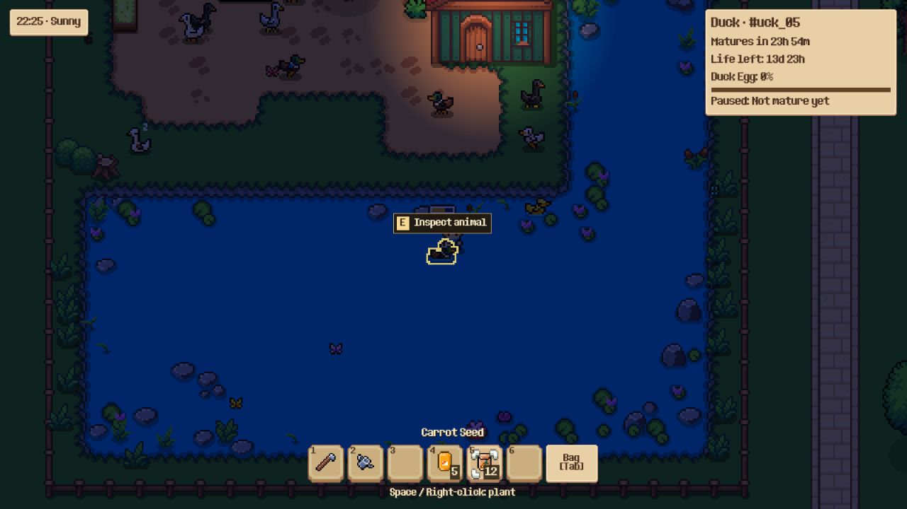
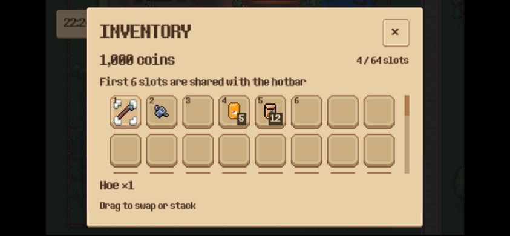

# Web preview và kết quả M0

Cập nhật 23/10/2026. Phần nền tảng Web đã chạy được trên trình duyệt desktop: build release, khởi động, lưu/tải, reload và đóng/mở tab đã được kiểm tra. M1 đã bổ sung bố cục cảm ứng, safe area và hướng dẫn xoay ngang; xem [kết quả M1](mobile_ui.md). M2 đã có joystick, nút dùng đồ/tương tác, pinch và swipe; xem [kết quả M2](mobile_controls.md). Android/iPhone thật vẫn cần nghiệm thu. Các kết quả và kích thước artifact M0 bên dưới được giữ làm bằng chứng lịch sử.

## Mở bản chơi thử

Chạy bằng Python thực đã cài, không dùng WindowsApps alias nếu alias chưa hoạt động:

```powershell
python scripts/serve_web.py
```

Mở `http://127.0.0.1:8060/index.html`. Server chỉ bind loopback và chỉ phục vụ thư mục `.dist`. Đây là địa chỉ trên máy đang chạy server, không phải đường dẫn để điện thoại khác truy cập.

Không mở `index.html` bằng `file://`: loader cần HTTP để tải WASM/PCK. Dừng server bằng Ctrl+C. Có thể chọn port khác bằng `--port`; mỗi origin/port có vùng lưu browser riêng.

## Build lại

Đã dùng Godot **standard 4.7.2**, không dùng Mono/.NET. Web templates debug/release cùng phiên bản đã được cài vào:

```text
%APPDATA%/Godot/export_templates/4.7.2.stable/
    version.txt
    web_nothreads_debug.zip
    web_nothreads_release.zip
```

Templates lấy từ [bản phát hành chính thức Godot 4.7.2](https://github.com/godotengine/godot-builds/releases/tag/4.7.2-stable). Chỉ tải các entry Web qua HTTP Range; đã xác minh Content-Range, kích thước, CRC của entry và CRC từng file trong ZIP bên trong. Không tải đầy đủ archive để đối chiếu checksum toàn gói.

```powershell
python scripts/build_web.py --godot "C:/Users/faker/Downloads/Godot_v4.7.2-stable_win64.exe/Godot_v4.7.2-stable_win64_console.exe"
```

Mặc định là release. Thêm `--debug` để build debug hoặc `--output .godot/web-qa` để dùng thư mục thử khác đã được Git bỏ qua. Khi serve thư mục khác, dùng `scripts/serve_web.py --directory .godot/web-qa`.

Script tái sử dụng preset `Web` và tạo staging tại `.godot/web-stage`:

- Không sửa `project.godot` gốc hoặc bật/tắt plugin trong editor đang dùng.
- Bỏ autoload MCPRuntimeServer và vô hiệu hóa editor plugins trong staging, vì bản Web không cần công cụ phát triển.
- Dùng đường dẫn script tường minh cho TimeManager thay vì phụ thuộc UID trong cache của editor.
- Chọn Compatibility renderer cho bản Web; giữ nguyên renderer desktop.
- Dùng stretch aspect `expand` trong staging và HTML shell có safe area; desktop giữ cấu hình hiện tại.
- Dùng thư mục user-data riêng nếu chạy staging như native preview, tránh bind save desktop đang chơi.
- Giữ các catalog được tải động bằng quét thư mục. Chưa tối ưu loại bỏ mọi asset không dùng trong giai đoạn này.
- Giữ log `.godot/web-build.log`; ghi `.dist/build-report.json`; trả lỗi nếu export báo error hoặc thiếu HTML/JS/WASM/PCK.

Source được nối vào staging bằng junction trên Windows hoặc symlink trên nền tảng khác. Không chỉnh map/config trong lúc build nếu cần một artifact cố định để phát hành. Bản thử hiện tại dùng trạng thái workspace tại thời điểm export; không reset các chỉnh sửa map đang có của người dùng.

## Bản sửa persistence

### Bootstrap

WorldPersistence chờ một `process_frame` trước khi kiểm tra `current_scene`. Web có thể chạy deferred startup trước khi SceneTree gán xong main scene; kiểm tra quá sớm khiến save service không được bind và F5/autosave không có tác dụng. Guard vẫn giữ lại để world trong GUT hoặc preview không bind save thật.

### IO trên Web

LocalSaveRepository không tạo Thread khi chạy Web. Các bước IO nhường một frame rồi thực hiện trên main thread, giữ cùng API async, khóa busy và bản sao snapshot đã chốt. Desktop vẫn dùng worker thread.

Các kiểm tra revision/hash, backup, recovery, giới hạn dữ liệu nguyên thủy và chống ghi chồng tiếp tục đi qua cùng luồng xử lý. Đây không phải thay thế bằng một hàm ghi JSON bỏ qua kiểm tra.

Với snapshot lớn, JSON/IO một luồng vẫn có thể gây khựng; cần đo trên thiết bị thật ở M3. Chưa tuyên bố mọi snapshot đều không gây giật trên điện thoại.

## Kết quả đã kiểm tra

| Kiểm tra | Kết quả |
| --- | --- |
| Release export, standard 4.7.2 | Thành công, không có error trong log export |
| HTTP không COOP/COEP | HTML/WASM/PCK tải được, MIME đúng, loader single-threaded |
| Browser boot | Hiện map, player, thú, HUD và inventory; không error/warn trong console được thu thập |
| Input cơ bản | Tab mở/đóng inventory, phím số chọn hotbar, drag chuyển stack bằng UI |
| F5 + reload | Chọn ô 3, lưu, reload: lựa chọn khôi phục đúng |
| Inventory + reload | Chuyển stack 12 Carrot Seed từ ô 3 sang ô 5, lưu, reload: ô 3 rỗng và ô 5 vẫn đủ 12 |
| Đóng/mở tab | Tab mới cùng origin khôi phục stack ở ô 5 và ví 1.000 xu |
| F9 | Chuyển stack sang ô khác nhưng chưa lưu, F9: UI đóng, có thông báo Progress loaded và stack quay về ô 5 |
| Autosave | Chọn ô 4 Poultry Feed, không bấm F5, chờ hơn 30 giây rồi reload: ô 4 vẫn được chọn |
| Repository + bootstrap GUT | 23/23 test đạt, 337 assertions |
| Static lint | 0 lỗi, 0 cảnh báo theo linter của skill |
| Engine validation module persistence | 8 script load được, 0 parse/runtime error; có 23 warning ở các dòng code sẵn có, không thuộc phần sửa M0 |

Đã kiểm tra ở browser desktop và thử viewport ngang 844×390; đây không phải mô phỏng đầy đủ CPU/GPU, touch, safe area hay lifecycle của Android/iOS.

Hai file lớn của artifact tại lần kiểm tra: WASM **39.514.754 byte**, PCK **9.548.224 byte**, chưa tính HTTP compression. Đây là kích thước file tải, không phải số đo RAM. Tối ưu tải/hiệu năng mobile thuộc M3.





## Giới hạn và việc còn lại

- Save browser là local theo origin, không đồng bộ với save desktop và không phải cloud save. Xóa dữ liệu website hoặc dùng môi trường chặn storage có thể làm mất/không giữ được save.
- Chưa bảo đảm ghi được thay đổi cuối cùng khi hệ điều hành dừng app đột ngột. Đã xác nhận autosave/reload/tab reopen trong browser desktop; lifecycle điện thoại cần thử ở M3.
- M1/M2 đã có bố cục, safe area và điều khiển cảm ứng. Phải kiểm tra trên Android/iPhone thật trước khi cam kết tương thích điện thoại; xem `mobile_controls.md`.
- Chưa thử thiết bị Android/iPhone thật hoặc phát hành public. Server local không mở ra LAN/Internet.
- Bộ test wiring mở rộng vẫn có một ca lỗi do gate dùng tên child cố định khi fixture đổi tên mọi node và kỳ vọng số thú 47 không khớp map hiện tại (11). Đây là ca kiểm thử ngoài bộ 23 test M0; chưa sửa map/test đó để làm xanh.
- Các test fixture world persistence đã được ghi nhận trong báo cáo mobile audit trước đó vẫn cần rà soát riêng. Kết quả M0 không thay cho chứng nhận toàn bộ game.

## Bằng chứng

Thư mục `docs/web_m0_2026-10-23/` chứa build report, ảnh chụp thực từ browser, console error list và kết quả test tập trung. Không chứa save cá nhân hoặc artifact WASM/PCK dung lượng lớn. Artifact được giữ ở `.dist`, không đưa vào Git.
