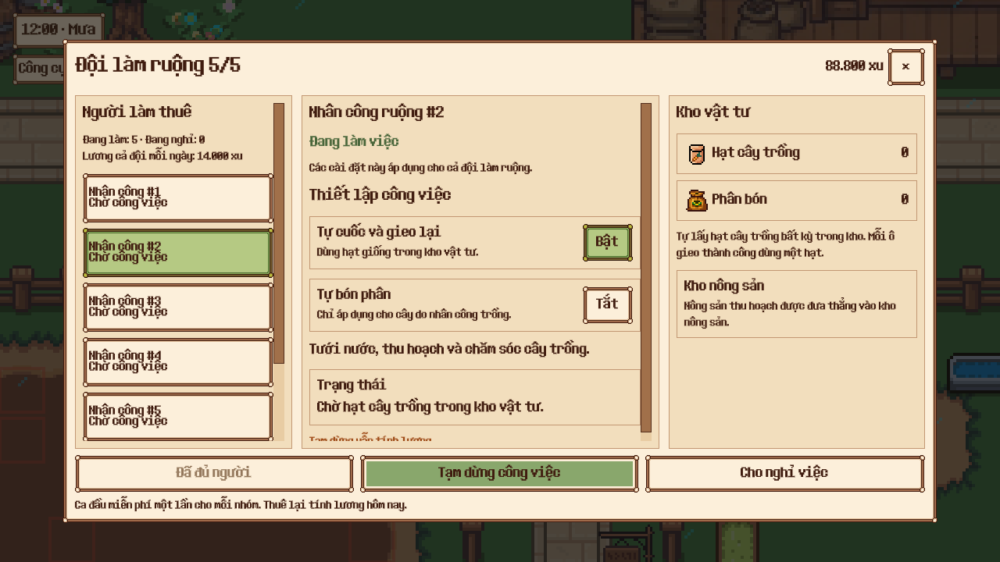
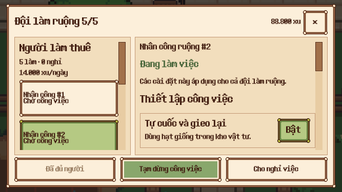

# Danh sách nhân công hiển thị trực tiếp

Đã thay ô chọn thả xuống bằng danh sách trong cột trái của UI đội làm ruộng.

- Desktop hiển thị đủ năm hàng: số thứ tự, việc hiện tại, đánh dấu người đang chọn bằng nền xanh.
- Cột giữa hiển thị tên/trạng thái người đang chọn, cài đặt chung và chi tiết công việc. Nút cho nghỉ luôn nhắm đúng ID đã chọn.
- Cột phải hiển thị kho vật tư. Trên cửa sổ nhỏ, kho chuyển vào phần nội dung cuộn; danh sách nhân công có vùng cuộn riêng.
- Dòng tổng số người và tiền lương được rút gọn ở cửa sổ nhỏ. Khi chưa thuê ai, danh sách hiện hướng dẫn thuê người đầu tiên.
- Cập nhật trạng thái định kỳ giữ nguyên các hàng và vị trí cuộn. Các vai trò vườn cây/chăn nuôi tiếp tục hiển thị chân dung như trước.

Kiểm chứng: suite UI 10/10 qua, gồm hiển thị đủ năm hàng trên desktop, chọn đúng người, sa thải/thuê lại, bố cục 667×375, khung chi tiết và giữ hàng khi refresh. Native Godot Compatibility 21/21 kiểm tra qua, gồm click hàng thứ hai, cuộn và chọn người thứ năm ở cửa sổ nhỏ. Lint 0 lỗi; cùng 11 cảnh báo đường dẫn có sẵn trước thay đổi.

