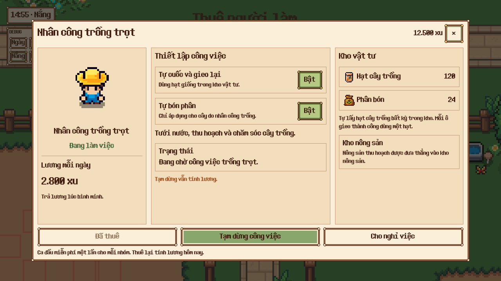
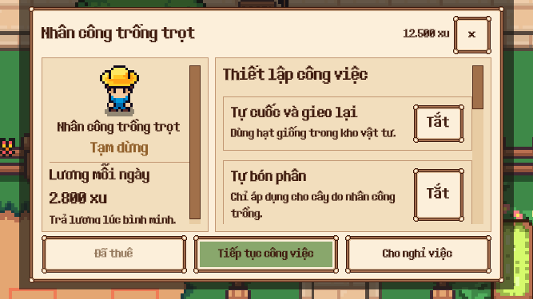
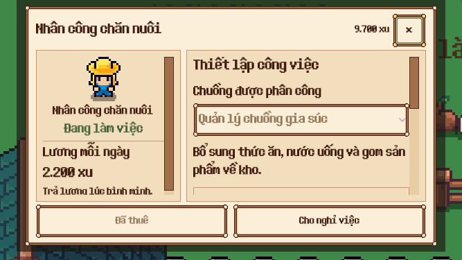
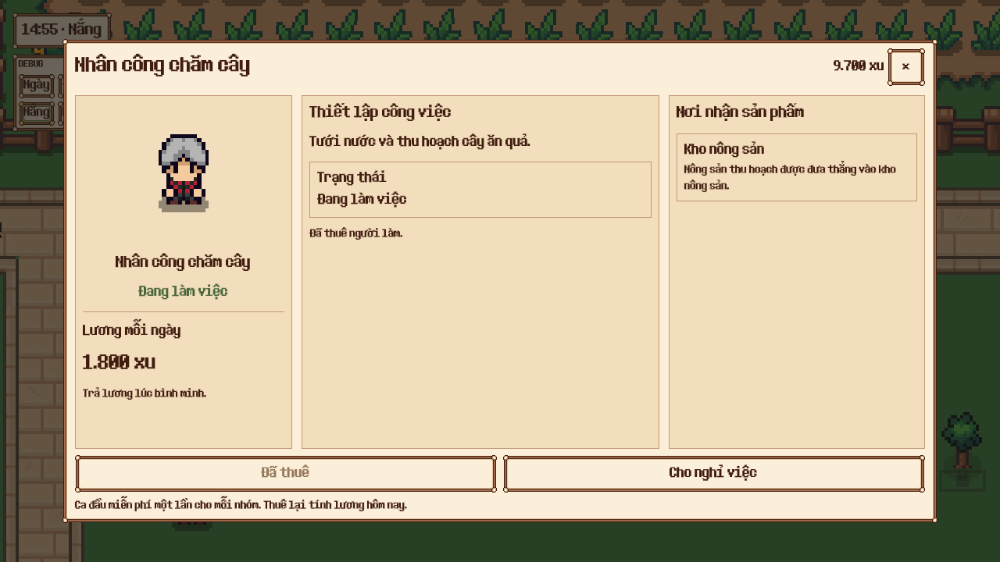
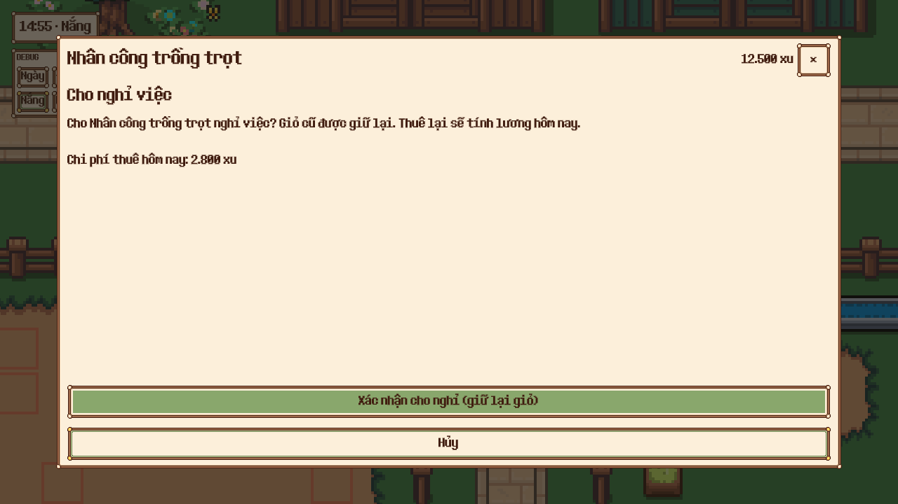

# Nhân công — UI đã triển khai

Concept được người dùng duyệt ngày 2026-10-27. UI mới áp dụng cho cả crop/orchard/ranch, qua bảng thuê và bảng tương tác trên nhân công. Scene `scenes/ui/workers.tscn` nối trong WorkerBoard; giữ nguyên WorkerService, lương, điều kiện mở khóa và schema lưu.

## Nội dung

- Khung ba vùng: chân dung/trạng thái/lương; thiết lập công việc; kho vật tư/nơi nhận sản phẩm. Trên màn nhỏ, phần kho chuyển vào cột thiết lập có cuộn, giữ nút thuê/tạm dừng/nghỉ việc luôn hiện.
- Portrait dùng SpriteFrames thật của từng nhóm, có playback độc lập, không thay đổi hoạt ảnh actor.
- Crop: tự cày/gieo lại, tự bón phân, trạng thái tác vụ/chờ việc, tạm dừng/tiếp tục. Tạm dừng vẫn tính lương; nút chỉ điều khiển khi đã thuê.
- Ranch: chọn chuồng trước khi thuê, khóa chuồng khi đang thuê, số thức ăn theo loại lấy từ kho vật tư dùng chung.
- Orchard: chỉ hiện thông tin chăm cây, tác vụ và nơi nhận sản phẩm, không có thiết lập crop.
- Chi phí thuê đầu/thuê lại theo trial_used và mức lương thật; không đủ điều kiện hoặc không đủ xu thì nút thuê bị vô hiệu.
- Nghỉ việc có trang xác nhận và hủy riêng. Không trừ xu khi cho nghỉ; thuê lại vẫn tính phí theo service. Đóng màn hoặc tải lại không giữ xác nhận cũ.
- Thu hồi giỏ cũ chỉ hiện khi còn sản phẩm/thức ăn legacy, giữ các lệnh transfer hiện có; không thêm nút nạp thức ăn vào giỏ, vì vật tư hiện nằm trong kho chung.
- EN/VI, cập nhật theo wallet/storage/service và nhịp polling cho trạng thái tác vụ. Sprite và số liệu trong game thay thế hình minh họa concept.

## Kiểm tra

- 6/6 test UI mới, 57 assertions: cấu hình crop, số vật tư, thuê/nghỉ/thuê lại, chọn chuồng, điều kiện mở khóa, ví thiếu xu, layout và thu hồi giỏ cũ.
- 78/78 kiểm tra runtime trên cả ba nhóm với chuột/cảm ứng. Xác nhận phí thuê lại, cancel giữ nhân công, tạm dừng vẫn employed, portrait độc lập và đóng modal.
- Bốn báo cáo layout main/confirmation ở desktop 1280×720 và compact 667×375: không có finding. Native còn kiểm tra 844×390 và 667×375 với safe insets.
- Lint components và scenes/ui: 0 lỗi/cảnh báo. Validate scenes/ui: 0 lỗi, 28 cảnh báo dependency có sẵn; không có diagnostic ở UI worker mới/sửa.
- Bộ test workers/crop_automation/worker_warehouse: 32/39 đạt. Cùng 7 test save/offline/legacy lỗi trước và sau thay UI; tập test lỗi trùng hoàn toàn, xem verification.json. Không sửa các service đó trong đợt đổi UI.
- Test tương thích cũ được cập nhật cho hành động thu hồi ẩn khi giỏ rỗng; native probe cũ dùng nút xác nhận nghỉ việc mới.
- QA dùng farm con và dữ liệu riêng, không gắn adapter save cá nhân.

Chi tiết: `verification.json`, `runtime-report.json`, `scene-tree.json` và các báo cáo layout. Concept tham chiếu: `concept.png`; prompt: `prompt.md`.
